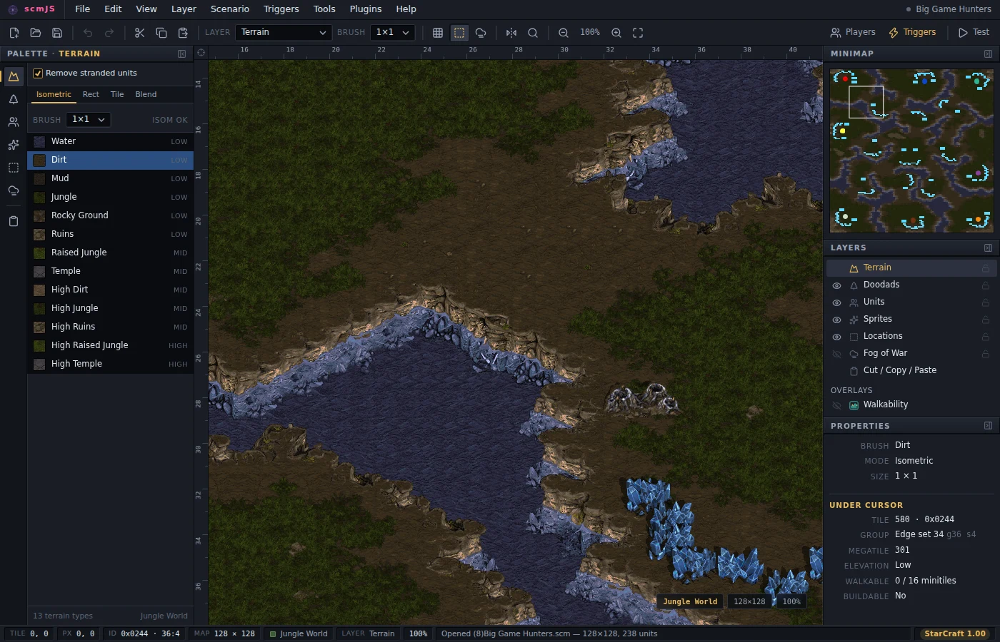

# scmJS

scmJS is a map editor and replay viewer for StarCraft, Brood War and StarCraft:
Remastered, modelled on StarEdit, SCMDraft 2 and StarForge. It runs in the browser and as
a desktop app.

It opens `.scm` and `.scx` maps (and a bare `.chk` scenario) and `.rep` replays, draws
them with the game's own terrain and unit graphics, classic or Remastered, and saves maps
the game plays. Anything in a map it does not understand is written back untouched, so a
map loses only what you change.

> **Beta.** This editor needs to be extensively tested. Keep backups of maps you care about,
> and check anything important in-game before you rely on it.

The [user guide](docs/guide.md) covers everything the editor does, starting with [your
first map](docs/guide.md#your-first-map). It is also at
[docs.scmjs.dev](https://docs.scmjs.dev), with a search box.

## Current Features

Beyond the terrain, units, locations and triggers every StarCraft editor has, scmJS does
the following. Items marked *Browse Plugins* are one click away under Plugins ▸ Browse
Plugins… rather than installed from the start.

- **Classic or Remastered graphics.** Pointed at a Remastered installation, the editor
  draws with Remastered's terrain, units and moving water; View ▸ Remastered Graphics
  switches back. See [Classic or Remastered
  graphics](docs/guide.md#classic-or-remastered-graphics).
- **Replays.** File ▸ Open Replay… opens a `.rep` on the map it was played on, with the
  players' orders on a timeline, build orders and the chat. At scmjs.dev the game also
  plays back and is analysed: fights, economy and tech. See
  [Replays](docs/guide.md#replays).
- **Test in the game or the browser.** Tools ▸ Test Map puts the map in the game's Maps
  folder; at scmjs.dev, Tools ▸ Test Map in Browser plays it in a browser tab from your
  own StarCraft files. See [Test Map](docs/guide.md#test-map).
- **Several people on one map.** Share the open map and anyone with the link edits it with
  you, live. See [Editing a map together](docs/guide.md#editing-a-map-together).
- **Triggers as code.** [TrigScript](docs/trigscript.md) writes triggers in TypeScript,
  with tests and a simulator; for Remastered it also builds code that runs in the game
  itself.
- **AI on your own key.** With your Anthropic API key, an assistant reads and edits the
  open map with you, and Tools ▸ AI lays out maps, writes triggers and briefings, and
  reviews a map. See [The AI](docs/guide.md#the-ai).
- **Triggers as a graph.** Trigger Map (*Browse Plugins*) shows which triggers set and
  read each switch, death counter and location, and what is never set, read or run.
- **The ground as a unit walks it.** View ▸ Walkability (Ctrl+Shift+W) draws islands,
  regions, chokes with their widths, and distances between start locations.
- **Damaged and protected maps.** Repair checks each map as it opens and fixes what the
  game would; Section Explorer (*Browse Plugins*) shows the file byte by byte. See
  [Protected and damaged maps](docs/file-formats.md#protected-and-damaged-maps).
- **Nothing lost on save.** Unknown or malformed sections and unnamed archive files are
  written back as they were read. See [Opening and saving maps](docs/file-formats.md).
- **Terrain from a picture.** File ▸ Import ▸ Terrain from Image… turns an image into
  terrain, cliffs and shores included. See [Plugins](docs/guide.md#plugins).
- **Stamps.** Save a ramp, a bridge or a mineral line once and lay it down on any map. See
  [Cut, copy and paste](docs/guide.md#cut-copy-and-paste).
- **Doodads into terrain.** *Convert Doodad to Terrain* turns a doodad into ordinary tiles
  you can edit. See [Doodads](docs/guide.md#doodads).
- **A recording of the build.** Timelapse (*Browse Plugins*) records the map change by
  change and exports a GIF or WebM video. See [Plugins](docs/guide.md#plugins).
- **Maps from scmscx.com.** File ▸ Find on scmscx.com… searches the community map archive
  and opens the map you pick. See [Opening a map](docs/guide.md#opening-a-map).
- **Work kept.** Maps open in tabs, recovery copies of unsaved work, and the version a
  save replaced kept as a `.bak` or under File ▸ Previous Versions. See
  [Saving](docs/guide.md#saving) and [Recovery copies](docs/guide.md#recovery-copies).
- **English or Korean.** Preferences ▸ General switches the language. See [Keyboard and
  preferences](docs/guide.md#keyboard-and-preferences).

## Getting started

1. **Open the editor.**
   - In the browser at [scmjs.dev/editor](https://scmjs.dev/editor/). Nothing to install,
     and your maps stay on your own disk.
   - As a desktop app for Windows, macOS and Linux, from the [releases](../../releases)
     page. It opens a map on a double-click and starts the game for Test Map.
   - In a container, for a server on your own network:
     `docker run --rm -p 8080:80 ghcr.io/scm-js/scm-js:latest`, then open
     `http://localhost:8080`.
2. **Point it at your StarCraft folder.** The game's graphics do not ship with the editor.
   On first use it asks for your StarCraft installation, classic (1.16) or Remastered, and
   reads them from there once; a Remastered folder turns on the Remastered graphics. The
   desktop app finds an installation on its own.
3. **No StarCraft installed?** The same dialog offers Blizzard's free StarCraft map editor
   download instead. It is enough to edit maps and watch replays; testing a map or playing
   needs StarCraft installed.

[Installing](docs/installing.md) has each step in full. Then start with the guide's [first
map](docs/guide.md#your-first-map).

## Documentation

All of this documentation is also a site, [docs.scmjs.dev](https://docs.scmjs.dev), with
these documents as pages, a search box, and a reference for every call in the plugin API
generated from the editor's own declarations. It is built from the release the hosted
editor runs, so the version in its footer is the one at
[scmjs.dev/editor](https://scmjs.dev/editor/). These files are the source; the site
renders them.

| Document | Covers |
| --- | --- |
| [docs/guide.md](docs/guide.md) | The user guide: a first map, then each layer and dialog, saving, sharing, plugins and preferences |
| [docs/installing.md](docs/installing.md) | The hosted editor, the desktop app, the container, and getting the game's graphics |
| [docs/trigscript.md](docs/trigscript.md) | TrigScript, triggers written as TypeScript: the script window, tests, programs that run in the game, examples and the reference |
| [docs/triggers.md](docs/triggers.md) | Every trigger condition and action: what it does, its arguments, its text form and where it is stored |
| [docs/game-data.md](docs/game-data.md) | Where the graphics come from, what is kept, mods as data sets, and how the pictures are drawn |
| [docs/file-formats.md](docs/file-formats.md) | What the editor does with a map file: what it preserves, what Save can strip, revisions, protected maps |
| [docs/chk-format.md](docs/chk-format.md) | Every section of the scenario file, byte by byte |
| [docs/plugins.md](docs/plugins.md) | Writing and installing plugins; the plugin API |
| [docs/development.md](docs/development.md) | Running from source, the desktop app and the container, releases, contributing |
| [ATTRIBUTION.md](ATTRIBUTION.md) | Provenance of adapted algorithms, tables and dependencies |

## License

The original scm-js source is MIT-licensed; see [LICENSE](LICENSE). That license does not
cover upstream code, packages, research, names or game data.
[ATTRIBUTION.md](ATTRIBUTION.md) records where each of those came from, and source-level
credit sits beside the code it applies to.

StarCraft and Brood War are trademarks of Blizzard Entertainment. This is a fan project,
not affiliated with or endorsed by Blizzard Entertainment.
