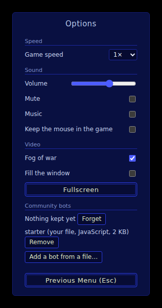
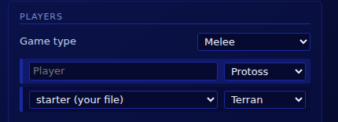

# Bots

A bot is a computer player you write in JavaScript. It is one ES module: the game calls it
every few frames with what its player can see, and it answers with orders. It plays on
StarCraft 1.16.1's own engine, the one the play page at
[scmjs.dev/play](https://scmjs.dev/play/) runs in your browser, and the same engine plays
it from a terminal with [`scmjs bot run`](cli.md#playing-a-bot). It can take a computer
seat against you, against the game's own computer players, or against other bots.

Underneath, a bot plays as a client of [BWAPI](https://github.com/bwapi/bwapi) 4.4.0, the
library the StarCraft bot tournaments use. You do not need to know BWAPI to write one.
What it means for you is that unit types have BWAPI's names (`Terran_Marine`), and that an
order goes into the game as a player's click would, so the game checks it the same way. A
BWAPI bot written in C++ plays on the same engine too: it is built with the scmbot
toolchain, as [the command line guide](cli.md#bots) describes.

There are two ways to write a bot. The short way is an `onFrame(game)` function: units are
objects with their orders on them, counts include what is on its way, and a building you
ask for finds its own money, builder and site. Start there. The interface underneath is
`create(init)` and `onFrame(view, api)`: a plain view of the game and a list of orders,
for a bot that wants to keep its own books. The short way is written on it.

## A first bot

[Download
`starter.mjs`](https://github.com/scm-js/scmbot/blob/main/examples/starter/starter.mjs)
(from the scmbot repository's examples), or save the code below under that name. It is
Starter, one of the play page's own bots: it plays all three races, and against the game's
own computer it wins more games than it loses.

```js
/** Each race's first fighting building and the unit it makes. The game's names are forgiving: "Marine" will do. */
const ARMY = {
  Terran: { building: "Barracks", unit: "Marine" },
  Protoss: { building: "Gateway", unit: "Zealot" },
  Zerg: { building: "Spawning_Pool", unit: "Zergling" },
};

/** How many fighters go out together. */
const WAVE = 12;

/** @type {import("@scm-js/bot").EasyBot} */
export default {
  name: "Starter",
  version: "2",

  onFrame(game) {
    const { building, unit } = ARMY[game.race.name];
    const zerg = game.race.name === "Zerg";

    // 1. The economy. Idle workers go to the minerals, a supply building (or overlord) goes up before supply runs
    // out, and workers are trained up to 18. `want` counts what is already on its way, so it is safe every frame.
    game.mine();
    game.keepSupply();
    game.want(game.race.worker, 18);

    // 2. Production: two of the fighting building (a zerg needs one pool; its units come from larvae).
    game.want(building, zerg ? 1 : 2);

    // 3. Growth. A new base before the minerals at ours run out — for zerg also whenever money piles up, since each
    // hatchery brings more larvae. For the others, piling money means one more production building, up to six.
    const mineralsLeft = game.ownBases.reduce((sum, base) => sum + game.mineralsLeft(base), 0);
    const ready = game.done(building).length > 0;
    if (game.planned(game.race.hall) === 0 && (mineralsLeft < 4000 || (zerg && ready && game.minerals > 400))) game.expand();
    if (!zerg && ready && game.minerals > 400 && game.planned(building) === 0 && game.count(building) < 6) game.build(building);

    // 4. The army: as many fighters as there is money for.
    game.want(unit, 200);

    // 5. Attack. A dozen at home leave together for the enemy's base; once out, a fighter with nothing left to do
    // goes on to the next thing of theirs it knows of (`enemyBase` searches the map when it knows of nothing).
    const target = game.enemyBase();
    const atHome = game.army.filter((u) => !u.memory.out);
    if (atHome.length >= WAVE && target) {
      for (const u of atHome) u.memory.out = true;
      atHome.attack(target);
      game.log(`a wave of ${atHome.length} goes to ${Math.round(target.x)},${Math.round(target.y)}`);
    }
    game.army.filter((u) => u.memory.out).idle.attack(target);
  },
};
```

To play against it, open [scmjs.dev/play](https://scmjs.dev/play/), go to **Options**, and
under **Community bots** choose **Add a bot from a file…** and pick `starter.mjs`. The
page keeps the file and lists it there:



Back on the setup screen, choose **starter (your file)** in a computer row, pick its race,
and start the game. The bot is named after its file, so it sits in the list beside the
page's own copy, **Starter (JavaScript)**:



With the [command line](cli.md#getting-started) and your own copy of StarCraft installed,
this plays it against the game's computer on a map of yours:

```sh
scmjs bot run starter.mjs "(2)Jungle Duel.scx" --race terran
```

Each line of `onFrame` asks for something, and what is asked for first is paid for first,
so the order of the lines is the bot's order of priorities: workers before buildings,
buildings before the army. `game.want(type, n)` counts what is already on its way (in
training, in an egg, under construction, or asked for and not yet placed), so the same
line runs every frame without ordering anything twice. `game.want("Barracks", 2)` is the
whole of what it takes to get two barracks: the short way keeps their price aside, picks a
worker, asks the game for a site and sends the worker there, and tries another site or
another worker when the game turns the first one away. `u.memory` is an object that stays
with a unit for the whole game; Starter marks there which units have left home.
`game.enemyBase()` is the nearest enemy building the bot has seen, and before it has seen
one, a start location it has not yet looked at, so a wave sent there goes looking.

`ARMY` names each race's first fighting building and the unit it makes. The comment above
`export default` is optional: it tells your editor what the module is, so that `game.`
offers its fields and methods as you type ([types in your editor](#types-in-your-editor)).
The page and the command line ignore it.

### Making it your own

A change is usually a line or two. This gives a terran Starter a refinery, an academy, the
upgrade that lengthens a marine's range, and a medic for every five marines. Put it before
step 4, so that it is paid for before the army:

```js
if (game.race.name === "Terran" && game.done("Barracks").length > 0) {
  game.want("Refinery", 1);
  game.want("Academy", 1);
  game.upgrade("U_238_Shells", { save: true });
  game.want("Medic", Math.floor(game.count("Marine") / 5));
}
```

`game.mine()` puts three workers on the refinery once it is finished. Nothing here waits
for the academy to stand before the upgrade and the medics are asked for: `upgrade` orders
nothing until a free academy is there, and `want` trains a medic only once the tech tree
allows it. `{ save: true }` keeps the upgrade's price aside for the rest of the frame when
the academy is free and only the money is missing, so the marines trained after it do not
spend every mineral as it comes in. Whether a change helps is found out by playing: change
a line, play a ladder against the game's computer, and keep what wins ([how good the
sample bots are](#how-good-the-sample-bots-are)).

## The short way

A module whose default export has `onFrame` and no `create` is written the short way. Its
fields:

| Field | What it is |
| --- | --- |
| `name` | The bot's name. The command line puts it before the bot's log lines; the page lists a bot added from a file under the file's name |
| `version`, `author` | Optional |
| `frameInterval` | Frames between two calls of `onFrame`: 8 unless set, a third of a second at the game's normal speed (24 frames a second) |
| `onFrame(game)` | Called every `frameInterval` frames. It may be `async`; while it runs, no other frame is delivered |
| `onStart(game)` | Optional: once, before the first `onFrame` |
| `onEnd(result, game)` | Optional: the game is over for this player. `result.result` is `"victory"`, `"defeat"` or `"ended"` (stopped without a winner) |
| `onUnitComplete(unit, game)` | Optional: one of the bot's units is finished |
| `onUnitDestroy(unit, game)` | Optional: one of the bot's units died, or turned into something the game counts as a new unit |
| `onEnemySeen(enemy, game)` | Optional: another player's unit came into sight for the first time |

Orders given during a call are collected and go into the game when the call returns. The
game does not wait for a bot on the page: a frame that comes due while the bot is still
thinking about the last one is skipped, and the next call sees the game as it is then.

### Names

A unit type can be named the way BWAPI names it or more loosely: `"Terran_Marine"`,
`"Marine"`, `"marine"` and `"Siege Tank"` all work, the bot's own race first. Techs and
upgrades go by BWAPI's names too, as loosely: `"Stim_Packs"`, `"Protoss_Ground_Weapons"`.
A name the game does not know throws, so a typo stops the bot with an error that names it.
A type of another race (`"Barracks"` for a protoss) is said once in the log, and nothing
is ordered. Anywhere a type is taken, its number works too.

`game.type(name)` turns a name into its number, and `game.info(type)` is the type's entry
in the game's tables: `mineralPrice`, `gasPrice`, `supplyRequired`, `maxHitPoints`,
`groundWeapon` and the rest, listed under [what a bot is told
once](#what-a-bot-is-told-once).

### Units

A unit is an object that lasts the whole game: the same object for the same unit, updated
with every frame. It has the fields of the view (`x`, `y`, `hitPoints`, `shields`,
`energy`, `isIdle`, `order` and the rest, under [the view](#what-a-bot-is-shown)), and
these besides:

| On a unit | What it is |
| --- | --- |
| `alive` | False once the unit is known to be gone |
| `memory` | An object of your own, kept with the unit |
| `info`, `name` | The type's table entry; the type's name (`"Terran_Marine"`) |
| `tileX`, `tileY` | The tile it stands on (a tile is 32 pixels) |
| `isBuilding`, `isWorker` | From its type |
| `is(...types)` | Whether it is of one of these types |
| `distanceTo(point)` | In pixels, to a point or another unit |

The bot's own units carry their orders as methods: `attack`, `move`, `patrol`, `gather`,
`returnCargo`, `stop`, `hold`, `train`, `build`, `buildAddon`, `morph`, `research`,
`startUpgrade`, `useTech`, `repair`, `heal`, `load`, `unloadAll`, `setRally`, `siege`,
`unsiege`, `burrow`, `unburrow`, `stim`, `cloak`, `decloak`, `lift`, `land` and `cancel`.
Each returns the unit, so they chain. `attack` takes a unit, a unit's number or a point:
`marine.attack(enemy)` attacks that unit, `marine.attack({ x, y })` attack-moves there. A
point is in pixels from the map's top-left corner.

An order is given as it is, and the game's own checks apply, with one exception. A fresh
order makes a unit drop the shot or the heal it was in the middle of, so a bot that
repeated `attack` every frame would have an army that never fires. For that reason
`attack`, `move` and `patrol` are not sent again to a unit already busy with the same
order (the same target, or a point within a tile and a half of the same point).

Other players' units are objects too, as last seen: `game.enemies` holds those in sight
now, and `game.enemyMemory` every one seen and not known to be gone, with `visible` false
for those out of sight and `lastSeen` the frame they were last seen.

### Lists of units

`game.units`, `game.army`, `game.enemies` and the other lists are arrays, so `filter`,
`map`, `length` and `for … of` work as usual, and `filter` keeps a list a list. They add:

| On a list | What it is |
| --- | --- |
| `of(...types)` | Those of these types: `game.units.of("Marine", "Medic")` |
| `done`, `idle` | The finished ones; those standing with nothing to do |
| `near(point, radius)` | Those within `radius` pixels of a point |
| `nearest(point)`, `farthest(point)` | One unit, or `undefined` for an empty list |
| `byDistance(point)`, `take(n)` | Nearest first; the first `n` |
| `center`, `first`, `ids` | The middle of the group (`null` when empty); the first unit; their numbers |

and the orders for a group: `attack`, `move`, `patrol`, `rightClick`, `gather`,
`returnCargo`, `stop`, `hold`, `siege`, `unsiege`, `burrow`, `unburrow`, `stim`, `load`
and `setRally`, sent to all of the bot's own units in the list as one order. `attack` and
`move` with `null` do nothing, so `game.army.attack(game.enemyBase())` is safe before the
enemy is found.

### The game

| On `game` | What it is |
| --- | --- |
| `race` | The bot's race: `name` (`"Terran"`, `"Protoss"`, `"Zerg"`), and the types of its `worker`, `hall` (town hall), `supply` provider and `gas` building |
| `frame` | The game's frame counter: 24 frames is a second at normal speed |
| `home` | The bot's start location: `x`, `y` in pixels, `tileX`, `tileY` of its town hall |
| `bases` | Every base on the map, nearest home first: its mineral fields, its geysers, and the tile a town hall goes on (`hall`) |
| `ownBases`, `freeBases()` | Bases with a finished town hall of the bot's; bases where no one's town hall is known |
| `mineralsLeft(base)` | What a base's fields hold, as last seen |
| `units`, `workers`, `army`, `buildings`, `larvae` | The bot's units: all of them; finished workers not building; finished fighting units (not workers, overlords, larvae or eggs); buildings; larvae not yet given an order |
| `enemies`, `enemyMemory`, `neutral` | Other players' units in sight now; every enemy unit seen and not known to be gone; mineral fields, geysers and critters in sight |
| `minerals`, `gas` | Money not yet spent this frame and not kept for a building asked for |
| `supply` | `used`, `total` and `free`, in the game's own numbers (a zergling is ½), less this frame's orders |
| `count(type)` | Units of a type, finished and on their way |
| `done(type)`, `coming(type)` | The finished ones; how many are on their way |
| `planned(type)` | Buildings asked for and not yet placed |
| `want(type, n)` | Have `n`, counting what is on its way: trains, morphs or builds what is missing as far as money, supply, producers and the tech tree allow. Call it every frame |
| `train(type, { save })` | One more now, if a producer is free: a larva for a zerg unit, the building for an add-on or a Lair. Returns whether it was ordered |
| `make(type)` | One more, whatever it takes: as `train`, and for a building, as `build` |
| `build(type, near?)` | Ask for one building, near a point or on a tile given as `{ tileX, tileY }`. Returns the job: its `state` is `waiting`, `asking`, `sited`, `walking`, `started` or `failed`, with `reason` when it failed |
| `expand()` | A town hall at the nearest free base. Returns the job, or `null` when no base is free |
| `research(tech, { save })`, `upgrade(upgrade, { save })` | At a free building of the right kind (a Lair or Hive does what a Hatchery does). Return whether it was ordered |
| `has(tech)`, `level(upgrade)` | Whether a tech is researched; the level an upgrade has reached |
| `researching(tech)`, `upgrading(upgrade)` | Whether it is under way |
| `canAfford(type)`, `canMake(type)` | The price and supply are there; the tech tree allows it |
| `save(type)` | Keep a type's price aside for the rest of this frame |
| `mine({ gas })` | Idle workers to the least busy field of their nearest base, and `gas` workers (3 unless set) on each finished gas building; any more go back to the minerals |
| `keepSupply({ margin })` | One supply building or overlord more whenever the supply left, counting those on their way, falls below `margin` |
| `freeGeyser()` | A geyser at one of the bot's bases with no gas building on it or asked for, or `null` |
| `enemyBase()` | The nearest enemy building known; else the nearest start of a seated enemy not yet seen empty; else the base out of sight longest |
| `unit(id)` | One of the bot's units by its number |
| `log(text)` | A line of text: printed by the command line, and shown on the page as a chat line from the bot |
| `memory` | An object of your own, kept for the whole game |
| `init`, `view`, `api` | The interface underneath, for anything the short way does not cover |

### What the short way takes care of

The game has rules that every new bot runs into. The short way handles these, so a bot
written on it does not have to.

What is asked for first is paid for first. A building asked for with `want` keeps its
price from the point where that line runs, each frame: the lines before it come first, the
lines after it wait. A building asked for once, with `build` or `expand`, keeps its price
from the start of every frame, and so does one whose site has been found. A building whose
`want` line stops running is dropped after ten seconds. An order given this frame keeps
its price, its supply and its producer until the game shows it, so a building is not told
twice to train while the first order is on its way.

A builder is picked and watched. The nearest worker with free hands (not carrying
minerals, not on gas) is sent. One the game turns away is replaced and another site is
asked for; one that stands still or takes too long is called off and rested. After eight
sites, or three workers called off, the building is given up, with a line in the log that
says why.

The game places no building on ground nobody has seen. A builder sent to a site far off or
out of sight walks there first, and the building is ordered, and its price kept, once the
builder is near and the site in sight. A long walk does not hold the money up.

No worker is sent to die. A site with enemy fighters on it is left for a few seconds while
another is looked for, and that does not count against the building. A base where an
expansion failed is left alone for a minute.

A town hall goes where the game allows, three tiles clear of every mineral field and
geyser, and of those spots, the one nearest them all.

### Types in your editor

The types of both ways are published as the npm package `@scm-js/bot`. Nothing in it runs:
it gives your editor completion and catches a misspelt method before you play. In a folder
of your own:

```sh
npm install --save-dev @scm-js/bot
```

In a JavaScript file, name the type in a comment on the default export, as Starter does:

```js
/** @type {import("@scm-js/bot").EasyBot} */
export default {
  name: "Miner",
  onFrame(game) {
    game.mine();
    game.want(game.race.worker, 24);
  },
};
```

Visual Studio Code reads that comment with no setup. Add `// @ts-check` as the file's
first line to have mistakes underlined as well. In TypeScript, import the types with
`import type`, which is removed before the bot runs:

```ts
import type { EasyBot, Game } from "@scm-js/bot";

const bot: EasyBot = {
  name: "Miner",
  onFrame(game: Game) {
    game.mine();
    game.want(game.race.worker, 24);
  },
};
export default bot;
```

The command line runs a `.ts` file as it is on Node.js 22.18 or newer. The page takes
`.js` and `.mjs` files only, so compile a TypeScript bot to JavaScript before you add it
there. A bot the page plays cannot import other files at run time, since the page keeps
the one file.

The package's major version is the interface's (`BOT_API`, now 1). The interface only
grows: a field or a call that exists keeps its meaning.

## Bots for mods

On the play page and under `scmjs bot run --mod`, a bot plays a mod as it plays the game.
Its view and its tables are the mod's, read from the game when the match starts: the mod's
prices, its tech tree, its types past the game's 228. It is told which mod it is in
`game.init.mod` (`{ name, hash }`), and every unit type is called by the mod's own name,
made an identifier. In Cosmonarchy BW the terran worker is `Terran_Mason`, so
`game.want("Terran_Mason", 14)`, or `game.want("Mason", 14)`, trains Masons. BWAPI's names
for the game's types stay as second names for the same types (`Terran_SCV` is the Mason
there too), so a bot written for the game's own units still runs. The names are the ones
`scmjs mod header` writes, by the rules [the command line
guide](cli.md#a-bot-made-for-a-mod) gives; `scmjs mod header "<mod>" --js` writes them as
a module, for your editor's completion. Weapons, upgrades and techs keep BWAPI's names
while the game runs.

This bot is made for Cosmonarchy BW. Its Masons mine, the Ministry trains more of them, a
Mason puts up a Stockade (and more of them, up to four, while minerals pile up), the
Stockades train Mavericks, and every six Mavericks attack:

```js
const WORKERS = 14, WAVE = 6, STOCKADES = 4;

export default {
  name: "Cosmonarchy Example (JavaScript)",

  onStart(game) {
    const mod = game.init.mod;
    if (mod?.name !== "Cosmonarchy BW") game.log(`made for Cosmonarchy BW, playing ${mod ? mod.name : "the game's own units"}: the names below may mean nothing here`);
    if (game.race.name !== "Terran") game.log("I play Cosmonarchy's terrans only: my workers will mine, nothing more");
  },

  onFrame(game) {
    game.mine();
    if (game.race.name !== "Terran") return;

    game.want("Terran_Mason", WORKERS);

    const stockades = game.count("Terran_Stockade");
    const more = stockades === 0 || (stockades < STOCKADES && game.minerals >= 2 * game.info("Terran_Stockade").mineralPrice);
    if (more && game.planned("Terran_Stockade") === 0) game.build("Terran_Stockade");

    game.want("Terran_Maverick", 200);

    const target = game.enemyBase();
    const atHome = game.army.of("Terran_Maverick").filter((u) => !u.memory.out);
    if (atHome.length >= WAVE && target) {
      for (const u of atHome) u.memory.out = true;
      atHome.attack(target);
    }
    game.army.filter((u) => u.memory.out).idle.attack(target);
  },

  onEnd(result, game) {
    game.log(result.result === "victory" ? "gg: a win for Cosmonarchy BW" : "gg");
  },
};
```

On the play page, choose the mod under **Mods**, then add the file as a bot. From a
terminal, `scmjs bot run cosmonarchy.mjs "(4)Exodus 1.0.scx" --mod "Cosmonarchy BW"` plays
it with the mod's plugins ([a bot on a mod](cli.md#a-bot-on-a-mod)). The [mods
guide](mods.md#a-bot-for-your-mod) has more on bots made for a mod.

## Running a bot

### On the play page

Under **Options**, **Community bots**, **Add a bot from a file…** takes a `.js` or `.mjs`
file; dropping the file on the page does the same. The bot is kept in this browser, needs
no account, and is offered in every computer row of the setup screen as "*name* (your
file)", where *name* is the file's name. The same list has the page's own bots (Vanta,
Starter and Gather, marked "JavaScript"), StarCraft's own computer, and the BWAPI bots of
the catalogue, which need a scmjs.dev account. One community bot plays in a game.

Options lists the bots you have added, each with **Remove**. Adding a file of the same
name again replaces the one kept, which is how you play a changed bot. In a game between
people, the host's page runs the bot and sends its orders, and the other pages see one
more player.

A bot that throws an error is stopped: the page shows the error with the bot's name, its
units stay where they are, and the game goes on without it.

### From the command line

`scmjs bot run starter.mjs "(2)Jungle Duel.scx"` plays the bot against the game's own
computer on the same engine as the page, with no page open. It needs your own copy of
StarCraft. `--race`, `--opponents`, `--seed`, `--frames` and `--mod` are described in [the
command line guide](cli.md#playing-a-bot); the same seed, bot and map play the same game,
because the command waits for the bot's answer every frame.

The command prints a line every thousand frames with each side's minerals, gas and supply,
and the bot's own `game.log` lines as they come. Starter as protoss against the zerg
computer, on a map made by `scmjs map generate`:

```
starter on (2)Jungle Duel.scx 128 × 128, jungle · bot protoss vs computer zerg · seed 1 · 1.16.1 files
  BWAPI: Connected to AI Client process
  starter: BWAPI 4.4.0.0 RELEASE is now live using "<Client Connection>".
  frame   1000  P1 bot P 24/0 7/9  |  P2 computer Z 42/0 8/9
  frame   2000  P1 bot P 36/0 10/17  |  P2 computer Z 260/0 9/17
  …
  frame   7000  P1 bot P 226/0 44/49  |  P2 computer Z 96/234 21/26
  Starter: a wave of 12 goes to 3456,3056
  frame   8000  P1 bot P 58/0 56/65  |  P2 computer Z 107/251 28/34
  …
  frame  45000  P1 bot P 12/0 0/0  |  P2 computer Z 167/887 93/94
▲ the bot lost at frame 45029 · 316 KB of orders · 0.27 ms a frame game, 0.27 bot · 25.8 s
```

The game ran at about 1,700 frames a second, a little over 30 minutes of play in 26
seconds. `scmjs bot ladder` plays bots against each other and against the game's computer
of each race, on every map you name, and keeps a replay of every game:

```sh
scmjs bot ladder starter.mjs computer --maps "(2)Jungle Duel.scx" "(4)Crossing.scx" --races tzp
```

JavaScript bots, BWAPI bots and the game's computer play in one ladder. A ladder run again
after you change your bot shows what the change did. [A ladder for
bots](cli.md#a-ladder-for-bots) has the options and what the results mean.

## How good the sample bots are

Vanta and Starter, two of the play page's own bots, played against the game's own computer
as each race against each race, on Boxer, Challenger, Astral Balance, Lost Civilization
and Frenzy with two seeds each: 90 games a bot. A game still going at 30 minutes counts as
a draw.

| Bot | Won | Drawn | Lost | As terran | As protoss | As zerg |
| --- | --- | --- | --- | --- | --- | --- |
| Vanta | 53 | 18 | 19 | 17-7-6 | 25-3-2 | 11-8-11 |
| Starter | 50 | 18 | 22 | 16-9-5 | 24-4-2 | 10-5-15 |

The race columns are won-drawn-lost. Starter is the one to read and copy; Vanta is longer.
It has a plan for each race as data: what to build, research and upgrade once the supply
reaches a number. Terran masses marines and medics with stim packs, protoss masses zealots
from as many gateways as the money keeps busy, and zerg makes zerglings and hydralisks
from four hatcheries. Terran and protoss send a dozen at a time and keep going; zerg
gathers at a rally in front of its base in waves that grow, and turns on whatever comes to
it. Vanta's army comes ahead of its workers while the base is under attack.

Each of those choices was measured against the others on the same 90 games. Medics with
stim beat marines alone. Zealots alone beat zealots with dragoons and upgrades. Sending
reinforcements in small groups did worse than waiting for the next wave, and pulling a
beaten wave back made no difference. Zerg is the weak race of both bots: about a third of
its games won.

Gather, the page's third bot of its own, is written on the interface underneath as an
example of it: it mines, keeps supply, trains fourteen workers, puts up one production
building and sends every four fighters to the enemy's start.

## The interface underneath

The short way is built on this interface, and a bot may use it directly: a module whose
default export has `create` is given the plain view and a list of orders, and keeps its
own books.

### The module

```js
/** @type {import("@scm-js/bot").BotModule} */
export default {
  name: "Do nothing",
  create(init) {
    // called once, before the first frame
    return {
      onFrame(view, api) {
        // called with each view; give orders through api
      },
      onEnd(result) {
        // optional: result.result is "victory", "defeat" or "ended"
      },
    };
  },
};
```

`create` and `onFrame` may be `async`. The module may also set `frameInterval`, a
`version` and an `author`. Everything a bot needs at run time arrives in `init` and
`view`, including the tables of names (`init.data.UnitTypes` and the rest), so a bot in
plain JavaScript imports nothing.

### What a bot is told once

`init` holds:

| Field | What it is |
| --- | --- |
| `api` | The interface's version, `BOT_API`: 1 |
| `self`, `race`, `name` | The bot's player number (0 to 7), its race (0 zerg, 1 terran, 2 protoss, already drawn if it was random) and the name it was seated under |
| `players` | Everyone seated: `id`, `name`, `race`, `isSelf`, `isEnemy`. There are no teams yet, so everyone else is an enemy |
| `frameInterval` | Frames between views unless the bot asks otherwise |
| `map` | The map, below |
| `data` | The game's tables, below |
| `mod` | In a mod's game, the mod's `name` and `hash` |
| `useMapSettings`, `limits` | In a game with the map's own settings: the bot starts with the map's units, and `limits` says what the map keeps from it (`forbiddenUnits`, `unavailableTechs`, `upgradeMax`) |

`init.map` is what a player who knows the map knows before the game starts:

- `width`, `height` in tiles (a tile is 32 pixels), and the `tileset`'s name;
- `walkable`: one byte per 8-pixel cell, `width * 4` to a row, 1 where the ground can be
  walked on (terrain only: buildings and units are not in it);
- `buildable`: one byte per tile, 1 where the terrain takes a building;
- `groundHeight`: one byte per tile, 0 low, 2 high, 4 very high, odd where a doodad blocks
  the view;
- `startLocations`: each with its point (`x`, `y` in pixels), the top-left tile of a town
  hall built there (`tileX`, `tileY`), and the `player` seated there, or -1;
- `resources`: every mineral field and geyser with its `id`, `type`, position and starting
  amount. The id can be used as a `gather` target even while the field is out of sight.

`init.data` holds the name tables (`UnitTypes`, `TechTypes`, `UpgradeTypes`, `Orders`,
`Races`, each a name to a number) and the game's own numbers, indexed by number:

- `units[type]`: `name`, `race`, `mineralPrice`, `gasPrice`, `buildTime` (frames),
  `supplyRequired` and `supplyProvided` (in halves: a marine is 2, a zergling 1, a depot
  gives 16), `tileWidth` and `tileHeight` for buildings, the collision box
  (`dimensionLeft`, `dimensionUp`, `dimensionRight`, `dimensionDown`), `maxHitPoints`,
  `maxShields`, `armor`, `sightRange` (tiles), `topSpeed`, `groundWeapon` and `airWeapon`
  (numbers in `weapons`, or -1), flags such as `isBuilding`, `isWorker`, `isFlyer`,
  `isResourceDepot`, `isRefinery`, `isDetector`, `requiresPsi` and `requiresCreep`, and
  the tech tree: `whatBuilds` (the type that makes it), `buildsWhat`, and `requiredUnits`,
  where every entry is needed and any one type of an entry will do;
- `techs[id]`: prices, `researchTime`, `energyCost`, `whatResearches`;
- `upgrades[id]`: prices and time for the first level with what each further level adds,
  `maxRepeats`, `whatUpgrades`;
- `weapons[id]`: `damageAmount`, `damageBonus`, `damageCooldown`, `damageFactor`,
  `minRange` and `maxRange` (pixels, edge to edge), `targetsAir`, `targetsGround`,
  `damageType`, and the three splash radii.

### What a bot is shown

`view`, each frame:

| Field | What it is |
| --- | --- |
| `frame` | The game's frame counter. 24 frames is a second at normal speed |
| `self` | `minerals`, `gas`, `supplyUsed` and `supplyTotal` (in halves), `techs` (the numbers researched), `upgrades` (the level of each) |
| `units` | The bot's own units and buildings, in full |
| `enemies` | Other players' units the bot's player sees now |
| `neutral` | Mineral fields, geysers and critters in sight now |
| `events` | What changed since the last view the bot was given |
| `visibility` | One byte per tile: 0 never seen, 1 seen before, 2 in sight now. Copy what you want to keep; the array may be reused |

Every unit has `id`, `type`, `player`, `x`, `y` (pixels, its centre), `hitPoints`,
`shields`, `energy`, `resources` (what is left in a field, a geyser or a gas building),
`angle` (0 to 255, clockwise from up), and the flags `isCompleted`, `isFlying`,
`isCloaked`, `isBurrowed`, `isMoving`, `isSieged`, `isLifted`, `isLockedDown`,
`isStasised`, `isEnsnared`, `isPlagued`, `isIrradiated` and `isDefenseMatrixed`.

The bot's own units add what only their owner knows: `order` (a number in `Orders`),
`orderTarget`, `targetX`, `targetY`, `isIdle`, `isGatheringMinerals`, `isGatheringGas`,
`isCarryingMinerals`, `isCarryingGas`, `isConstructing`, `buildType` (what a worker is
about to build, or what an egg becomes), `trainingQueue`, `isTraining`,
`remainingBuildTime`, `remainingTrainTime`, `tech`, `upgrade`, `remainingResearchTime`,
the three cooldowns, `isLoaded`, `loadedUnits`, `transport` (the transport the unit is
inside, or -1), `isPowered`, `spiderMineCount`, `killCount`, `isStimmed`, `isMorphing`,
`addon` (a terran building's add-on, or -1) and `rallyX`, `rallyY`, `rallyUnit` (-1 when
there is no rally point). A unit in training, a building under construction and an egg are
in the list with `isCompleted` false.

Counting what is on its way takes care, and the short way's `count` does it for you:

- The unit a building is training is in `units`, unfinished, and is also the first entry
  of that building's `trainingQueue`. Count one of the two, or the same marine is counted
  twice.
- An egg has the type `Zerg_Egg`, and what it becomes is its `buildType`. An egg of a type
  with `isTwoUnitsInOneEgg` (zerglings, scourge) becomes two units; the type's
  `mineralPrice` is the egg's, its `supplyRequired` each unit's.
- A worker told to build shows the building in `buildType` until the building is started.
  A terran or protoss building then appears as a unit of its own; a zerg worker becomes
  the building and keeps its id.

An `id` belongs to one unit for the whole game. Events are `unitCreate`, `unitComplete`,
`unitMorph` and `unitDestroy` for the bot's own units, and `unitShow` and `unitHide` for
other players' units coming into sight and leaving it; an enemy or a mineral field seen to
die is a `unitDestroy`. They cover the time since the last view the bot was given, which
is longer than one interval when views were skipped.

### What a bot sees

A bot sees what a player in its seat would see, by the game's own sight, high ground
included. Its own units are there in full. Another player's unit is there only while it is
in sight, and a cloaked or burrowed one only while one of the bot's detectors reaches it.
Resources are there as the map places them (`init.map.resources`), with their amounts
while in sight. The bot sees its own money, supply, techs and upgrades, and nobody else's.

The same rule covers orders. BWAPI takes no order aimed at a unit the bot cannot see: a
target must be one of its own units, a unit in sight, or a resource. A worker sent to
gather from a field out of sight walks there and is told to gather once the field is in
sight.

### Orders

`api` has a method for each order, and each takes one unit's id or a list of them:

```js
api.move(units, x, y, queued)
api.attack(units, enemyId)            // attack that unit
api.attack(units, { x, y })           // attack-move
api.rightClick(units, target)
api.patrol(units, x, y)
api.stop(units)
api.holdPosition(units)
api.gather(workers, resourceId)       // a mineral field or a finished gas building
api.returnCargo(workers)
api.train(producer, unitType)         // a building; or a larva, or a hatchery (one of its larvae morphs)
api.build(worker, unitType, tileX, tileY)   // the tile is the building's top-left
api.buildAddon(building, unitType)
api.research(building, tech)
api.upgrade(building, upgrade)        // the next level
api.useTech(caster, tech, target)     // a spell, by its tech
api.cloak(units); api.decloak(units)
api.morph(units, unitType)            // a hatchery into a Lair, a hydralisk into a lurker …
api.cancelConstruction(building)      // three quarters of the price back
api.cancelTrain(building, slot)       // slot 0 is the unit under way; without a slot, the last one queued
api.cancelResearch(building); api.cancelUpgrade(building)
api.cancelMorph(units)                // an egg, a morphing building
api.cancelAddon(building)
api.siege(tanks); api.unsiege(tanks)
api.burrow(units); api.unburrow(units)
api.stim(units)
api.load(units, transport)            // into a transport or a bunker
api.unload(transport, unit); api.unloadAll(transports)
api.unloadAllAt(transports, x, y)     // fly there and put everything out
api.lift(buildings); api.land(building, tileX, tileY)
api.placeNydusExit(canal, tileX, tileY)
api.setRallyPoint(buildings, target)  // a point { x, y } or a unit's id
api.mergeArchon(units); api.mergeDarkArchon(units)
api.repair(scvs, target)
api.heal(medics, target)              // a unit's id, or a point to walk to, healing on the way
api.rechargeShields(battery, unit)
api.command({ kind: "move", units: [...], x, y })   // any order as a plain object
```

Orders are collected while `onFrame` runs and sent when it returns, or when its promise
settles. Each goes in as a BWAPI command, and BWAPI and then the game check it as they
would a player's click: a unit is trained only by the building that trains it, with its
requirements standing; a tech or an upgrade only at its own building; a spell only by a
unit that has it; a building only on a site the game takes. An order that is refused, for
want of money or supply or because the site turned out to be taken, does nothing, and the
next view shows what happened. Calling off a nuclear strike is not possible: BWAPI has no
command for it.

Two of the game's rules catch every new bot written on this interface. A building is paid
for when its construction starts, once the worker has reached the site, not when the order
is given: money spent on something else while the worker walks leaves it at the site with
nothing built. And the game places no building on ground nobody has seen: a worker sent
there is turned away.

### Questions

The game answers what a bot cannot work out from the view. Each question returns a
promise:

```js
const ok = await api.canBuildHere(tileX, tileY, unitType, builderId);
const why = await api.placement(tileX, tileY, unitType, builderId, checkCost);
// "ok", or the first rule that fails: "requirements", "cost", "bounds", "terrain", "occupied",
// "unit", "creep", "nocreep", "psi", "resources" (a hall too close to minerals), "geyser"

const site = await api.getBuildLocation(unitType, nearTileX, nearTileY, { radius });
// { tileX, tileY } or null
```

`placement` is BWAPI's `canBuildHere` with the reason the game's rules give. Ground nobody
has seen reads as `"occupied"`, and with a builder named, a unit in the way can read as
`"requirements"`: ask without the builder for the plain reason. `getBuildLocation` is
BWAPI's: a site the rules take within `radius` tiles (64 unless given) of the tile, the
nearest free geyser for a gas building, and for a town hall the best spot BWAPI knows,
which may be at another base than the one asked about. It does not check the price or the
tech tree, whether a worker can walk there, or whether the bot has just sent another
worker to the same tiles. The game does not wait for a bot waiting for an answer.

### Timing

A bot is given a view every 8 frames unless it asks otherwise: `frameInterval` on the
module, or `api.setFrameInterval(n)` at any time, from 1 to 240. On the page the game
never waits for a bot; a view that comes due while the bot is still answering the last one
is skipped and counted, and the next one is current. The command line waits for every
answer, which is why its games repeat. `api.log(text)` writes a line, as `game.log` does.

## Trust

A bot is a script. On the page, each bot runs in a Web Worker of its own, so a slow or
broken bot cannot stall or crash the game, and that is the only separation there is: the
bot has a worker's privileges, can use the network, and nothing stops it from sending what
it is shown somewhere else. Adding a bot from a file is the same decision as running any
other script from whoever gave it to you; the page says so where a bot is added. The
command line runs a bot inside its own Node.js process, with Node's privileges: your files
and your network.

The game's whole state is in the page, so the rule that a bot sees only what its player
would see is a rule of the interface, kept by BWAPI, and not a security boundary.

## In the source

For developers. The bot interface and the engine are written in the play page's
repository, which is not public; this repository holds a copy of the interface's two files
for the types package, and the command line's side of running a bot.

| File | Does |
| --- | --- |
| `bot/src/api.ts` | The interface underneath (`BOT_API` 1): the module, `init`, the view, the orders and the questions. A copy |
| `bot/src/kit.ts` | The short way, written on `api.ts`. A copy |
| `bot/package.json`, `bot/README.md` | The `@scm-js/bot` package: the declarations of both files, as one `index.d.ts` |
| `scripts/build-bot-types.mjs` | Copies the two files in from the engine's repository, and builds the declarations |
| `tests/bot-package.test.ts` | That the two files import only each other, that the package builds, and that the bots on this page type-check against it |
| `cli/src/botrun.ts`, `cli/src/ladder.ts` | `scmjs bot run` and `scmjs bot ladder` |
| `cli/src/files.ts` | Telling a JavaScript bot from a built `.scmbot` file |
| `cli/src/mod/header.ts` | `scmjs mod header --js` |
