# The command line

`scmjs` is scmJS in a terminal. It opens and writes maps with the editor's own code, so
the editor and the command always agree about a map. Use it to look inside maps and
replays, run Check Map in CI, keep maps in git, run a map's triggers in the game, share a
map, keep a mod as text, and build plugins and bots.

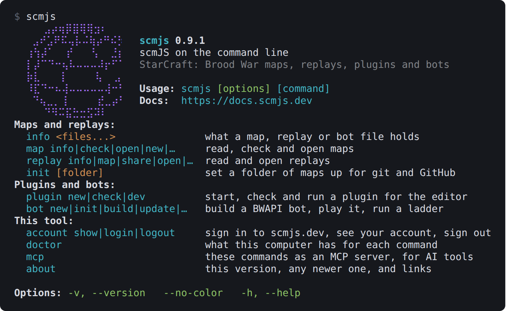

*`scmjs` on its own: the commands, grouped by what they work on.*

## Getting started

With Node.js 22.12 or newer, install the command once with npm:

```sh
npm install -g @scm-js/cli
scmjs info "(2)Ridge.scx"
```

Or run it without installing. `npx` fetches it the first time:

```sh
npx @scm-js/cli info "(2)Ridge.scx"
```

Without Node, download the command as a single program instead: see [Without
Node](#without-node).

### Without Node

Each release also carries `scmjs` as one program with Node inside it, for Windows, macOS
and Linux. It runs every command the npm package runs, and nothing else needs installing.

| System | Download |
| --- | --- |
| Windows (x64) | [scmjs-cli-windows-x64.zip](https://github.com/scm-js/scm-js/releases/latest/download/scmjs-cli-windows-x64.zip) |
| macOS (Apple silicon) | [scmjs-cli-macos-arm64.tar.gz](https://github.com/scm-js/scm-js/releases/latest/download/scmjs-cli-macos-arm64.tar.gz) |
| macOS (Intel) | [scmjs-cli-macos-x64.tar.gz](https://github.com/scm-js/scm-js/releases/latest/download/scmjs-cli-macos-x64.tar.gz) |
| Linux (x64) | [scmjs-cli-linux-x64.tar.gz](https://github.com/scm-js/scm-js/releases/latest/download/scmjs-cli-linux-x64.tar.gz) |

Each holds `scmjs` (`scmjs.exe` on Windows), its licence and the licences of what is
inside it, Node's among them. Put the program in a folder on your PATH so that `scmjs`
works from any folder. On Windows, make a folder such as `C:\Tools`, unpack `scmjs.exe`
into it, and add the folder under Settings ▸ System ▸ About ▸ Advanced system settings ▸
Environment Variables ▸ Path. On macOS and Linux:

```sh
curl -L https://github.com/scm-js/scm-js/releases/latest/download/scmjs-cli-linux-x64.tar.gz | tar -xz scmjs
sudo mv scmjs /usr/local/bin/
```

The programs are not code-signed. The first time, Windows may show SmartScreen's "Windows
protected your PC": choose **More info**, then **Run anyway**. macOS refuses a program
downloaded in a browser because "the developer cannot be verified"; clear the quarantine
flag once in Terminal, or allow it under System Settings ▸ Privacy & Security:

```sh
xattr -d com.apple.quarantine scmjs
```

A file fetched with `curl` carries no quarantine flag. The release's `SHA256SUMS` lists
each file's checksum; `sha256sum -c SHA256SUMS --ignore-missing` (`shasum -a 256 -c` on
macOS) checks the files you downloaded.

A package manager installs the same program and updates it with the rest of your software:

```sh
scoop bucket add scm-js https://github.com/scm-js/scoop-bucket
scoop install scmjs                  # Windows, Scoop
winget install scm-js.scmjs          # Windows, winget
brew install scm-js/tap/scmjs        # macOS and Linux, Homebrew
```

One thing still needs Node: `map build`, and a plugin written in TypeScript, compile with
TypeScript, which is installed with npm. The program looks for it in the map's project
(`npm install typescript` there) and in npm's global folder. Everything else is the same
as the npm package: the same cache folder, the same copy of StarCraft, the same Docker for
bots. For Claude Code, register the program itself: `claude mcp add scmjs -- scmjs mcp`
(`scmjs doctor` prints the line for your copy).

### The commands

`scmjs` on its own, or `scmjs --help`, prints the overview above. Most commands sit under
a noun: `map`, `replay`, `mod`, `plugin`, `bot` and `account`. `scmjs map --help` lists
the map commands, and every command has its own `--help` with its options and examples.
The [command reference](#command-reference) lists them all on one page.

A command that takes several files takes as many as you name, so a shell pattern works:

```sh
scmjs map check maps/*.scx
```

A file that cannot be read is reported and the others carry on. The Windows Command Prompt
and PowerShell do not expand `*.scx` for a program, so there you name the files.

### First commands

```sh
scmjs info "(2)Ridge.scx"         # what the map holds: size, players, units, triggers
scmjs map check maps/*.scx        # Check Map over a folder of maps
scmjs map open "(2)Ridge.scx"     # open it in scmJS
```

`scmjs info` reads whatever it is given: a map, a replay or a built bot (`.scmbot`).

### Checking your setup

Most commands need nothing more than the command itself. A few need more: TypeScript,
Docker, or your copy of StarCraft. `scmjs doctor` says what this computer has, what each
thing is for, and the command that installs what is missing. It ends with the commands
that cannot run yet and the one thing each lacks.

```
scmjs 0.9.1 · the newest · Node v24.13.0 · linux x64

  Tools
  ✔ TypeScript   6.0.3          ~/maps/node_modules/typescript
  ▲ Docker       not found
      scmjs bot new|init|build run the bot toolchain in it.
      https://docs.docker.com/get-docker/
  ✔ Desktop app  scmJS.exe      /mnt/c/Users/you/AppData/Local/Programs/scmJS/scmJS.exe
  · Claude Code  scmjs mcp not added
      claude mcp add scmjs -- npx -y @scm-js/cli mcp
  · scmjs.dev    not signed in
      scmjs login

  The game
  ✔ StarCraft    Remastered     /mnt/c/Program Files (x86)/StarCraft
  ✔ Game engine  1248410ad2a0   ~/.cache/scmjs/engine

  Not ready
  ✖ bot new|build  Docker not found
```

What it looks for:

| Line | Needed by |
| --- | --- |
| TypeScript | `map build`, and `map run` or `plugin dev` with a plugin written in TypeScript |
| Docker | `bot new`, `bot init`, `bot build` and `bot update` |
| Desktop app | `map open` and `replay open`, which use the browser without it |
| Claude Code | `scmjs mcp`, when you use it from Claude Code |
| scmjs.dev | `map share`, `replay share` and `map play` |
| Browser | `replay export`, which draws its clips in Chrome, Chromium or Edge |
| ffmpeg | `replay export` to an `.mp4`; a `.webm` or a `.gif` does without it |
| StarCraft | `map preview`, `map generate` and every command that runs the game |
| Game engine | `map trace`, `map cost`, `map rush`, `map test`, `map balance`, `replay watch`, `replay export`, `bot run`, `bot ladder` |

A dot instead of a tick means the thing is not there and nothing is wrong: ffmpeg, the
desktop app, Claude Code and a scmjs.dev sign-in are all optional. Only a missing thing
has lines under it. The Claude Code line looks for `scmjs mcp` among the servers Claude
Code knows, for every folder or for this one, and says so when Claude Code is not
installed.

The game engine line names the engine's build. Each command that plays the game drives the
engine with a runner of its own; an engine fetched before the play page had a runner lacks
that one, and the line says which it holds. The next command that needs a missing runner
fetches it. Before anything is fetched the line says "not fetched yet".

The first line says which `scmjs` this is: the npm package says nothing more, and the
single program says "single executable", with the package manager it came from. `--json`
prints the checks, how this copy was installed and the list of ready commands as JSON. The
doctor changes nothing, and exits with 1 only when Node itself is too old (the single
program carries its own).

### Commands that need StarCraft

`map preview` draws a map with the game's graphics and `map generate` lays its ground with
the game's tilesets. `map trace`, `map cost`, `map coverage`, `map rush`, `map test`,
`map heatmap`, `map balance`, `replay watch`, `replay export`, `bot run` and `bot ladder`
run the game itself. They need two things on your computer:

- Your copy of StarCraft, Remastered or 1.16.1. It is found in the usual places; otherwise
  name its folder with `--starcraft <folder>` or the `SCMJS_STARCRAFT` setting. Nothing of
  the game is fetched or carried by the command.
- The game engine, for the commands that run the game. It is the engine of
  [scmjs.dev/play](https://scmjs.dev/play/), about 25 MB, fetched the first time a command
  needs it and kept in your cache folder (`~/.cache/scmjs` on Linux, the usual place on
  other systems; `SCMJS_CACHE` moves it).

None of these run on a build server such as GitHub's, which has no copy of the game.

### Updating

`scmjs about` prints this version, whether a newer one is out and the line that installs
it, how this copy was installed, the desktop app and Docker if they are installed, and the
addresses of the editor, the docs and the source. To update the npm package:

```sh
npm install -g @scm-js/cli@latest
```

The single program updates through the package manager that installed it:

```sh
scoop update scmjs
winget upgrade scm-js.scmjs
brew upgrade scmjs
```

A downloaded one is replaced by downloading the newer file from the [releases
page](https://github.com/scm-js/scm-js/releases/latest) over it. Both kinds are released
together, with the same version.

### Shell completion

`scmjs completion bash`, `zsh` or `fish` prints a completion script with every command and
option in it. Install it once:

```sh
eval "$(scmjs completion bash)"                        # in ~/.bashrc
scmjs completion zsh > ~/.zsh/completions/_scmjs       # a folder on $fpath
scmjs completion fish > ~/.config/fish/completions/scmjs.fish
```

## Looking inside a map

These commands read a map and change nothing.

### What a map holds

`scmjs map info` (or `scmjs info`) prints a map's summary: its size, tileset and version,
the players, units, resources, triggers and strings, and what Check Map makes of it.

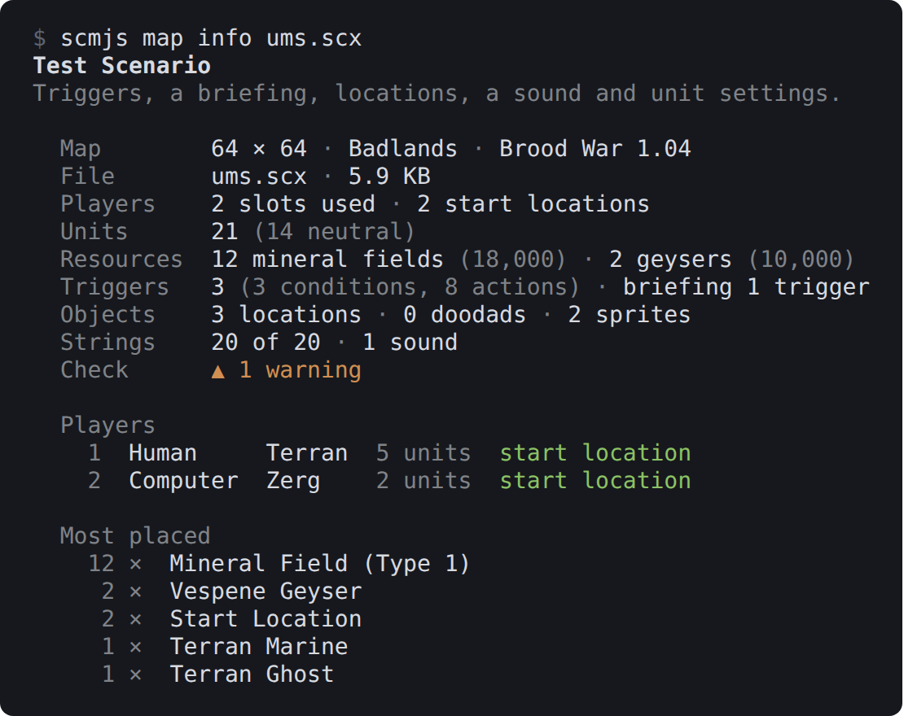

*`scmjs map info ums.scx`. The name and description keep their colours in a terminal with
full colour.*

`--table` prints one row per map instead, for a folder of them:

```
$ scmjs map info --table *.scx
File            Name                      Size     Tileset       Version           Players  Units  Triggers  Check
melee.scx       Test Melee                64 × 64  Jungle World  Brood War 1.04    2        16     0         ✔ no problems
remastered.scx  Test Remastered 리마스터  64 × 64  Ice           Remastered 1.21+  2        16     0         ✔ no problems
ums.scx         Test Scenario             64 × 64  Badlands      Brood War 1.04    2        21     3         ▲ 1 warning
```

### Checking a map

`scmjs map check` runs Check Map, as the editor does, and lists the errors and then the
warnings, each with the part of the map it is in. `--all` adds the notes. The command
exits with 1 when a map has errors, so it can stop a build; `--strict` fails a map on
warnings too.

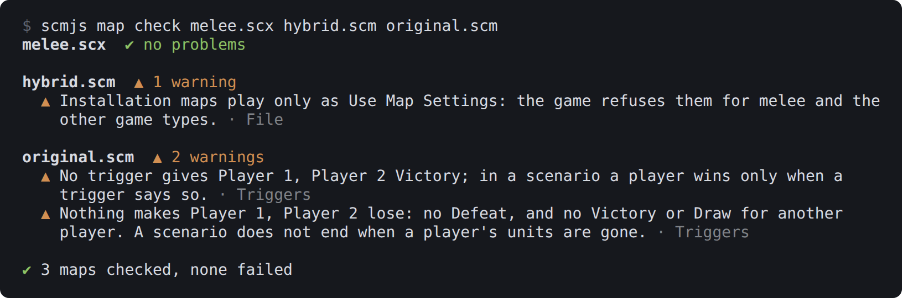

*`scmjs map check` over three of the test maps.*

A few checks need the game's graphics or unit data, such as units placed where they cannot
walk. The command does not run those. The editor does, once it has the game data.

For CI, `--format` writes the findings in a form other tools read:

| Format | What it is |
| --- | --- |
| `github` | GitHub Actions annotations: each finding shows on the pull request, beside the map |
| `junit` | JUnit XML, one test case per map, for any CI system that takes test results |
| `sarif` | SARIF 2.1.0, for code scanning tools such as GitHub's `upload-sarif` action |

The exit code is the same whatever the format. A step in a GitHub workflow that checks a
pull request's maps:

```yaml
- run: npx @scm-js/cli map check maps/*.scx --strict --format github
```

[`scmjs init`](#setting-up-a-folder-of-maps) writes a whole workflow that runs it on every
push.

### A baseline for old maps

A map made years ago, or by other tools, can have hundreds of findings, so `--strict`
would fail it on every push. A baseline lets you start from where the map is.
`--write-baseline` keeps the findings the maps have now in a file, and `--baseline` then
reports and fails only on findings that file does not hold:

```sh
scmjs map check maps/*.scx --write-baseline            # once: today's findings, in .scmjs-baseline.json
scmjs map check maps/*.scx --baseline --strict         # from then on: only new findings fail
```

```
$ scmjs map check maps/* --baseline --strict
ridge.scx  ✔ no new problems · 1 fixed since the baseline

wakka.scm  ▲ 1 new warning · 72 known
  ▲ Trigger 1: Create Unit with Properties names properties slot 0; the slots are 1 to 64. ·
    Triggers

✖ 1 map of 2 failed the check · 72 known findings left out, 1 fixed since the baseline
```

*A trigger was added at the top of `wakka.scm`, and a Defeat to `ridge.scx`. The 72 known
findings of the triggers below the new one still match.*

Without a file name both options use `.scmjs-baseline.json` in the current folder; give
one to keep it elsewhere. The file is JSON, one list of findings for each map, keyed by
the map's path from the file's folder, so one file serves a whole folder of maps. Commit
it beside the maps.

A finding is matched by the part of the map it is in and its text, with the parts that
move taken out. A trigger is known by its text, not by its number, so adding a trigger
above it, or renumbering the strings, does not make its findings new. Counts are left out
too: one more unit in a slot that is not in the game is the same finding as before.
Editing the trigger itself, or renaming a location it uses, makes its findings new again,
so look at them again.

Findings the baseline holds that are gone are counted as fixed since the baseline. They do
not fail anything, and `--write-baseline` drops them. Run it again whenever you accept the
findings as they are. `--format github`, `junit` and `sarif` list only the new findings,
so the CI step is one line:

```yaml
- run: npx @scm-js/cli map check maps/*.scx --baseline --strict --format github
```

With `--json`, each map has a `baseline` entry: the file, how many findings it left out
(`suppressed`), how many are new, and how many are fixed, with the fixed findings listed.

### The whole map as text

`scmjs map dump ridge.scx` prints everything in the map as text: the header, the players
and forces, every unit and location, the triggers in the trigger window's text form, the
strings, the archive's other files with their sizes and hashes, and the scenario's
sections with their sizes. Nothing is cut. The same file always gives the same text, so
you can search it with `grep`, keep it beside the map, or have git show a map's changes
with it ([Reading maps in git diff](#reading-maps-in-git-diff)).

```
# ridge.scx — scmjs map dump 1

## Map
  Name         Ridge
  Size         96 × 64
  Tileset      Jungle World
  …
## Units (14)
  Start Location  Player 1  336,1744
  Mineral Field (Type 1)  Neutral  176,1552  resources 1500
  …
## Triggers (3)
Trigger("Player 1"){
Conditions:
	Always();
…
```

`--json` gives the same data as JSON, with the units and triggers as the records the
editor holds.

### Searching maps

`scmjs map find <text> <maps…>` is Edit ▸ Find over any number of maps. It finds units,
locations, sprites and doodads whose name holds the text, and strings and triggers whose
text does. A number also matches a unit id, a location's slot, a string's number or a
trigger's number.

```
$ scmjs map find Marine maps/*.scx
ums.scx  4 matches
  unit     Test Marine  Player 1 · 14, 50
  string   Test Marine  String #13
  string   Bring a Marine to the middle.  String #17
  trigger  Trigger 1  Bring a Marine to the middle.
```

`--in strings,triggers` searches only those kinds: units, locations, sprites, doodads,
strings, triggers and briefing. `--case` matches case. A map with no match prints nothing.
Like `grep`, the command exits with 1 when nothing matched in any map, so a script can ask
whether any map still says something.

### A picture of a map

`scmjs map preview` draws the map with the game's tileset graphics, read from your copy of
StarCraft. Only the map's own tileset is read, which takes a fraction of a second. Without
a copy of the game there is no picture, and the command says how to name one.

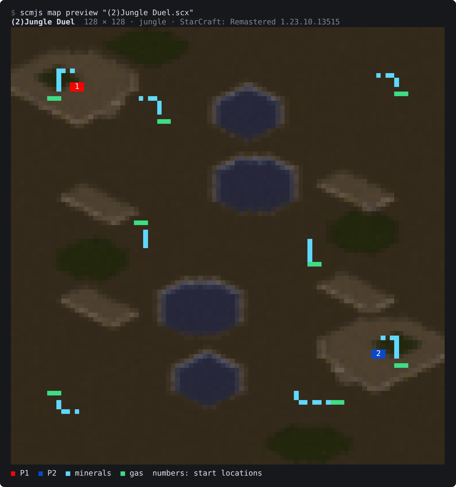

*`scmjs map preview` in a terminal with 24-bit colour. The numbers are the start
locations.*

Over the terrain go the things the minimap shows: a box for each unit in its owner's
colour, as big as the unit, mineral fields in blue, geysers in green, and the start
locations framed in their player's colour. `--no-units` draws the terrain alone.

In the terminal the picture fills the terminal's width, at most two columns a tile, and a
tall map is drawn no more rows high than half the terminal's columns. `--width 60` sets
the number of columns, or `--scale 0.5` gives half a column a tile. Each character is two
pixels, one above the other, in 24-bit colour where the terminal has it
(`COLORTERM=truecolor`) and in the nearest of 256 colours where it does not. A start
location is drawn as its player's number.

A terminal without colour, or without the block characters (the old Windows console), gets
letters: shades for the ground, `#` for a building, `o` for a unit, `$` for a mineral
field or geyser. kitty and iTerm2 can show a picture themselves and are sent a PNG;
`--blocks` asks for characters there too.

`--out ridge.png` writes a PNG at `--scale` pixels a tile: 1, 2, 4 (the default, so a 128
× 128 map is 512 pixels square), 8, 16 or 32, the game's own size. `--out -` writes the
PNG to standard output, and `-` as the map reads it from a pipe:

```sh
scmjs map preview ridge.scx --out ridge.png --scale 8
scmjs map new - --tileset ice --players 4 | scmjs map preview - --out - > new.png
```

`--json` describes the picture without drawing it: its form, size and scale, the tileset,
the copy of the game it came from, and how many start locations, units, buildings, mineral
fields and geysers are on it.

To see where things happened on the map in real games, where units died or where buildings
went up, draw a [heatmap from replays](#where-things-happened-across-many-games).

### A map's sounds

`scmjs map sounds ridge.scx` lists the sounds the map carries: the entries of its WAV
table, which is the Sound Editor's list, and any other sound file in the archive. Each
line gives the slot, the length, the format, the size and the triggers that play it.

```
$ scmjs map sounds ums.scx
ums.scx · 1 sound, 11 KB
    1  staredit\wav\tone.wav  1.0 s · 11025 Hz · 8-bit · mono · 11 KB  Trigger 1: Play WAV
```

`scmjs map sounds export ridge.scx` writes them into a folder, `ridge-sounds` beside the
map unless `--out` names another. Each sound comes out as the file that went into the map:
the compression StarEdit and the game use for sounds in an archive is undone, and a WAV or
Ogg file is otherwise written as it is. Two sounds with the same file name get `-2`, `-3`
after it.

A name in the WAV table that the map does not carry is listed and not written. That is not
an error. A name under `sound\` is one of the game's own sounds, which plays from the
game's files, and is listed as such. `--json` gives the list, and for `export` the file
each sound went to.

### Maps from scmscx.com

[scmscx.com](https://scmscx.com) is the community's map database: years of maps people
have shared, searchable by name, description and file name. `scmjs map fetch` searches it
and downloads from it. The maps belong to their makers and the site; the command asks the
site the way its own pages do.

```
$ scmjs map fetch lost temple
scmscx.com · 2,918 files match "lost temple" · the best 10 maps

  Name                           Size       Tileset       Players  Downloads  Id
  (The Lost Temple 8 Players)    128 × 128  Jungle World  8        246        GDj6p383
  PGT - Lost Temple 2.4 [02]     128 × 128  Jungle World  4        170        B8V7fdyj
  PGT - Lost Temple 2.35 [01]    128 × 128  Jungle World  4        35         jVYB3rBz
  …
```

The list is in the site's order of best match, and lists a map once however many file
names it was uploaded under. `--limit 25` lists more, up to 50; each map's details are a
request of their own, which is why the list stops there. `--json` gives the list to a
script. When nothing matches, the command says so and exits with 1.

To download a map, give its id or its address on the site with `--id`, or add `--first` to
take the best match:

```sh
scmjs map fetch --id B8V7fdyj
scmjs map fetch lost temple --first --out maps/
scmjs map fetch lost temple --first --open
scmjs map fetch lost temple --first --out - | scmjs map info -
```

The file keeps the name the site gives it, with the characters Windows does not allow in a
file name changed to `_`. It is written in this folder, or to the file or folder `--out`
names; `--out -` sends it down a pipe. A file that is already there is left alone unless
you add `--force`. Before anything is written, the map is opened as the editor opens it
and the command says what it is:

```
PGT - Lost Temple 2.4 [02]
  Map   128 × 128 · Jungle World · StarCraft 1.00
  File  (4)Lost Temple 2.4 PGT.scm · 172 KB
  From  https://scmscx.com/map/B8V7fdyj · uploaded by anonymous · 170 downloads
✔ Written to (4)Lost Temple 2.4 PGT.scm
```

Anything the site sends that is not a map is refused, and nothing is written. `--open`
opens the map in scmJS once it is written. The command waits at most ten seconds for the
site, and says so (exit 1) when the site does not answer or turns the request down.
Nothing is kept between runs.

### Opening a map in scmJS

`scmjs map open ridge.scx` opens the map in the scmJS desktop app when it is installed.
Without the app, it opens the editor at scmjs.dev in your browser and hands it the file:
the command serves a small page on your own computer, that page opens the editor, and the
editor takes the file from it. The file does not leave your computer. If the browser
blocks the editor's window, the page shows a button to open it. `--browser` uses the
browser even when the app is installed.

| Setting | Effect |
| --- | --- |
| `SCMJS_APP` | The desktop app's path, when it is installed somewhere unusual |
| `BROWSER=none` | Opens no browser; the command prints the page's address for you to open |

## Making a map

### A blank map

`scmjs map new ridge.scx` writes the map File ▸ New makes: flat ground, eight open slots
and nothing else, 128 × 128 Badlands unless you say otherwise.

```
$ scmjs map new maps/ridge.scx --size 96x64 --tileset jungle --players 2
✔ maps/ridge.scx: 96 × 64 · Jungle World · Brood War 1.04 · 2 start locations · 3.0 KB
```

| Option | What it sets |
| --- | --- |
| `--size` | Width and height, each 64, 96, 128, 192 or 256, as the New dialog offers them |
| `--tileset` | badlands, platform, install, ashworld, jungle, desert, ice or twilight |
| `--name`, `--description` | The map's name (the file's name without its extension by default) and description |
| `--players 2` | Start locations for players 1 and 2, placed in a ring as Tools ▸ Auto-place does, with the other slots closed, so the map passes Check Map as it is. `--layout corners` puts them in the corners |
| `--revision remastered` | A Remastered map |
| `--force` | Writes over a file that is already there; without it the command refuses |

A name ending in `.chk` writes the bare scenario. Without the game's graphics the ground
is written by its terrain ids, as the editor does when it has no game data; the map opens
as it should and the editor fills in the tiles' looks when it saves. The same arguments
always give the same file, byte for byte, so a map made in a build step is the same map
every time.

### A melee map from a seed

`scmjs map generate` makes a melee map ready to play. Each player gets a main on high
ground with one ramp down to a natural expansion; there are free bases where there is
room, and a middle of low ground broken up by mesas, lakes and patches of the tileset's
other ground. Every player's bases are copies of one another, and the command walks the
map before writing it to check that they are as far apart as they should be.

```sh
scmjs map generate "(2)Jungle Duel.scx" --seed 1207
scmjs map generate "(4)Crossing.scx" --players 4 --tileset desert --seed 2026
```

```
✔ (4)Crossing.scx: 128 × 128 · Desert · 4 players · seed 2026 · 29 KB
  Laid out   mirrored both ways · open · 4 ramps · 2 free bases
  Balance    walks the symmetry makes equal differ by 1.5% start to start, 5.0% to the free bases
  Check Map  no errors or warnings
  Layout     layout 2 of the 2 tried · StarCraft: Remastered 1.23.10.13515

    Player  Main                  Natural               Minerals  Gas     To the middle
    1       9 × 1,500 + 1 geyser  7 × 1,500 + 1 geyser  24,000    10,000  70 tiles
    2       9 × 1,500 + 1 geyser  7 × 1,500 + 1 geyser  24,000    10,000  71 tiles
    3       9 × 1,500 + 1 geyser  7 × 1,500 + 1 geyser  24,000    10,000  71 tiles
    4       9 × 1,500 + 1 geyser  7 × 1,500 + 1 geyser  24,000    10,000  70 tiles

  Ground distance start to start, in tiles (a straight line in brackets)
        P1         P2         P3         P4
    P1  –          141 (119)  93 (88)    123 (80)
    P2  141 (119)  –          124 (80)   92 (88)
    P3  93 (88)    124 (80)   –          141 (119)
    P4  123 (80)   92 (88)    141 (119)  –
```

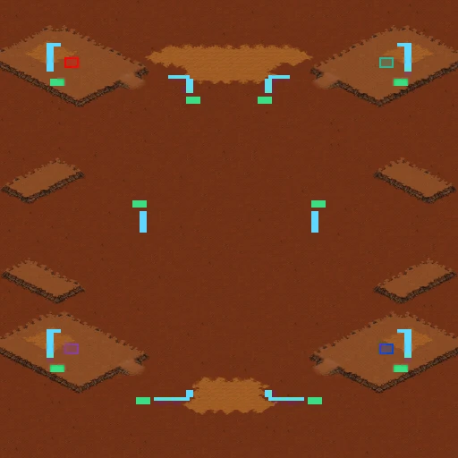

*`(4)Crossing.scx` from the command above, drawn with `scmjs map preview --out`.*

It needs [your copy of StarCraft](#commands-that-need-starcraft), Remastered or 1.16.1.
The ground is painted with the editor's isometric brush, which needs the tileset's terrain
table to know which tile joins which, and the ramps are the tileset's own. Without a copy
the command says so and writes nothing.

| Option | What it does |
| --- | --- |
| `--players` | 2, 3, 4, 6 or 8 (2 by default). Three players get the four-player layout with the fourth main and natural left without a start location, for anyone to take |
| `--size` | 128 × 128 by default, 192 × 192 for eight players. Each side is 96, 128, 192 or 256, and at least 96 for two players, 128 for three to six and 192 for eight: the bases are a fixed size, so a small map runs out of room |
| `--tileset` | jungle by default, or badlands, platform, ashworld, desert, ice or twilight. Installation is not offered, since none of its ground can be built on |
| `--symmetry` | How the players' halves or quarters relate. `rotational` turns the map half round its centre; it is the default on a square map, and `mirror-x` on one that is not. `mirror-x` mirrors left to right, `mirror-y` top to bottom, and `diagonal` (two players on a square map) across the diagonal. Four and eight players are always mirrored both ways. Six players are three a side; `mirror-y` puts the sides at the top and bottom, which needs a map 192 wide or more |
| `--style` | `open` (the default) keeps the ways out of the naturals clear; `chokes` lays more and bigger mesas, two of them either side of each natural's way out |
| `--seed` | The number the map is made from. The same seed and options with the same copy of the game give the same file, byte for byte. Without `--seed` the command picks one and prints it, so you can make a map you like again |
| `--rush` | Also walks an SCV between the starts in the game itself, as [`map rush`](#rush-distances) does; this needs the game engine |
| `--name` | The map's name, the file's name without its extension by default |
| `--force` | Writes over a file that is already there |
| `--json` | The summary as JSON |

`-` as the file name writes the map to standard output.

### What a generated map has

Each main is a plateau with the start location, nine mineral fields of 1,500 and a geyser
of 5,000 behind the town hall, away from the ramp. The ramp leads down to the natural:
seven fields and a geyser, placed so the mineral line is out of the way up the ramp and
the way to the middle. Free bases have six fields and a geyser. Resources are placed the
way the Melee Wizard plugin places them: each field three tiles from the town hall, the
closest the game allows, the line wrapping round the hall's corners and the geyser past
one end. Cliffs and shores are drawn as StarEdit draws them, and each ramp goes where
StarEdit's own rule places it, and is kept only if a unit can walk up it.

What it does not place: trees, rocks and other doodads besides the ramps, a third level of
ground, bridges, neutral buildings and critters. Open the map in scmJS to add them, and
look at it first with `scmjs map preview`:

```sh
scmjs map preview "(4)Crossing.scx" --out crossing.png --scale 8
```

### How a generated map is balanced

StarCraft's ramps all lead down to the south: no tileset has a ramp up a north-facing
cliff. So a player's bases are never turned upside down with the map. A player at the
bottom has their main above their ramp, like a player at the top, and the foot of the ramp
is where the symmetry puts it. Every walk out of a main goes down its ramp, so the walks
from the mains match to within a few percent start to start. The walks to the free bases
match less closely, because a bottom player's main lies between its ramp and the ground
above it. The summary gives both numbers.

Before the file is written, the map must pass Check Map, and every start location is
walked to every other and to every free base, over the ground a unit can walk, with
mineral fields and geysers in the way. Walks that the symmetry makes equal are compared: a
pair of starts against its mirror image, and each player's walks to the free bases against
those of the player it mirrors. A layout that fails is thrown away and the next one tried,
twelve at most. When none is within 8%, the closest is written, its balance is marked
"unbalanced" and the first line has a warning instead of a tick. When no layout passes,
nothing is written and the command exits with 1.

The distances in the summary are the command's own walk, in tiles: to the middle of the
map for each player, and start to start beside the straight line.

## Changing a map

Each command here writes the map back over itself, or to another file with
`--out other.scx`, and keeps everything else in the file as it was: its sounds and other
files, and the way the scenario was compressed, as Save does in the editor.

### Name, description and revision

`scmjs map set` is Map Properties. It sets what you give and leaves the rest, and writes
nothing when nothing changed.

```sh
scmjs map set ridge.scx --name "Ridge <04>2.1" --description "Final for the tournament."
scmjs map set ridge.scx --revision remastered
scmjs map set ridge.scx --encoding euc-kr
```

```
✔ ridge.scx: Name ridge → Ridge · written to ridge.scx · 3.0 KB
```

In a name or description, `<XX>` is one of the game's colour codes, as in the string
files. `--revision` is one of original, hybrid, broodwar, remastered and remasteredHybrid,
and does what the editor's revision change does. `--encoding` is how the map's text is
stored for 1.16.1: utf-8, euc-kr, shift_jis, gbk, big5, windows-1251 or windows-1252.
Remastered reads UTF-8.

### Resizing

`scmjs map resize ridge.scx --size 128x96` is Scenario ▸ Resize.

```
✔ ridge.scx: 96 × 64 → 128 × 96 · written to ridge.scx · 3.6 KB
```

`--anchor` says which part of the map stays where it is: center (the default), top-left,
top, top-right, left, right, bottom-left, bottom or bottom-right. Units and other things
that fall outside the new edge are dropped, and the command lists them. Locations that
hang over the edge are pulled inside unless you pass `--no-clamp`. New ground is the
tileset's base terrain.

### Triggers and strings as text

A map's triggers and strings can live beside it as text files. In git a change to them
shows as a diff; in any text editor you can search and replace across a hundred triggers.
Then they go back into the map.

```sh
scmjs map triggers export mymap.scx > triggers.txt
scmjs map triggers import mymap.scx triggers.txt
```

`triggers export` prints the triggers in the text form the editor's trigger window uses
(the [trigger reference](triggers.md) lists every condition and action in it), or writes
them to `--out`. A file name ending in `.trg` writes the raw trigger records instead: the
file SCMDraft's Export Triggers makes and reads. `--briefing` exports the mission
briefing's triggers.

`triggers import` replaces the map's triggers with the file's, or adds them after the
map's own with `--append`. Text the map cannot resolve, such as a condition it does not
know or a location it does not have, is refused with its line number, and nothing is
written.

```sh
scmjs map strings export mymap.scx > strings.txt
scmjs map strings import mymap.scx strings.txt
```

The strings file has one string a line: the string's number, a tab, and its text, with the
game's colour codes written as `<XX>`. A `#` starts a comment. `strings import` sets each
numbered string in place and adds any numbered past the end. Nothing is renumbered,
because the map's triggers and locations refer to strings by number; a line you take out
leaves that string as it is.

### Editing triggers or strings in your editor

`edit` exports, opens the text in your editor, and imports it when you close the editor:

```sh
scmjs map triggers edit mymap.scx
scmjs map strings edit mymap.scx --editor "code --wait"
```

The command waits until the editor is closed. If you saved a change, the text is imported
as `import` reads it and the map is written. If you saved nothing, or only a comment, the
map is left alone and the command says nothing changed.

Text that cannot be read, such as a condition the map does not know or a strings line that
is not a number and a tab, is not imported and the map is left alone. The error gives the
line. The file you edited is kept with your changes in it, and the command prints its path
and the `import` command that brings it in once you have fixed it.

The editor is `--editor`, or else the `VISUAL` or `EDITOR` setting as git uses them, or
else Notepad on Windows and vi elsewhere. An editor that opens a window has to be told to
wait for it to close, or the command sees the file unchanged straight away: `code --wait`,
`subl -w`, `gedit -s`. `triggers edit --briefing` edits the briefing's triggers.

### Removing unused strings

`scmjs map strings prune ridge.scx` is the string editor's Delete Unused. A string that no
trigger, location, name, force, sound or setting refers to is blanked, and the blank slots
at the end of the table are dropped. Nothing is renumbered, so the triggers still point at
the right strings. `--dry-run` lists what would go and writes nothing.

### Making a map smaller

`scmjs map optimize` takes out of a map what the game never uses and stores the rest as
small as the game still reads it. It writes over the map unless `--out` names another
file; `--dry-run` says what would go and writes nothing. A table says what each step
saved:

```
$ scmjs map optimize "(3)Defenders of the Galaxy.scm"
✔ (3)Defenders of the Galaxy.scm: 44 KB → 36 KB (−17.7%) · written to (3)Defenders of the Galaxy.scm

  Step                                           Saved
  Unused sounds    none                          -
  Other files      none                          -
  Unused strings   23 strings                    243 B
  Editor sections  skipped: with --strip-editor  -
  Compression      PKWARE, rewritten             7.5 KB

Removed
  string    21 - Defend your Nexus at all costs.  nothing in the map refers to it
  …
```

In order, the steps are:

- Sounds that no trigger or briefing plays and the sound list does not name, and the sound
  list's entries for files the map does not hold. A sound only the list names stays: it is
  in the Sound Editor, waiting for a trigger.
- Any other file in the archive that nothing in the map names, listed one by one.
- The strings nothing refers to, as [`strings prune`](#removing-unused-strings) drops
  them.
- With `--strip-editor`, the sections only editors read (below).
- Every file compressed again. PKWARE is the default, since every version of the game
  reads it. A map that was already in zlib, which only Remastered reads, gets the smaller
  of the two. `--compression zlib` or `--compression pkware` chooses.

Some files stay whatever refers to them. The game itself opens a few files by name:
`(attributes)`, `(signature)` and the marks Blizzard's own maps and the ladder maps carry,
such as `blizzard_2.cnd`. TrigScript's, Magenta's and the editor's build files stay
(`trigscript\`, `magenta\`, `scmjs\`), as do files the archive holds without a name. A
sound StarEdit imported is stored with the game's own sound compression, which loses a
little quality to be about four times smaller; the editor reads it but cannot write it,
and writing it any other way would make the map larger, so such a file is kept exactly as
it is stored. `--keep` names other files to keep: `--keep "notes\"` keeps a folder.

A map built from a TrigScript script keeps its scenario as it was built, so the editor
still opens the map you were editing; only its stray files and its compression change. A
map whose triggers write to the game's memory (an EUD map) keeps every string, since such
a map can reach a string by its place in the table.

`--strip-editor` also drops `ISOM`, `TILE`, `DD2`, `IVER`, `IVE2`, `IOWN`, `UPUS`, `SWNM`
and `WAV`, the sections the [CHK reference](chk-format.md) marks as read by editors only,
with the strings and sounds only they named. The map plays the same, but an editor that
opens it has no isometric terrain to paint, no doodads to select, no sound list and no
switch names. It is the Save dialog's *Smallest that plays* for these sections; keep the
original to go on editing.

The result is opened again as the editor opens a map before anything is written, and when
the editor cannot write the map any smaller, nothing is written. `scmjs map diff` between
the two shows only what went.

### The archive as a folder

A map file is an archive: the scenario, `staredit\scenario.chk`, with the map's sounds, a
TrigScript script's files and anything else put in it. `scmjs map unpack` writes those
files into a folder at their paths in the archive, and `scmjs map pack` puts the folder
back together:

```sh
scmjs map unpack ridge.scx            # → ridge/staredit/scenario.chk, ridge/staredit/wav/…, ridge/archive.json
scmjs map unpack ridge.scx --list     # the files and their sizes, nothing written
scmjs map pack ridge                  # → ridge.scx again, beside the folder
```

`archive.json` in the folder records what the files cannot: the map's name, how the
scenario was compressed and whether it was encrypted, whether the archive had a file list,
and the files a protected map keeps without a name, which go under `stored/` byte for
byte. `pack` writes the archive as `archive.json` says, so an unpacked and repacked map
reads the same in the editor and the game.

A file you add to the folder goes into the map at its path: a sound dropped into
`staredit/wav/`, a script's file under `trigscript/`. `--compression none|pkware|zlib`
changes how every file is stored, and `--out` names the folder or the file to write.

Nothing is parsed or restored on the way: the folder is the file as it is. A map the
editor built from a TrigScript script unpacks into its built scenario and the `scmjs/`
files holding the source, and packs back into the same built map. The packed file is
opened as a map before it is written, so a folder whose scenario is not a scenario is
refused.

With `--text`, the scenario itself is written as text files under `scenario/` instead of
the one binary `staredit/scenario.chk`, so the map can be kept in git and read and merged
as text. [A map as a folder of text](#a-map-as-a-folder-of-text) explains the folder.

### Building a TrigScript map

The editor builds a map with a [TrigScript](trigscript.md) script every time it saves it:
the script's `trigger()` calls become triggers in the map, and its `program()`s are built
into the file. `scmjs map build` does the same without the editor, so a map kept in git
can be built where it is checked, and a script edited outside the editor can be applied
from the terminal.

```
$ scmjs map build maps/ridge.scx --test
✔ ridge.scx: 12 triggers → #4–#15 · 2 programs (Remastered) · 7 tests passed · written to maps/ridge.scx · 48 KB
```

The script is the one the map keeps, with the copies of libraries the map keeps. It is
compiled against the map's names, settings and placed units, as the editor compiles it.
The built file opens in the editor as the map you were editing, with the build kept beside
it, as a saved one does.

| Option | What it does |
| --- | --- |
| `--out` | Writes the built map to another file |
| `--test` | Runs the script's tests first, in the simulator; a failing test stops the build. A map whose script settings make tests guard the build runs them without the flag |
| `--check` | Compiles (and tests, with `--test`) and writes nothing: the check for a pull request |

An error in the script is printed as `main.ts:12:5 error …`, a failing test with its name
and line, and the command exits with 1 with nothing written.

The compiler is TrigScript's own, the version this release of the editor ships, so the
command and the editor build the same map. It compiles with TypeScript, which is not part
of the command: install it in the map's project (`npm install typescript`) or globally
(`npm install -g typescript`). A sound of two seconds or more is encoded as Ogg Vorbis
with an encoder the command fetches once, unless the project has `wasm-media-encoders`
installed.

Two things differ from the editor. In the tests, a unit type's hit points come only from
the map's own unit settings: the editor falls back on the game's unit data for a type the
map leaves at its defaults, and the command does not have that data. A test that counts on
a Marine's 40 hit points should set them in the map. And programs that other plugins add
to a build are not built here: a map with Magenta's triggers is refused, and is built by
saving it in the editor.

### Running a plugin over a map

`scmjs map run` gives a plugin the editor's [plugin API](plugins.md) with a map open and
no editor around it. The plugin can be a folder with a `plugin.json`, the manifest itself,
a single script file, `github:owner/repo` or a URL: whatever Plugins ▸ Add takes, and a
file on your disk too. A script is a file that exports `activate(api)` as a plugin's entry
does, so a few lines that read or change a map need no plugin around them:

```js
// starts.mjs
export default (api) => {
  const starts = api.document.scenario().units.filter((u) => u.unitId === 214);
  api.ui.status(`${api.document.info().name}: ${starts.length} start locations`);
};
```

```sh
scmjs map run starts.mjs "(4)Crossing.scx"
scmjs map run ../plugin-repair maps/ridge.scx --command repair --dry-run
```

What the plugin would show is printed as it happens: its status line, its toasts, and the
warnings and errors in its log. Dialogs and panels register and show nothing, and a
request for a file gets none. `--command <id>` runs one of the commands the plugin
registered, with `--arg` values as its arguments; `--json` includes what the command
returned.

The map is written back only when the plugin changed it (`--out` writes it elsewhere, even
unchanged), and the last line says what changed, in the terms of
[`map diff`](#comparing-two-maps). `--dry-run` prints that comparison in full and writes
nothing. Saving is the command's job: `api.document.save()` has no file picker to open
here. A plugin written in TypeScript needs TypeScript installed, as `map build` does; a
built plugin or a JavaScript script needs nothing more.

This is the editor's own plugin host, so a plugin's logic runs as it does in the editor.
You can try a plugin from a terminal, or run it over many maps from a shell loop, before
anyone installs it.

## Maps in git

A map file is binary, so git on its own can only say that it changed, and cannot merge two
changes to it. scmjs gives git a way to read maps as text and to merge them part by part,
and gives a pull request Check Map's findings.

### Setting up a folder of maps

`scmjs init` sets a folder of maps up for git and GitHub in one command. Run it in the
folder, or name the folder:

```
$ scmjs init maps
maps · 5 maps · in the git repository ladder
  ✔ .gitattributes                 written: maps diff as text and merge part by part
  ✔ .gitignore                     written: the .bak files Save leaves, map test's replays
  ✔ ../.github/workflows/maps.yml  written: checks the 5 maps on push and pull request; scmjs 0.9.0
  ✔ README.md                      written: lists the 5 maps, and the commands
  ✔ git config diff.scmjs          set: textconv, xfuncname, cachetextconv
  ✔ git config merge.scmjs         set: name, driver
ℹ The workflow is at the repository's top, where GitHub reads it, and checks maps/ from there.
```

What it writes:

- `.gitattributes` has git read `.scx`, `.scm` and `.chk` files through `scmjs map dump`,
  so `git diff` and `git log -p` show what changed inside a map, and merge them through
  `scmjs map merge`, so two branches that changed one map in different places merge.
- The git settings (`diff.scmjs.textconv`, `.xfuncname` and `.cachetextconv`, and
  `merge.scmjs.name` and `.driver`) tell git what those lines mean. Settings belong to a
  clone rather than to the repository, so they are set in the repository the folder is in,
  and everyone who clones it runs `scmjs init` once too; it writes nothing that is already
  there. `git diff` and `git merge` run `scmjs` by name, so it has to be installed
  (`npm install -g @scm-js/cli`); `init` says so when it is not.
- `.github/workflows/maps.yml` runs `map check --strict --format github` over the maps on
  every push and pull request, so a map with errors or warnings fails the run and each
  finding shows on the pull request beside the map. A map with a TrigScript script also
  gets `map build --check`, which compiles the script and writes nothing. The workflow
  names this version of `@scm-js/cli`, so a run gives the same answer until you change the
  version, as its first lines say. GitHub reads workflows only at a repository's top, so
  for a folder inside a repository the file goes there and names the folder's maps.
- `README.md` lists the maps (name, file, size, tileset, players) and the commands people
  need: `map check`, `map dump`, `map diff --rev HEAD`, settling a merge with `map merge`,
  and the git settings a new clone needs.
- `.gitignore` has `*.bak`, the copy of a map the desktop app keeps when Save replaces it,
  and `*.tests/`, where `scmjs map test` keeps the replays of failed scenarios.

The workflow has no `map test` step: that needs a copy of StarCraft, which GitHub's
runners do not have.

`init` keeps the maps themselves in git and has git read them through scmjs. The other way
is to keep each map as a folder of text and build the map file from it when you need one:
see [A map as a folder of text](#a-map-as-a-folder-of-text).

Nothing is overwritten. `.gitattributes` and `.gitignore` get only the lines they lack, at
the end. A `README.md` or workflow that is already there is left as it is, and so is a git
setting that holds another value; each is reported on its own line. `--force` replaces the
README and the workflow and sets the git settings; it never takes a line out of the other
two files.

In a folder that is not in a git repository, the files are written and the git settings
are not. Run `scmjs init` again after `git init`, or add `--git` to have the command run
`git init` first; it never runs it unasked.

`--print` writes nothing and prints every file and the `git config` lines instead, to read
first or paste by hand. `--json` lists the files and what became of each, with their text
when given `--print` as well. The command exits with 2 when the folder does not exist.
`scmjs help init` has its help.

### Reading maps in git diff

Told to read maps through `scmjs map dump`, git shows what changed inside them in
`git diff`, `git log -p`, `git show`, and the pull requests of tools that honour
`.gitattributes`. `scmjs init` sets this up. To do it by hand, once in the repository:

```sh
git config diff.scmjs.textconv "scmjs map dump"
git config diff.scmjs.xfuncname "^## .*"
printf '*.scx diff=scmjs\n*.scm diff=scmjs\n*.chk diff=scmjs\n' >> .gitattributes
```

```
$ git diff
--- a/ridge.scx
+++ b/ridge.scx
@@ -100,7 +100,7 @@ ## Strings (20)
   2	Hold the base.
-  3	Force 1
+  3	Renegades
   4	Force 2
```

The second line makes each hunk's heading the part of the map it is in, as
`## Strings (20)` above. Earlier versions of this guide gave it as `"^## "`, which shows a
bare `##`; `scmjs init` replaces that value. `git config diff.scmjs.cachetextconv true`
keeps the text of each version, so a long `git log -p` does not read every map again. The
`.gitattributes` lines are committed, so everyone who clones gets them; the `git config`
lines are per clone, or for every repository on your computer with `--global`.

### A map as a folder of text

`scmjs map unpack --text` writes a map as a folder of text files: the header and players
as JSON, the terrain as a grid, the units, locations and settings as tables, and the
strings and triggers in their usual text forms. Keep the folder in git in place of the map
file, and `scmjs map pack` builds the map from it:

```sh
scmjs map unpack ridge.scx --text     # → ridge/, the scenario under ridge/scenario/
scmjs map pack ridge                  # → ridge.scx, built from the text
```

```
ridge/
  archive.json                 how the archive was stored, as for any unpacked map
  staredit/wav/tone.wav        the map's other files, as map unpack writes them
  scenario/
    map.json                   type, revision, size, tileset, name, players, forces, sounds, switches
    strings.txt                the string table, as map strings export writes it
    triggers.txt               the triggers, as map triggers export writes them
    briefing.txt               the mission briefing, the same way
    terrain.txt                the tiles, a row of the map per line
    under-doodads.txt          the ground under doodads, where it differs from terrain.txt
    isom.txt                   the isometric terrain, a row per line
    mask.txt                   the fog of war, a row per line
    units.tsv                  the units, one per line, in the map's order
    sprites.tsv, doodads.tsv   the sprites and doodads, one per line
    locations.tsv              the locations in use, numbered as triggers number them
    cuwp.tsv                   the Create Unit with Properties slots
    settings/*.tsv             unit, weapon, upgrade and technology settings, one row each
    sections.json              every section of the scenario, in the file's order
    sections/                  the sections kept as they are: IVE2.bin, VCOD.bin, …
```

Each change to the map is then a change to a few lines. Moving a mineral field in the
editor and unpacking again, or editing the line by hand, gives:

```
$ git diff -U1
--- a/ridge/scenario/units.tsv
+++ b/ridge/scenario/units.tsv
@@ -2,3 +2,3 @@
 1	336	1744	214	0x0000	0x0000	0x0000	0	100	100	100	0	0	0x0000	0	0	Start Location
-2	176	1552	176	0x0000	0x0000	0x0010	11	100	100	100	1500	0	0x0000	0	0	Mineral Field (Type 1)
+2	272	1552	176	0x0000	0x0000	0x0010	11	100	100	100	1500	0	0x0000	0	0	Mineral Field (Type 1)
 3	240	1552	176	0x0000	0x0000	0x0010	11	100	100	100	1500	0	0x0000	0	0	Mineral Field (Type 1)
```

so two people who changed different units, triggers or strings merge with git's own line
merge, and a pull request shows the change itself. A conflict is a conflict in the text
file, settled there.

**Nothing is lost.** Before writing the folder, `unpack` packs it again in memory and
compares the result with the map, section by section; an untouched folder packs back into
the same scenario, byte for byte. A section the editor does not model (`IVE2`, `VCOD`, a
protected map's extra sections), a section the file has more than one copy of, and any
section whose text could not hold all of it are kept as bytes under `sections/`, and
`unpack` lists them:

```
$ scmjs map unpack ridge.scx --text
✔ ridge.scx: 24 files · 137 KB · → ridge
  Scenario as text  31 sections · 126 KB in 23 files
  Kept as bytes     IVE2 (not modelled), VCOD (not modelled)
```

A map StarEdit wrote also keeps its string table and its triggers' records beside their
text ("Bytes kept beside"). StarEdit lays the string table out its own way and leaves a
flag clear in conditions and actions that the text form always sets; the kept bytes are
written for as long as the text says what it said. A changed string table is written the
way the editor saves one, and a changed trigger is read from its text, while every trigger
whose text is unchanged keeps its record exactly.

**Editing the text.** The text decides: `pack` reads each file into the editor's model of
the map and writes each section as the editor would save it.

- In the `.tsv` tables the columns are the fields of the record in the order the file
  stores them; positions are in pixels, owners count from 0 (Player 1) to 11 (neutral),
  and flags are hexadecimal. The `name` column is there to read and is not read back: the
  number columns decide.
- `terrain.txt` holds a tile id per cell in hexadecimal, the tileset's group times 16 plus
  the megatile within it, so a whole tile group shares its first three digits.
- `strings.txt` and `triggers.txt` are what `map strings export` and `map triggers export`
  write. A trigger names its text by what it says, so triggers.txt decides a trigger's
  text: changing a message there adds it to the string table (as `map triggers import`
  does), and the old one stays until `scmjs map strings prune`. To change a message in
  place, change it in both files.
- `map.json` names players' types, races and colours, and the forces' flags, by name;
  `nameString` and the like are numbers in the string table.

A file that does not read stops the pack, with the file and line:

```
$ scmjs map pack ridge
✖ scenario/units.tsv, line 3: x: "abc" is not a number
```

The map's size is in `map.json` and in the shape of every grid, so a map is resized with
`scmjs map resize`, not by hand. `map dump` and the git textconv are unchanged: they read
a map file, which this folder builds.

**TrigScript.** A map built from a TrigScript script unpacks as the editor saved it: the
built scenario as text, beside the script's files under `trigscript/` and `scmjs/`.
Packing the folder does not build the script again; run `scmjs map build` on the packed
map after changing the script.

### Comparing two maps

`scmjs map diff a.scx b.scx` says what changed between two maps, in a map maker's terms:
the name, size, tileset and version; each player's type, race, colour and force; units and
locations added or removed; triggers and briefing triggers added or removed, one line
each; strings added, removed or changed; the archive's other files; and which sections of
the scenario differ at all.

```
old.scx → new.scx

Map
  ~ Name           Ridge → Ridge, revised

Triggers +1 −1
  − Player 1: Bring("Player 1", "Terran Marine", "Middle", At least, 1) → Victory()
  + Player 1: Bring("Player 1", "Terran Marine", "Middle", At least, 4) → Victory()

Strings ~1
  ~ 7  Hold the base. → Hold the base. Reinforcements at 4:00.

Sections
  ~ STR   355 B → 371 B
  ~ TRIG  7.0 KB → 7.0 KB
```

A trigger that changed shows as the old one removed and the new one added. Long lists stop
at twenty; `--all` lists everything. Like `diff`, the command exits with 1 when the maps
differ and 0 when they are the same, so a script can ask whether a step changed anything.

`--rev` compares a map with the version git has at a revision, so one command says what a
commit changed in a map, or what is not committed yet:

```sh
scmjs map diff --rev HEAD~1 maps/ridge.scx     # what the last commit changed
scmjs map diff --rev main maps/ridge.scx       # what this branch changed
```

The older version is read with `git show`, so this works wherever `git diff` does. A file
that is not in a repository, or not at that revision, is refused with git's own message.

### Where a map changed

`--picture` shows where the map changed rather than what. It draws the second map as
[`map preview`](#a-picture-of-a-map) does, with your copy of StarCraft, and darkens the
ground that did not change:

| Mark | Means |
| --- | --- |
| Magenta tiles | Tiles that changed |
| Green box | A unit added |
| Red box | A unit removed |
| Yellow box, with a frame and a line | A unit moved a few tiles (same type and owner): the frame is where it was. A unit edited where it stands is yellow too |
| Outline | A location that changed: green when added, red where one was, yellow where it is now |
| Grey stripes | Tiles only one of the maps has, when one was resized |

Start locations, mineral fields and geysers are drawn to find your way by, with start
locations and geysers in greys so they do not read as changes. A line under the picture
counts it all.

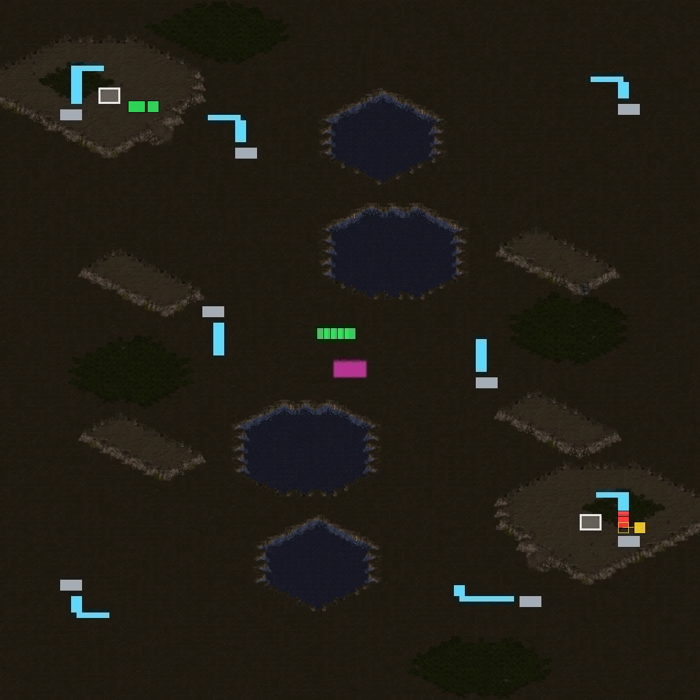

*`scmjs map diff before.scx after.scx --picture --out review.png --scale 8`: Marines and
buildings added (green), mineral fields removed (red) and one moved (yellow), and a patch
of ground changed (magenta).*

In the terminal the picture is drawn as `map preview` draws it, two pixels a character.
Without colour it is letters: `A` added, `R` removed, `M` moved or edited, `x` a changed
tile, `/` a tile only one map has, `#` a location.

```sh
scmjs map diff old.scx new.scx --picture
scmjs map diff --rev main maps/ridge.scx --picture --side-by-side --out review.png
```

`--out diff.png` writes a PNG at `--scale` pixels a tile (4 by default). `--side-by-side`
puts the first map, the changes and the second map in one picture, also in the terminal
when it is wide enough for three pictures of 32 columns; otherwise you get the changes
alone. `--json` adds what was drawn to the comparison: how many tiles, units and locations
changed, and the box of tiles round the changes.

Tiles are compared by position, so a map resized with its content moved shows every tile
as changed. Maps of two tilesets cannot be drawn as one picture: they are drawn side by
side with nothing marked, and the command says so. The exit code is the comparison's,
picture or not.

### A map's history

`scmjs map log` lists the commits that changed a map, newest first, and says under each
one what it changed in the map, in the words `map diff` would use:

```
$ scmjs map log maps/ridge.scx
maps/ridge.scx · 8 commits

d5587bc  2026-11-07 09:00  Jeany  Tidy the trigger order
         triggers reordered

dbf21a0  2026-11-06 14:00  Mina   Rename Middle to Ridge top
         1 location changed

daa8752  2026-11-06 08:30  Jeany  Say what to do
         description changed

d25740d  2026-11-05 13:10  Mina   Spread the minerals
         2 units moved, 1 removed

68033b5  2026-11-04 16:40  Mina   Room for a third base
         resized 64 × 64 → 96 × 96 · 1 location changed

d38a14e  2026-11-03 09:05  Jeany  Waves, and four marines to win
         3 triggers added, 1 changed · 3 strings added

55d0fd9  2026-11-02 11:20  Mina   Call it Ridge
         name changed

3927771  2026-11-01 10:00  Jeany  Start Ridge from the test scenario
         map added: 64 × 64 Badlands, 21 units, 4 locations, 3 triggers
```

Each commit is compared with the version before it. A trigger that was replaced in the
same place counts as changed. One that only moved in the list is not counted at all, and
when that is all a commit did, the entry says the triggers were reordered. A unit in a new
place with nothing else different has moved. A string that is a name (the map's, a
location's or a force's) is counted as a change to that name, not as a string as well. A
commit that saved the file again without changing the map says so. For the details of one
commit, `git show <commit>` shows its changes as text, once the map's text form is set up
as [Reading maps in git diff](#reading-maps-in-git-diff) describes.

`-n 5` shows the newest five commits. `--rev` takes what `map diff --rev` takes, and a
range as well. `--rev main..HEAD` lists what this branch did to the map. A merge is
compared with its first parent, so the entry shows what the merge brought in. `--json`
gives each commit's hash, parents, author, date, subject and the list of changes.

### Who last changed what

`scmjs map blame` is `git blame` for a map. Instead of a line of text, each row is a
trigger, a location, a string, a group of units or a setting, with the commit, author and
date that last changed it. With no option it shows the triggers, or the settings when the
map has no triggers:

```
$ scmjs map blame maps/ridge.scx
Triggers (6) · maps/ridge.scx
39277712 (Jeany 2026-11-01 1) Player 1: Always() → Display Text Message(Always Display, "Hold the ridge."); …
d38a14e1 (Jeany 2026-11-03 2) Player 1: Bring("Player 1", "Terran Marine", "Ridge top", At least, 4) → …
39277712 (Jeany 2026-11-01 3) Force 1: Switch("Alarm raised", set) → Victory()
d38a14e1 (Jeany 2026-11-03 4) Player 2: Elapsed Time(At least, 60) → Display Text Message(Always Display, …
d38a14e1 (Jeany 2026-11-03 5) Player 2: Elapsed Time(At least, 180) → Display Text Message(Always Display, …
d38a14e1 (Jeany 2026-11-03 6) Player 2: Elapsed Time(At least, 120) → Display Text Message(Always Display, …
```

`--locations`, `--strings`, `--units` and `--settings` show the other kinds, and can be
given together. Units get one row for each kind of unit and owner, and the row counts as
changed when one of them was added, removed, moved or edited. Settings are the name,
description, size, tileset and version, each player and force, the terrain, doodads and
sprites, the unit, upgrade and tech settings and availability, the switch names, the sound
list and each file in the archive.

```
$ scmjs map blame maps/ridge.scx --locations
Locations (4) · maps/ridge.scx
39277712 (Jeany 2026-11-01 Base     ) #0  192,1600–512,1856
39277712 (Jeany 2026-11-01 Nest     ) #1  1536,192–1856,512
dbf21a0c (Mina  2026-11-06 Ridge top) #2  896,896–1152,1152
68033b5d (Mina  2026-11-04 Anywhere ) #63  0,0–3072,3072
```

Things are matched between versions the way `map diff` matches them. Triggers and units
are matched by what they are, so moving a trigger up the list does not change it.
Locations and strings are matched by their number, and settings by name. A trigger's text
is a string, so editing what a trigger says changes the string, not the trigger, and
`--strings` shows who did that.

`--trigger 4` shows one trigger with its whole text and the commit's subject.
`--location "Ridge top"`, by name or by number, and `--string 16` do the same for a
location and a string.

Without `--rev` the map is read as it is on disk. What differs from the last commit is
marked as `git blame` marks it, with a hash of zeros:

```
$ scmjs map blame maps/ridge.scx --strings
…
00000000 (Not committed yet 2026-11-07 16) Hold the ridge.
```

`--rev HEAD~3` blames the map as that revision has it. `--rev v1.0..HEAD` looks only at
the commits since `v1.0`. Anything older is put on the commit at the start of the range,
with a `^` before its hash, as `git blame` does. Changes made on a branch and merged are
put on the branch's commit, not on the merge. `--json` gives every row with its commit.

Both commands work from any folder of the repository, read every version of the map from
git once, and stop with a message when the file is not in a repository or has not been
committed. Neither follows a map that was renamed, so the history starts at the commit
that gave the map its present name.

### Merging two versions of a map

When two people change copies of one map, `scmjs map merge` puts both sets of changes into
one map, the way `git merge` does for text files. It takes three files: the version both
started from (the *base*), yours (*ours*) and the other one (*theirs*):

```
$ scmjs map merge ridge-base.scx ridge.scx ridge-alex.scx
✔ ridge.scx merged: 3 changes from ours, 2 from theirs · written to ridge.scx
  Units      2 from ours
  Locations  1 from theirs
  Triggers   1 from ours, 1 from theirs
  Strings    1 string of theirs renumbered
```

Each part of the map is compared with the base on both sides. What only one side changed
is taken from that side, and what both changed the same way is taken once. What both
changed differently is looked at more closely, and is a conflict only where the two
changes are to the same thing:

| Part | Merged | A conflict when |
| --- | --- | --- |
| Terrain | Tile by tile (the isometric record and fog of war the same way) | Both changed the same tile differently; the tiles are listed as rectangles |
| Units, doodads, sprites | One by one. They have no names, so each is matched by its type, owner, place and properties. A unit removed and one of the same type and owner added within four tiles is one unit moved or edited | Both edited the same unit differently, or one side removed a unit the other edited |
| Locations | By number; the place, the elevation flags and the name each on their own | Both changed the same field of one location differently |
| Triggers, briefing | As an ordered list: triggers either side added are kept (both, when both added at one place), and triggers either side changed or removed are changed or removed | Both changed the same trigger differently, or one side removed a trigger the other changed |
| Players, forces, unit, upgrade and technology settings, unit properties, switch names, sounds | Field by field: one player's race, one unit's hit points, one force's name | Both changed the same field differently |
| Name, description, revision, text encoding | Each on its own | Both changed it differently |
| Size and tileset | When either side resized the map or changed its tileset, the terrain and everything on it come from that side | Both sides changed the terrain or what is on it, and one of them resized the map or changed its tileset |
| The archive's other files (sounds, scripts) | File by file | Both changed the same file differently |
| Sections the editor does not read | Section by section, compared as bytes | Both changed the same section |

Triggers are matched by what they say, with their text compared as text, so two maps that
number their strings differently still match the same trigger. A trigger names a location
by its number, so renaming a location on one side does not count as changing every trigger
that mentions it.

Strings follow what uses them. A string theirs changed in place keeps its number. A new
string of theirs keeps its number unless ours put another string there; then it takes a
free number, and the trigger, location or setting that uses it is changed to match. That
is the "renumbered" line above. Strings nothing in the map uses are merged by number.

Everything the merge did not change is written exactly as it was in your version, and the
file is written as yours was, compressed and encrypted the same way. When only one side
changed the map at all, that side's file is taken as it is.

The merged map is written over your version (the second file), as `git merge-file` does
and as git expects of a merge driver. `--out` writes it somewhere else, and `--out -` to
standard output. `--dry-run` says what would happen and writes nothing. `--json` gives
each part's changes, and each conflict with what the base, ours and theirs had.

### Conflicts

When both sides changed one thing differently, the command says what each side did, writes
nothing, and exits with 1:

```
$ scmjs map merge ridge-base.scx ridge.scx ridge-alex.scx
✖ ridge.scx: 1 conflict; nothing written
  Triggers  1 from ours, 1 from theirs

Conflicts
  Triggers · trigger 1 of the base
      base   Player 1: Always() → Display Text Message(Always Display, "Hold the line.")
      ours   Player 1: Always() → Display Text Message(Always Display, "Hold fast.")
      theirs Player 1: Always() → Display Text Message(Always Display, "Stand firm.")

Add --ours or --theirs to settle each with that side's version.
```

`--ours` or `--theirs` settles every conflict with that side's version and writes the map;
everything that did not conflict is still merged from both. The conflicts are listed
again, marked with the side taken. To settle some one way and some the other, merge with
one of them and change the rest in the editor afterwards.

### Merging in git

`scmjs init` makes `map merge` git's way of merging maps. To do it by hand, once in the
repository:

```sh
git config merge.scmjs.name "StarCraft maps, part by part (scmjs map merge)"
git config merge.scmjs.driver "scmjs map merge %O %A %B --out %A --name %P"
printf '*.scx merge=scmjs\n*.scm merge=scmjs\n*.chk merge=scmjs\n' >> .gitattributes
```

After that, `git merge`, `git pull` and `git rebase` merge maps that both branches
changed. A map with no conflicts is merged and git carries on. A map with a conflict stops
the merge as a text file would: git says
`CONFLICT (content): Merge conflict in ridge.scx`, the command's list says what clashed,
and the file is left as your version. Settle it by giving the map's name alone, which
reads the three versions git keeps during a merge, then carry on as usual:

```sh
scmjs map merge ridge.scx            # the conflicts again
scmjs map merge ridge.scx --theirs   # settled, and written over ridge.scx
git add ridge.scx
git commit
```

Without the setting, git cannot merge a map at all, and a map both branches changed is
always a conflict. As with `git diff`, git runs `scmjs` by name, so it has to be installed
for each clone.

The merge cannot lay one side's terrain over a map the other side resized, so both
changing the ground of a map one of them resized is a conflict over the whole map.
Triggers that a TrigScript script generates are merged as triggers; when both sides
changed the script, its files conflict, and the map should be built again with
`scmjs map build` once the script is settled. A built map is merged as the map it was
built from and written that way, so build it again after merging.

## Running a map in the game

These commands start the map in the game itself, the engine of the play page, with the
game's files from your copy of StarCraft ([what they
need](#commands-that-need-starcraft)). Nobody has to play: the game runs as fast as the
computer can run it. Or the players of a recorded game play it: `--replay` gives the game
the commands from a replay, so the game in a bug report can be traced and tested. A map in
the original StarCraft 1.00 form is run as Brood War, as the editor would convert it. The
Blizzard campaign maps are not something the engine runs yet. Each command exits with 2
when the game could not start.

### Which triggers fire

`scmjs map trace` starts the map as a Use Map Settings game, with your seat left idle and
the computers as the map sets them, runs it for a while, and records every condition the
game checks and every action it runs. The report has a line per trigger, with how often it
fired, when first and last, and whose it is. Then come the triggers that never fired, each
with the condition that last said no.

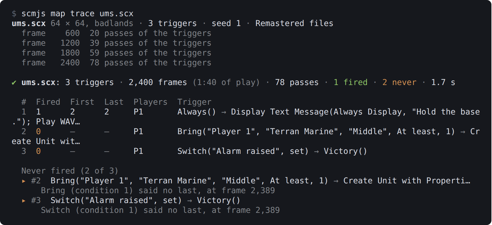

*`scmjs map trace ums.scx`. Nobody brings a Marine to the middle, so the trigger waiting
for one never fires.*

The game runs the triggers about every two seconds; each run is a pass, and a trigger that
fires on every pass is a preserved one. A count with `+n` after it is a trigger whose Wait
held it and then let it go on `n` times.

| Option | What it does |
| --- | --- |
| `--frames` | How long to run, at 24 frames a second. The default, 2,400, is 100 seconds of play; the game may end sooner if a trigger ends it |
| `--seed` | Fixes the game's luck, so the same map and seed give the same run |
| `--all` | Lists every trigger, when the map has more than forty |
| `--json` | The same, per trigger, as data |

Nobody plays, so nothing a player would do happens. A trigger waiting for a unit to be
brought somewhere will say so, which is the point.

### What the triggers cost

`scmjs map cost` runs the map the same way and weighs every trigger the game passes and
every condition and action it runs, as StarCraft: Remastered charges for them. The model
is the one TrigScript's editor uses, measured on the real game: a Deaths condition costs
about five nanoseconds, and the game stays smooth up to about fifteen milliseconds of
triggers a frame. The report says what a frame costs on average where triggers ran and at
most, how that compares with what a frame can carry, and which triggers cost the most:

```
✔ trigscript-frame-cost.scx: triggers cost 0.025 ms a frame on average where they ran (599 of 601 frames), 1.10 ms at the most (frame 2: 83,787 records, 53,192 triggers)
  Remastered on a fast computer: smooth to about 15 ms of triggers a frame, slows past 37 ms
  83,787 of the records ran in no trigger of the map — a program's own (TrigScript, eudplib), 1.10 ms in all
```

A TrigScript or eudplib program runs its own records through the EUD trigger chain rather
than through the map's trigger list. For such a map the cost is in the first lines, and
the triggers listed are only the ones that start the program. TrigScript's editor shows a
program's cost line by line.

### Triggers in a replay's game

When someone sends a replay of a game where the map went wrong, `--replay` plays that game
with the trace on. The players' own commands drive it, people and computers as they
played, to the end of the replay.

```sh
scmjs map trace --replay report.rep --order
```

The report is the one above, with two differences. The first and last firings are given on
the game's clock, `m:ss` at Fastest as the replay viewer counts it, and only the triggers
owned by the players in the game are listed. `--order` adds every firing in the order the
game ran them: the time, the frame, whose copy of the trigger it was, and the trigger.

```
$ scmjs map trace --replay 1631.rep --order
1631.rep 128 × 128, jungle · 4 players · 10:16 · 1,713 triggers (12 copies in the game) · Remastered files

✔ 1631.rep: 1,713 triggers (5 owned by the players) · 14,662 frames (10:16), Ever)Z(bOy won · 473 passes · 4 fired · 1 never · 6.2 s

  #     Fired  First  Last   Players      Trigger
  1709  2      0:00   0:00   P3 P4        Elapsed Time(At least, 0) → Set Resources("Current Player", S…
  1710  2      0:00   0:00   P5 P6        Always() → Run AI Script("Turn ON Shared Vision for Player 1"…
  1711  0      –      –      P3 P4        Command("Current Player", "Buildings", At most, 0) → Defeat()
  1712  1      10:13  10:13  P3 P4        Command("Non Allied Victory Players", "Buildings", At most, 0…
  1713  4      0:00   0:00   P3 P4 P5 P6  Elapsed Time(Exactly, 0) → Display Text Message(Always Displa…

  Never fired (1 of 5)
  ▸ #1711  Command("Current Player", "Buildings", At most, 0) → Defeat()
      Command (condition 1) said no last, at frame 14,634

  In the order they fired (9)
  Clock  Frame   Player          #      Trigger
  0:00   2       P3 ErOs_Class   #1709  Elapsed Time(At least, 0) → Set Resources("Current Player"…
  0:00   2       P3 ErOs_Class   #1713  Elapsed Time(Exactly, 0) → Display Text Message(Always Dis…
  0:00   2       P4 Ever)Z(bOy   #1709  Elapsed Time(At least, 0) → Set Resources("Current Player"…
  0:00   2       P4 Ever)Z(bOy   #1713  Elapsed Time(Exactly, 0) → Display Text Message(Always Dis…
  0:00   2       P5 ErOs_Kyoung  #1710  Always() → Run AI Script("Turn ON Shared Vision for Player…
  0:00   2       P5 ErOs_Kyoung  #1713  Elapsed Time(Exactly, 0) → Display Text Message(Always Dis…
  0:00   2       P6 iCoN`MisO    #1710  Always() → Run AI Script("Turn ON Shared Vision for Player…
  0:00   2       P6 iCoN`MisO    #1713  Elapsed Time(Exactly, 0) → Display Text Message(Always Dis…
  10:13  14,603  P4 Ever)Z(bOy   #1712  Command("Non Allied Victory Players", "Buildings", At most…
```

With no map named, the game is played on the map inside the replay. Name a map as well to
play the replay's commands on that map instead, such as the fixed version of the one in
the bug report:

```sh
scmjs map trace fixed.scx --replay report.rep
```

The command says first how the map differs from the one in the replay. A replay is only
the players' commands, so a changed map can make the game go out of step. When a unit a
player clicked is not there, or a building cannot be placed, the game plays on with
commands meant for another game. Changes to triggers alone usually keep it in step.
Changes to units, terrain or resources usually do not. The game checks each command
against what it has, and the report says when and where the game parted from the replay.
What fired before that point is what happened.

`scmjs map cost --replay` weighs the triggers of the replay's game in the same way.
`--frames` stops the game sooner. Left out, the whole replay is played. In a game that is
not Use Map Settings, the game runs its own melee triggers rather than the map's, and the
report says so.

### Testing a map's triggers

`scmjs map test` checks that a map's triggers do what you meant, in the game. You write
scenarios in a tests file: what the game starts with, what happens at given times, how
long to play, and what must be true at the end. Each scenario is one game. A scenario that
fails says what did not hold and what was there instead, and keeps the game's replay so
you can watch what happened.

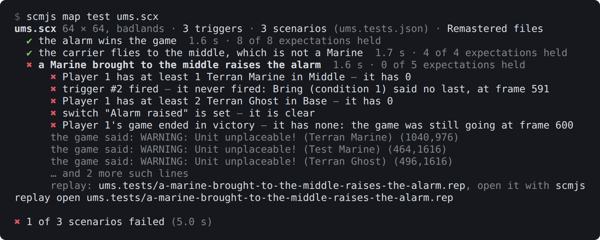

*`scmjs map test ums.scx`, with the tests file kept beside the test map.*

Here the third scenario found something real: the test map has no ground a Marine can
stand on, so the Marine never appeared and the trigger waiting for it never fired. That is
why a failed scenario lists the game's own warnings from its start.

### The tests file

The tests are read from `<map>.tests.json` beside the map (`ums.tests.json` for
`ums.scx`), or from the files named after the map on the command line. The file is JSON:

```json
{
  "scenarios": [
    {
      "name": "the alarm wins the game",
      "frames": "0:20",
      "steps": [
        { "at": 24, "chat": "glhf" },
        { "at": "0:02", "create": "Terran Wraith", "player": 1, "location": "Middle" },
        { "at": "0:05", "switch": "Alarm raised", "state": "set" }
      ],
      "expect": [
        { "trigger": "Opening", "fired": 1 },
        { "text": "Hold the base." },
        { "units": "Terran Wraith", "player": 1, "location": "Middle", "is": 1 },
        { "switch": "Alarm raised", "is": "set" },
        { "outcome": "victory", "player": 1 },
        { "ended": true }
      ]
    },
    {
      "name": "a Marine brought to the middle raises the alarm",
      "frames": "0:25",
      "setup": [
        { "create": "Terran Marine", "player": 1, "location": "Middle" }
      ],
      "expect": [
        { "trigger": 2 },
        { "switch": "Alarm raised", "is": "set" }
      ]
    }
  ]
}
```

A scenario has a `name`, and may have `frames`, `seed`, `setup`, `steps` and `expect`.
`frames` is how long to play: a number of frames, 24 to a second at Fastest, or `"m:ss"`;
2,400 unless the file or `--frames` says otherwise. `frames` and `seed` at the top of the
file apply to every scenario that does not set its own.

A scenario may name a `replay` instead of `setup` and `steps`. The replay's commands drive
the game, played on the map being tested, and the scenario plays to the replay's end
unless `frames` says otherwise:

```json
{
  "name": "the bunker fills at 7:30",
  "replay": "reports/bunker.rep",
  "expect": [
    { "trigger": "Bunker full", "fired": 1 },
    { "outcome": "victory", "player": 1 }
  ]
}
```

The path is relative to the tests file's folder. `seed` does nothing here, because the
game uses the replay's own. Such a scenario takes no `setup` or `steps`, since anything
added to the game would take it out of step with the replay. `scmjs map test record`
writes these scenarios for you ([below](#a-test-from-a-replay)).

Things are named as the trigger window names them:

| Thing | Written as |
| --- | --- |
| Player | A number from 1 to 12, or `"Player 1"`. Where a trigger would take a group, `"All Players"`, `"Force 1"`, `"Foes"` and `"Allies"` too |
| Unit | Its name (`"Terran Marine"`, or `"Marine"` when that is clear), a class (`"Any unit"`, `"Men"`, `"Buildings"`, `"Factories"`), or its number in units.dat |
| Location | Its name, `"Anywhere"`, or its number |
| Switch | Its name, `"Switch 3"`, or a number from 1 to 256 |
| Trigger | The number `scmjs map trace` prints for it, or the text of its Comment action |

A name the map does not have is an error that lists the names it does have.

`setup` is what the game starts with. Each entry does one thing:

| Entry | Does |
| --- | --- |
| `{ "create": unit, "player": p, "count": n, "location": l }` | Creates the units (one unless `count` says) |
| `{ "kill": unit, "player": p, "count": n, "location": l }` | Kills the units (all of them unless `count` says) |
| `{ "remove": unit, "player": p, "count": n, "location": l }` | Removes the units, as Remove Unit does |
| `{ "give": unit, "player": p, "to": q, "count": n, "location": l }` | Gives the units to player `q` |
| `{ "switch": s, "state": "set" }` | Sets the switch (`"clear"` and `"toggle"` too) |
| `{ "minerals": n, "player": p }`, `{ "gas": n, "player": p }` | Sets the player's minerals or gas; `"+100"` adds, `"-100"` takes away |
| `{ "deaths": unit, "player": p, "count": n }` | Sets the death count, with the same `+` and `-` |
| `{ "action": "Set Countdown Timer(Set To, 60)" }` | Any action, in the trigger window's text form; a list of them works too |

`location` is Anywhere when left out.

`steps` happen during the game. Each has `at`, a frame or `"m:ss"`, and one of the entries
above, or one of these, which are your own commands as a player would give them:

| Entry | Does |
| --- | --- |
| `{ "at": t, "order": "move", "unit": u, "location": l, "to": m }` | Orders your units of that type in location `l` to location `m`: `"move"`, `"attack"` (attack-move) or `"patrol"`; `"stop"` and `"hold"` need no `to`. `unit` is Any unit and `location` Anywhere when left out |
| `{ "at": t, "chat": "text" }` | Sends a chat line, which shows on screen like any other |

You play the map's first slot that is open to a person, as when you start the map alone,
and the computers play as the map sets them. Your commands reach the game at the frame
given. The other steps are carried out by the game's triggers, which run about every 31
frames (1.3 seconds), so they happen at the first pass after the game's clock reaches
their time.

`expect` is what must be true when the scenario ends:

| Entry | Holds when |
| --- | --- |
| `{ "trigger": t, "fired": n }` | The trigger fired that many times; `true` (the default) is at least once, `false` is never |
| `{ "switch": s, "is": "set" }` | The switch is set, or `"clear"` |
| `{ "deaths": unit, "player": p, "is": n }` | The player's death count for that unit |
| `{ "minerals": n, "player": p }`, `{ "gas": n, "player": p }` | The player's minerals or gas |
| `{ "units": unit, "player": p, "location": l, "is": n }` | How many of the units the player has there, counted as the Bring condition counts them (as Command counts them when there is no `location`; `player` is All Players when left out) |
| `{ "text": "words" }` | The words were on your screen at some point: trigger text, transmissions, chat. `"shown": false` for words that must not appear. In a replay's game, the screen is the replay viewer's |
| `{ "outcome": "victory", "player": p }` | The player's game ended in victory (`"defeat"`, `"draw"`, or `"none"` for no outcome yet) |
| `{ "ended": true }` | The game ended before the scenario's frames ran out (`false`: it was still going) |

A count is a number, meaning exactly that many, or a comparison such as `">= 2"`, `"< 5"`
or `"!= 0"`. The text shown and how often a trigger fired cover the whole game; everything
else is read when the scenario ends.

### How a test runs

The setup and the timed steps become triggers in a copy of the map. The setup is one
trigger placed before the map's own, owned by the first player in the game, with the
condition Always, so it runs first in the first pass. Each step is a trigger placed after
the map's own with an Elapsed Time condition. Your map file is not changed, and the
trigger numbers in the report are the map's own.

Because these triggers are part of the copy, the replay holds them. A failed scenario's
replay is kept in `<map>.tests/` beside the map (or where `--out` says) and plays back the
scenario exactly as it ran. `scmjs replay open` opens it in the editor, where the test's
own triggers show first and last among the map's.

| Option | What it does |
| --- | --- |
| `--seed` | The game's random seed for scenarios that do not set one; the same map, scenario and seed give the same game every time |
| `--frames` | How long to play, for scenarios and files that do not say |
| `--out` | Where the failed scenarios' replays go |
| `-u`, `--update` | For scenarios that play a replay: the expectations that no longer hold are rewritten to what the game gives now |
| `--json` | Every scenario with each expectation, whether it held and what the game had |
| `--format github`, `junit`, `sarif` | The failures in the forms CI tools read, as for [`map check`](#checking-a-map), each placed on the scenario's line in the tests file |

The command exits with 1 when a scenario fails, and with 2 when the tests file or the map
cannot be read or the game could not start. It needs the game, so it does not run on
GitHub's own runners; the workflow `scmjs init` writes leaves it out and says how to run
it on a runner of your own that has the game.

A test cannot yet have a player leave (you are the only person in the game) or give the
computers' own commands, except by playing a replay of a game where they did.

### A test from a replay

`scmjs map test record` turns a replay into a test. It plays the replay on the map, as
[`map trace --replay`](#triggers-in-a-replays-game) does, and writes a scenario into the
map's tests file with everything the game ended with as expectations:

```
$ scmjs map test record 1631.scx 1631.rep --name "2v2 to the end"
✔ Recorded "2v2 to the end" into 1631.tests.json · 14,662 frames (10:16) · 40 expectations · 6.5 s
  5 triggers, 1 line shown, 4 outcomes, 1 end, 8 unit counts, 4 minerals, 4 gas, 13 death counts
```

The scenario it wrote begins:

```json
{
  "name": "2v2 to the end",
  "replay": "1631.rep",
  "frames": 14662,
  "expect": [
    { "trigger": 1709, "fired": 2 },
    { "trigger": 1710, "fired": 2 },
    { "trigger": 1711, "fired": 0 },
    { "trigger": 1712, "fired": 1 },
    { "trigger": 1713, "fired": 4 },
    { "text": "ErOs_Class has left the game.", "shown": true },
    { "outcome": "defeat", "player": 3 },
    { "outcome": "victory", "player": 4 },
```

The expectations are a snapshot of the end of the game: how often each trigger the players
own fired (`0` for the ones that never did), the switches that are set and the named ones
that are clear, the lines shown that were not chat, each player's outcome, whether the
game ended, each player's men and buildings, minerals and gas, and every death count.
Triggers, switches and units are named as the map names them, where the map has a name for
them. Each expectation is one line of the file, so delete the lines you do not care about
and keep the ones the test is for.

| Option | What it does |
| --- | --- |
| `--name` | The scenario's name; the replay's file name by default. A scenario with that name is replaced |
| `--tests` | The tests file to write into; `<map>.tests.json` beside the map by default, made if it is not there |
| `--frames` | How much of the replay to play; all of it by default |
| `--json` | The scenario as written, with the game's end |

From then on `scmjs map test` plays the replay against the map as it is now. After a
change you meant to make, `scmjs map test map.scx -u` rewrites the expectations of
replay-driven scenarios that no longer hold to what the game gives now. Only the values
change. The expectations you deleted stay deleted, and a comparison such as `">= 3"` that
still holds is left alone. Scenarios with steps are never rewritten. If the map changed so
much that the game parted from the replay, the report says when, as `map trace --replay`
does.

### Which triggers fired across many games

`scmjs map coverage` plays a folder of replays on the map, each as
[`map trace --replay`](#triggers-in-a-replays-game) plays one, and adds up what fired. It
answers whether a trigger ever fires when people play the map. A trigger that never fired
in any of the games is either one nobody reaches or one that is broken, so those are
listed clearly.

```sh
scmjs map coverage td.scx replays/
```

Replays are files or folders, sub-folders included. Only replays of this map count: the
same map, or one with the same name and size, as for
[`map heatmap`](#where-things-happened-across-many-games). Only Use Map Settings games
count too, since in the other game types the game runs its own melee triggers. Every
replay left out is listed with the reason. Several games are played at once: half the
processors, at most four, or `--parallel`.

```
$ scmjs map coverage fs.scx replays/ --force
fs.scx · 4 triggers · 6 replays to play, 4 at a time
1/6 ▲ 1570.rep  25:24 · 6 players · 2 triggers fired · parted at 0:00, counted to there · 6.6 s
2/6 ▲ 1571.rep  31:59 · 6 players · 2 triggers fired · parted at 0:00, counted to there · 7.3 s
3/6 ▲ 1544.rep  49:11 · 4 players · 2 triggers fired · parted at 1:46, counted to there · 10.7 s
4/6 ▲ 1631.rep  10:16 · 4 players · 2 triggers fired · parted at 0:34, counted to there · 5.5 s
5/6 ▲ 1635.rep  37:42 · 3 players · 2 triggers fired · parted at 0:00, counted to there · 8.1 s
6/6 ✔ 1603.rep  34:08 · 4 players · 3 triggers fired · 30.5 s

▲ fs.scx: 3 of 4 triggers fired in 6 games; 1 never fired
▲ 5 games parted from the map: 1544.rep at 1:46, 1570.rep at 0:00, 1571.rep at 0:00 and 2 more. What fired after that is not counted: the players' commands were meant for another game.

  #  Games  Fired  First  Players            Trigger
  1  6/6    12     0:00   P1 P2 P3 P4        (no conditions) → Set Resources("Current Player", Set To, …
  2  6/6    15     0:00   P3 P4 P5 P6 P7 P8  (no conditions) → Run AI Script("Turn ON Shared Vision for…
  3  0/6    0      –      P1 P2 P3 P4        Command("Current Player", "Buildings", At most, 0) → Defea…
  4  1/6    1      34:06  P1 P2 P3 P4        Command("Non Allied Victory Players", "Buildings", At most…

  Never fired (1 of 4)
  ▸ #3  Command("Current Player", "Buildings", At most, 0) → Defeat()
      Command (condition 1) said no last, in 1603.rep at 34:08
```

*`--force` took replays played on other maps, so five of the six games parted from this
one early. Only the last game ran this map as it was played.*

For each trigger the table gives the games it fired in, how often it fired in all of them,
and its first firing on the game's clock. Only triggers owned by a player in at least one
of the games are listed. The first line counts the rest separately, and `--all` lists them
too. A game whose players' commands parted from the map, as [explained
above](#triggers-in-a-replays-game), counts only what fired before that point, and is
marked ▲.

`--tests` counts the scenarios of the map's [tests file](#testing-a-maps-triggers) as
games as well, and a tests file named among the replays (any `.json`) counts its
scenarios. Whether a scenario passes does not matter here; that is `map test`'s job.

| Option | What it does |
| --- | --- |
| `--tests` | Also count the games of `<map>.tests.json` beside the map |
| `--strict` | Exits with 1 when a trigger a player owned never fired |
| `--format` | `github`, `junit` or `sarif`: the triggers that never fired, for CI. Warnings, or errors with `--strict`, and a note for each game that parted |
| `--all` | Lists every trigger, even ones no player in the games owned |
| `--force` | Takes replays played on another map too. Expect those games to part early |
| `--parallel` | Games played at once |
| `--json` | Every game, every trigger with its counts, its text and why it never fired |

Each replay takes about a second for every minute or two of play, so a folder of a hundred
games takes a few minutes. Like the other commands that run the game, it needs your copy
of StarCraft, so in CI it runs only on a machine that has one.

### Rush distances

`scmjs map rush` measures how long a rush takes between each pair of start locations. The
game walks a unit from each start location to every other, along the path a unit sent
there in a game would take, and times each walk. An SCV walks unless you name another unit
with `--unit`: by its name in the editor (`"Zerg Zergling"`), without the race
(`Zergling`, `Dragoon`), or by its number in units.dat. The rows of the table are the
starts walked from and the columns the starts walked to, each with its place on the map as
a clock face from the middle:

```
$ scmjs map rush "(4)Crossing.scx" --unit Zergling
(4)Crossing.scx 128 × 128, desert · 4 start locations · a Zergling walked 12 times · Remastered files
  1 → 2  4,376 px, 34.6 s
  …

✔ (4)Crossing.scx: a Zergling walked between 4 start locations by the game · 12 walks · 3.4 s

  from ╲ to                    1                 2                 3                 4
  1 11 o'clock                 –  4,376 px, 34.6 s  2,957 px, 23.5 s  3,826 px, 30.5 s
  2 4 o'clock   4,408 px, 34.9 s                 –  3,847 px, 30.9 s  2,871 px, 22.3 s
  3 1 o'clock   2,858 px, 22.7 s  3,847 px, 30.9 s                 –  4,535 px, 36.4 s
  4 8 o'clock   3,857 px, 30.7 s  2,937 px, 23.1 s  4,576 px, 36.8 s                 –

  Shortest 2 → 4: 2,871 px (90 tiles), 22.3 s · air 2,816 px, 1.02× the straight line
  Longest  4 → 3: 4,576 px (143 tiles), 36.8 s · air 3,806 px, 1.20× the straight line
```

The pixels are the distance the unit walked (32 to a tile) and the seconds are game time
at Fastest. The unit sets out five tiles from its start toward the middle of the map and
stops at the edge of the town hall at the other start: a neutral Nexus stands on every
start while the walks run, so the walk ends where a real rush ends, at the base. The two
directions between a pair can differ by a second or so, because the way out of each base
is not the same. The shortest and longest walks are compared with the straight line
between the two starts, the distance a flyer goes. When the terminal is too narrow for
both figures, the seconds and the pixels come as two tables.

A walk that does not arrive is a finding too. Two starts with no ground between them, on
an island map or where the terrain walls one off, are reported as having no way; on a map
where no two starts are joined, the report says so and lists the straight lines instead. A
unit that stops short (at a wall of minerals or buildings the map places, say), gets
stuck, or is still walking after seven minutes of game time is named with how far from the
base it ended.

The walks run in one game with nobody else in it: about four seconds for a four-player map
and fifteen for an eight-player map of 256 × 256. `--seed` changes the game's luck, such
as a unit stepping round another; the default is the one the editor's Walkability plugin
uses, so the two agree. `--json` gives every walk and the table as data. A building or a
flyer is refused (exit 2), as is a map with fewer than two start locations.

### Is the map fair to every start

`scmjs map balance` is a melee map's report card. The same two sides play game after game
on the map, and the report has a row for each start location: how often the side that
started there won, how long its games lasted and how soon it met the enemy, beside the
numbers that need no game. The sides are your [bots](#bots): one bot plays the game's own
computer, or two bots play each other, as [`bot ladder`](#a-ladder-for-bots) plays them.

```sh
scmjs map balance "(4)Crossing.scx" --bots out/mybot.scmbot:p --races p --games 12 --parallel 4
scmjs map balance "(4)Crossing.scx" --bots mybot.scmbot,mybot.scmbot --games 12
```

```
$ scmjs map balance "(4)Test4.scx" --bots ualbertabot.scmbot:p,ualbertabot.scmbot:p --games 12 --parallel 4
12 games · UAlbertaBot vs UAlbertaBot (ualbertabot-2) · 4 start locations · 1248410ad2a0 · 4 at once
 2/12 ✔ UAlbertaBot (ualbertabot-2) P (start 4, 8 o'clock) beat UAlbertaBot P (start 3, 1 o'clock) · 9:39 · first contact 2:32 · seed 2
 …

(4)Test4.scx 128 × 128 · 12 games played · UAlbertaBot 8-4 vs UAlbertaBot (ualbertabot-2) 4-8 · 176 s

  Start              Games  Won  Lost  Win rate  Expected  Length  Contact  Rush    Minerals           Gas
  1      11 o'clock  8      1    7     13%       50%       8:10    2:22     32.0 s  9 × 1,500 · 6.4 t  1 × 5,000 · 7.8 t
  2      4 o'clock   3      2    1     67%       33%       11:05   2:16     32.7 s  9 × 1,500 · 6.4 t  1 × 5,000 · 7.8 t
  3      1 o'clock   9      7    2     78%       59%       7:40    2:26     32.0 s  9 × 1,500 · 6.4 t  1 × 5,000 · 7.8 t
  4      8 o'clock   4      2    2     50%       42%       9:13    2:27     32.8 s  9 × 1,500 · 6.4 t  1 × 5,000 · 7.8 t

  Pairs met: 1–2 ×3, 1–3 ×5, 3–4 ×4 · never: 1–4, 2–3, 2–4

▲ Start 1 (11 o'clock) wins only 13% where 50% was expected — its resources and distances are within 10% of the others', so the difference is in the ground or in how the games went.
```

The map above was made by `map generate` with its four quarters mirrored, so its starts
differ only in where they face. Twelve games of one bot against itself are enough to see
that this bot does worse from the top left; they are not enough to say why. A verdict to
act on wants more games, and more than one bot.

| Column | Means |
| --- | --- |
| Games, Won, Lost | The games a side started at this start location, and how they went. A game stopped at `--frames` is counted in Games only |
| Win rate | Won out of won and lost |
| Expected | What the two sides' own records predict for those games. With two sides of a strength it is 50%; when one side is stronger, a start it was dealt more often is expected to win more |
| Length, Contact | The average game, and the average time the first unit was lost to the other side |
| Rush | The average walk to the other starts, as [`map rush`](#rush-distances) measures it; `--no-rush` leaves it out |
| Minerals, Gas | The main's fields and geysers: those nearest this start and within 12 tiles of it, the amount each holds and their average distance in tiles |

The verdict compares each start's win rate with what was expected. Within 10 points
everywhere, the map is called balanced within the largest difference. A start further off
is named, with the number that sets it apart from the others when one does (less gas, a
mineral line further away, shorter walks to the enemy, earlier fights). When the games are
too few to tell the difference from chance, the verdict says so and how far chance alone
would move that start. When one side won every game, the games say nothing about the
starts, and the verdict asks for two sides of a strength: the same bot twice does that.

The game deals the start locations itself, as it does in any melee game, and there is no
way yet to ask for a particular one. So each game's replay is played back afterwards to
see which start each side was dealt, and the rows are filled from those. Enough games give
every start its turn; the line under the table lists the pairs of starts that met and
those that never did. A bot playing itself plays each seed once, since the other lobby
order deals the same starts and gives nearly the same game.

A game takes from ten seconds to a minute or so, depending on the bots and how long it
lasts; `--parallel` plays several at once (by default up to four, as the computer's cores
and memory allow; a game takes about 1.5 GB for each bot in it). The replays are deleted
afterwards unless `--out` names a folder to keep them in, for `scmjs replay watch`.
`--json` gives every row, every game with the starts dealt, and the verdict as data. The
command exits with 1 when a game could not be played, and with 2 for a map with fewer than
two start locations.

## Replays

`scmjs replay` reads replays from any version, from 1.16 to Remastered. To see which of
the map's triggers fired in a replay, and when, see [Triggers in a replay's
game](#triggers-in-a-replays-game). To make a test from one, see [A test from a
replay](#a-test-from-a-replay).

### What a replay holds

`scmjs replay info` (or `scmjs info`) shows the players in their colours with race, APM
and team, the map, the game's length and speed, when it was played, and how much chat
there was. APM is counted the way the replay viewer counts it: every action except chat,
until the player left.

```
$ scmjs replay info ualbertabot-vs-computer-z_jungle-duel_PvZ_seed1.rep
UAlbertaBot vs Garm Brood  PvZ
Melee on (2)Jungle Duel

  Length       5:02 · 7,180 frames · Fastest
  Played       1969-12-31 17:00
  Map          (2)Jungle Duel · 128 × 128 · Jungle World
  Game         oracle hosted by UAlbertaBot
  Recorded by  Brood War · 1.16 or earlier
  File         ualbertabot-vs-computer-z_jungle-duel_PvZ_seed1.rep · 179 KB

  Players
    UAlbertaBot  Protoss  129 APM   team 1
    Garm Brood   Zerg     computer  team 2
```

That replay is from a [bot ladder](#a-ladder-for-bots), whose replays carry the game's
seed where a real game has its start time, so the date is the first of January 1970 (or
the last day of 1969, west of Greenwich).

### The map a replay was played on

`scmjs replay map game.rep` writes out the map the replay was played on. A replay carries
the whole scenario the game loaded, so the map is there whether or not you still have the
file. It goes beside the replay with the replay's name and `.scx`, or to `--out`, as a
bare `.chk` or as an archive like a new map's, and opens in the editor like any map. Only
the scenario is in a replay, not the map's sounds or other files, so Check Map may say a
sound is missing. `--out -` writes it to a pipe:

```sh
scmjs replay map game.rep --out - | scmjs map info -
```

### Watching a replay in the terminal

`scmjs replay watch game.rep` plays the replay in the terminal. The game is the play
page's engine, which plays the replay as the game itself does. You see a minimap redrawn
as the game goes: a dot for every unit in its player's colour, buildings as blocks,
mineral fields and geysers dim, and the ground shaded where the terminal has 24-bit
colour. Under it are the clock and frame, a line per player with minerals, gas, supply,
units alive and APM so far, and the last three lines of chat.

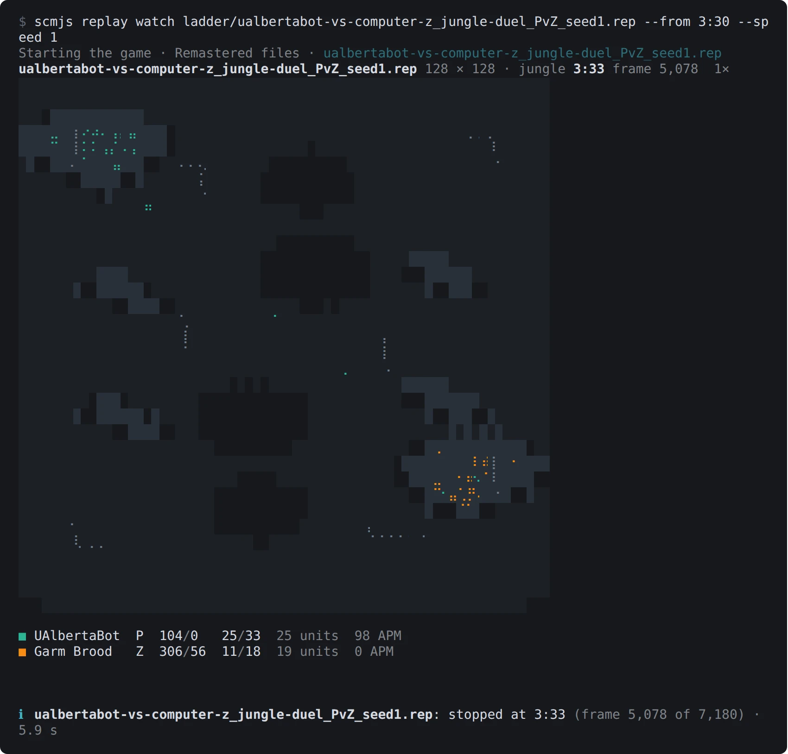

*`scmjs replay watch` on a replay from a bot ladder, stopped at 3:33.*

Space pauses, `+` and `-` double and halve the speed, and `q` stops and leaves the last
picture on screen.

| Option | What it does |
| --- | --- |
| `--speed 4` | Plays at four times the game's Fastest; the default is 8. The engine plays a ten-minute game in a few seconds, so any speed holds |
| `--from 6:30` | Starts there |
| `--size 80x30` | The picture's size in characters; by default it fills as much of the terminal as the map's shape allows |
| `--every` | The frames between lines when the output is not a terminal |
| `--json` | A line of JSON per frame with every unit's place, for a script or a plot |

Into a pipe or a file there is no picture: a line per player every minute of game, with
the chat between them. The players' names, colours, chat and APM come from the replay
file, read as `replay info` reads it; the figures and the picture come from the game.

A player who leaves shows as `left at 10:05` on their line from then on, instead of the
zeros the game keeps for them. When the replay has played to its end, the last line says
who won (`Question won`), or that the game ended at the replay's end when nobody had won
by then. A replay from any version plays, except one from a game that held more units at
once than 1.16.1 allows, which is refused as the play page refuses it. It needs [your copy
of StarCraft and the engine](#commands-that-need-starcraft).

### Where things happened across many games

`scmjs map heatmap map.scx replays/` plays every replay on that map in the game and draws
where things happened as heat over the map's picture. By default that is where units died.
It can also be where units were killed, where buildings went up, or where the armies
walked. Name the replays one by one or give folders, and the `.rep` files in a folder are
taken.

```sh
scmjs map heatmap "Fighting Spirit.scx" replays/
scmjs map heatmap fs.scx replays/ --what buildings --out buildings.png
scmjs map heatmap fs.scx replays/*.rep --what kills --player 1 --until 10:00
```

Only replays played on this map count. A replay carries the map the game loaded, so the
replay counts when that is the same map as the file, or a map with the same name and size,
such as an earlier version of it. The others are listed as left out, with the map they
were played on, and `--force` takes them anyway.
[`replay map`](#the-map-a-replay-was-played-on) gets you the map from one of the replays
when you do not have the file.

Each replay is played to its end, as [`replay watch`](#watching-a-replay-in-the-terminal)
plays it, a few at once. A line reports each one as it is done, with its races, its length
and what it gave. A 35-minute game takes about 25 seconds. What each replay gave is kept
in your cache folder, keyed by the replay's contents, so the next run plays only the
replays it has not seen. Changing `--what`, `--player` or `--until` needs nothing played
again.

| Option | What it does |
| --- | --- |
| `--what deaths` | Where units died (the default). Every unit the game counts as killed, placed where it last stood, except a Reaver's Scarabs and spells running out |
| `--what kills` | The same places, counted for the player who killed the unit; deaths with no killer are left out |
| `--what buildings` | Where buildings were placed, a Drone's buildings and refineries on geysers included; what stood at the start is not |
| `--what paths` | Where the armies walked: every second, each army unit that has moved to another tile. Workers are left out, or their mining would outshine everything |
| `--player 2` | One player's events, by number as the map's slots count them, or by name as the replays have it (`--player Flash`). For kills, that is the killer |
| `--until 8:00` | Only what happened by then in each game |
| `--out heat.png` | Writes a PNG at `--scale` pixels per tile, 4 by default, as `map preview` does. `--out -` writes it to standard output |
| `--side-by-side` | The map as `map preview` draws it beside the heat |
| `--parallel 2` | How many replays are played at once: half your processors by default, at most 4. Each takes about 750 MB of memory |
| `--json` | The counts per tile, the busiest first, and per unit type, with the replays taken and left out |

The ground is drawn in grey so that no colour of the tileset reads as heat, with the
mineral fields and geysers in grey too and the start locations framed in white. The heat
spreads each event over a tile or two and goes from dark violet where little happened to
pale yellow where the most did. Under the picture are the count, the busiest tile and the
units most counted. The terminal draws it as `map preview` does, and `--width` sets its
columns.

A replay the game cannot play is listed with the reason, and the others still count. The
command then exits with 1. It needs [your copy of StarCraft and the
engine](#commands-that-need-starcraft).

### A video or GIF of a replay

`scmjs replay export game.rep` makes a video of the replay with the game's own pictures,
to share where nobody has the game, such as a Discord channel, a forum post or a web page.
The play page's replay viewer draws it in a browser already on your computer, Chrome,
Chromium or Edge started without a window, with the pictures from your own copy of
StarCraft.

```sh
scmjs replay export game.rep --from 14:00 --to 14:30           # game.webm beside the replay
scmjs replay export game.rep --out fight.mp4 --follow 2 --from 20:30 --to 20:58
scmjs replay export game.rep --out game.gif --all --speed 16 --to 6:00
```

The game is stepped picture by picture rather than played and filmed, so the clip plays at
the speed you ask whatever your computer's pace, with no picture dropped. A 720p clip
takes about as long to make as it lasts, less for a quiet part of the game and more for a
big fight. Before that, the game has to run on to `--from`, which takes about twenty
seconds to reach twenty minutes into a game.

| Option | What it does |
| --- | --- |
| `--out clip.webm` | The file: `.webm`, `.mp4` or `.gif`. By default the replay's name with `.webm`, beside it |
| `--from 4:30`, `--to 5:00` | Where the clip starts and ends in the game; the whole game by default |
| `--follow <player>` | The camera stays on that player's play. Name them, give the start of the name, or a number as `replay info` lists the players. The first person in the replay by default |
| `--at 64,40` | The camera holds on this tile |
| `--all` | The whole map, scaled to fit |
| `--speed 4` | Four times the game's Fastest. The default is 1, the game's own pace |
| `--size 1920x1080` | The clip's size in pixels: 1280x720 by default, 640x360 for a GIF |
| `--fps 30` | Pictures per second, 24 by default and 12 for a GIF. A GIF counts in hundredths of a second, so 12 becomes 12.5 |
| `--browser <path>` | The browser to draw with, or the `SCMJS_BROWSER` setting. Otherwise one is found in the usual places |
| `--json` | The file, its size and the time each part took, as JSON |

Following a player, the camera goes where their army is, and to the biggest fight the army
is in. To know that, the engine runs the game through first and reports every unit, as it
does for `replay watch`. The camera holds still while what it shows stays near the middle
of the screen, pans to a place within reach, cuts to one further away, and does not chase
a lone scout. The view shows as much of the map as the game's own screen does, at a whole
number of pixels for each of the game's, two at 720p, so the pictures stay sharp.

A `.webm` (VP9) or a `.gif` needs nothing more. An `.mp4` (H.264) is made from the `.webm`
with [ffmpeg](https://ffmpeg.org/download.html) when it is installed. Without it the
command says so and makes nothing. The GIF is made from the pictures as drawn, each with a
palette of its own, which keeps the game's colours exact. A GIF of a camera that moves is
large, so keep it short: eight seconds of a fight at 640x360 is about 12 MB. A 30-second
720p `.webm` is about 8 to 10 MB. Progress is shown as it goes, and the file's name and
size are printed at the end.

The pictures are the classic game's, whichever copy you have. Remastered's own pictures
are not drawn yet, and there is no sound. Besides your copy of StarCraft, the command
needs [the engine](#commands-that-need-starcraft) and the play page itself, both fetched
once from scmjs.dev and kept.

### Opening a replay in scmJS

`scmjs replay open game.rep` opens the replay in the replay viewer of the scmJS desktop
app, or of the editor in your browser when the app is not installed, the same way
[`map open`](#opening-a-map-in-scmjs) opens a map.

`scmjs replay share` gives a link that anyone opens to watch the replay: see [Sharing from
the terminal](#a-link-to-a-replay).

## Mods

A mod is the game with other data: other tables, animation scripts, pictures, sounds,
strings and AI. `scmjs mod` reads a mod as its makers ship it, unpacks it into a folder of
text and pictures to edit and keep in git, checks it, compares two versions, packs it back
into the MPQ the launchers load and hands it to the play page. The [mods guide](mods.md)
has the folder's form and how it works with PyMS, MPQDraft, FireGraft and samase; this
section is the commands.

### What a mod holds

```sh
scmjs mod info "Cosmonarchy BW"
scmjs mod info MyMod.mpq "My Mod.exe" mymod.zip
```

says what a mod is: its files and their sizes by kind, its tables and which are wider than
the game's (DatExtend's expanded `.dat`, GPTP's `.datex`), its scripts, the plugins and
FireGraft files it carries (kept, never run), a self-executing exe's archive and the game
it is for. It reads a folder (the game's paths at its root or a folder down), an `.mpq`, a
self-executing `.exe` (MPQDraft's or FireGraft's patcher, read and never run) or a `.zip`.
`--json` prints the same as data.

### A mod as a folder of text

```sh
scmjs mod unpack MyMod.mpq mymod
scmjs mod pack mymod -o MyMod.mpq
```

`mod unpack` writes the tables as PyDAT's text, the string tables, iscript and AI as
PyMS's text, the GRPs as PNG sheets (the units' sprite sheets and the uncompressed GRPs of
the dialogs, score screens and icons alike) and the rest as they are, and `mod.json`. A
file is written as text or a picture only when that packs back into the same bytes;
anything else stays as it is under `files/`, and `mod.json` says which and why. `mod pack`
puts the folder back into an MPQ (`--compression zlib`, `pkware` or `none`), or with
`--folder <out>` into loose files in the game's paths. The same folder gives the same MPQ
every time. `scmjs mod new
<folder>` starts an empty one.

### Checking and comparing mods

```sh
scmjs mod check mymod
scmjs mod diff mymod
scmjs mod diff v1.mpq mymod
scmjs mod build mymod -o MyMod.mpq
```

`mod check` looks across the tables for what makes the game stop or draw nothing (a
reference past its table, an image with no GRP, an image whose animation script is
missing, a string past its table, a button set or requirement for something not there) and
for what is probably a mistake (a weapon the mod added that no unit carries, a sound row
with no file, units with one name). It exits 1 on an error. `mod diff` reads as a
changelog, "Terran Marine: ground weapon damage 6 → 7", against your copy of the game when
given one mod. `mod build` checks, then packs, and stops on an error unless `--force`.

These commands read your copy of StarCraft when they find one, as the [commands that need
StarCraft](#commands-that-need-starcraft) do, for the game's own files under the mod; they
work without it and say what they could not look at.

### Playing a mod on the play page

```sh
scmjs mod play mymod
scmjs mod play MyMod.mpq --map "(2)Ridge.scx"
```

opens scmjs.dev/play in your browser and hands it the mod's files that differ from your
copy of the game (all of them when none is found here). Nothing is uploaded: the page
keeps the mod in your browser. The play page's support for mods arrives with its next
release.

The hand-over is the one `map play` uses: the command serves a page on 127.0.0.1, which
opens the play page with `?handoff=1` and, each time that page says `scmjs.ready` or
`scmjs.play.ready`, posts it:

```js
{
  type: "scmjs.play",
  dataSet: {
    name: "My Mod",
    hash: "3f9a0c2e5b7d1146",          // 16 hex digits
    files: [{ path: "arr/weapons.dat", file: File }, …],
  },
  map: Uint8Array,                      // with --map: the map's bytes
  name: "(2)Ridge.scx",                 // and its file name
}
```

`path` is the game's path in lower case with forward slashes. `hash` is SHA-256 over a
line `path<TAB>sha256 of the file` for each file handed over, the game's names with
backslashes, sorted and joined with newlines; its first sixteen hex digits. A page that
already keeps a mod with that hash can skip storing it again. The editor records the same
hash for a data set made from the same files (see [Game
data](game-data.md#a-map-remembers-its-data-set)). The page answers with
`scmjs.play.started`, `scmjs.play.shown` or `scmjs.taken`, which end the wait, or
`scmjs.play.error` with a `message`, which the command prints before it exits 1;
`scmjs.waiting` messages are printed as they come. The command waits five minutes.

### A mod in the game engine

```sh
scmjs mod test mymod ridge.scx
scmjs map test ridge.scx --mod mymod
scmjs map trace ridge.scx --mod MyMod.mpq
```

`mod test` is `map test` with the mod's files laid over the game's; `map test`,
`map trace` and `map cost` take `--mod`. The engine's runners take a mod from the play
page's next release; with an engine from before, the command names the version it needs
and stops.

A mod that changes animation scripts, pictures, overlays or the sound table makes the game
read its startup data again before the game starts, and that opens every unit picture and
overlay the image table names. With StarCraft: Remastered, the command reads those
pictures out of your installation and lays them under the mod for the game, so such a mod
runs on a Remastered copy as on a 1.16.1 one. They are the classic pictures, the same in
both. The first line under the run says how many of the mod's files the game read and
whether the startup data was read again without a missing file; `--json` has the same
under `mod`.

## Sharing from the terminal

These commands use your [scmjs.dev account](guide.md#your-scmjsdev-account). Nothing else
in `scmjs` talks to scmjs.dev.

### Signing in

`scmjs login` opens a page in your browser, which opens Discord's sign-in as the editor
does (`--provider google` or `battlenet` for the others). The command says who signed in
once you have approved it. It waits two minutes. With `BROWSER=none` it prints the page's
address for you to open.

The session is kept in a file only you can read: `~/.config/scmjs/session.json`, or
`%APPDATA%\scmjs\session.json` on Windows. `scmjs logout` ends the session on scmjs.dev
and deletes the file.

`scmjs account` (or `scmjs account show`) says who you are signed in as, how much of your
storage is in use, and the maps you are sharing for editing with their links, each also as
a QR code with `--qr`. `--json` prints it as JSON. `scmjs account login` and
`scmjs account logout` are the same as `scmjs login` and `scmjs logout`.

When scmjs.dev refuses something, for instance because your storage is full or you are
sharing too many maps at once, the command shows scmjs.dev's own message. Until you sign
in, the sharing commands say "Sign in first: scmjs login" and exit with 2.

### A link to a map

`scmjs map share ridge.scx` does what the editor's **Account ▸ Copy Link to This Map…**
does, from the file: the map is saved to your scmjs.dev account and you get a link anyone
can open a copy of it with, in their own editor and without signing in. The copy is
theirs; nothing they do changes yours. The user guide's [Giving someone a
copy](guide.md#giving-someone-a-copy) says more about such links.

```
$ scmjs map share ridge.scx
https://scmjs.dev/editor/map/sJ5Z3w12SFSoLCD6zej-b46a
Ridge · 128 × 128 · 61 KB · revision 1, a new map on your account
Anyone with the link opens a copy in their editor, without signing in.
```

The link is the first line on its own, so `scmjs map share ridge.scx | head -1` is just
the link. When your account already has a map with the same file name, the file is saved
as its next revision and the line says which; `--new` makes a new map anyway. Sharing a
file that is already on the account unchanged stores nothing and gives the link it had.
The link opens the revision you shared, so a link you have posted does not change when you
share the map again.

| Option | What it does |
| --- | --- |
| `--name` | The map's name on your account (the scenario's name otherwise) |
| `--note` | The revision's note |
| `--new` | A new map on the account, even when one has this file name |
| `--qr` | A [QR code](#qr-codes) of the link under it |
| `--no-picture` | No picture for the link's card |

With a copy of StarCraft on the computer, as for `map preview`, the command draws the
map's picture for the link's card; without one the map goes up without a picture and the
card shows its size instead. `-` as the map reads it from a pipe. Account ▸ My Maps… in
the editor lists the map with its revisions and links, and removes them.

### Editing a map together

`--edit` makes a link to edit the map together instead, as **Account ▸ Share this Map…**
does: whoever opens it edits the same map with you, each in their own editor (see the user
guide's [Editing a map together](guide.md#editing-a-map-together)). It stays open until
everyone has left, and closes after a while if nobody comes. `--keep day`, `week`, `month`
or `forever` keeps it open that long after its last edit, saved on your account as a map
of its own, or as the next revision of the one with the same file name, as the Share
dialog's *Keep it open* does.

```
$ scmjs map share ridge.scx --edit --keep week
https://scmjs.dev/editor/share/49vlCkKoYvMJGzIah5I0Vo_y
Ridge · 128 × 128 · 61 KB · shared for editing, kept open for a week after its last edit, stored on your account
Anyone with the link edits the map with you in their editor, without signing in.
```

### A link to a replay

`scmjs replay share game.rep` stores the replay on your account (My Maps ▸ Replays; up to
8 MB each, counted with your maps) and prints `https://scmjs.dev/editor/replay/<token>`.
Anyone opens that link to watch the replay in the editor's replay viewer, and where links
get a card, it shows the map and the players. The map's picture on the card is drawn from
the map in the replay when your copy of the game is on the computer. `--note` adds a note,
`--no-picture` leaves the picture out, and `--qr` draws a QR code. The same replay shared
again gives the link it already has.

### A game with other people

`scmjs map play ridge.scx` opens scmjs.dev/play in your browser with the map and asks it
for a lobby. The page hosts the game, as when you press Invite Players there, and the
command prints the invite link for you to send around:

```
ℹ Opening ridge.scx in the play page in your browser
✔ Lobby open: send this link to the people you want to play with
  https://scmjs.dev/play/?game=invite1x4hunfg
✔ Handed to the play page
```

Opening a lobby needs a scmjs.dev account, so the page asks you to sign in when you are
not, and opens the lobby once you have. The first time, it asks for the game's files too,
as the play page always does. The people you send the link to need their own StarCraft
files and no account. The command waits up to five minutes for the page. `--json` prints
the link, the invite code and what the page said on the way, and `--qr` draws a QR code.

### QR codes

`--qr` on `map share`, `replay share`, `map play` and `account` draws each link as a QR
code under it, for the people next to you to open on a phone. The link stays the first
line.

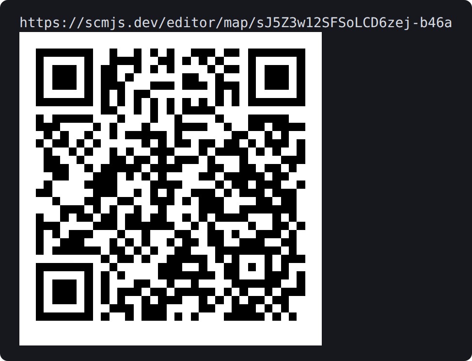

*A link and the code `--qr` draws under it.*

The code is drawn with half-block characters, two rows of the code to a line, black on
white where the terminal shows colour. Without colour it is drawn for a dark terminal,
light marks on the dark background, which phone cameras read too. The old Windows console
has no such characters, so there it is drawn with `#`, twice as wide.

### Settings

| Setting | Effect |
| --- | --- |
| `SCMJS_SESSION` | Another file for the session |
| `SCMJS_SERVER` | Another server than `https://api.scmjs.dev`, such as one of your own; its links carry its address for the editor |

## Bots

`scmjs bot` builds a [BWAPI](https://github.com/bwapi/bwapi) 4.4.0 bot, the C++ AI modules
of the bot tournaments, into one `.scmbot` file, and plays it.

### Building a bot

You can play against a built bot at [scmjs.dev/play](https://scmjs.dev/play/): **Options →
Community bots → Add a bot from a file…**, then choose it for a computer slot. Building
needs [Docker](https://docs.docker.com/get-docker/): the toolchain is a Docker image, a
few GB, downloaded the first time.

Run the commands in your bot's folder:

```sh
scmjs bot init      # scmbot.json, read from the bot's Visual Studio project
scmjs bot build     # out/<key>.scmbot
```

With no bot yet, `scmjs bot new` writes one to start from, which mines, trains workers and
builds supply. A build needs a licence file for the bot (`LICENSE`, with any licence you
choose), since it goes into every build and is shown with the bot.

`scmjs bot update` fetches the newest toolchain, the one the play page expects. The
toolchain's guide, with what it does for code written for Visual Studio and the fields of
`scmbot.json`, is at [github.com/scm-js/scmbot](https://github.com/scm-js/scmbot).

### Playing a bot

`scmjs bot run out/mybot.scmbot "(2)Jungle Duel.scx"` plays the bot against the game's own
computers with no page open. The game is the play page's engine, and the bot sits in the
player's seat. It needs [your copy of StarCraft and the
engine](#commands-that-need-starcraft).

```
UAlbertaBot on (2)Jungle Duel.scx 128 × 128, jungle · bot zerg vs computer zerg · seed 1794078640 · Remastered files
  Loaded the AI Module: bot
  oracle: BWAPI 4.4.0.0 RELEASE is now live using "bot".
  oracle: Enabled Flag UserInput
  frame   2000  P1 bot Z 152/0 4/9  |  P2 computer Z 252/0 9/9
  frame   4000  P1 bot Z 88/0 9/9  |  P2 computer Z 56/0 0/17
✔ the bot won at frame 5194 · 39 KB of orders · 0.21 ms a frame game, 0.32 bot · 4.5 s
```

| Option | What it does |
| --- | --- |
| `--race` | The bot's race |
| `--opponents zerg,terran` | The computers' races, one computer each |
| `--seed` | Fixes the game: the same seed, bot and map give the same game |
| `--frames` | Stops a game nobody has won, at 24 frames a second: 50,000 is about 35 minutes of play |
| `--every` | The frames between progress lines; 0 for none |
| `--data folder` | Keeps the files the bot writes between games (its `bwapi-data/write`), as the play page does |
| `--json` | Everything as data |

The bot's own text is printed as it comes. The command exits with 1 when the bot printed
errors, and with 2 when the game could not start.

### A ladder for bots

`scmjs bot ladder` plays bots against each other and against the game's own computer,
every pairing on every map, and keeps every game's replay. Name the bots, `computer` for
the game's computer, and the maps:

```sh
scmjs bot ladder out/mybot.scmbot:p ../rival/out/rival.scmbot computer --maps "(2)Jungle Duel.scx" "(4)Crossing.scx" --races tzp
```

A race after a colon is the race that side always plays: `mybot.scmbot:p`, `computer:t`. A
side without one plays each race of `--races` in turn (`z`, `t`, `p`, and `r` for random,
which the game draws from the seed); `computer` alone is then one computer for each of
those races. Two bots play each other twice on each map, once each as the lobby's first
player, and a bot plays each computer once. `--games 3` plays each of those games three
times, with the seeds 1, 2 and 3, or `--seeds 4,9` names the seeds. The same seed, bots
and map give the same game, so a ladder run again after you change your bot shows what the
change did.

A line comes as each game ends, then the standing:

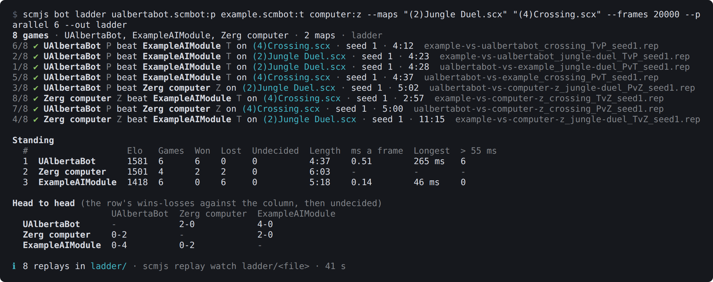

*`scmjs bot ladder` with UAlbertaBot, the BWAPI example bot and the Zerg computer on two
maps made by `map generate`.*

| Column | Means |
| --- | --- |
| Elo | Every side starts at 1500 and moves by up to 32 points a game; a game stopped at the frame limit counts as a draw. Games are counted in the order they were scheduled, so the same ladder gives the same ratings however the games ran |
| Length | The average game |
| ms a frame | The time the bot took to think, on average per frame |
| Longest | The bot's slowest frame; usually the first, where most bots read the map |
| > 55 ms | The frames over the 55 milliseconds the bot tournaments allow |

The time is counted, not enforced. The bot runs in WebAssembly beside a game that is
itself translated code, so it is slower here than in the real game. With three sides or
more, a head-to-head table follows, with each row's wins and losses against each column.

Everything goes in a folder of its own, `ladder-<date>-<time>` where you ran the command,
or the folder `--out` names:

- a replay of each game, named by the two sides in lobby order, the map, the races and the
  seed (`mybot-vs-computer-t_jungle-duel_PvT_seed1.rep`), so a loss opens with
  `scmjs replay watch` or `scmjs replay open`;
- `ladder.json`, the whole result as data (`--json` prints the same);
- `bwapi-data/`, what each bot wrote to its `bwapi-data/write` folder, which it reads
  again before its next game, as in the tournaments. Nothing is kept from a game in which
  the bot failed. `--data folder` keeps these files somewhere that outlasts one ladder.

### How ladder games are played

A game between two bots is two copies of the game, one bot in each, kept in step on your
computer. Every frame, both bots' orders go to both copies, so a slow bot slows the game
as it would in a tournament, and the two copies are checked against each other as they go.
A game against the computer is one copy.

A frame of a replay holds only so many orders, so two bots share that room: orders past a
bot's half wait for the next frame, as they would in the real game with its turn full, and
the replay plays back as the game that was played. A map from the original StarCraft
(before Brood War) is played converted to Brood War, so that its replay plays back too.

`--frames` stops a game nobody has won (50,000 by default, about 35 minutes of play).
`--parallel 4` plays four games at once, which suits a computer with the cores and memory:
a game takes about 1.5 GB for each bot in it. With games running side by side, a bot's
files from one game are not always there for the next.

A bot that fails has left the game, and the other side wins. A bot fails when it throws,
runs out of memory, or takes longer than `--timeout` seconds over one frame: 60 by
default, and at least five minutes for its first frame, where it reads the map. The
command exits with 1 when a game could not be played or a bot failed, so a script can tell
a broken bot from a losing one.

## For developers

### Writing a plugin

`scmjs plugin new "Base Check"` writes a plugin to start from in `plugin-base-check/`: its
manifest, a `plugin.ts` that adds a Tools menu item, the Korean catalogue and the test
that keeps it complete, the typings, and the build and CI every scm-js plugin uses. Then:

```sh
cd plugin-base-check
npm install
npm start
```

`npm start` runs `scmjs plugin dev`. It builds the plugin, serves its folder on your own
computer and opens the editor with it. The first time, the editor asks you to add the
plugin, as for any plugin. After that, each time you save a file the plugin is built again
and the editor reloads it. A build that fails is shown in the terminal and in the editor,
and nothing is reloaded until it is fixed. Ctrl+C stops it.

The editor remembers the plugin by its address, `http://127.0.0.1:5310/`, so it is the
same plugin next time. `--port` serves it on another port, and `--no-open` prints the
editor's address instead of opening it.

`scmjs plugin check` reads the folder the way the editor loads it and says what would go
wrong: a manifest the editor would refuse, an API version it does not have, a missing
icon, entry or build, a build older than its source, and, for a plugin without a build,
imports of files that are not there or of npm packages. It exits with 1 when the editor
would not load the plugin, so it can stop a CI step. The [plugin guide](plugins.md) covers
the rest, and [`map run`](#running-a-plugin-over-a-map) runs a plugin over a map from the
terminal.

### AI tools

`scmjs mcp` speaks the [Model Context Protocol](https://modelcontextprotocol.io) on
standard input and output, so an AI tool on your computer, such as Claude Code, Cursor or
VS Code, can work on your maps with the same code these commands use. The tool starts
`scmjs mcp` in your maps folder and talks to it over the pipe; the paths it gives are
files in that folder. Nothing goes on the network except what the commands themselves
fetch: the game engine the first time a map is run in the game, and npm's newest version
for `doctor`.

With Claude Code, once, in the folder your maps are in:

```sh
claude mcp add scmjs -- npx -y @scm-js/cli mcp
```

Other tools take the same thing as JSON in their MCP settings:

```json
{ "mcpServers": { "scmjs": { "command": "npx", "args": ["-y", "@scm-js/cli", "mcp"] } } }
```

Each tool is a command from this guide. It takes the same arguments by name and answers
with the command's text and its `--json` data:

| Tools | The commands |
| --- | --- |
| `map_info`, `map_check`, `map_dump`, `map_find`, `map_diff` | Reading, checking, searching and comparing maps. `map_check` takes a `baseline` file and lists only the findings it does not hold |
| `map_triggers_export`, `map_triggers_import`, `map_strings_export`, `map_strings_import`, `map_strings_prune` | The triggers and strings as text, in and out. The text is passed inline, so the model edits triggers in the [trigger window's text form](triggers.md) |
| `map_set`, `map_resize`, `map_new`, `map_build`, `map_run` | The Scenario menu's edits, a new map, the TrigScript build, a plugin run over the map |
| `map_optimize` | The map made smaller; a dry run unless the model asks to write |
| `map_preview` | The answer is the picture itself, so a model that can see images sees the map |
| `map_trace`, `map_cost`, `map_coverage` | The triggers run in the game, what they cost, and which fired across many replays |
| `map_balance` | Games played on a melee map with your bots, to see whether its starts are fair; it takes minutes |
| `replay_info`, `replay_map` | What a replay holds, and its map written out |
| `mod_info`, `mod_check`, `mod_diff`, `mod_unpack`, `mod_pack`, `mod_new` | [Mods](#mods): what a mod is, its check, a changelog, the folder of text and back, a new one |
| `doctor` | What this computer has, so the model knows what it can call |

A map reads as the editor reads it, so what the model is told is what the editor would
show. Tools that change a map write over it unless given `out`, like the commands, so keep
your maps in git or give the tool copies. `map_run` runs a plugin, which is code, with
your privileges, as `scmjs map run` does; the AI tool asks you before it calls a tool, and
you can leave that one unapproved.

`map_preview`, `map_trace`, `map_cost` and `map_coverage` need [your copy of the
game](#commands-that-need-starcraft), and the runs fetch the engine the first time; a
trace or cost run takes a few seconds and plays at most ten minutes of game.
`map_coverage` plays whole replays, so it takes as long as the command does. `doctor`
tells the model whether the game and the engine are there and what you would need to
install, so it can say so rather than fail. When the game is not in one of the usual
places, the model can pass its folder as `starcraft`, or you can set `SCMJS_STARCRAFT` in
the tool's MCP settings.

### TrigScript in your text editor

`scmjs lsp` is a language server for [TrigScript](trigscript.md). It speaks the Language
Server Protocol on standard input and output, so VS Code, Neovim, Helix or any editor with
an LSP client can check a script as you type, outside scmJS's TrigScript window. It gives
what that window gives:

- The errors `scmjs map build` would stop on, TypeScript's and TrigScript's own, checked
  against the map's names, as you type and when you save.
- Completions: the script's own names, the standard library's, a library's exports,
  keywords, and after `locations.`, `units.`, `switches.` or `players.` what the map has.
- A hover with the signature and doc comment, what a program's variable holds, and which
  of the map's things a name is (`locations.Nest` is location 2: 10 × 10 tiles at 48, 6).
- Go to definition, into the script's other files, a library's module and the standard
  library's (`trigscript/fog`).
- The outline of a file.

A script is the `trigscript/` folder of a map unpacked with
[`scmjs map unpack`](#the-archive-as-a-folder), where its files are kept at their paths in
the archive. The map's locations, switches, unit names and sounds are read from
`staredit/scenario.chk` beside that folder, and read again when the file changes. The
copies of other plugins' libraries that the map keeps are in `trigscript/@libraries/`. The
round trip is:

```sh
scmjs map unpack ridge.scx            # ridge/trigscript/main.ts, ridge/staredit/scenario.chk, …
# edit ridge/trigscript/*.ts in your editor
scmjs map pack ridge                  # back into ridge.scx
scmjs map build ridge.scx --test      # the triggers applied and the programs built, as Save does
```

Any other folder called `trigscript` is a script too, checked against the names every map
has. For a script kept somewhere else, `--map` names the map whose names it uses, as a map
file or an unpacked map's folder. With a map file, a `.ts` file belongs to the nearest
folder above it that has a `main.ts`. Files that are not part of a script get nothing from
the server, so the server can be on for every TypeScript file.

The server needs TypeScript, as `map build` does, either in the maps folder's project or
installed globally. Install the command once rather than running it through `npx`, so the
editor starts it quickly:

```sh
npm install -g @scm-js/cli typescript
```

**VS Code.** TrigScript's repository has a small extension in
[`editors/vscode/`](https://github.com/scm-js/plugin-trigscript/tree/main/editors/vscode)
that starts the server for the files under a `trigscript/` folder. Its README says how to
install it. VS Code's own TypeScript checks the same files without TrigScript's names and
marks `program`, `units` and the rest as unknown, so turn that check off for the maps
folder in `.vscode/settings.json`:

```json
{ "typescript.validate.enable": false }
```

**Neovim** (0.11 or later), in `init.lua`:

```lua
vim.lsp.config("scmjs", {
  cmd = { "scmjs", "lsp" },
  filetypes = { "typescript", "typescriptreact" },
  root_markers = { "archive.json" },
})
vim.lsp.enable("scmjs")
```

On an older Neovim, `vim.lsp.start` does the same from an autocommand:

```lua
vim.api.nvim_create_autocmd("FileType", {
  pattern = { "typescript", "typescriptreact" },
  callback = function(args)
    local root = vim.fs.root(args.buf, "archive.json")
    if root then vim.lsp.start({ name = "scmjs", cmd = { "scmjs", "lsp" }, root_dir = root }) end
  end,
})
```

If `ts_ls` also runs on these files, it reports TrigScript's names as unknown. Leave the
maps folder out of its `root_dir`.

**Helix**, in a `.helix/languages.toml` in the maps folder, so it applies there only:

```toml
[language-server.scmjs]
command = "scmjs"
args = ["lsp"]

[[language]]
name = "typescript"
language-servers = ["scmjs"]
```

**Other editors** take the same three things: the command `scmjs lsp`, standard input and
output, and the TypeScript file types. Zed starts language servers only from its
extensions, and there is no TrigScript extension for it yet.

What the server says about each check goes to standard error, which an editor shows as the
server's log. It names the script and the map it found, and how long each check took,
about half a second for a script that imports the standard library.

### In scripts and pipes

`--json` prints what a command found as JSON: one object for one file, a list for several.
The text output may change between versions, so scripts should read the JSON.

`-` as a map's path is standard input, and `--out -` is standard output. A map read from
`-` is written to standard output when there is no `--out`. So the commands chain in a
pipe:

```sh
scmjs map new - --size 64x64 --players 2 | scmjs map set - --name "Ridge" | scmjs map check -
cat ridge.scx | scmjs map resize - --size 128x96 --out - > ridge-wide.scx
```

While a map is on standard output, what the command says goes to standard error, and
`--json` is refused, since both want the pipe. A map from a pipe has no name: it is
`stdin.scx` or `stdin.chk` by its contents, and is written back in the same form.

Colour is off when the output is not a terminal, when `NO_COLOR` is set, and with
`--no-color`.

For what the commands do not do, such as a script that edits maps or a check of your own,
the same functions are the [`@scm-js/core` library](core.md); the command is built on it.

### Exit codes

| Code | Means |
| --- | --- |
| 0 | All went well |
| 1 | A map failed its check, two maps differed, a merge had conflicts it was not told how to settle, nothing matched a search, a build did not go through, a map test or a bot failed, a trigger never fired in `map coverage --strict`, a replay could not be played, or something went wrong |
| 2 | A file was missing or the wrong kind for the command, an option was not valid, you need to sign in first, or the game could not start |

## Command reference

Every command, with a link to where this guide describes it. `scmjs <command> --help`
gives its options.

### `scmjs info`

| Command | What it does |
| --- | --- |
| [`scmjs info <files…>`](#what-a-map-holds) | What a map, replay or bot file holds, whichever it is |

### `scmjs map`

| Command | What it does |
| --- | --- |
| [`scmjs map info <maps…>`](#what-a-map-holds) | Size, tileset, players, units, triggers, strings and the check in one line; `--table` for a folder |
| [`scmjs map check <maps…>`](#checking-a-map) | Check Map: errors, then warnings; `--format github`, `junit` or `sarif` for CI; `--baseline` fails only on new findings |
| [`scmjs map dump <map>`](#the-whole-map-as-text) | The whole map as text, for `git diff` and `grep` |
| [`scmjs map find <text> <maps…>`](#searching-maps) | Edit ▸ Find across maps: units, locations, strings, triggers |
| [`scmjs map preview <map>`](#a-picture-of-a-map) | A picture of the map, in the terminal or as a PNG with `--out` |
| [`scmjs map sounds [list\|export] <map>`](#a-maps-sounds) | The sounds the map carries, listed or written out as WAV and Ogg files |
| [`scmjs map fetch <words…>`](#maps-from-scmscxcom) | Searches scmscx.com, and downloads a map with `--id` or `--first` |
| [`scmjs map open <map>`](#opening-a-map-in-scmjs) | Opens the map in scmJS |
| [`scmjs map new <map>`](#a-blank-map) | A new map: flat ground, start locations placed |
| [`scmjs map generate <map>`](#a-melee-map-from-a-seed) | A symmetric melee map from a seed, walked and checked before it is written |
| [`scmjs map set <map>`](#name-description-and-revision) | The name, description, revision or text encoding |
| [`scmjs map resize <map>`](#resizing) | Scenario ▸ Resize: another size, anchored |
| [`scmjs map triggers export\|import\|edit`](#triggers-and-strings-as-text) | The triggers as a text or `.trg` file and back; `edit` opens them in your editor |
| [`scmjs map strings export\|import\|edit\|prune`](#triggers-and-strings-as-text) | The strings as a text file and back; `prune` removes the unused ones |
| [`scmjs map optimize <map>`](#making-a-map-smaller) | The map made smaller: unused sounds, files and strings out, compressed again; `--strip-editor` drops the editor-only sections too |
| [`scmjs map unpack <map>`, `scmjs map pack <folder>`](#the-archive-as-a-folder) | The map's archive as a folder of files, and back |
| [`scmjs map unpack <map> --text`](#a-map-as-a-folder-of-text) | The scenario as text files to keep in git; `map pack` builds the map from them |
| [`scmjs map build <map>`](#building-a-trigscript-map) | Builds the map's TrigScript script into it, as Save does |
| [`scmjs map run <plugin> <map>`](#running-a-plugin-over-a-map) | Runs a plugin, or a script written like one, over the map |
| [`scmjs map diff <a> <b>`](#comparing-two-maps) | What changed between two maps, or since a git revision with `--rev`; `--picture` shows where |
| [`scmjs map log <map>`](#a-maps-history) | The commits that changed the map, each with what it changed in the map's terms |
| [`scmjs map blame <map>`](#who-last-changed-what) | The commit, author and date that last changed each trigger, location, string, unit group or setting |
| [`scmjs map merge <base> <ours> <theirs>`](#merging-two-versions-of-a-map) | Two versions of a map merged with their common ancestor, as git's merge driver |
| [`scmjs map trace <map>`](#which-triggers-fire) | Runs the triggers in the game: which fired, how often, which never did and why |
| [`scmjs map trace [map] --replay <rep>`](#triggers-in-a-replays-game) | The same for a replay's game: when each trigger fired, and `--order` lists every firing in turn |
| [`scmjs map cost <map>`](#what-the-triggers-cost) | What the triggers cost Remastered each frame, and the costliest; `--replay` as for `map trace` |
| [`scmjs map test <map> [tests…]`](#testing-a-maps-triggers) | Plays the map's test scenarios in the game, with a replay of each that fails; `-u` rewrites what a replay's scenario expects |
| [`scmjs map test record <map> <rep>`](#a-test-from-a-replay) | A test scenario from a replay, its expectations taken from the end of the game |
| [`scmjs map coverage <map> <replays…>`](#which-triggers-fired-across-many-games) | Plays many replays on the map: which triggers fired in how many games, and which never did |
| [`scmjs map rush <map>`](#rush-distances) | The time to walk between the start locations, by the game's own pathing |
| [`scmjs map balance <map> --bots <bots…>`](#is-the-map-fair-to-every-start) | Games played on the map with your bots, a row a start location: win rate, length, first contact, rush distance, resources, and a verdict |
| [`scmjs map heatmap <map> <replays…>`](#where-things-happened-across-many-games) | Where units died, buildings went up or armies walked in many replays, as heat over the map |
| [`scmjs map share <map>`](#a-link-to-a-map) | A link to the map on scmjs.dev; `--edit` to edit it together |
| [`scmjs map play <map>`](#a-game-with-other-people) | A lobby on the play page with the map, and its invite link |

### `scmjs init`

| Command | What it does |
| --- | --- |
| [`scmjs init [folder]`](#setting-up-a-folder-of-maps) | Sets a folder of maps up for git and GitHub: maps as text in `git diff`, merged part by part, checked on every push |

### `scmjs replay`

| Command | What it does |
| --- | --- |
| [`scmjs replay info <replays…>`](#what-a-replay-holds) | Who played, on which map, for how long and at what APM |
| [`scmjs replay map <replay>`](#the-map-a-replay-was-played-on) | The map the replay was played on, as a map file |
| [`scmjs replay watch <replay>`](#watching-a-replay-in-the-terminal) | Plays the replay in the terminal |
| [`scmjs replay export <replay>`](#a-video-or-gif-of-a-replay) | A video or GIF of the replay with the game's own pictures |
| [`scmjs replay open <replay>`](#opening-a-replay-in-scmjs) | Opens the replay in scmJS's replay viewer |
| [`scmjs replay share <replay>`](#a-link-to-a-replay) | A link that opens the replay in the editor |

### `scmjs mod`

| Command | What it does |
| --- | --- |
| [`scmjs mod info <mods…>`](#what-a-mod-holds) | What a mod is: files by kind, tables and their layouts, plugins and FireGraft files, the game it is for |
| [`scmjs mod unpack <mod> <folder>`](#a-mod-as-a-folder-of-text) | The mod as a folder of text and PNG sheets; what would not come back the same is kept as bytes |
| [`scmjs mod pack <folder>`](#a-mod-as-a-folder-of-text) | The folder back into an MPQ, or `--folder` loose files in the game's paths |
| [`scmjs mod new <folder>`](#a-mod-as-a-folder-of-text) | An empty mod folder: `mod.json` and a README |
| [`scmjs mod check <mods…>`](#checking-and-comparing-mods) | Mistakes across the tables: references, pictures, scripts, sounds, buttons, requirements |
| [`scmjs mod diff <a> [b]`](#checking-and-comparing-mods) | A changelog between two mods, or what one changes in the game |
| [`scmjs mod build <folder>`](#checking-and-comparing-mods) | Check, then pack; stops on an error unless `--force` |
| [`scmjs mod play <mod>`](#playing-a-mod-on-the-play-page) | The mod's changed files handed to the play page; `--map` starts a map with it |
| [`scmjs mod test <mod> <map> [tests…]`](#a-mod-in-the-game-engine) | `map test` with the mod laid over the game; `map test`, `trace` and `cost` take `--mod` |

### `scmjs plugin` and `scmjs bot`

| Command | What it does |
| --- | --- |
| [`scmjs plugin new <name>`](#writing-a-plugin) | A plugin to start from |
| [`scmjs plugin dev`](#writing-a-plugin) | The editor with your plugin, reloaded each time you save |
| [`scmjs plugin check`](#writing-a-plugin) | What the editor would make of the plugin |
| [`scmjs bot new`, `init`, `build`](#building-a-bot) | A BWAPI bot built into a `.scmbot` file for the play page |
| [`scmjs bot update`](#building-a-bot) | The newest bot toolchain |
| [`scmjs bot run <bot> <map>`](#playing-a-bot) | Plays the bot against the game's computers |
| [`scmjs bot ladder <bots…> --maps <maps…>`](#a-ladder-for-bots) | Bots and computers against each other on every map: Elo, head-to-head, replays |

### Your account and setup

| Command | What it does |
| --- | --- |
| [`scmjs login`, `scmjs logout`](#signing-in) | Signs in to scmjs.dev in the browser, and out again |
| [`scmjs account`](#signing-in) | Who you are signed in as, your storage, the maps you are sharing |
| [`scmjs doctor`](#checking-your-setup) | What this computer has for each command, and what is missing |
| [`scmjs about`](#updating) | This version, whether there is a newer one, and the links |
| [`scmjs mcp`](#ai-tools) | The map commands as an MCP server for AI tools |
| [`scmjs lsp`](#trigscript-in-your-text-editor) | A TrigScript language server for your text editor: errors, completions, hovers, go to definition |
| [`scmjs completion <shell>`](#shell-completion) | A completion script for bash, zsh or fish |

### Cheat sheet

```sh
scmjs info map.scx                              # what the map holds
scmjs map check maps/*.scx --strict             # fail on errors and warnings
scmjs map check maps/*.scx --baseline --strict  # fail only on findings not in .scmjs-baseline.json
scmjs map preview map.scx --out map.png         # a picture
scmjs map find "Marine" maps/*.scx              # search
scmjs map triggers edit map.scx                 # triggers in your text editor
scmjs map diff --rev HEAD~1 map.scx --picture   # what the last commit changed, and where
scmjs map log map.scx                           # the map's history, in the map's terms
scmjs map blame map.scx                         # who last changed each trigger
scmjs map generate "(2)Duel.scx" --seed 7       # a melee map to play
scmjs map balance map.scx --bots mybot.scmbot   # is every start fair? games from each
scmjs map optimize map.scx --dry-run            # what would make the map smaller
scmjs map trace map.scx                         # which triggers fire in the game
scmjs map test map.scx                          # run map.tests.json in the game
scmjs map trace --replay bug.rep --order        # which triggers fired in a played game, and when
scmjs map coverage map.scx replays/             # which triggers never fired in any of those games
scmjs replay watch game.rep                     # a replay in the terminal
scmjs map heatmap map.scx replays/ --out h.png  # where units died in those games
scmjs replay export game.rep --to 0:30          # its first half minute, as game.webm
scmjs map share map.scx --qr                    # a link, and a code for a phone
scmjs init                                      # this folder of maps, ready for git
scmjs map unpack map.scx --text                 # the map as text files, to keep in git
```

## In the source

For developers. The command is built from the editor's own code into a single file. Run it
from a clone with `npm run cli -- <command>`, or build it with `npm run build:cli`.

| File | Does |
| --- | --- |
| `cli/src/main.ts` | The commands, their help and options, and running a command over several files |
| `cli/src/map.ts`, `cli/src/replay.ts` | The map and replay reports, and how they are printed |
| `cli/src/exchange.ts` | Triggers and strings out as files and back in, and writing a map back as it was opened |
| `cli/src/files.ts` | What kind of file was named, a map or replay read out of it, and `-` as standard input and output |
| `cli/src/diff.ts` | What changed between two maps, by group, and the section comparison underneath; a map read from a git revision |
| `cli/src/diffpicture.ts` | `map diff --picture`: the second map drawn with the changes marked, side by side, in the terminal or as a PNG |
| `cli/src/history.ts` | A map's versions in git: the commits that changed the file, the blob ids of all of them in one call, the blobs read in batches and each parsed once |
| `cli/src/maplog.ts` | `map log`: each commit compared with its parent's version, the comparison put in a few words |
| `cli/src/blame.ts` | `map blame`: the items of each kind, matched between versions as `map diff` matches them, and git blame's walk from the newest version back |
| `cli/src/merge.ts` | The three-way merge: each part's rule, the ordered list merge for triggers, units matched without ids, the string table numbered again; git's three versions of a stopped file |
| `cli/src/edit.ts` | The header set, the map resized and the unused strings dropped, over the open document |
| `cli/src/optimize.ts`, `cli/src/relocate.ts` | `map optimize`: what refers to each member, the steps each measured as the file it leaves, the compression chosen; a member kept as stored moved to the archive's start, its key changed with its place |
| `cli/src/report.ts` | Check Map's findings, a map test's failures and the triggers `map coverage` never saw fire, as GitHub annotations, JUnit XML and SARIF |
| `cli/src/baseline.ts` | `map check --baseline`: a finding's identity (a trigger by its text, counts left out), the known findings matched one for one, the file read and written |
| `cli/src/dump.ts` | The map as text: every part in file order, the triggers and strings in their text forms, members hashed, sections as they would be written |
| `cli/src/find.ts` | Edit ▸ Find over a map from the terminal: the kinds, the hits and their lines |
| `cli/src/create.ts` | A new map as File ▸ New makes it: the flat fill with a seeded variation, the start locations, the slots closed, the file written as a new map is saved |
| `cli/src/generate.ts` | A map from a seed: the plan on the isometric lattice, the base complex and its copies, the ground painted a terrain at a time, the ramps tried until one walks, the walks and checks |
| `cli/src/generatecmd.ts` | `map generate`'s options, the tileset read from your copy of the game, the summary and its JSON |
| `cli/src/bases.ts` | Where a base's resources go: the Melee Wizard plugin's layout |
| `src/editor/isom.ts` | The isometric brush, which `map generate` paints with |
| `cli/src/init.ts` | A folder of maps set up for git and GitHub: the lines and files it lacks, the workflow and README made from the maps, the git settings |
| `cli/src/doctor.ts` | The checks: Node, npm's newest, TypeScript, Docker, a browser, ffmpeg, StarCraft, the engine cache, the desktop app, and what each one is for |
| `cli/src/archive.ts` | The archive as a folder and back: member names as file names, the manifest, the members without a name |
| `cli/src/source.ts` | The scenario as a folder of text and back: each section's text form, the check that the folder packs back into the same scenario, the bytes kept beside |
| `cli/src/texteditor.ts` | `triggers edit` and `strings edit`: the editor chosen and started, the file kept when the text does not read |
| `cli/src/sounds.ts` | The map's sounds: the WAV table joined with the archive's members, their lengths, the files written |
| `cli/src/qr.ts` | The QR encoder for `--qr` and its drawing in the terminal |
| `cli/src/run.ts`, `src/plugins/headless.ts` | A plugin run over a map: the editor's plugin host with a store, a document and no page, its status, toasts and log reported instead of shown |
| `cli/src/build.ts` | The TrigScript build: finding TypeScript, compiling against the map's names, applying the block, laying the programs in and packing the file |
| `cli/src/completion.ts` | The bash, zsh and fish scripts, generated from the command tree |
| `cli/src/mcp.ts` | The MCP server: each tool a command's functions, its text and JSON as the result |
| `cli/src/lsp.ts` | The language server: which files are a script and which map names them, the protocol round TrigScript's language service (`plugins/trigscript/language.ts`) |
| `cli/src/replaymap.ts` | The replay's scenario written out as a map file |
| `cli/src/scmscx.ts`, `cli/src/fetch.ts` | scmscx.com's routes in one place, with the timeout and the errors; the search table, the file name made safe, the download opened before it is written |
| `cli/src/open.ts` | Finding the desktop app, handing a file to the editor in a browser, and a lobby asked of the play page the same way |
| `cli/src/account.ts` | The scmjs.dev sign-in through a page on the loopback address, the session file, and the account |
| `cli/src/share.ts` | A map saved to the account and linked, or opened for editing together, with its facts and picture |
| `cli/src/replayshare.ts` | A replay stored on the account and linked, with the map's picture for the card |
| `cli/src/bot.ts` | Running the bot toolchain's image in the bot's folder |
| `cli/src/engine.ts` | The game engine the playing commands share: the play page's current build fetched into the cache with its runners, the copy of the game found, a runner started |
| `cli/src/botrun.ts` | A bot's game with no page: scm-sim's bot runner run and its lines worded |
| `cli/src/ladder.ts` | The ladder: the sides read off the command line, the schedule and the replays' names, scm-sim's match runner run for each game, Elo, the standing and the head-to-head |
| `cli/src/watch.ts` | A replay in the terminal: the braille minimap, its colours and the lines around it, the replay's chat and APM, and the runner paced a picture at a time |
| `cli/src/export.ts` | A replay's clip: the options settled, the play page and the game's files served on the loopback address, the page asked to record, the MP4 made with ffmpeg |
| `cli/src/browser.ts` | Finding Chrome, Chromium or Edge, starting it without a window, and the DevTools protocol on its pipe |
| `cli/src/camera.ts` | The camera that follows a player: aims from the game's units (the army, the biggest fight), or the player's clicks, made into a smoothed track |
| `cli/src/gif.ts` | The GIF writer: a palette a picture by median cut, unchanged pixels left transparent, LZW |
| `cli/src/trace.ts` | A map's triggers run in the game: scm-sim's map runner run, its trace and cost worded against the map's own triggers; a replay's game, the map given compared with the replay's, the firings in order |
| `cli/src/maptest.ts` | A map's tests: the tests file read and resolved against the map's names, the setup and timed steps made triggers of a copy, the map runner run in its test mode for each scenario, the end judged and the failed scenarios' replays kept; scenarios that play a replay, recorded from one and rewritten with `-u` |
| `cli/src/coverage.ts` | `map coverage`: the replays matched to the map, played a few at once by the map runner's replay mode, each game's trace folded per trigger (to the parting, from the firings in order), the tests' scenarios as games, the totals and the report |
| `cli/src/heatmap.ts`, `cli/src/heat.ts` | A heatmap from replays: the replays matched to the map, played a few at once by the replay runner's event mode and kept in the cache, the events chosen, counted per tile, spread and drawn as a heat ramp |
| `cli/src/balance.ts` | `map balance`: the games played on the match runner, each replay's events read for the starts dealt and the first contact, the main's resources, the rows and the verdict |
| `cli/src/rush.ts` | The walks between the start locations: the unit found by name, the map runner run in its rush mode, the table of the starts |
| `cli/src/preview.ts`, `cli/src/png.ts` | A map's picture: the terrain from the tileset, reduced to the scale asked, the units, resources and start locations over it, and the PNG written by hand |
| `cli/src/paint.ts` | The picture in a terminal: colour half blocks, the 256-colour fallback, ASCII shades, kitty's and iTerm2's picture protocols |
| `cli/src/gamefiles.ts` | Files out of your copy of the game: a Remastered installation's storage, a 1.16.1 copy's archives in the game's order |
| `cli/src/weigh.ts` | The weigher `map cost` hands the game: TrigScript's model of what Remastered charges, built beside the command |
| `cli/src/runtime.ts`, `cli/src/sea.ts` | The npm package and the single program told apart: how each updates, the package manager read off the program's folder, a runner started by the program as Node would run it, the weigher written out of it |
| `scripts/build-cli-binary.mjs`, `scripts/check-cli-binary.mjs` | The single programs: the bundle again as CommonJS, injected into Node's own executable for each system and packed for the release; the commands run against one with no Node on PATH |
| `packaging/` | The Scoop, winget and Homebrew recipes, filled for a release by `scripts/release-recipes.mjs` |
| `cli/src/mod/` | `scmjs mod`: a mod opened from a folder, MPQ, exe or zip; the folder unpacked and packed, info, check, diff, new, the play page's hand-over, the engine's overlay |
| `src/formats/mod/` | The mod folder's form and its check-by-packing, the lints, the changelog, the exe and zip readers ([mods.md](mods.md)) |
| `cli/src/plugin.ts` | A new plugin's files, the plugin check, and the server `plugin dev` runs |
| `src/plugins/devLink.ts` | The editor's half of `plugin dev`: only a plugin served on this computer is taken |
| `cli/src/ui.ts` | Colour, marks, aligned rows, and StarCraft's text colours in a terminal |
| `cli/src/banner.ts` | The globe and the command list that `scmjs` on its own prints |
| `core/src/index.ts` | The library's surface; the command imports from the editor only what it exports ([core.md](core.md)) |
| `src/hooks/` (the opener hand-over) | The editor's half of the hand-over: only a page on the loopback address that opened it is listened to |
| [@scm-js/replay](https://github.com/scm-js/replay) | The replay reader, shared with the replay viewer plugin |
| `scripts/build-cli.mjs` | Builds `cli/dist/scmjs.mjs` |
| `scripts/cli-screenshots.mjs` | This guide's pictures: the commands run on the test maps and on maps `map generate` makes, their output drawn as a terminal |
