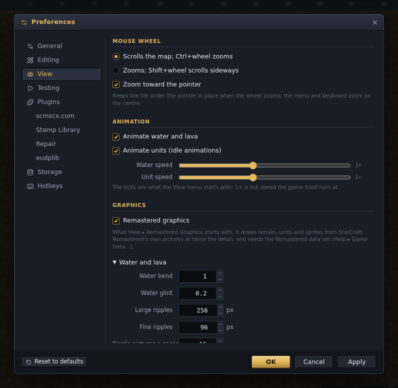

# Game data

A map file holds numbers: a tile id per cell, a unit type per placed unit. The pictures
those numbers refer to are in StarCraft's own files. That is Blizzard's data, not covered
by this project's MIT license and not redistributable, so none of it ships with the
editor. The editor reads it from a StarCraft installation you own, classic (1.16) or
Remastered, copies what it needs once, and keeps the copy.

This document is for map makers who want to know where the graphics come from and what is
kept where, and for mod makers who want the editor to use a mod's files in place of the
game's. It ends with how the pictures are drawn. The steps of the first-run dialog are in
the [installing guide](installing.md#the-graphics); building the editor from source is in
[Extracting for a source build](#extracting-for-a-source-build).

Attribution is not permission. Before publishing a fork or hosting a build, read
[ATTRIBUTION.md](../ATTRIBUTION.md#starcraft-and-brood-war-data).

## Getting the files

The recommended source is your own StarCraft installation. Blizzard's free map editor
download is the fallback for anyone without one. Both are offered by the **Game Data**
dialog on first use and by **Help ▸ Game Data…** afterwards; the [installing
guide](installing.md#the-graphics) walks through it.

| Source | What you can do with it |
| --- | --- |
| A StarCraft: Remastered installation | Edit, with classic or Remastered graphics; test and play maps; watch replays |
| A classic StarCraft (1.16) installation | Edit, with classic graphics; test and play maps; watch replays |
| Blizzard's map editor download | Edit, with classic graphics; watch replays |

The map editor download carries the whole game's files, but it is a map editor's download,
not the game. A copy made from it is enough to edit maps and watch replays. Testing a map
or playing one, in the game or on the site's play page, needs StarCraft installed.

- **A classic installation** has two archives, `StarDat.mpq` and `BrooDat.mpq`, with a
  `patch_rt.mpq` beside them that is applied over both, as the game applies it. Brood
  War's archive is required: its unit table is the layout the editor reads, and the Ice,
  Desert and Twilight tilesets exist only there.
- **A Remastered installation** has no `.mpq` archives. The editor reads the same files
  out of its `Data` folder instead, along with Remastered's own pictures; see [StarCraft:
  Remastered](#starcraft-remastered).
- **Blizzard's map editor download** is a 101 MB zip carrying both archives and a
  `patch_rt.mpq`. With that applied, they give the same files a 1.16.1 installation does.
  The editor fetches only those three members, 83 MB, through a small forwarder at
  `gamedata.scmjs.dev`, because a web page cannot read Blizzard's download server
  directly. The forwarder stores nothing.

Either way the copy is made on your machine, in a background thread in the browser and in
the app's own process on the desktop, so it happens once. Open maps pick the graphics up
as they arrive.

### Where it looks

The editor settles on one source of game data when it starts, in this order:

1. **A data set you chose.** When a [data set](#data-sets) other than the game's own is
   selected, its stored copy is asked for first. If that copy is gone, the editor says so
   and continues with the game's own files.
2. **Bundled with the build.** A source build that ran `npm run extract` serves the files
   from its own folder. The desktop app serves its own copy the same way.
3. **A copy kept in the browser.** An earlier install left the files in the browser's
   private storage for the site. The copy survives reloads and browser restarts. A browser
   with no such storage holds the files for the session only.
4. **The desktop app's search.** The desktop app looks next to the app itself (so the two
   archives dropped beside it are found), in its own data folder, in `SCM_DATA_DIR` or
   `STARCRAFT_DIR` from the environment, in the usual install locations
   (`C:\Program Files (x86)\StarCraft`, `/Applications/StarCraft`, a Wine prefix on
   Linux), and in `~/StarCraft` and `~/Games/StarCraft`. The first folder with the
   archives or a Remastered installation is copied into the app's data folder, which is
   then step 2. Someone whose game is where the installer put it never sees a dialog.
5. **Nothing.** The editor runs without graphics and opens the Game Data dialog.

Nothing is ever fetched from an address you did not name.

[scmjs.dev/editor](https://scmjs.dev/editor/), the nightly at
[scmjs.dev/nightly](https://scmjs.dev/nightly/) and the play page at scmjs.dev/play share
one copy, so the game is installed once for all three. The page
[scmjs.dev/editor/data](https://scmjs.dev/editor/data) lists every copy the browser holds:
what it is, where it came from, how many files and how large, and when it was made.

### Removing a copy

**Remove copy** in Help ▸ Game Data… deletes the stored copy. The editor then goes back to
whatever step of the search above it would have reached without it, which in the browser
is the dialog's first page again.

## What is kept

From either kind of installation, or the download, the editor copies about 930 files it
draws with, about 30 MB from the classic archives:

| Files | For |
| --- | --- |
| `tileset/<name>.cv5`, `.vx4`, `.vr4`, `.vf4`, `.wpe` | each tileset's terrain: tile groups, megatiles, pixels, walkability and height, palette |
| `tileset/<name>.ofire.pcx` and three more remaps | fire and explosion colours |
| `tileset/<name>.dddata.bin`, `stat_txt.tbl` | the doodad placement table; doodad and unit names |
| `arr/units.dat`, `flingy.dat`, `sprites.dat`, `images.dat`, `images.tbl` | the chain from a unit type to its picture |
| `arr/weapons.dat`, `upgrades.dat`, `techdata.dat` | the defaults in the Unit, Upgrade and Technology Settings dialogs |
| `arr/sfxdata.dat`, `sfxdata.tbl` | the list of the game's sounds, for the trigger sound picker |
| `game/tunit.pcx` | team colours |
| `scripts/iscript.bin` | animation scripts |
| `unit/**/*.grp`, `unit/**/*.lo?` | about 750 sprite sheets and their overlay positions |
| `unit/cmdbtns/cmdicons.grp`, `ticon.pcx` | command card icons, which plugins show |

The eight tilesets, in the order the map file numbers them, are Badlands, Space Platform,
Installation, Ashworld, Jungle, Desert, Ice and Twilight.

### Files for playing

A copy kept in the browser also holds the files the game itself runs on: its sounds, its
computer players' scripts, the rules of each game type, its cursors and interface
pictures, and the pictures of things only a game in play draws (buildings going up, spell
effects, selection circles). The editor opens none of them. They are for the play page at
scmjs.dev/play, which runs maps and replays in the browser from the same copy. The desktop
app's own copy leaves them out.

From a Remastered installation, the copy can also keep what the game's real-time lighting
reads: tick **Keep the files for real-time lighting on the play page** when you choose the
folder. Choosing the folder again with the box ticked adds them to an existing copy.

| Copy | In the browser | In the desktop app |
| --- | --- | --- |
| From a classic installation or the download | about 140 MB | about 30 MB |
| From a Remastered installation | about 650 MB | about 365 MB |
| From Remastered, with the lighting files | about 850 MB | — |

Most of the difference is sounds, which Remastered stores uncompressed, and Remastered's
own pictures. The files are written one at a time as they are read, so the size is on
disk, not in memory.

The play page can make the copy itself: choose a Remastered folder there and it is
installed by the same code, into the same place. The editor then opens with Remastered
graphics on, as it does after installing from its own dialog.

### Without game data

Without any of this the editor still runs. Terrain is drawn in flat colours, one per
tileset, units and sprites as coloured markers, and everything else works: every layer,
every dialog, opening and saving. The palettes that would need the graphics say so.

## StarCraft: Remastered

A Remastered installation keeps the game in its `Data` folder as a few large files with an
index over them, and the editor reads the files it needs out of that with
[kascade](https://github.com/jeany55/kascade). Choose the folder the game is installed in,
the one that holds `.build.info`. Nothing in the folder is changed. The browser asks
whether to upload the folder's files; nothing is uploaded, and the editor reads only the
parts it needs.

Out of an installation of several gigabytes the editor keeps about 1,700 files, 365 MB.
Most of that is Remastered's own terrain and sprite pictures, and what its water and lava
need to move; see [Remastered graphics](#remastered-graphics). A Remastered copy turns
**View ▸ Remastered Graphics** on when it is made.

Remastered also added tiles, and so doodads, to seven of the eight tilesets (Installation
is unchanged). Everything the 1.16 tile tables hold is in its tables unchanged, so a map
made for 1.16 draws the same from either copy. A map that uses the added tiles needs the
Remastered files: from a 1.16 copy those tiles have no picture.

There are two ways in:

- **With no graphics yet**, choose the Remastered folder in the Game Data dialog. The
  result is the editor's copy of the game's files. The desktop app's search finds a
  Remastered installation in the usual places the same way.
- **With a classic copy or the download already in place**, choose **Add StarCraft:
  Remastered…** under *Data sets* in Help ▸ Game Data…. It is installed beside that copy
  as a [data set](#data-sets) of its own, and the list switches between the two.

Of Remastered's high-definition art, the terrain and sprites are read at twice the classic
size. The four-times versions in the same installation are not used.

## Data sets

The editor draws from one set of game files at a time, and a *data set* names one. The
default is the game's own. Any other is a mod's: the game's files in the same formats with
some of them replaced, such as its own `units.dat`, graphics, sounds or `stat_txt.tbl`. A
Remastered installation added beside a classic copy is a data set too.

To add one, open Help ▸ Game Data…, choose **Add a data set…**, give it a name and pick a
folder. The folder holds the game's two archives, because a mod replaces files rather than
bringing all of them, together with the mod's own files:

```
MyMod/
  StarDat.mpq          the game's archives, required
  BrooDat.mpq
  patch_rt.mpq         applied over the two, if present
  mymod.mpq            a mod's own archive
  arr/units.dat        loose files, by the game's paths
  unit/terran/marine.grp
  rez/…
```

Where several sources have the same file, the later one wins, as in the game:
`StarDat.mpq`, then `BrooDat.mpq`, then the other archives in name order, and loose files
under `arr`, `unit`, `tileset`, `game`, `scripts` or `rez` over all of them. Anything else
in the folder is ignored.

The data set is stored under its own name beside the game's copy, so removing one leaves
the others alone. The *Data sets* list appears in Help ▸ Game Data… once there is a second
one, and the choice is remembered. Switching drops everything decoded from the previous
files, since the same ids now mean different pictures, and loads again; an open map stays
open and picks the new graphics up as they arrive.

What a data set cannot be:

- **A mod that extends the game's tables.** The table sizes (228 unit types, 130 weapons,
  61 upgrades, 44 technologies), the tileset formats and the map file's fixed-width
  sections are the game's. A mod with more unit types, a longer `.dat` layout or extended
  tilesets is not supported.
- **A mod made for Remastered's storage.** A data set is read from `.mpq` archives and
  loose files; a mod packaged in Remastered's own storage format is not supported.

### Names

The game names things in `stat_txt.tbl`: entries 0 to 227 are the unit types, and the
weapon, upgrade and technology tables each point into the same file. The editor's own name
tables are StarEdit's, which read better in about fifty places ("Cargo Ship (Unused)"
where the game says "Unused") and are the names the text trigger format and other editors
share.

The rule is per entry: where the loaded data's name differs from what the game's own data
says for that id, the loaded name shows; everywhere else, StarEdit's stands. With
Blizzard's files nothing changes. With a mod's, whatever it renamed shows the new name in
every palette, list and dialog, and the text trigger parser accepts both names, so a
trigger printed under a mod reads back.

## Testing a map in the game

Tools ▸ Test Map needs the installed game rather than a copy of its data. Neither version
of StarCraft opens a map handed to it from outside, so the editor writes the map into a
`scmJS` folder under the game's `Maps` folder, where Single Player ▸ Custom Game lists it.

- **The desktop app** finds the installation in the same places its search looks, or takes
  a folder you pick and remembers it, and starts the game.
- **Chrome and Edge** write into a folder you pick once and remember. Other browsers
  download the file.

At scmjs.dev, Tools ▸ Test Map in Browser plays the map on the play page instead, from the
copy described above. It needs a copy made from your own installation, not from the map
editor download.

## Extracting for a source build

A clone has no game data until it is extracted. The script finds the archives on its own
or takes them as arguments:

```sh
npm run extract                                                     # look for an installation
npm run extract -- --from "/mnt/c/Program Files (x86)/StarCraft"     # a folder
npm run extract -- path/to/StarDat.mpq path/to/BrooDat.mpq           # the archives themselves
SCM_DATA_DIR=~/games/sc npm run extract                              # from the environment
```

With no arguments it looks in `SCM_DATA_DIR` or `STARCRAFT_DIR`, then in the repository's
own `fixtures/data/`, then in the usual install locations for the platform, including the
Windows drives a WSL session sees under `/mnt`. A `patch_rt.mpq` found with the two is
applied over them.

The script reads `.mpq` archives only, from a classic installation or the map editor
download; it cannot read a Remastered installation. With only Remastered, run the dev
server and install from Help ▸ Game Data… as in the browser.

| Command | Does |
| --- | --- |
| `npm run extract` | everything |
| `npm run extract:tilesets` | the tileset graphics only |
| `npm run extract:units` | the unit tables, sprites and scripts only |
| `npm run check:assets` | report what is on disk without opening any archive |

Everything lands in `public/` (its [README](../public/README.md) is the inventory), which
is gitignored along with `fixtures/`. The run takes a few seconds and can be repeated at
any time; repeat it after a game patch or after changing what the scripts take.
`npm run dev` and `npm run build` warn when the files are missing and carry on, because
the editor runs without them. A green test run and a working dev server therefore prove
nothing about the extraction; run it.

### The container image

The container image at `ghcr.io/scm-js/scm-js` carries no game data and refuses to serve
the paths the files would be at, so a container starts at step 5 of [the
search](#where-it-looks) and asks, like the hosted editor. To serve your own extraction to
your own browser instead, mount an extracted tree over those paths:

```sh
docker run --rm -p 8080:80 \
  -v "$PWD/public/tileset:/usr/share/nginx/html/tileset:ro" \
  -v "$PWD/public/arr:/usr/share/nginx/html/arr:ro" \
  -v "$PWD/public/unit:/usr/share/nginx/html/unit:ro" \
  -v "$PWD/public/game:/usr/share/nginx/html/game:ro" \
  -v "$PWD/public/scripts:/usr/share/nginx/html/scripts:ro" \
  ghcr.io/scm-js/scm-js:latest
```

That is a copy on your own machine served to your own browser. Publishing an image with
the files inside, or serving one from a public address, is redistributing Blizzard's data;
see [ATTRIBUTION.md](../ATTRIBUTION.md#starcraft-and-brood-war-data).

## How terrain is drawn

Each tileset is five files. A tile id in the map file leads through them to pixels:

```
MTXM tile id ──(id >> 4)──▶ CV5 group ──(id & 15)──▶ VX4 megatile
VX4 megatile ──▶ 16 minitile refs (bit 0 = flipped) ──▶ VR4 8×8 bitmaps ──▶ WPE palette
```

A tile is a 32×32 megatile made of sixteen 8×8 minitiles, each an index into the tileset's
256-colour palette. The CV5 groups megatiles into terrain types with their variations and
edge pieces, which is where the terrain palette's list of terrains comes from. The VF4
holds each minitile's walkability and height, which the elevation and buildability
overlays, the placement checks and the Walkability plugin all read.

The editor draws each tileset once into one large image, the *atlas*, and draws the map by
copying tiles out of it. Only the tileset the open map uses is decoded; the others are
fetched into the browser's cache in the background so a later map opens faster.

### Water and lava

The graphics are indexed colour, and StarCraft animates water and lava by rotating a few
short bands of the palette every eight game frames, about a third of a second at the
Fastest speed. The band tables per tileset are the game's own; Space Platform and
Installation have none. View ▸ Animate Water turns the animation on, and Preferences ▸
View sets the speed from a quarter to four times the game's. The minimap and the far zoom
levels, which draw average tile colours, do not animate.

### Remastered graphics


**View ▸ Remastered Graphics** draws the terrain, units and sprites from StarCraft:
Remastered's own pictures in place of the classic ones, and switches back at any time. It
needs game data from a [Remastered installation](#starcraft-remastered); with a 1.16 copy
the option says so and the classic graphics stay. Installing from Remastered turns the
option on; from then on it is yours, and Preferences ▸ View holds whether the editor
starts with it.

**Terrain.** Remastered keeps one picture per megatile, 64 pixels square where the classic
one is 32, numbered as the same installation's tile tables are. So the map is untouched,
and so is everything the editor works out from the tiles (walkability, height,
buildability, the terrain brushes): only where a megatile's pixels come from changes. Each
picture is decoded the first time it is drawn. Turning the option on loads the tileset's
Remastered file once (3 to 21 MB); the classic terrain keeps drawing until it has arrived.

**Units and sprites.** Where the classic game has a GRP per image, Remastered has a sprite
sheet whose frame N is the GRP's frame N. So the animation scripts, facings and positions
are the same, and only the pixels differ. A second picture marks what takes the player's
colour. About 780 of the 885 images the editor uses have a Remastered sprite; the rest,
and any whose file has not arrived yet, are drawn from their GRP, so the two can appear
side by side.

At 100% zoom both are drawn at half their size, at 200% pixel for pixel, where the classic
graphics are each pixel doubled. The tile palette, doodad and unit thumbnails, the paste
preview and an exported map image follow the same option. A plugin that asks for a unit's
or a sprite's picture is always given the classic one.

**Water and lava.** Remastered does not rotate the palette. It draws the ground and then
bends the picture: water is the ground seen through two layers of ripples drifting across
the map, and lava the ground seen through heat, which shows on whatever glows red and
leaves dark rock alone. A table per tileset says which megatiles take the effect, and a
mask for each says where on it, so a shoreline tile moves on its water side only. The
editor does the same with View ▸ Animate Water on. Ashworld's is the lava; the other
tilesets' is water; Space Platform and Installation have neither. Desert's tar is left
still, as in the game.

How far the picture bends and how the ripples drift are the game's own figures. How large
the ripples are and how fast they change are not in its files, so they can be adjusted:
Preferences ▸ View ▸ Graphics ▸ *Water and lava* has the bend, the glint, the two ripple
sizes, their rate and the lava's heat, and the water speed on the same page applies to
both. This needs WebGL, which every current browser has; without it the water and lava are
drawn still. An exported map image is always still.



Three things differ from the game:

- The water's glint comes from the ripples alone; the game places a highlight by the
  middle of the screen, which in an editor would follow the window about.
- The sprites are drawn flat, without the game's lighting.
- The minimap and the far zoom levels keep the classic average colours.

## How units are drawn

A unit type leads to its picture through four tables:

```
units.dat[id].flingy ─▶ flingy.dat.sprite ─▶ sprites.dat.image ─▶ images.dat.grp
   ─▶ images.tbl ─▶ unit\…\*.grp
```

A GRP is a sprite sheet: a set of frames in the tileset's palette, with one frame per
facing for anything that turns. The copy follows this chain from all 228 unit types and
from all 517 entries of the sprite table, so pure sprites and doodad overlays have
graphics as well. Sprite sheets are loaded the first time something needs them, so a melee
map loads minerals, geysers and start locations and nothing else.

Team colour is palette indices 8 to 15 of a GRP, remapped through the row of `tunit.pcx`
for the owning player's colour and painted through the tileset's palette. Sprites
therefore need the tileset loaded as well. Pink and the custom RGB colours a Remastered
map can set have no row to remap to, so the editor makes a ramp for them.

### Animation

Placed units run their idle animations when View ▸ Animate Units is on. Every unit's
script is stepped once per game frame, 42 ms at Fastest, on the same clock as the water,
and Preferences ▸ View scales the rate on its own.

Each unit is a stack of images (shadow, body and overlays), each with its own script.
Buildings play their *Built* animation; tanks and Goliaths play *StarEditInit*, StarEdit's
own hook, which adds the turret. That is what gives turning turrets, pulsing Hatcheries,
marines looking around, the Nexus glow, Starport lights and refinery smoke.

Damage overlays follow hit points: a building below two thirds burns (Terran), sparks
(Protoss) or bleeds (Zerg) at the positions its `.lo` file gives, with more of them the
lower the hit points and the large effect below one third. Fire draws through the
tileset's own remap tables. Cloaked units draw half transparent. Anything that needs the
running game (attacks, sounds, projectiles and condition jumps) is skipped.

## In the source

For developers. The extraction is one module shared by every route, and the drawing is
under `src/formats/`.

| File | Does |
| --- | --- |
| `src/gamedata/source.ts` | The search order above, as a chain over injected probes so `tests/gamedata.test.ts` can pin it without a browser. |
| `src/gamedata/copies.ts` | What kind of thing a stored copy is (Blizzard's download, your own 1.16 files, Remastered, a mod), for the Game Data page. |
| `src/pages/GameDataPage.tsx`, `src/pages/data.tsx` | The Game Data page (`data.html`), one of the build's three pages, around the dialog's own controls. |
| `src/pages/install.ts` | The installer page (`install.html`), the third: the play page frames it to have a Remastered folder installed. |
| `src/gamedata/store.ts` | The browser's copies, in the Origin Private File System: `gamedata/` for the game's own, `gamedata-profiles/<id>/` per data set, a stamp file written last so a half-written copy counts as nothing. |
| `src/gamedata/install.ts`, `zip.ts` | The install routes. `zip.ts` reads a zip's directory and single members over HTTP ranges with no zip library; `tests/zip.test.ts` drives it over a zip built in the test. |
| `src/gamedata/extract.ts` | The extraction: archives in as a `ReadMember`, a map of paths to bytes out, no file system and no network. It imports only `iscript.ts`, so Node runs it without a build step. |
| `src/gamedata/play.ts` | The files for playing: what the play page reads beyond the editor's files, copied after them. |
| `src/gamedata/extract.worker.ts`, `scripts/extract-*.mjs`, `desktop/main.ts` | The three places the extraction runs: a browser worker, the Node scripts, the desktop's main process (which also holds the disk search and Test Map). |
| `src/gamedata/remastered.ts` | A StarCraft: Remastered installation in the archives' place, over [kascade](https://github.com/jeany55/kascade); `tests/remastered.test.ts` checks the result against a direct extraction, and against a real installation when `SCM_REMASTERED_DIR` names one. |
| `src/gamedata/remasteredFolder.ts` | Telling a Remastered installation folder from a folder pick (`.build.info`), kept apart so the extraction stays off the startup path. |
| `src/gamedata/remasteredDefault.ts` | Turning Remastered graphics on after the installer page made a Remastered copy. |
| `src/gamedata/archives.ts`, `scripts/lib/archives.mjs` | Opening the archives with [mopaq](https://github.com/jeany55/mopaq), later archives winning, with a mod's loose files as an overlay; and finding them on disk. |
| `src/gamedata/profiles.ts`, `src/services/gameData.ts` | Data sets: the id and name, the stored choice, and the switch that drops every decoded table and loads again. |
| `src/data/gameNames.ts` | The per-entry naming rule; `tests/names.test.ts` pins the differences against the real files. |
| `src/formats/tileset/hd.ts` | Remastered's 2x terrain and where its water and lava are. `tests/hd-terrain.test.ts`. |
| `src/components/viewport/effectPass.ts` | The WebGL pass that moves Remastered's water and lava over the terrain layer. |
| `src/formats/dat/anim.ts`, `src/formats/dds.ts` | Remastered's 2x sprites: the `.anim` tables and the cut-down copy the extraction keeps, and DXT1 / DXT5 decoding. `tests/hd-sprites.test.ts`. |
| `src/formats/tileset/` | `decode.ts` for the five files, `atlas.ts` for the atlas, `terrain.ts` for the terrain catalogue, `palette.ts` for the terrain names, `cycle.ts` for the palette bands, `doodads.ts` for `dddata.bin`, `load.ts` for fetching and the per-tileset cache. |
| `src/formats/dat/` | Decoders for the `.dat` tables, `.tbl`, GRP, PCX, `.lo` and the iscript bytecode. |
| `src/formats/units/` | The unit tables and lazy sprite loading, the per-frame canvas cache, team colours, and the animator. |
| `src/services/testMap.ts` | Test Map's browser half. |
