# User guide

This guide is for map makers. It starts with getting the editor running, walks through a
first map, and then goes through each layer and dialog in turn. TrigScript, triggers
written as code, has [a guide of its own](trigscript.md); the technical side — file
formats, game data, writing plugins, building from source — has documents of its own,
listed in the [README](../README.md#documentation).

> **Beta.** This editor needs to be extensively tested. Keep backups of maps you care about,
> and check anything important in-game before you rely on it.

## Getting started

There are three ways to run scmJS, each covered in [docs/installing.md](installing.md):

- **In the browser** at [scmjs.dev/editor](https://scmjs.dev/editor/). Nothing to install,
  and your maps stay on your own disk.
- **As a desktop app** for Windows, macOS and Linux, from the
  [releases](https://github.com/scm-js/scm-js/releases) page. It finds a StarCraft
  installation on its own and opens a map on a double-click.
- **In a container**, for a server on your own network:
  `docker run --rm -p 8080:80 ghcr.io/scm-js/scm-js:latest`, then open
  `http://localhost:8080`.

### The game's graphics

StarCraft's graphics do not ship with the editor. On first use it asks where to get them,
and the recommended answer is **your StarCraft folder**: the classic game (1.16) or
StarCraft: Remastered. Choose **Choose the StarCraft folder…** and pick the folder the
game is installed in, usually `C:\Program Files (x86)\StarCraft`. The browser asks whether
to upload the folder; nothing leaves your computer, the files are only read. The desktop
app looks for an installation on its own, and has a **Search this computer** button as
well. Picking a Remastered folder also turns on [Remastered
graphics](#classic-or-remastered-graphics).

Without StarCraft installed, the dialog offers Blizzard's free StarCraft map editor
download (83 MB), which carries the graphics. You can also pick `StarDat.mpq` and
`BrooDat.mpq` from a classic installation by hand. What each source allows:

| Where the files come from | Edit maps | Watch replays | Test or play on scmjs.dev |
| --- | --- | --- | --- |
| Your StarCraft folder, classic or Remastered | Yes | Yes | Yes |
| `StarDat.mpq` and `BrooDat.mpq` from a 1.16 installation | Yes | Yes | Yes |
| Blizzard's map editor download | Yes | Yes | No |

The files are read once and a copy is kept for next time. [The
graphics](installing.md#the-graphics) has the steps in full. Without any graphics the
editor still runs, with terrain in flat colours and units as coloured markers.

**Help ▸ Game Data…** opens the same dialog later. It shows where the current copy came
from and can remove it. Under *Data sets* it installs a mod's files beside the game's and
switches between them, and offers **Add StarCraft: Remastered…** when you have a classic
copy and no Remastered one. A tick keeps the extra files the play page needs for real-time
lighting (about 200 MB more). [Data sets](game-data.md#data-sets) explains how mods are
installed.

### Opening a map

- **Ctrl+O** (File ▸ Open…) opens a `.scm`, `.scx` or `.chk` file, and so does dropping
  one on the window.
- **File ▸ Open Recent** lists what you have had open before. In Chrome, Edge and the
  desktop app it reopens the file straight from disk.
- **File ▸ Find on scmscx.com…** searches the community map archive and opens the map you
  pick. A link like `https://scmjs.dev/editor/scmscx/35b32Dsq`, with the id from the map's
  address on scmscx.com, opens the editor with that map picked.
- **File ▸ Open from scmjs.dev…** lists the maps kept on your scmjs.dev account, with
  every revision you saved (see [Your scmjs.dev account](#your-scmjsdev-account)).
- **File ▸ Open Replay…** opens a replay over the map it was played on (see
  [Replays](#replays)).

A map opens in its own tab, beside the ones already open (see [The editor
window](#the-editor-window)). The blank map the editor starts on is the exception: the
first map you open takes its place.

A map that is damaged, or that a map protector has altered, is checked and repaired as it
opens. See [Damaged and protected maps](#damaged-and-protected-maps).

## The editor window

The window has nine parts, numbered in the picture below.

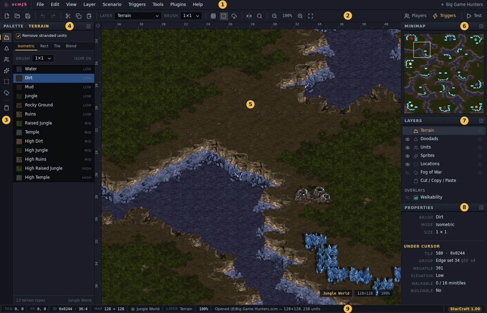

1. **Menu bar.** Every command is here, with its shortcut beside it. The dot at the right
   end glows while the map has unsaved changes.
2. **Toolbar.** New / open / save, undo and redo, cut / copy / paste, the active layer and
   brush size, the grid, locations and fog-of-war toggles, symmetry, find, zoom, and
   buttons for Player Settings, the Trigger Editor and Test Map.
3. **Layer rail.** The seven layers, top to bottom: Terrain, Doodads, Units, Sprites,
   Locations, Fog of War, Cut / Copy / Paste. The keys `T D U S L F C` switch between
   them.
4. **Palette.** What the active layer places: terrain types and brushes, doodads, unit
   types, sprites, the location list, the fog players, the clipboard options.
5. **Map.** Drag to paint or place, click to select, double-click for properties.
   Right-click opens a context menu, or stops whatever you are placing.
6. **Minimap.** Click or drag on it to move the view.
7. **Layers panel.** The eye hides a layer's objects from the view; the padlock locks a
   layer so its tools stop changing the map. Plugin overlays (Walkability, say) are listed
   under it.
8. **Properties.** What is selected, or what is under the cursor: for a tile its id,
   group, elevation, walkability and buildability; for a unit its owner, position and
   vitals; for a location its bounds and elevation flags.
9. **Status bar.** The tile and pixel under the cursor, the tile id, map size, tileset,
   layer and zoom, and a line saying what the last action did or why it was refused. At
   the right end, your scmjs.dev account (or *Sign in to scmjs.dev*), and the *AI* cell
   when the [AI](#the-ai) is on; each is a click to open.

### Several maps

Open a second map and a row of tabs appears under the toolbar, one per open map, with a
glowing dot on any that has unsaved changes. Click a tab to switch, or use the Window menu
(Ctrl+Tab and Ctrl+Shift+Tab in the desktop app). The × on a tab, a middle click, or File
▸ Close Map closes that map, asking about unsaved changes first. Each map keeps its own
undo history, selection and view, so switching back lands where you left off.

With one map open the row is hidden. To work on one map at a time, untick *Open each map
in its own tab* in Preferences ▸ General; Open and New then replace the open map.

### Moving around

- **Scroll** with the mouse wheel (Shift for sideways), the arrow keys (Shift for half a
  screen), a middle-button drag or the scrollbars, or click on the minimap. A drag that
  reaches the edge of the window scrolls the view with it, so a stroke, a marquee or a
  unit being moved can carry on past the screen. It speeds up the further past the edge
  you push.
- **Zoom** with Ctrl++ and Ctrl+−, or the toolbar's magnifiers. Ctrl+0 is 100%, and
  Ctrl+Shift+0 fits the whole map in the window. Preferences ▸ View can make the wheel
  zoom instead of scroll.
- **The grid** is Ctrl+G. View ▸ Grid Settings… sets its spacing, colour and style.
- **The panels** can be hidden from View ▸ Panels, and their widths dragged.

### Undo

Every layer has its own selection and its own palette. Undo is Ctrl+Z and redo Ctrl+Y. The
history is two hundred steps deep and shared across all the layers, so a terrain stroke
and the units it stranded come back together. A dialog — player settings, triggers,
strings — is its own OK / Apply / Cancel transaction, and each OK or Apply that changed
something is one more undo step ("Edit triggers", "Edit settings"), in the same history as
the strokes around it.

## Classic or Remastered graphics

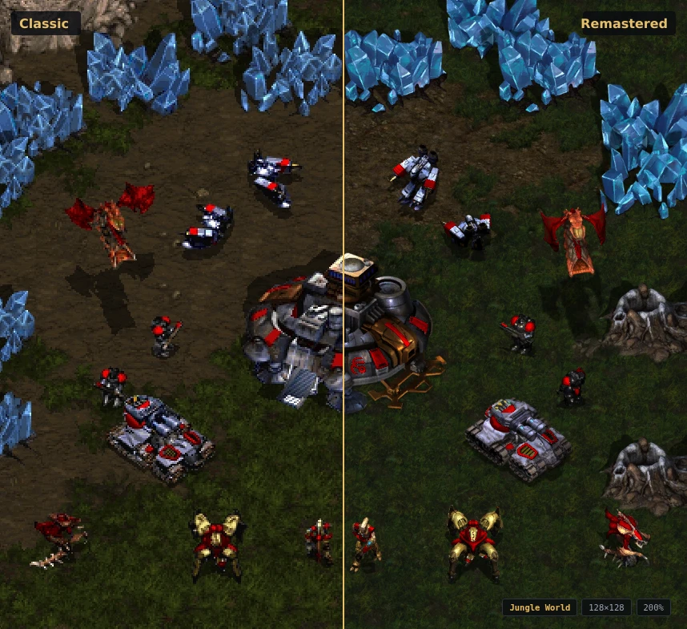

The editor can draw a map with the classic graphics or with StarCraft: Remastered's.
**View ▸ Remastered Graphics** switches between them at any time, for the terrain, the
units and the sprites together. The switch changes only how the map is drawn. It does not
touch the map, and the brushes behave the same with it on or off.

Remastered's pictures have twice the detail, which shows most when you zoom in: at 200%
they are drawn pixel for pixel, where the classic ones are each pixel doubled.

The Remastered graphics come from a Remastered installation:

- If you chose your Remastered folder when the editor first asked for the game's files,
  they are installed and already on.
- If you installed from a classic copy or Blizzard's download, open **Help ▸ Game Data…**
  and choose **Add StarCraft: Remastered…** under *Data sets*, then pick the folder
  Remastered is installed in.

The editor keeps a copy of what it needs (a few hundred MB), so this happens once.
[Installing](installing.md#the-graphics) has the steps in full.

Remastered's files also add several hundred doodads to seven of the eight tilesets, and
with them installed those doodads are in the Doodads palette, whichever look you draw
with. A map that uses one depends on Remastered: it shows blank tiles in an editor with a
1.16 copy, and uses tiles the 1.16 game does not have. Maps that keep to the older doodads
are unaffected. **Tools ▸ Check Map…** says when a map uses any of these tiles, how many,
and where the first one is.

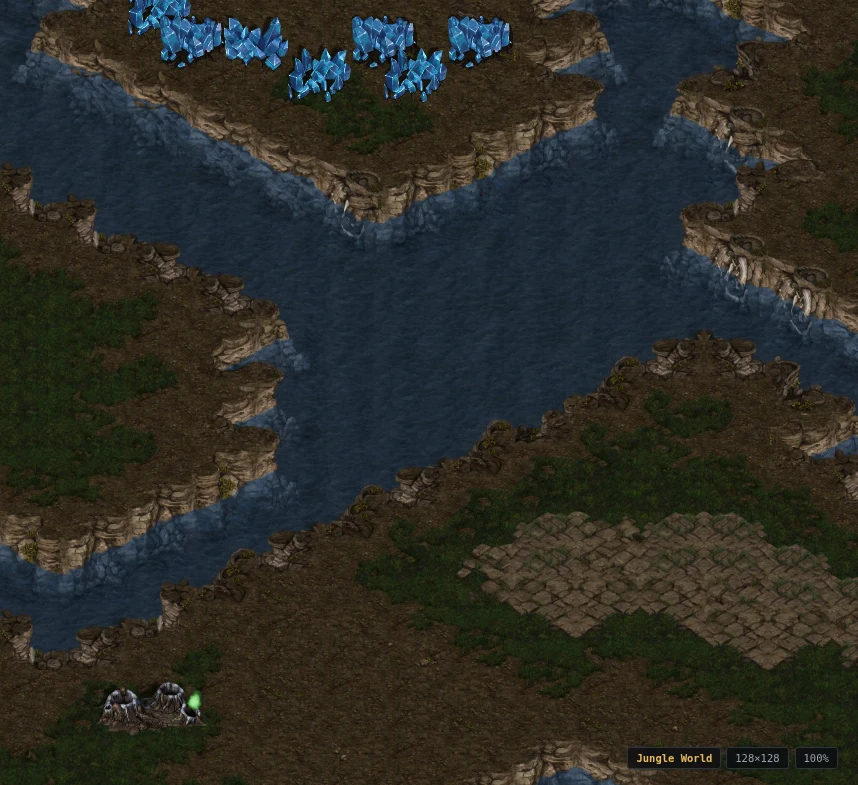

With **View ▸ Animate Water** on, water ripples and lava shimmers as they do in
Remastered; Desert's tar stays still, as it does in the game. **Preferences ▸ View ▸
Graphics** sets how strongly and how fast, and whether the editor starts with the
Remastered graphics on.

A few things differ from the game: units are drawn without its lighting, the minimap keeps
the classic colours, and an exported map image has still water.
[game-data.md](game-data.md#remastered-graphics) explains how the graphics are drawn.

## Your first map

This section walks through a small melee map from start to finish. Everything here is
covered in more depth in the sections that follow.

### 1. Make the map

Ctrl+N opens New Scenario. Pick a tileset — each is shown as its own ground — a size, and
how many players. The terrain list under the size is what the whole map is filled with,
and the preview shows the result at its real scale. *Place automatically* (off by default)
lays down one start location per player in a ring; tick it for this map.

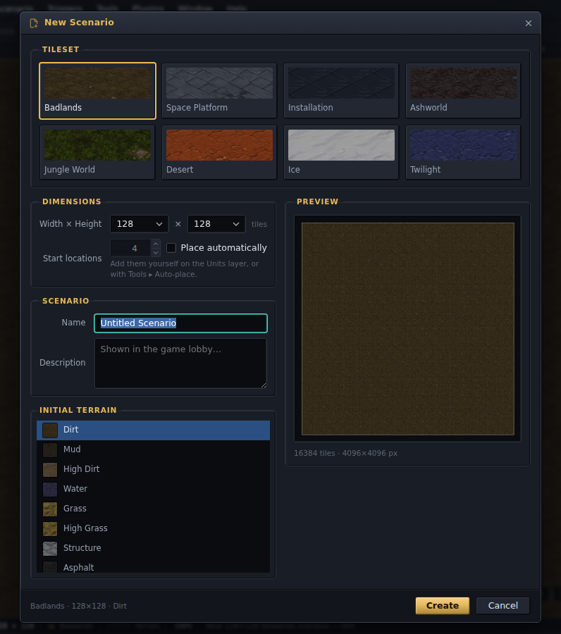

Give the map a name and a description — both are what players see in the game lobby — and
press Create.

### 2. Shape the ground

Stay on the Terrain layer and the **Isometric** tab. Pick *High Dirt* (Badlands; every
tileset has a high ground of its own), set the brush to 3×3, and drag across the map. The
cliffs around the high ground are laid for you, and where a stroke meets a terrain the new
one cannot touch, the terrain in between is put in. Painting *Water* works the same way
and gives you a shore.

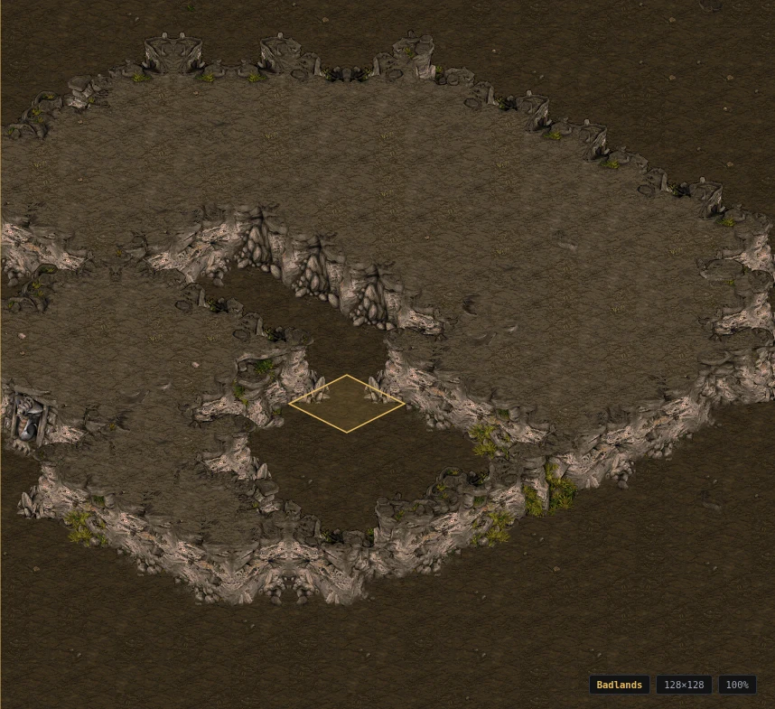

The brush size keys are `[` and `]`. Alt+click picks the terrain under the cursor. Ctrl+Z
takes back the whole stroke.

Ramps are not terrain: they are on the **Doodads** layer. Type `ramp` in its search box to
list them, click one, and click on a cliff edge; the ghost is red until the footprint sits
on ground it fits.

### 3. Place the bases

Switch to the **Units** layer (`U`). The start locations are already there. In the
palette, *Special* holds *Start Location* and *Resources* holds the mineral fields and the
Vespene Geyser, or type a name in the search box. Click a type to arm it, then click on
the map to place; Esc or a right-click stops placing.

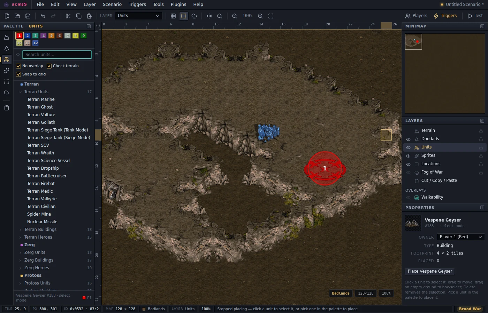

A mineral field holds 1500 minerals and a geyser 5000 gas when placed; double-click one to
change the amount, or select a whole line and set them all at once. Eight fields and one
geyser is the usual main.

*Snap to grid* keeps buildings and resources on the tile grid where the game expects them.
The two ticks above it are the game's own placement rules; a red ghost means the game
would drop the unit when it loaded the map, and the status bar says why.

For a symmetric map, Tools ▸ Symmetry… mirrors what you paint and place across the axis
you choose. The Melee Wizard plugin (Plugins ▸ Browse Plugins…) lays out whole bases with
the mineral line at the distance the game mines fastest from.

### 4. Check the players

Scenario ▸ Player Settings… is where each slot's controller, race and colour live. A melee
map needs *Human* and *User Selectable* on every slot that has a start location; that is
what a new map is set to already. Force Settings… groups them into teams for the lobby.

> **Note.** A Use Map Settings map is different: give each player a fixed race. The game
> treats a player left on *User Selectable* as a melee player, hands them a base and
> workers, and removes every unit you placed for them. It also removes the units of a human
> slot nobody takes in the lobby, so put decorations such as beacons on Player 12, the
> neutral one.

### 5. Check the map

Tools ▸ Check Map… lists what the game would object to: a start location with no player, a
unit off the map, too many units, and so on. Double-click a line to go to it.

View ▸ Walkability (Ctrl+Shift+W) draws the ground as a unit sees it: which areas connect,
where the chokes are and how wide, and which pockets cannot be reached at all. It updates
as you edit.

### 6. Save and play

Ctrl+S saves. A new map opens the Save dialog the first time, where the name and the file
format are chosen; `.scx` is a Brood War map. From then on Ctrl+S writes the file in place
(Chrome, Edge, the desktop app) or downloads it (Firefox, Safari) — the notice at the
bottom right says which.

To try the map, press Ctrl+F5 (Tools ▸ Test Map). The game cannot be handed a map from the
outside, so the editor writes the map into a `scmJS` folder under the game's *Maps*
folder, where **Single Player ▸ Custom Game** lists it; the desktop app then starts the
game as well. In the editor at scmjs.dev, **Tools ▸ Test Map in Browser** plays the map in
a browser tab instead. See [Test Map](#test-map).

That is a playable melee map. Triggers, briefings, custom unit settings and everything a
Use Map Settings map needs are in the sections below.

## Terrain

Terrain is painted with four brushes, each a tab in the palette:

| Brush | Paints |
| --- | --- |
| Isometric | Terrain types, laying the cliffs and edges around them. The one to use for almost everything. |
| Rect | Flat ground of one terrain type, with StarEdit's random variation. No cliffs, no edges. |
| Tile | Any single tile by number: cliff pieces, doodad tiles, anything the tileset has. |
| Blend | One tile next to a tile you picked, chosen from those whose facing edge continues it. |

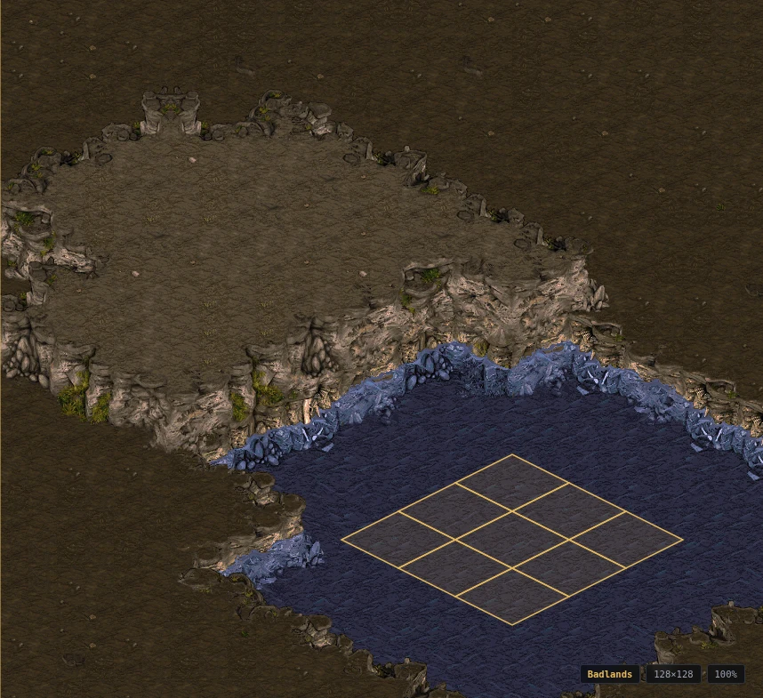

Drag to paint. `[` and `]` resize the brush from 1×1 to 7×7, Alt+click picks the terrain
or tile under the cursor, and right-click offers Pick and Fill Area. The Properties panel
breaks the tile under the cursor into group, slot, elevation, walkability and
buildability.

### The isometric brush

The isometric brush is StarEdit's diamond brush. It sets the diamond under the cursor to a
terrain and works outward from there: a neighbour that cannot border the new terrain
becomes the terrain in between, and cliff faces stack as tall as the tileset draws them. A
single click of high ground gives a small mesa; a wider brush gives flat high ground
inside a cliff ring.

The brush works from the map's isometric record, a part of the file that only editors
read. Protected maps often have it stripped; the Repair plugin rebuilds it as such a map
opens, exactly where the ground was laid with the isometric brush and as a best guess
elsewhere. The Isometric tab warns when the record and the ground disagree, and when part
of the map is ground the brush cannot join up with, such as hand-placed tiles or another
editor's work.

### Rect, Tile and Blend

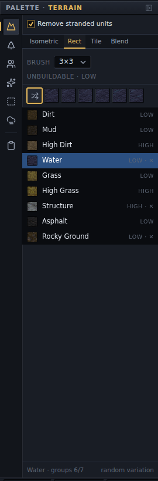 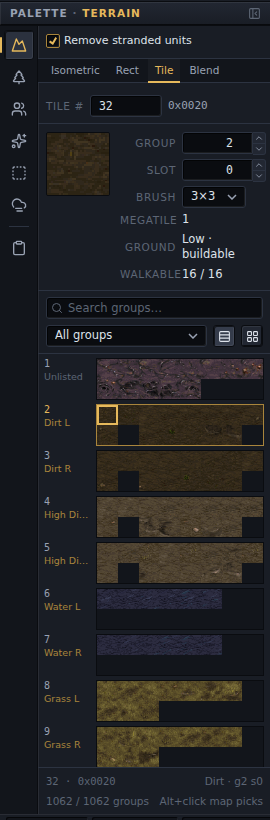 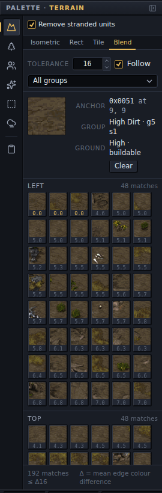

- **Rect** lays flat ground and nothing else, for filling an area you will shape
  afterwards, or for ground under a doodad.
- **Tile** is for the pieces the isometric brush will not give you: a single cliff tile, a
  doodad's tile, a corner the cliff sets do not have.
- **Blend** is for joins the cliff sets never had — dirt into a doodad's base, one edge
  set into another, a hand-laid shoreline. Click a tile to make it the anchor, and the
  palette lists for each side the tiles whose opposite edge continues it, best seam first.

These three leave the isometric record alone.

### Overlays and tools

Two overlays on the View menu show what the ground means to the game:

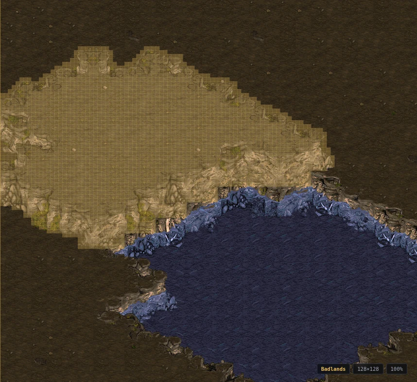

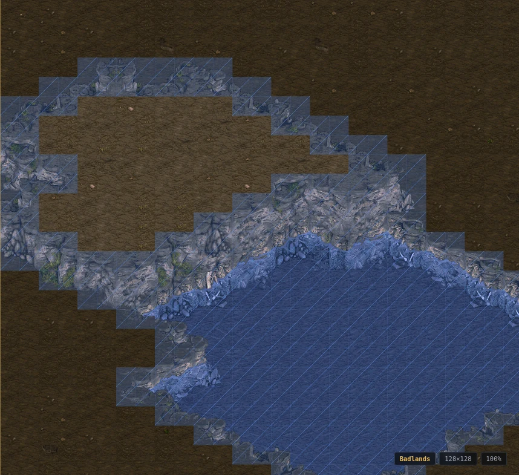

**View ▸ Walkability** (Ctrl+Shift+W) draws the ground as a unit walks it: islands, the
areas the map divides into, the chokes between them with their widths, and the distances
between start locations. In the editor at scmjs.dev its panel (Tools ▸ Walkability…) can
also have the game itself walk the map: the regions the game plans routes over, real units
walked between the start locations, a group of twelve units timed through every choke, and
how fast each start location mines with 8, 16 and 24 workers.

**File ▸ Import ▸ Terrain from Image…** turns a picture into terrain with the isometric
brush, over the whole map or a rectangle. Walkability and Terrain from Image are plugins,
on from the start; see [Plugins](#plugins).

**Tools ▸ Replace Terrain…** turns every tile of one terrain type (or one exact tile) into
another, over the whole map or the area marked on the Cut / Copy / Paste layer. **Tools ▸
Fill Terrain** lays the whole map anew. Both are one undo step.

**Tools ▸ Symmetry…** mirrors what you do across the map's axes or about its centre —
every brush, the fills, and placing units, sprites, doodads and locations, each as one
undo step. The axes show on the map while a mode is on, the ghost shows where the copies
will land, and a doodad that would have to turn is skipped. Blend, moving and deleting are
not mirrored.

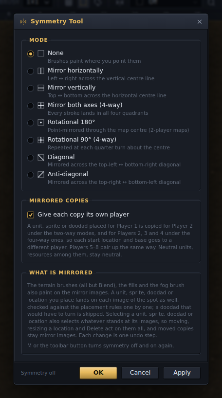

The Terrain palette's *Remove stranded units* tick deletes the units a stroke has just
made illegal (a building now half on a cliff) as part of the same undo step.

## Doodads

Doodads are the trees, rocks, ruins, ramps and bridges of a map: pieces of terrain that
come with their own tiles and, sometimes, a sprite drawn over them. The palette is built
from the current tileset's own groups, with StarEdit's categories and placement rules.

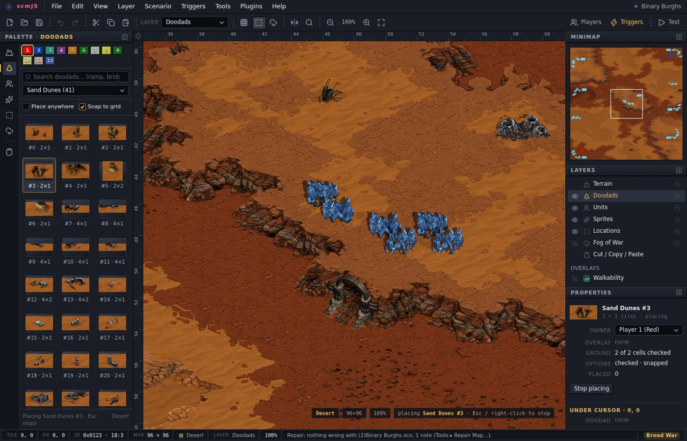

Picking a doodad arms placement, and the ghost turns red where the footprint leaves the
map, covers another doodad or sits on the wrong terrain. *Place anywhere* drops that rule;
*Snap to grid* keeps the footprint on StarEdit's two-tile isometric grid, for a move as
well as a placement. Right-click or Esc stops placing.

Doodads have no names in the game data, so the search box matches what the data does say:

- the category: `bridge`, `temple`, `coastal`;
- the id: `#12`;
- the footprint: `6×6`;
- the sprite or unit an overlay draws: `hdrock`, `Xel'Naga Temple`;
- `ramp`, for anything whose tiles are ramp tiles (StarEdit files ramps under cliffs and
  walls).

A placed doodad stays whole — its tiles, its record and any canopy or door overlay — and
removing one restores the ground underneath. When you want the tiles without the doodad —
a ramp to touch up piece by piece, a cliff edge to paint into — right-click it and choose
*Convert Doodad to Terrain* (the Properties panel has the same button). The tiles stay,
the doodad goes, and an overlay stays on as an ordinary sprite. From then on the Terrain
layer treats the cells as ground. *Place as terrain* in the palette does the same at
placement, for ramps and cliff pieces you mean to work over by hand.

## Units

The Units layer places everything the game has a unit for: the three races' units and
buildings, heroes, critters, resources, start locations, beacons and powerups. The palette
groups them by race, and the search box takes a name or an id.

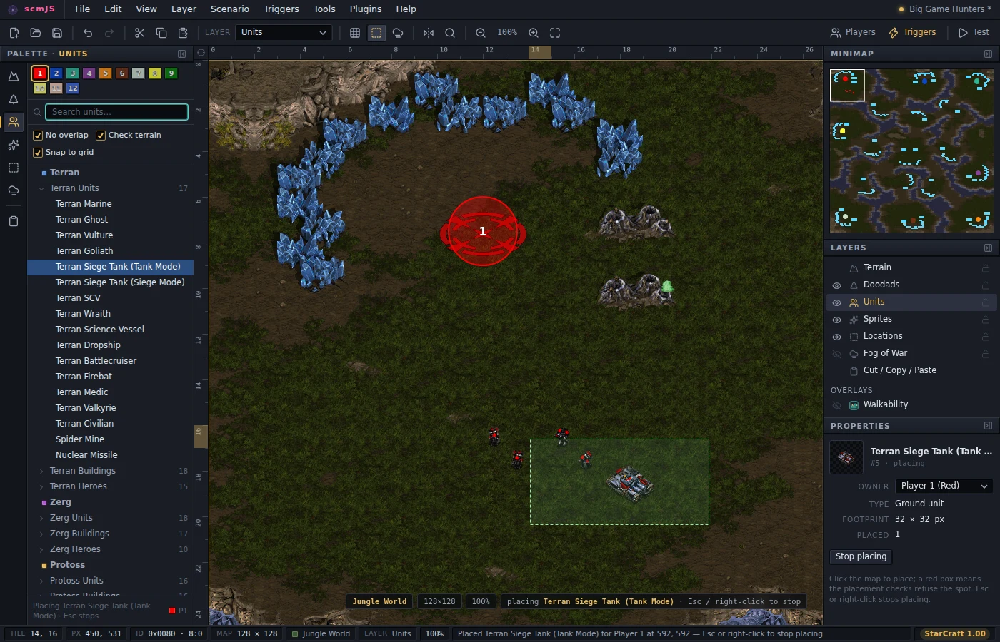

Picking a unit type arms placement, and each click on empty ground places one for the
player selected at the top of the palette. Esc or right-click stops placing and drops you
into select mode, where a click selects, a drag on empty ground marks a box, and a drag on
a unit moves it. Del deletes the selection.

**Snap to grid** puts buildings, resources, start locations and beacons on the tile grid
by their placement box, the way StarEdit stores them, and every other unit on the nearest
tile centre. Turn it off for pixel placement. It applies to a move as well as a placement,
so dragging a unit that sits off the grid brings it back onto it.

The **placement checks** are on by default and refuse a spot with a red ghost and a reason
in the status bar. They are the rules the game applies when it loads a map, silently
dropping the units that do not fit:

- no overlapping collision boxes for ground units and buildings;
- buildable tiles under a building's whole placement box;
- walkable ground under a unit.

The unit in the way gets outlined. Untick the checks to stack units on purpose, and expect
the game to keep only the first.

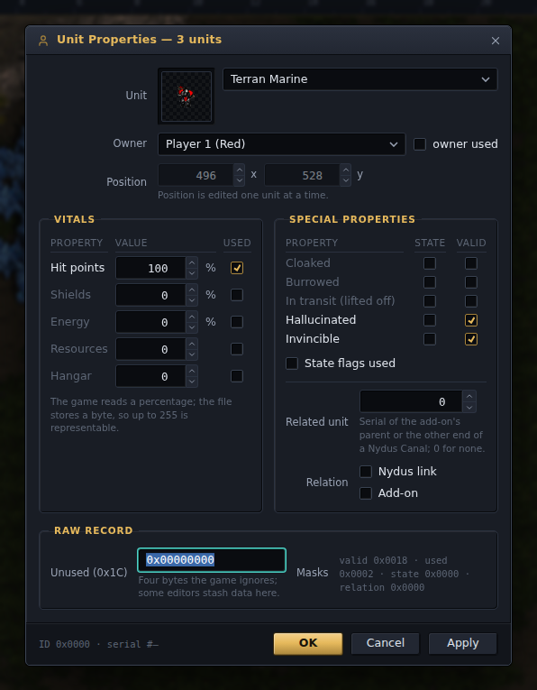

Double-click a unit for every field its record holds: owner, position, hit points,
shields, energy, resources and hangar count with their "used" ticks, the special
properties (cloaked, burrowed, lifted off, hallucinated, invincible), and the related-unit
link an add-on or a Nydus Canal uses. The game links two units only when each names the
other, so setting the related unit sets the other unit back to this one. With several
units selected, only the fields you touch are written to all of them, so a mineral line
can be set to one amount in one go.

An add-on placed in its spot beside its owner's building is linked to it, as StarEdit
does, and so is a building placed where a free add-on of its owner stands. Nydus Canals
are linked in pairs as they are placed: each one to its owner's last canal without an
exit. A Refinery, Extractor or Assimilator starts with 5000 gas, as a geyser does; without
an amount in its record it would have none in the game.

**Tools ▸ Auto-place Start Locations…** puts one start location per player on a ring or in
the corners, each moved to the nearest ground the placement checks accept, and selects
them so you can drag them where you want. For a melee map, the Melee Wizard plugin
(Plugins ▸ Browse Plugins…) lays out symmetric start locations with mineral lines and
geysers at the distance the game mines fastest from; see [Plugins](#plugins).

## Sprites

There are two kinds of sprite. Pure sprites are a graphic drawn where it stands with no
unit behind it: tree canopies, markers, glows. Unit sprites are records the game turns
into a unit when the map loads, which is how StarEdit does Installation doors and traps.

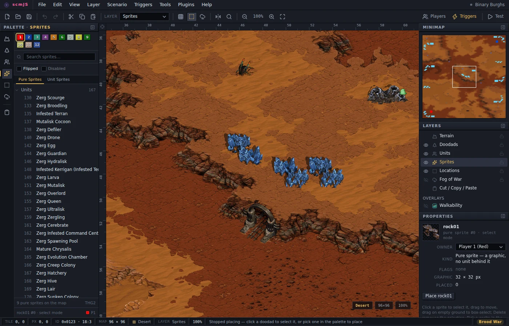

The palette has a tab for each. Pure Sprites lists all 517 entries grouped as Units,
Effects and Doodads, the last named after the graphics file since the game has no names
for them. Placement is free: click anywhere, no rules to refuse a spot. The *Flipped* and
*Disabled* ticks are the sprite flags.

Doodad overlays are ordinary sprites and can be selected here too. The Properties panel
says which doodad one belongs to, and warns that moving it alone leaves the doodad's tiles
behind.

## Locations

Locations are the rectangles that triggers refer to, as in "bring a unit to *Beacon*" or
"create a unit at *Spawn*". A melee map needs none.

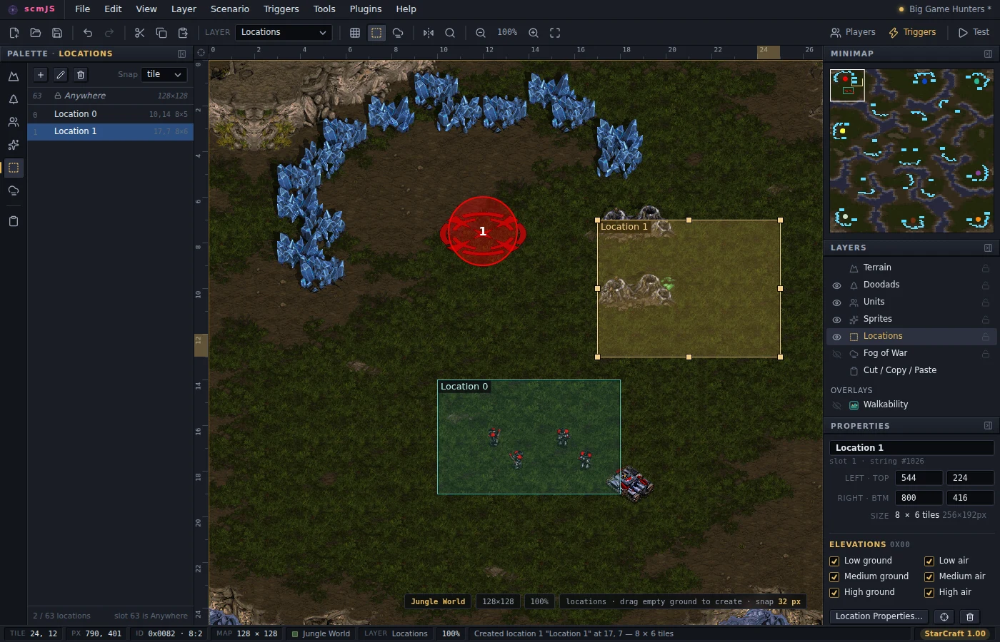

Drag on empty ground to create one, drag the eight handles to resize, drag inside to move,
and use the arrow keys to nudge the selected ones (with nothing selected they scroll the
view). *Snap* is off, 8 or 16 pixels, one tile, or 64 pixels; a move snaps the box's
corner rather than the pointer, so a box picked up off the grid lands on it. The palette
lists every location in use, and Scenario ▸ Locations… is the same list as a sortable
table.

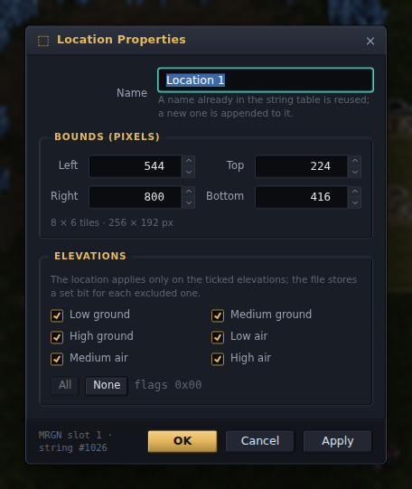

Double-click one for its name and exact bounds, and for the elevation ticks: a location
applies only on the ticked elevations, which is how you keep a trigger from firing on the
cliff above it. An amber stripe on a location's row marks one that excludes something.

A map has a fixed number of location slots — 64 in StarCraft 1.00 maps, 255 in hybrid and
Brood War ones. A new location takes the lowest free slot, deleting one empties it, and
triggers keep pointing at the slot they named.

Slot 64 is **Anywhere**, the location every trigger can pick, and the game and other
editors depend on it covering exactly the map. It is pinned at the top of the list with a
lock, never drawn, never picked by a click, and cannot be moved, renamed or deleted. If a
map's Anywhere has gone missing or no longer matches the map, the editor offers to put it
back.

A map built with eudplib (euddraft, or TrigScript's Remastered build) has no readable
locations in the file. eudplib stores its loader in the location table, scrambled, and the
game puts the real locations back when the map starts. Drawn, those slots would cover the
whole map, so the editor hides locations when it opens such a map and says so in a notice.
Its *Show* button or the Locations eye brings them back. The next map with real locations
shows them again, unless you have turned them on or off yourself in between.

## Fog of war

The fog of war decides which tiles a player starts the game unable to see. Every player
has their own. A new map starts every tile fogged for every player, and that is what the
editor draws until the first stroke. Only Use Map Settings games read the fog a map sets:
a melee game starts every player fully fogged whatever the map says.

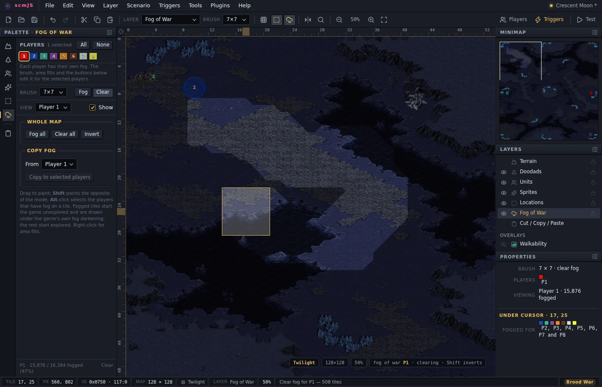

Select any of the eight players at the top of the palette and every stroke and fill edits
all of them at once; *View* picks whose fog the map and minimap show. *Fog* and *Clear*
are the brush modes, Shift-drag paints the opposite, and Alt+click picks up which players
have fog on a tile. Fog All, Clear All, Invert and Copy Fog act on the whole map for the
selected players.

Fogged tiles darken over everything, units and locations included, in the tint the game
itself uses for that tileset.

## Cut, copy and paste

To copy part of a map, drag on it with the Cut / Copy / Paste layer active (`C`) to mark a
rectangle, then Ctrl+C or Ctrl+X. On the object layers the same keys act on the selection
instead, and the clip is the selection's bounding box carrying just those objects, so a
base can be copied from either side.

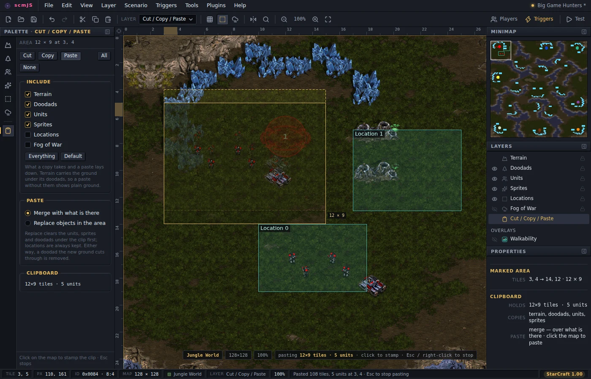

*Include* says both what a copy takes and what a paste lays down: terrain, doodads, units,
sprites, locations, fog. Terrain carries the ground under the doodads too, so a paste
without doodads shows plain ground rather than half a tree. Doodads are pasted with their
overlays, units get fresh ids with add-on and Nydus links kept when both ends came along,
and locations take free slots, which is the one thing a paste can run out of.

Ctrl+V arms the pointer with a ghost of the clip. A click stamps it and stays armed for
the next; Esc or right-click stops. *Merge* adds to what is there; *Replace* clears the
units, sprites and doodads under the clip first, though never locations. Terrain from a
different tileset is refused, since tile numbers mean something else there, while the
objects still paste. The clip survives File ▸ Open, which is how a base moves between
maps.

A piece worth keeping past this map — a ramp, a bridge, a cliff corner — can be saved as a
*stamp* (Edit ▸ Save as Stamp…, or the right-click menu on the marked area) and laid down
on any later map from Tools ▸ Stamp Library…; see [Plugins](#plugins).

## Triggers

Triggers turn a map into a scenario: *when* these conditions hold, *for* these players,
*do* these actions. A Use Map Settings map is built from them. A melee game ignores the
map's triggers and applies its own rules, so a melee map needs none. (Blizzard's melee
maps carry the three standard ones — defeat, victory, starting resources — for anyone who
plays them as Use Map Settings.)

Several editors work on the same list of triggers, and you can switch between them freely:

- **The Trigger Editor** (Ctrl+T): StarEdit's form.
- **The Text Trigger Editor**: the triggers as text in SCMDraft 2's syntax. It is a
  plugin, installed but off.
- **TrigScript**: triggers written as code. See [TrigScript](#trigscript).
- **Magenta** (Plugins ▸ Browse Plugins…): every trigger as a sentence, with a catalogue
  of StarCraft: Remastered EUD conditions and actions.

Mission briefings have an editor of their own. The [trigger reference](triggers.md) has a
page for every condition and action.

To see how a map's triggers fit together, the Trigger Map plugin (Plugins ▸ Browse
Plugins…) draws them as a graph: which triggers set a switch, a death counter or a
location and which ones read it, with a list of switches nothing sets, counters nothing
reads and triggers that never run.

### The Trigger Editor

Ctrl+T, or Triggers ▸ Trigger Editor…. A player filter on the left, the trigger list in
the middle, and for the selected trigger its players, up to 16 conditions and up to 64
actions.

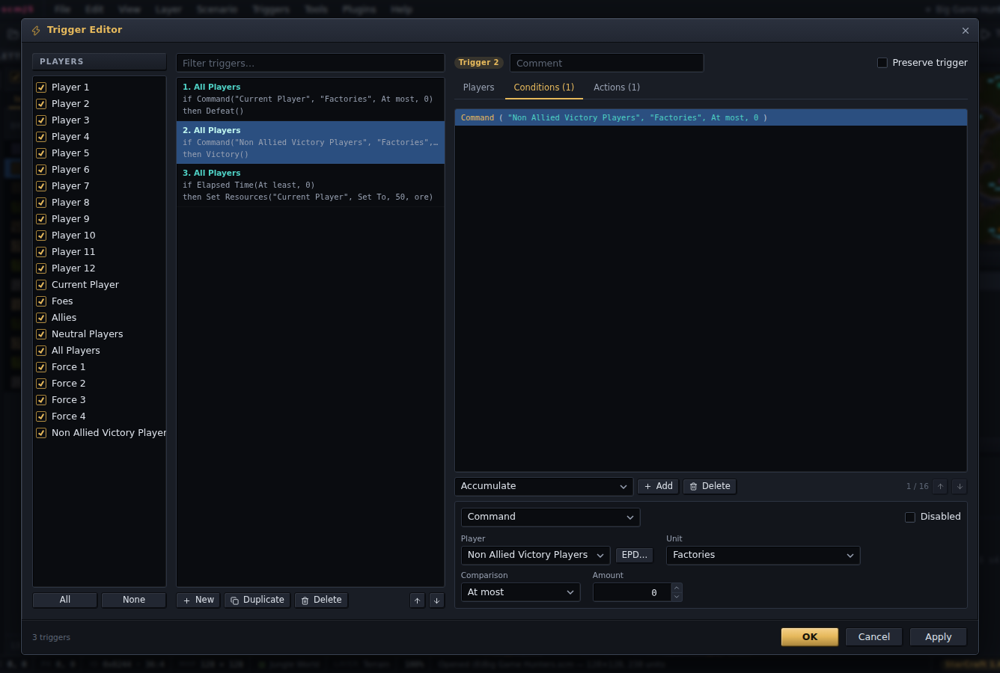

The Players tab offers the owners the game hands triggers to: Players 1–8, All Players and
the four forces. A trigger ticked for nothing else never runs, so the other groups (Player
9–12, Current Player, Foes, Allies and the rest, which are arguments rather than owners)
only show when a trigger already has one ticked, to be cleared.

Every condition and action the game has is there. Each argument gets a widget of its kind
— a player pick, a unit type list, a location list, a number, a text box with the colour
codes — and any value the lists do not include can still be typed as a raw number, which
is how EUD values and unusual unit ids get in. An item can be disabled without deleting
it; a disabled one is kept in the file and skipped by the game. *Preserve trigger* is the
flag that keeps a trigger firing more than once.

A new *Create Unit*, *Create Unit with Properties* or *Set Deaths* starts on Terran Marine
rather than *Any unit*: the game creates nothing for a unit class, and Set Deaths on *Any
unit* writes nothing. The unit list of the two Create Unit actions holds only what the
game will create, the units of StarEdit's palette; larvae, eggs, traps, doors and the like
are left out, because the game refuses them.

### The Text Trigger Editor

The same triggers as text, in SCMDraft 2's TrigEdit syntax, so text from SCMDraft pastes
in and text from here pastes back out. Compile checks it and reports the first line that
does not parse.

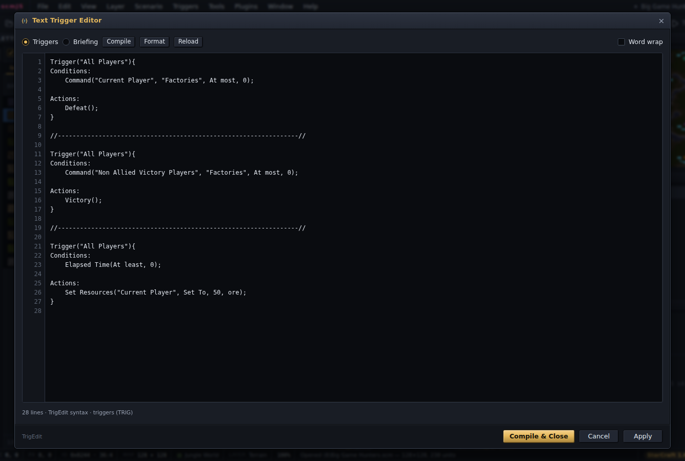

It is the [TrigEdit](https://github.com/scm-js/plugin-trigedit) plugin, installed but
starting *off*: tick it on in Plugins ▸ Manage Plugins…, and Triggers ▸ Text Trigger
Editor… and its Ctrl+Shift+T appear.

A leading `;` disables a line, and a `Flags:` block carries the trigger flags SCMDraft has
no syntax for. The *Briefing* switch at the top edits the mission briefing in the same
syntax.

### Mission briefings

Triggers ▸ Mission Briefing Editor… (also Scenario ▸ Mission Briefing…) is the same form
over the briefing actions: text, portraits, transmissions and the pauses between them, one
briefing per player. The layout matches the briefings on Blizzard's own multiplayer maps.

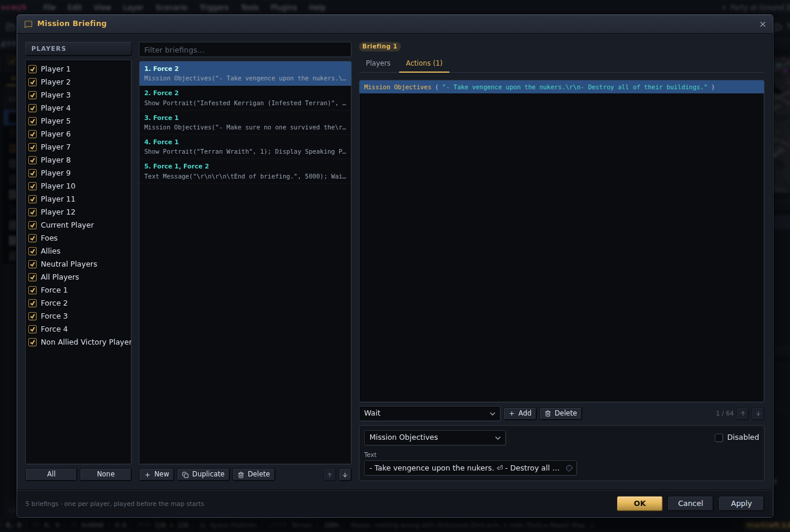

### Unit properties slots

Triggers ▸ Unit Properties Slots… is the table behind the *Create Unit with Properties*
action: 64 slots, each the hit points, shields and energy (as percentages), resources,
hangar count and special states a trigger applies to the units it creates. The action's
argument lists the slots by what they set and opens this editor on one.

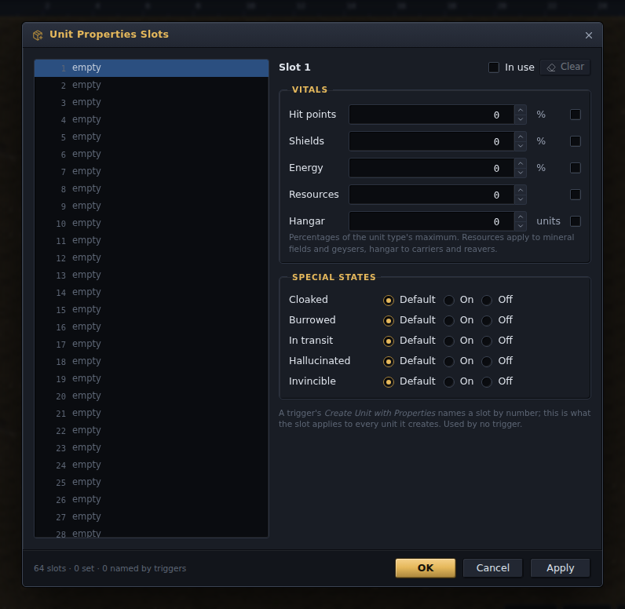

### EUD

For EUD work, the player pick next to a Deaths condition or Set Deaths action has an *EPD*
box: type a memory address and it becomes the player value that reaches it through the
deaths table, and a raw value shows which address it reaches. Check Map points out the raw
values so they are not mistaken for errors.

For named reads and writes of the game (a unit's hit points, a player's minerals), use a
[TrigScript program](trigscript.md#programs) or Magenta. Both make maps that play on
StarCraft: Remastered only.

### Importing, exporting and checking triggers

**File ▸ Import** and **File ▸ Export** (also Triggers ▸ Import Triggers… and Export
Triggers…) carry triggers as `.trg` files, SCMDraft's format, or as text. An import can be
added to the map's triggers or replace them. A `.trg` holds string numbers rather than
text, so it fits only a copy of the same map; text works between maps.

**Triggers ▸ Validate Triggers** is [Check Map](#check-map) limited to the triggers.

## TrigScript

TrigScript writes triggers as code: TypeScript files kept inside the map. It is a plugin,
on from the start, and Triggers ▸ TrigScript… opens it once a map is open. Each
`trigger()` call the script makes becomes an ordinary trigger, the same kind the Trigger
Editor shows, and plays on any version of the game. Code inside `program(() => { … })`
runs in the game itself, with variables, arrays, functions and loops, and **a map with a
program in it needs StarCraft: Remastered**.

TrigScript has [a guide of its own](trigscript.md):

- [Quick start](trigscript.md#quick-start): a first script, from opening the window to the
  triggers it makes.
- [Writing triggers](trigscript.md#writing-triggers): `trigger()` and the helpers for
  writing many at once.
- [Programs](trigscript.md#programs): code that runs in the game.
- [Testing and Simulate](trigscript.md#testing-and-simulate): trying the script in the
  simulator, and tests that run after every change.
- [The workspace](trigscript.md#the-workspace): the script window, its files, and the
  script in a panel beside the map.
- [Reference](trigscript.md#reference): every function, and what is not supported.

## Scenario settings

The Scenario menu holds the map's own tables. Each dialog is its own OK / Apply / Cancel
transaction, and what an OK or Apply wrote is one undo step: Ctrl+Z after closing the
dialog takes the whole of it back, and Ctrl+Y puts it on again.

### Map Properties, Players, Forces, Colours

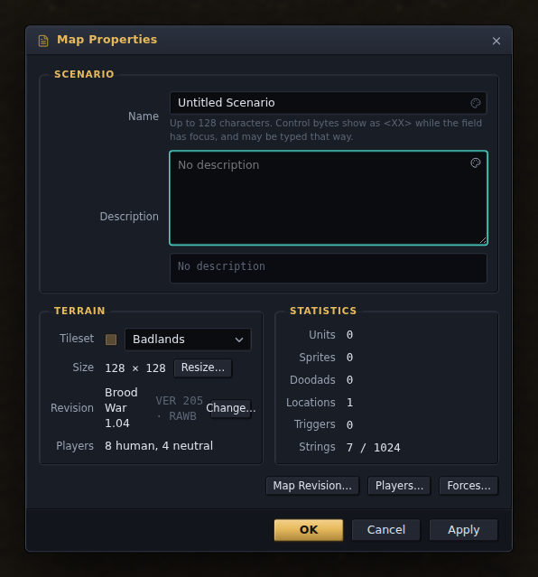

**Map Properties** (Alt+Enter) is the name and description the lobby shows, the tileset,
the size and the revision, with buttons to the rest.

Changing the tileset lays the terrain again with a terrain you pick — tile numbers mean
something else in every tileset — and drops the doodads, while units, sprites, locations,
fog and triggers stay. You can also keep the tile numbers, to see what they draw in the
new tileset. **Resize / Crop Map…** grows or trims the map about a corner or the centre.
Both clear the undo history.

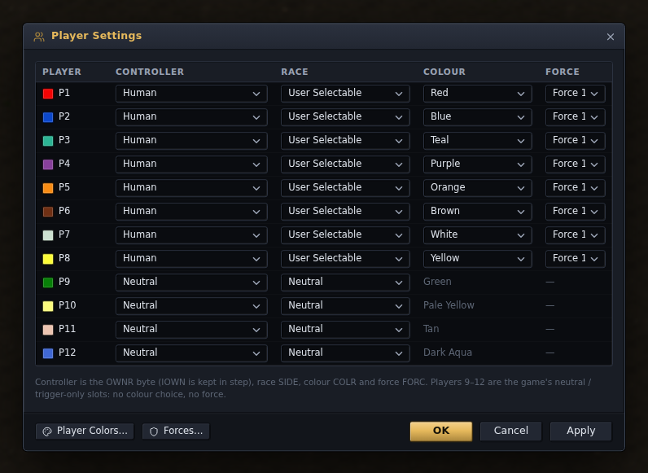

**Player Settings** is each slot's controller (Human, Computer, Rescuable, Neutral…),
race, colour and force.

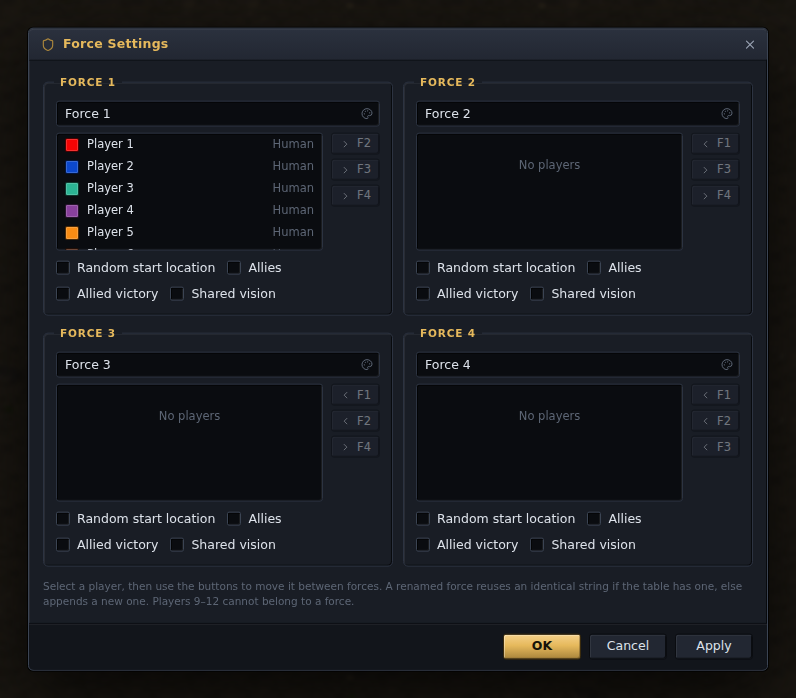

**Force Settings** groups the players into up to four teams and sets, per team, allied
victory, shared vision, allies and random start locations.

**Player Colors** picks each slot's palette colour and, for Remastered, a custom RGB,
random, or the player's own choice; the map repaints as you change them. Remastered reads
these settings in a map of any revision. Only the first twelve colours work as a palette
colour in the game: for the rest older versions show a wrong colour and Remastered the
player's usual one, and Tools ▸ Check Map says so. In Remastered, a custom RGB gives the
player any colour, those ten included.

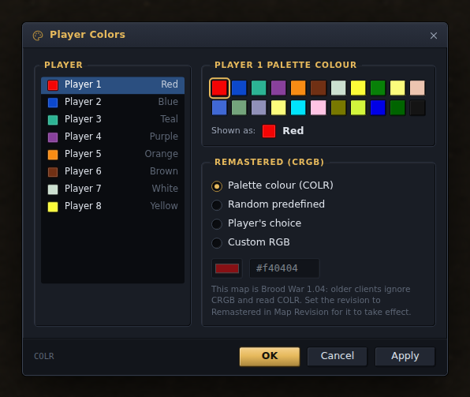

### Units, upgrades and technology

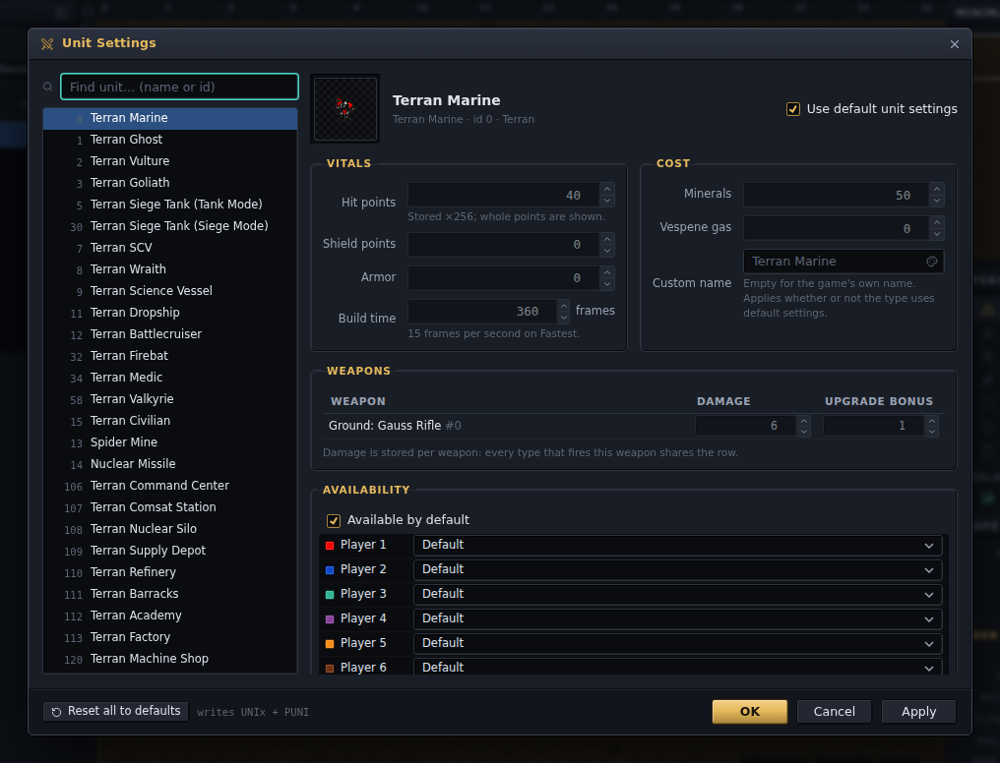

**Unit Settings**, **Upgrade Settings** and **Technology Settings** edit the cost and
availability tables:

- a unit's hit points, armour, build time, cost and weapon damage, a custom name, and
  which players may build it;
- an upgrade's cost and levels;
- a technology's cost, and whether each player starts with it or may research it.

A row on *use default* shows the game's own numbers greyed out, and starts from them when
you untick it.

### Strings

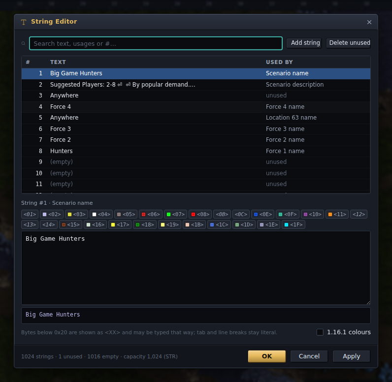

Every piece of text a map carries — its name, the force names, location names, every
trigger message — is a numbered string, and the **String Editor** lists them all with
where each is used. Edits keep their number, so triggers and locations keep pointing where
they did; *Delete unused* clears out what nothing refers to.

The row of buttons inserts the game's colour codes, each drawn in the colour it produces,
and the preview under the box shows the string the way the game draws it. The same codes
work in every field whose text the game draws: the map name and description, force names,
custom unit names, and the text of a trigger or briefing action. Each of those fields
shows the string as the game draws it until you click into it, and has a palette button at
its right-hand end.

The previews follow Remastered's rule, where a colour set on one line carries onto the
next. StarCraft 1.16.1 reset the colour at every line break, so an older map's text can
show in colours its author did not choose. The *1.16.1 colours* tick (also in Preferences
▸ View) switches every preview to the old rule, and the Repair plugin offers to write the
resets the old game supplied.

**File ▸ Export ▸ Strings (.txt)…** writes every string to a numbered text file, and
**File ▸ Import ▸ Strings (.txt)…** reads such a file back, replacing the strings by
number — a way to translate or proofread a map's text outside the editor.

**Text that looks garbled.** If a map's text opens as nonsense, often Korean or Japanese
text in an older map, the editor guessed its encoding wrong. A map file does not say what
encoding its text is in, so the editor guesses from the bytes when the map opens. Open
**Scenario ▸ Map Revision…**, choose the right encoding (*Korean*, say), and every string
is fixed at once. The same choice decides how the text is written on save, so a map made
for 1.16.1 on a Korean Windows stays readable there. A new map is UTF-8, which Remastered
reads, and a map moved to Remastered's string table becomes UTF-8 too. A character the
chosen encoding cannot hold is saved as `?`; Check Map and the Save dialog say so
beforehand.

### Sounds and switches

The **Sound Editor** lists the map's sounds with the `.wav` files in the archive: import,
play, remove, and adopt files the archive carries but the list does not. Import takes any
file the browser can decode (MP3, FLAC, AAC, Ogg, WAV in any encoding) and writes it as a
WAV in the format picked next to the button. The default, 22050 Hz 16-bit mono, is what
the game's own sounds are; the smaller presets are for maps near the size limit. A *Play
WAV* action then names the file.

A trigger can also play one of the game's own sounds, a unit's voice or an interface
click, without the file being in the map. In the Trigger Editor, **Browse…** beside a WAV
argument lists the map's sounds and the game's together. Search by file name, by unit, or
by when the unit says the line: "marine yes" finds the four things a Marine says when
ordered. In a Transmission the list opens on the lines of the unit the action already
names. The line under the field says what the path is, and warns when it is neither in the
map nor one of the game's. The list does not play the sounds.

**Switches** names the 256 switches triggers set and test, so the trigger editors show
"Gate open" rather than "Switch 3".

## Checking, testing and saving

Before a map is played, it can be checked for common mistakes, tried in the game, and
saved in the form you want to release.

### Check Map

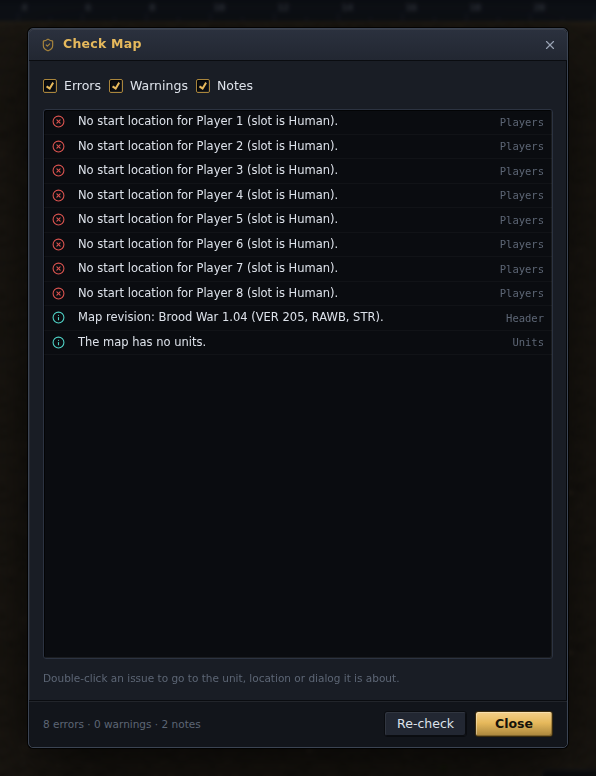

Tools ▸ Check Map… looks for what the game would refuse or silently drop:

- start locations that do not match the player settings;
- more than 1700 units, or units off the map;
- a missing or moved Anywhere location;
- triggers that point at unused locations or at strings that do not exist;
- unit and player values the game does not have, and AI scripts it does not ship;
- Play WAV actions with no file in the map;
- switches tested but never set;
- the file's own health: missing sections, player settings the game reads differently from
  StarEdit, the isometric record.

A map with triggers is a scenario and gets three more checks:

- a human player no trigger ever gives Victory or Defeat (in a scenario nobody wins or
  loses unless a trigger says so);
- no Set Mission Objectives;
- with hyper triggers present, a Wait in another preserved trigger of the same player,
  which fights them for the player's one wait slot (see [Waits](triggers.md#waits) in the
  trigger reference).

Double-click an issue to go to it. The same check runs inside the Save dialog.

### Test Map

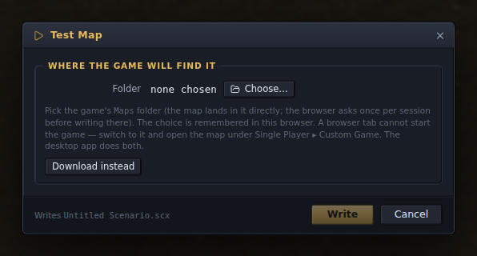

Tools ▸ Test Map (Ctrl+F5) hands the map to the game. The game cannot open a map from the
outside, so the editor writes it into a `scmJS` folder under the game's Maps folder, where
Single Player ▸ Custom Game lists it.

- **The desktop app** finds the installation (or takes a folder you pick) and starts the
  game as well.
- **Chrome and Edge** write the map into a folder you pick once. Start the game yourself
  and open the map under Single Player ▸ Custom Game.
- **Firefox and Safari** download the map; move it into the game's Maps folder.

**Tools ▸ Test Map Settings…** opens the dialog to change the folder and whether the game
starts.

**Test Map in Browser.** In the editor at scmjs.dev, **Tools ▸ Test Map in Browser** opens
the map on the site's play page, scmjs.dev/play, which runs the game in a browser tab. The
map goes straight from the editor's tab to that one, and testing again sends the new
version to the same tab. The game runs from your own StarCraft files: the first time, the
play page asks for the folder StarCraft is installed in. Blizzard's map editor download is
not enough for it.

How the map is played is set under **Edit ▸ Preferences ▸ Plugins ▸ scm-sim**:

- **Game type.** *From the map* (the default) plays with the map's own settings when it
  has computer players or units placed beyond the start locations, and as a melee game
  otherwise. *Use Map Settings* and *Melee* always play that way. *Choose on the play
  page* opens the map on the play page's setup screen, which lists the map's forces and
  slots as the game's own lobby does, and nothing starts until you press Start Game.
- **Your race**, **your slot** for Use Map Settings (the first open one, or a player you
  name), and for melee the number of **computers** and their race. Where the map fixes a
  slot's race or has fewer places, the map's settings win.

> **Note.** Test Map in Browser comes with the scm-sim plugin and appears only in the editor
> at scmjs.dev, not in the desktop app or an editor hosted elsewhere.

### Saving

Ctrl+S writes the map back where it came from.

- **Chrome, Edge and the desktop app** keep a handle to the file you opened, so Save
  writes in place once the browser has asked for permission.
- **Firefox and Safari** give the editor a file's contents but no way to write it back, so
  every save is a download, and the notice at the bottom right says so.

Save As (Ctrl+Shift+S) and Save Copy As… open the Save dialog; a copy is written without
the open map changing its name or file.

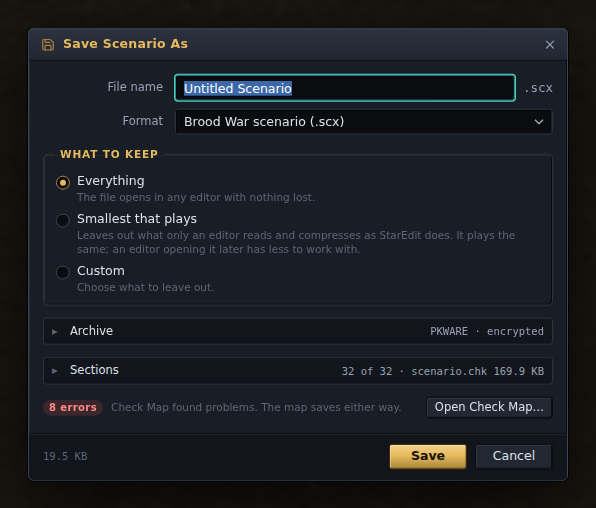

The Save dialog asks for a file name, a format and what to keep. Everything else is folded
away underneath and can be left alone:

- **Format**: `.scx` (Brood War), `.scm` (original StarCraft), or a bare `.chk`, the
  scenario alone with no archive around it.
- **What to keep**: *Everything* writes the whole file, so any editor can open it with
  nothing lost. *Smallest that plays* leaves out the parts only an editor reads (the
  isometric record, the editor's copies of the player settings and so on) and compresses
  the archive as StarEdit does; the map plays the same, but an editor opening the file
  later has less to work with. *Custom* shows each of those parts with its own tick. The
  map in the editor is not changed either way.
- **Archive** (folded): the compression, StarEdit's encryption tick, and the other files
  in the archive. PKWARE is what StarEdit writes, and every StarCraft version reads it;
  zlib is smaller but only Remastered reads it (StarCraft 1.16.1 cannot open such a map);
  none is the largest and readable by anything. A map keeps the compression it was opened
  with. The sounds and the files plugins keep in the archive each have a tick, so a copy
  for release can leave them out. Files in the archive the editor cannot name — common in
  protected maps — are kept exactly as they were, and the fold says how many there are.
- **Sections** (folded): every section the file will hold, with its size and whether it
  changed, was left out or was merged.

If Check Map finds problems, the dialog says how many beside a button that opens it; the
map saves either way. The options confirmed here are what Ctrl+S reuses for that map from
then on.

**The file a save replaces** is kept, so a bad save can be undone:

- **The desktop app** copies the old file to a `.bak` beside it first (`Lagoon.scx` to
  `Lagoon.scx.bak`, replacing an older `.bak`). If the `.bak` cannot be written (a
  read-only folder, say), the save still goes through, a notice says why, and the old file
  goes to Previous Versions instead.
- **Chrome and Edge** cannot put a file beside another, so the version replaced is kept in
  the browser's storage, the last three of each file name. **File ▸ Previous Versions…**
  lists them: **Open** puts one in its own tab with "(previous)" added to its name, and
  **Save As** writes it out as it was.
- **Firefox and Safari** download every save and replace nothing, so there is nothing to
  keep.

Preferences ▸ General ▸ Saving turns this off.

**Maps built on save.** A map with a TrigScript program is compiled by the eudplib plugin
as the file is written. The file you save is the one the game plays, and it carries the
map as you see it in the editor inside, which is what comes back when you open it again. A
notice shows while the build runs, with a button to save without waiting for it. If the
build fails, the map is still saved and the notice says what went wrong; the file lacks
the built part until a later save succeeds. Test Map builds the same way, and stops on a
failure instead.

**Save to scmjs.dev…**, under File and under Account, keeps a copy of the map on your
scmjs.dev account as a numbered revision with a note. It does not change where Ctrl+S
writes. See [Keeping maps on scmjs.dev](#keeping-maps-on-scmjsdev).

### Recovery copies

While a map has unsaved changes, the editor keeps a copy of it in the browser's storage
(the app's own storage in the desktop app): every two minutes, and whenever the editor
goes to the background — another tab, the window minimised. The copy is removed as soon as
the map is saved or closed, so a copy only survives when the editor closed with work
unsaved: a crash, a closed tab, a power cut.

At the next start the **Recover Maps** dialog lists what was left, with the map's name,
its file, its size and when it was copied. **Restore** opens the map in its own tab with
its changes unsaved, under its old file name, so Ctrl+S writes back to the same file
(after the browser asks again for permission). **Later** keeps the copies for the next
start, and File ▸ Recover Maps… lists them at any time. Maps still open in another tab or
window are never listed there.

Quitting the desktop app and answering Don't Save removes the copies. A copy only covers
changes up to the moment it was made, and it lives in this browser: it is not a backup of
the file, and clearing the site's data removes it. Preferences ▸ General ▸ Recovery turns
the copies off or changes how often they are made.

### Export an image

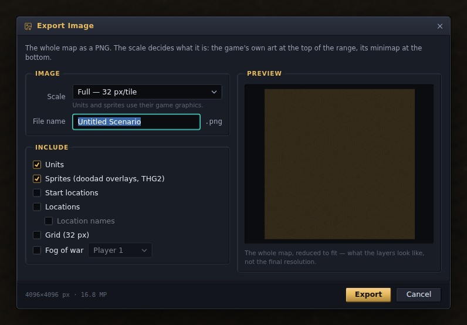

File ▸ Export ▸ Image (.png)… renders the whole map to a PNG, with one setting that
decides what the picture is: at 32 pixels per tile it is the full game art, at 8 or 16 the
same smaller, at 4 and 2 the average tile colours with units as minimap dots, and at 1
pixel per tile it is the game's minimap. Units, locations, fog and the grid are each a
tick.

To show how a map was made rather than how it ended up, the Timelapse plugin (Plugins ▸
Browse Plugins…) records the map one change at a time and exports the recording as a GIF
or a WebM video; see [Plugins](#plugins).

Tools ▸ Statistics… counts what the map holds — units per player, resources, doodads,
triggers, strings — and Ctrl+F finds a unit, location, sprite, string or trigger by name.

## Replays

The editor opens StarCraft replays (`.rep` files) and shows, on the map the game was
played on, what the players did: where buildings went down and when, where units were
sent, each player's build order and actions per minute, and the chat, on a timeline you
can scrub or play. Map makers use it to see which paths and chokes players use, where and
when they expand, and whether one start location plays differently from another.

Replays come with the [Aftermath](https://github.com/scm-js/plugin-aftermath) plugin,
which is installed and on from the start. To open one:

- **File ▸ Open Replay…** picks one or more replays;
- **File ▸ Open…** takes a replay as well as a map;
- dropping replays anywhere on the editor opens them.

Replays from every version of the game are read. **View ▸ Aftermath** opens Aftermath's
panel with no replay in front, to drop replays on.

### A replay's tab

Each replay opens the map it was played on in a tab of its own. A replay opens view-only:
its tab has an eye where the unsaved-changes dot would be, and the status bar says *View
only*. You can scroll, zoom, switch layers and select things, but nothing can be changed
or saved:

- the palette, Layers and Properties panels are hidden (the View menu has the layer
  switches);
- the tools do nothing, and every menu item and dialog that would change the map is
  greyed;
- the toolbar leaves out Save, Undo and Redo, Cut and Paste, the brush, Symmetry, Players
  and Triggers, and has an **Edit a Copy** button in place of Save.

Save Copy As… still works. **Edit a Copy** (the button, or File ▸ Edit a Copy) opens an
ordinary copy of the map in a new tab, which asks where to save the first time you save
it.

Switching tabs switches replays, each keeping its own place on the timeline, and closing
the tab closes the replay.

### The timeline and the panel

While a replay's tab is in front, a timeline runs under the map: Play and Pause, the time
and the speed, a graph of the game, and marks for the fights, the chat and players
leaving. Space plays and pauses, ← and → go ten seconds back or on (a minute with Shift),
and Home and End go to the start and the end.

The column on the right has the game's details, the players, and tabs for the build order,
the chat and the rest. On the map, each player's buildings and orders are drawn in their
colour as the timeline moves. The [Aftermath
README](https://github.com/scm-js/plugin-aftermath#use) describes every part.

### The Replay view

In the editor at scmjs.dev, a replay's tab opens on the **Replay**: the game itself
replaying in the map's place, from the game's files you installed. Blizzard's map editor
download is enough for this. A switch in the top-left corner goes between the Replay and
the **Map**, the overhead view with Aftermath's marks and heat maps. The timeline drives
whichever is shown.

While the Replay is shown, the editor keeps what still makes sense there:

- zoom works on it: View ▸ Zoom In and Zoom Out, Zoom to Fit, and the toolbar's
  magnifiers;
- the grid, the locations and other plugins' overlays are drawn over it, and View ▸ Grid,
  Locations and Location Names turn them on and off;
- View ▸ Fog of War shows the game's own fog, through the eyes picked in the **Vision**
  menu under the replay: everyone, or one player;
- the status bar's tile and position follow the pointer, and the minimap shows where the
  game looks; press or drag on it to move the game's camera;
- pointing at a unit shows what the game's console would: its name, owner, hit points and
  what it is doing.

What only applies to the map behind it — the layers, selecting, the clipboard, Find, the
brush and the map's own toggles such as Units or Elevation — is left off the toolbar and
greyed in the menus.

### Analysis

In the editor at scmjs.dev, every replay you open is also analysed: the game is played
through in the background to see what really happened rather than what was ordered. Once
it is done, Aftermath shows the units where they stood, what each player really built and
lost, the fights and the key moments, and a camera (*Spectate*) that follows the action.
**View ▸ Replay Analysis** opens a larger window with each player's economy and tech over
the game.

Open several replays of one map and **Map stats** takes them together: how each start
location did, which bases were taken and when, where the fights happened, and the ground
no unit ever entered.

> **Note.** In the desktop app and an editor hosted elsewhere, Aftermath works from the
> players' orders alone: there is no Replay view and no analysis.

## Plugins

Plugins add tools to the editor, and several of the tools in this guide are plugins. Most
come installed and on; a few more are a click away in **Plugins ▸ Browse Plugins…**.

| Plugin | Starts | Where | What it does |
| --- | --- | --- | --- |
| [Aftermath](https://github.com/scm-js/plugin-aftermath) | On | File ▸ Open Replay… | Opens replays over their map; see [Replays](#replays) |
| [eudplib](https://github.com/scm-js/plugin-eudplib) | On | Save | Builds TrigScript programs into the saved map |
| [Paint](https://github.com/scm-js/plugin-paint) | On | Tools ▸ Paint… (Ctrl+Shift+P) | Lines, shapes, spray and text, from the palette's pick |
| [Repair](https://github.com/scm-js/plugin-repair) | On | Tools ▸ Repair Map… | Repairs damaged and protected maps as they open |
| [scm-sim](https://github.com/scm-js/plugin-scm-sim) | On | Tools ▸ Test Map in Browser | Plays the map on scmjs.dev/play |
| [scmjs.dev](https://github.com/scm-js/plugin-scmjs-dev) | On | Account menu | Your [scmjs.dev account](#your-scmjsdev-account) |
| [scmscx.com](https://github.com/scm-js/plugin-scm-scx) | On | File ▸ Find on scmscx.com… | Searches the scmscx.com map archive |
| [Stamp Library](https://github.com/scm-js/plugin-stamp-library) | On | Tools ▸ Stamp Library… (Ctrl+Shift+L) | Pieces of map kept across maps |
| [Terrain from Image](https://github.com/scm-js/plugin-image-to-terrain) | On | File ▸ Import ▸ Terrain from Image… | Turns a picture into terrain |
| [TrigScript](https://github.com/scm-js/plugin-trigscript) | On | Triggers ▸ TrigScript… | Triggers as code; see [TrigScript](#trigscript) |
| [Walkability](https://github.com/scm-js/plugin-walkability) | On | View ▸ Walkability (Ctrl+Shift+W) | The ground as a unit walks it |
| [TrigEdit](https://github.com/scm-js/plugin-trigedit) | Off | Triggers ▸ Text Trigger Editor… (Ctrl+Shift+T) | Triggers as SCMDraft text |
| [Magenta](https://github.com/scm-js/plugin-magenta) | Browse | Triggers ▸ Magenta… | Triggers as sentences, with Remastered EUD |
| [Melee Wizard](https://github.com/scm-js/plugin-melee-wizard) | Browse | Tools ▸ Melee Wizard… (Ctrl+Shift+M) | Start locations and mineral lines |
| [Section Explorer](https://github.com/scm-js/plugin-section-explorer) | Browse | Tools ▸ Section Explorer… (Ctrl+Shift+H) | The map file, section by section and byte by byte |
| [Timelapse](https://github.com/scm-js/plugin-timelapse) | Browse | View ▸ Timelapse… | Records the map as you build it |
| [Trigger Map](https://github.com/scm-js/plugin-trigger-map) | Browse | Triggers ▸ Trigger Map… | The triggers as a graph |

*On* plugins are installed and running; *Off* is installed but needs ticking on in Plugins
▸ Manage Plugins…; *Browse* is installed from Plugins ▸ Browse Plugins….

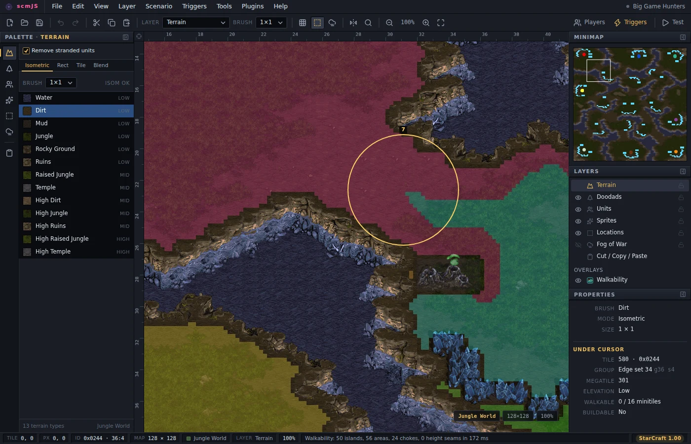

A few that need more than a line:

- **Paint** lays down whatever the active layer's palette has picked, so it paints units,
  doodads, sprites, terrain or fog depending on the layer.
- **Stamp Library** keeps named pieces — a ramp, a bridge, a cliff corner, a mineral line
  — in the browser's storage. Click one and it hangs under the pointer, drawn with the
  map's graphics; click to lay it down. Stamps can be searched, tagged, exported and
  shared as a line of text.
- **Melee Wizard** lays out symmetric start locations, and mineral lines and geysers at
  the distance the game mines fastest from, with presets for main, natural and third, a
  symmetry check and a resource summary.
- **Timelapse** records one frame per change and plays the recording back with a box
  around each change. Export it as a GIF or a WebM video. Opening the same file again
  carries on the same recording.
- **scm-sim** is the game engine behind the play page. Besides Test Map in Browser, it is
  what Aftermath and Walkability use to have the game play a replay or walk a map. It
  works only in the editor at scmjs.dev.
- **eudplib** has no window of its own. It builds the parts of a map that need StarCraft:
  Remastered — a TrigScript program, Magenta's EUD triggers — when the map is saved.

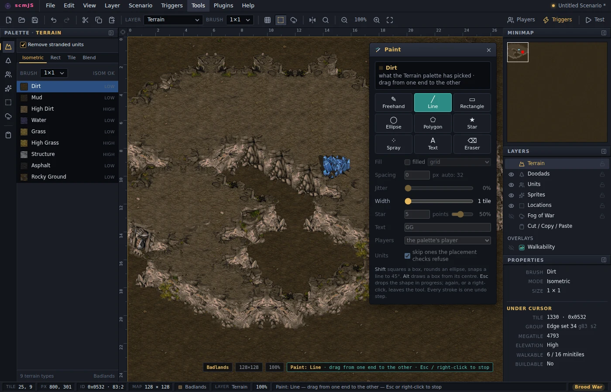

Each plugin's own README, linked in the table, has the details.

### Adding and managing plugins

**Plugins ▸ Browse Plugins…** lists the plugins the project publishes; press Install on
one and it shows where the code comes from before adding it. The plugins listed there are
reviewed before they are listed.

**Plugins ▸ Manage Plugins…** lists what is installed, turns each on or off, and takes the
address of any other plugin: a GitHub repository, a link to its `plugin.json`, or
`http://localhost:3000/` while you write one. A plugin that has settings keeps them on its
own page under Edit ▸ Preferences ▸ Plugins.

There is no sandbox: a plugin has the same access as the editor itself, so only add
plugins you trust. The Add screen shows the manifest, the repository and the addresses the
plugin will fetch from.

Browse Plugins also lists two plugins for people writing their own: [Hello
World](https://github.com/scm-js/plugin-hello-world), an example with nothing in it but a
Tools menu item, and the [API
Playground](https://github.com/scm-js/plugin-api-playground), a code editor for trying the
plugin API on the open map. Installing plugins, what they are allowed to do, and writing
one are covered in [docs/plugins.md](plugins.md).

## Your scmjs.dev account

[scmjs.dev](https://scmjs.dev) is the project's own service. An account there does two
things for the editor:

- it keeps maps for you, with a history of revisions and links that give anyone a copy;
- it lets you share the map you have open so others can edit it with you at the same time
  ([Editing a map together](#editing-a-map-together)).

None of it is required. The editor works completely without an account, and it sends
nothing to scmjs.dev until you use one of these features; there is no request at startup
unless you are already signed in.

All of it lives in the scmjs.dev plugin, which is installed and on from the start. If you
would rather not see the Account menu at all, turn the plugin off in Plugins ▸ Manage
Plugins….

### Signing in

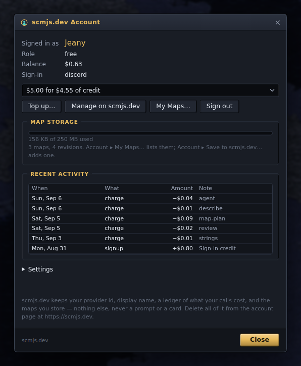

**Account ▸ Sign in to scmjs.dev…**, or the *Sign in to scmjs.dev* cell at the right end
of the status bar, starts the sign-in. Sign in with Discord: the provider's own page opens
in a small window, you approve it there, and the window closes itself. The editor never
sees a password, only a display name and an id from the provider.

Signed in, the same cell (or **Account ▸ Account…**) opens the Account dialog, which
shows:

- your name and the sign-in you used;
- a *Status* list of what the account can use: map storage, shared editing, and the AI
  features (on your own key; see [The AI](#the-ai));
- how much of your map storage is in use;
- the maps you are sharing (see [Your shared maps](#your-shared-maps)).

Its buttons open your account page on scmjs.dev (to link another sign-in, or delete the
account and everything with it), open My Maps, and sign out. Under *Settings*, a tick
hides the status-bar cell.

scmjs.dev keeps the id and display name from your sign-in and the maps you store there.
The account page deletes all of it.

### Keeping maps on scmjs.dev

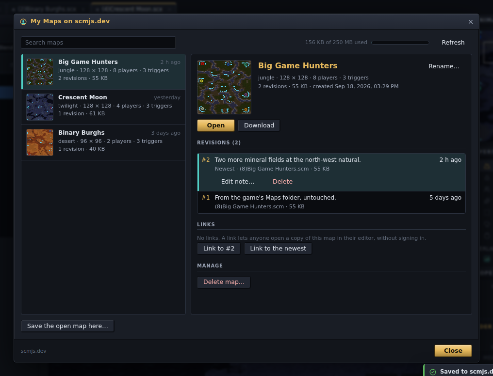

**Account ▸ My Maps…** — also File ▸ Open from scmjs.dev… — lists the maps on your
account, newest change first, each with a picture, its tileset, size and player count, and
how many revisions it has. The box above the list searches the names, tilesets, file names
and notes. The map you last opened or saved from here is picked when the list arrives, and
its revisions appear on the right: the number, the note you wrote, the file name, the size
and when it was saved. Up and Down move through the list, and Enter opens the map.

- **Open** puts the picked revision in the editor, asking first if the map you have open
  has unsaved changes.
- **Download** saves the file to disk as it was uploaded.
- The note can be added or edited later, and the map renamed.
- A revision can be deleted, except the last one — delete the map to remove it.

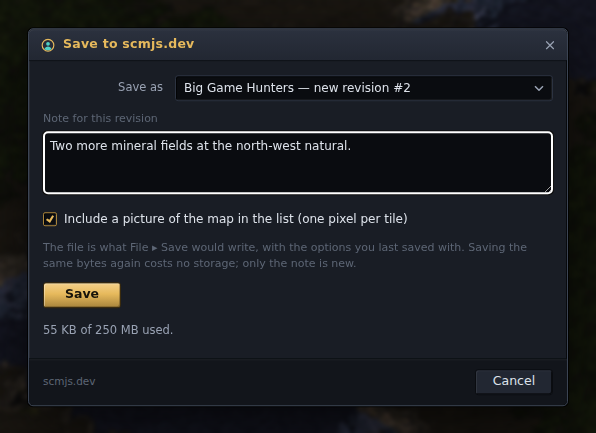

**Account ▸ Save to scmjs.dev…** — also under File, beside Save Copy As — saves the open
map to the account, as a new map or as the next revision of one you pick; the map it was
opened from or last saved to is picked for you. Write a note saying what changed, and tick
whether to include a one-pixel-per-tile picture for the list. The file is what File ▸ Save
would write, with the save options you last confirmed, so what comes back is playable. It
is a copy: Ctrl+S goes on writing to the file on your disk, and nothing on the account
changes until you save there again.

Revisions are numbered in order and a number is never reused. Saving a file whose bytes
are already on the account costs no storage — only the new note is kept. Storage is 250 MB
per account, shown as a bar in both dialogs.

### Giving someone a copy

A link can hand a map to anyone: whoever opens it gets a copy of the map in their own
editor, without signing in. The copy is theirs — it opens as a new file, File ▸ Save asks
where to keep it, and nothing they change reaches your map. To edit a map together
instead, see [Editing a map together](#editing-a-map-together).

**Account ▸ Copy Link to This Map…** saves the open map to your account — as the next
revision of the map it came from, or as a new map — and gives you the link, already on the
clipboard. The link opens the version you just saved, so a link you have posted somewhere
does not change under the people who follow it; tick *Let the link follow my later saves*
for one that opens whatever you save to that map next.

Pasted into Discord, Slack, a forum or most other places that show previews, a link to the
web editor shows a card with the map's name, who shared it, its tileset, size and players,
and its picture. A link that has been removed shows a card saying it no longer works.

**Embed…** beside a link in My Maps gives you that card as a picture to put somewhere
yourself, with the link around it: a forum post or signature (BBCode), a GitHub README or
a Discourse forum (Markdown), or a website (HTML). Pick the large picture (1200 × 630) or
the small one (600 × 315) for a signature, and copy the code. The picture's own address
opens nothing: only the link you wrap it in does. When the link is removed, the picture
says the map is no longer shared.

The picture of the map on the card is drawn by your editor when it saves the map to
scmjs.dev, so a map saved without the game's graphics installed shows its size instead.

In **My Maps**, the *Links* part of a map lists its links, how many times each was opened,
and **Remove** for each; a removed link stops working at once and the map stays. *Link to
#3* makes a link to the revision you are looking at, *Link to the newest* one that follows
your saves. Deleting a revision removes the links to it, and deleting a map removes all of
its links. A map can have ten links.

Opening a link starts the editor with an *Open a Copy* dialog showing the map's name,
picture, size and who shared it; **Open a copy** opens it. **Account ▸ Open a Map Link…**
takes a link pasted in, which is the way in the desktop app.

## Editing a map together

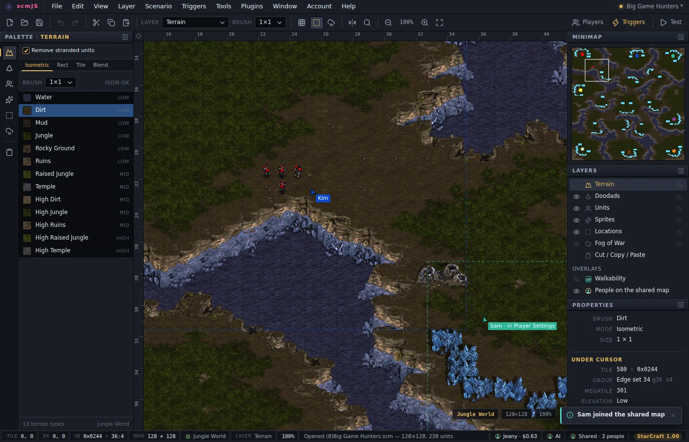

Several people can work on one map at the same time, each in their own editor. One of them
shares the map they have open and sends the others a link; whoever opens it gets the map
in their editor, and from then on every change anyone makes shows up for everyone:
terrain, doodads, units, sprites, locations, fog, the settings dialogs, triggers, strings
and sounds. Each person also sees the others' pointers on the map with their names, a
dashed box in their colour around what each of them has on screen, and which dialog they
are in.

Sharing goes through scmjs.dev: the person who shares needs a signed-in
[account](#your-scmjsdev-account), and the people joining need only the link.

### Sharing a map

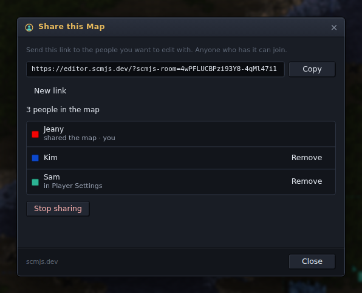

**Account ▸ Share this Map…** asks for a name for the map (its own name to start with) and
how long to **keep it open**, and copies it to scmjs.dev when you press **Start sharing**.
The dialog then shows the link: **Copy** puts it on the clipboard for you to send. A cell
appears in the status bar — *Shared · 3 people* — and clicking it opens the dialog again.
Pasted into Discord, Slack or a forum, the link shows a card with the map's name, who
shared it and, for a map kept open, its picture.

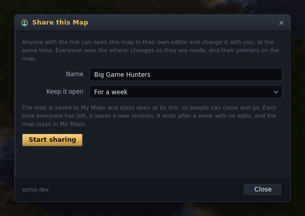

*Keep it open* decides what happens when people leave:

- **Until everyone leaves** (the choice to start with) shares the map only while people
  are in it. Nothing is stored: sharing ends when you stop it, half an hour after the last
  person leaves, or when the server restarts.
- **For a day**, **for a week** or **for a month** saves the map to [My
  Maps](#keeping-maps-on-scmjsdev) and keeps it open at its link, so people can come and
  go as they like, on different days if they want. Each time everyone has left, the map is
  saved as a new revision with a note naming who changed it (*Edited together: Kim, Sam*),
  and the next person to open the link carries on from there. The time counts from the
  last edit, so a map people are working on stays open, and one nobody has touched for
  that long ends. The dialog shows the date: *ends 3 Oct unless someone edits it*.
- **Until I end it** keeps it open with no time limit. It still ends after a year with no
  edits.

When a map kept open ends, only the sharing ends: the map and its revisions stay in My
Maps. If the map in front came from My Maps, sharing it adds a revision to that map rather
than making a second one.

The dialog lists who is in, in the colour their pointer is drawn in, and what each of them
has open. The link is the key: anyone who has it can join and edit, so send it only to
people you want in the map. Only you, as the person who shared it, see the link and the
controls:

- **Remove** sends one person out of the map. They keep what they had.
- **New link** makes the old link stop working without sending anyone out, for when the
  link went further than you meant.
- **Stop sharing** (**End sharing** on a map kept open) ends it for everyone. On a map
  kept open, **Leave** takes only you out and leaves it open for the others; you can
  change how long it stays open here too.

Up to eight people can be in one map, and an account can share five maps at a time,
counting both kinds. A map shared from the desktop app gets a link to the web editor,
since that is what anyone can open.

### Your shared maps

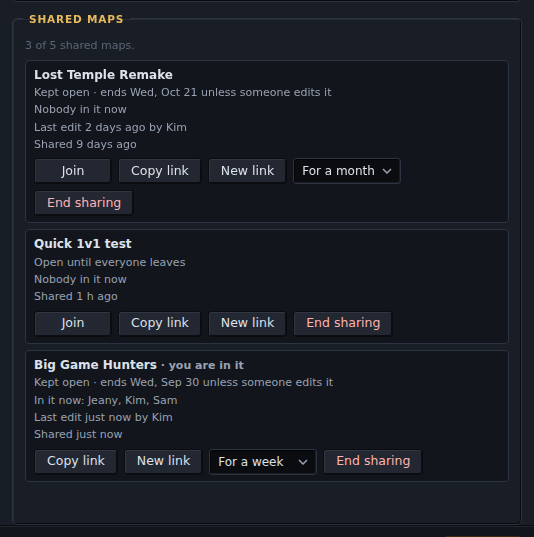

The **Shared maps** part of **Account ▸ Account…** lists every map you are sharing: who is
in it now, the last edit and who made it, and when it ends. Each has **Join**, **Copy
link**, **New link**, how long to keep it open, and **End sharing**. When you are already
sharing five, Share this Map… shows the same list so you can end one first.

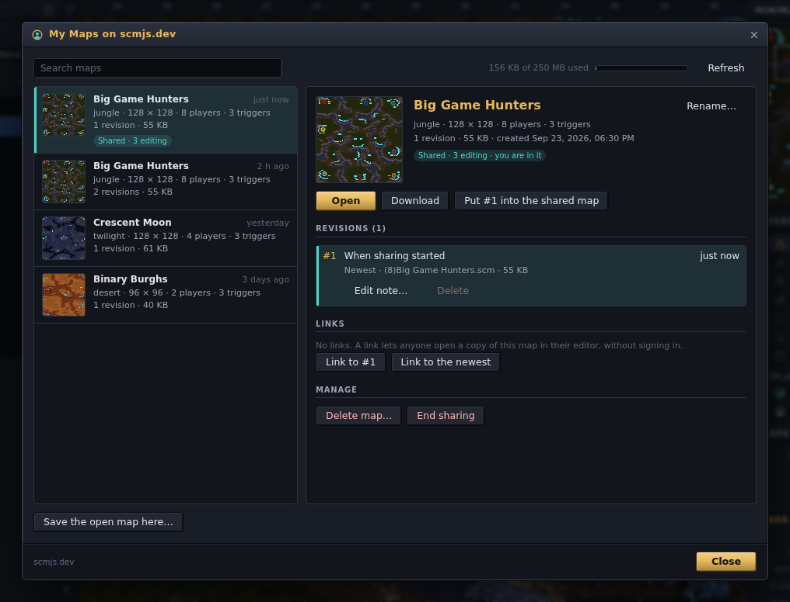

A map kept open also has **Embed…** in that list and in the Share dialog. Its picture can
open a copy of the map (the default; a link to the newest revision is made for it) or the
shared map itself. The second lets anyone who sees the picture join and edit, and the
dialog says so; **New link** is the way back if it went further than you meant.

In **My Maps** a map kept open says so (*Shared · 2 editing*, or when it ends), and
**Join** opens it with whoever is there; **Open** still gives you a revision on its own.
While you are in one of your maps kept open, a revision of it has **Put #N into the shared
map**, which replaces the map for everyone with that revision: the way back if someone
spoiled it. Everyone's undo history starts again, as after a resize, and the map as it was
is not kept unless you saved it first.

### Joining

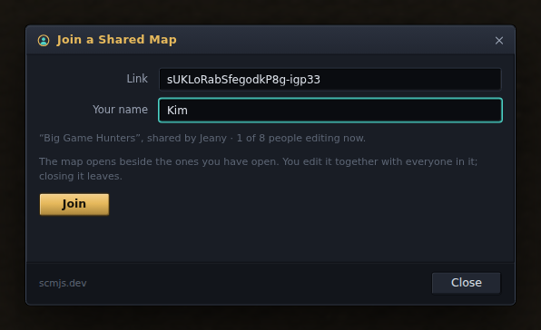

Open the link in a browser and the editor starts with the Join dialog up. In the desktop
app, or in an editor that is already open, paste the link into **Account ▸ Join a Shared
Map…**. The dialog says which map the link leads to, who shared it and how many people are
in it; type the name the others will see you by and press **Join**. The map opens in a new
tab beside whatever you had open (or in place of the empty map the editor starts with).
Closing that tab leaves the shared map.

You can be in one shared map at a time. Joining another leaves the first, which stays open
as an ordinary map.

### Talking to each other

While a shared map is in front, a **Chat** button sits in the bottom-right corner of the
map, next to the tileset and zoom. It opens a small window over the map with what everyone
has written and a line to type in; Enter sends. What you type there goes to everyone in
the map and nowhere else, and typing in it does not trigger the editor's shortcut keys.

When the chat is closed, a new message shows as a notice and as a count on the button.
Anyone who joins later sees what was said before them. The chat is kept only while people
are in the map: it is gone when sharing ends, or when everyone has left a map kept open,
and it is not saved with the map.

### When two people change the same thing

- **Your stroke is never cut in two.** While you hold the mouse button on the map, other
  people's changes wait and arrive when you let go. The same happens while a dialog that
  edits the map is open (Player Settings, the Trigger Editor, Unit Properties and the
  like); the others see that you are in it, next to your pointer and in the Share dialog.
- **The later change wins.** If two people paint the same tile, the change the server got
  second stays. If two people move the same unit, the first move stands and the second is
  dropped, because the unit is no longer where the second person's editor had it; the
  status bar says when some of your change no longer applied. A dialog's OK writes its
  whole table, so if two people change the triggers at the same time, the second OK wins.
  When you see someone in the Trigger Editor, talk before you open it too.
- **Undo is yours.** Ctrl+Z takes back your own changes, not other people's, and leaves a
  tile alone once someone else has painted over it. Undoing your own OK puts a table back
  only if nobody has written it since.
- **Resize, a tileset change and a raw section edit** replace the whole map for everyone,
  and everyone's undo history starts again, as it does when you do them alone.

### Saving, and when it ends

Saving is each person's own: File ▸ Save writes your copy to your disk, and anyone in the
map can save at any time. A map shared *until everyone leaves* is kept on scmjs.dev only
while it is shared, and nothing of it is stored there afterwards; a map kept open is one
of the sharer's maps in My Maps, and its revisions stay there after sharing ends. Everyone
still has the map open in their editor when sharing ends, so nobody loses work — save it.

A server restart ends a map shared until everyone leaves, but not a map kept open: the
editors in it reconnect on their own when the server is back and carry on.

If your connection drops, the status bar says *Reconnecting…* and you can keep working:
your changes are kept and sent once the connection is back, and you get everyone else's
changes from while you were gone. The others see you as having lost the connection
meanwhile. If you are away so long that the server has moved on, the shared map opens
again in a new tab with everyone's latest, and your copy stays open in its own tab, with a
note saying how many of your changes the others never got. After two minutes of trying,
the editor gives up and leaves the shared map; the map stays open, and the link still
works.

If the server cannot take one of your changes, your editor leaves the shared map and says
so. The map stays open; save it, or open the link again to carry on with everyone's
latest.

## The AI

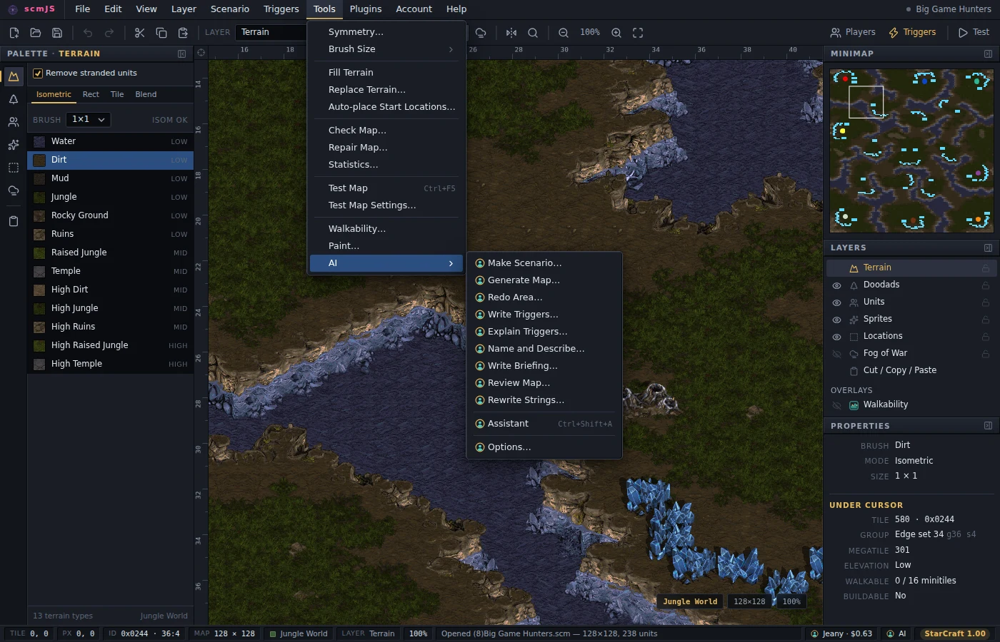

**Tools ▸ AI** holds an assistant that reads and edits the open map with you, and tools
that lay out maps, write triggers, names and briefings, review a map and rewrite its
strings. They come with the scmjs.dev plugin and run on your own Anthropic API key.

### Adding your key

1. Make an API key at [console.anthropic.com](https://console.anthropic.com).
2. Open **Edit ▸ Preferences ▸ Plugins ▸ scmjs.dev** (or *Add your key…* in the Account
   dialog), paste the key under **Your Anthropic key** and press **Check and use**.
3. The key is checked with Anthropic first, which costs nothing. When it passes, the
   **Tools ▸ AI** menu, the assistant and the AI buttons in the editor's dialogs appear.

No scmjs.dev account is needed for this. Anthropic bills each request to your Anthropic
account. The key stays in your browser: scmjs.dev passes it on with each AI request and
keeps no copy. **Forget the key** on the same page removes it, and the AI features with
it.

A few things are the same for every feature:

- **What is sent.** Only what the feature needs: what you typed and the map's facts (size,
  tileset, players, what is where), and for some features a picture of the map, the
  strings or the triggers. The map file itself is never sent.
- **Undo.** Every change the AI makes is one undo step, labelled "AI: …", including what
  it writes to the name and description, strings, triggers, players and unit settings.
- **Cost.** Every AI dialog shows its progress while you wait, and what the request cost
  when it finishes.

### The assistant

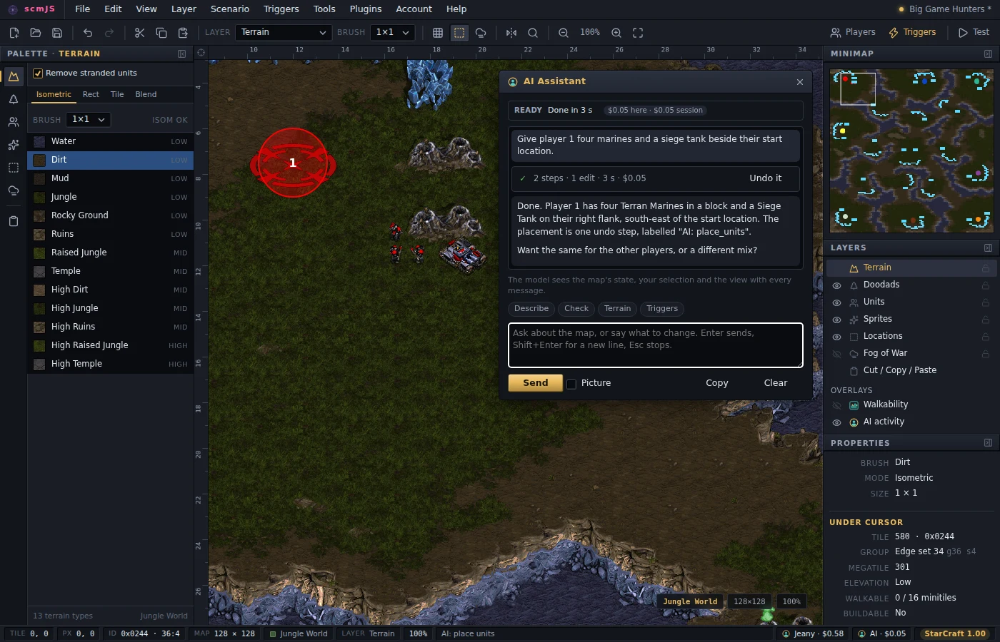

**Assistant** (Ctrl+Shift+A, or the *AI* cell in the status bar) opens a conversation
about the open map. Ask a question or say what to change, and the assistant reads the map
and edits it with the editor's own tools while you watch.

- **What it reads:** everything — units and their properties, doodads, sprites, locations,
  strings, switches, sounds, triggers and the trigger script, unit, upgrade and technology
  settings, fog, terrain, Check Map results, your selection, and a screenshot of any area.
- **What it changes:** nearly everything the editor can, from terrain and units to
  triggers, players and forces, settings and the map's size. It draws terrain as shapes —
  a plateau with a ramp that fits, a lane that stays walkable, a river with a bridge — and
  can tell you whether units can walk from one place to another.

Each turn is folded into one block under your message. While it runs, the block shows the
latest steps (**▸** a read, **✎** a change), and the map outlines what is about to change
and follows the work, zooming out but never in. Scroll or zoom yourself and the view stays
where you put it for the rest of the turn. When the turn ends, the block shows the steps,
the time and the cost, with an **Undo** button that reverses the whole turn. Escape stops
a turn.

To start a message, use the suggestion chips above the input, or right-click the map and
choose *Ask AI about this spot / the selection / this area…*. Tick *Picture* to send a
screenshot of the visible area. Player Settings has a *Set up with AI…* button that sets
up players and forces from one sentence. After 24 rounds of tool calls the assistant stops
and offers to continue.

### Make Scenario

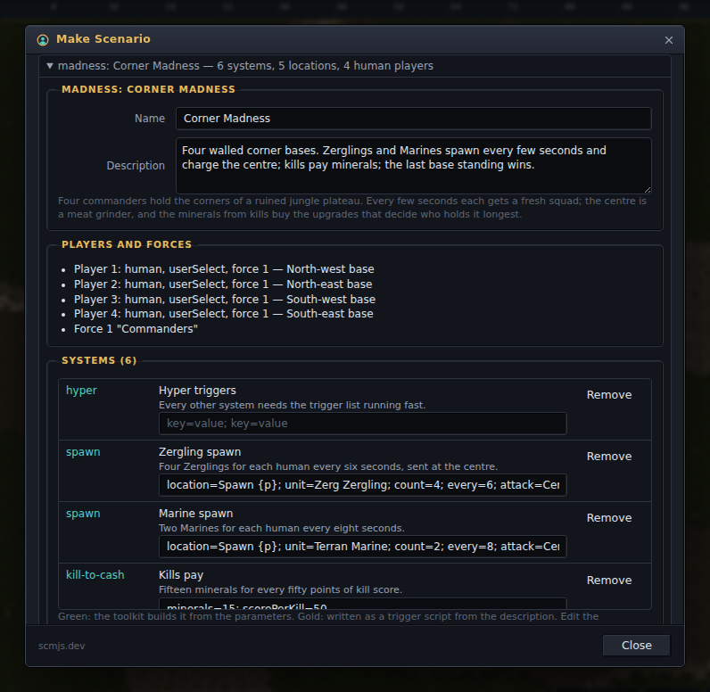

**Make Scenario…** builds a whole scenario from a sentence, such as "a madness map" or "a
two-lane tower defense". Set the size, tileset and number of players and press **Design**.

1. **The design.** The model writes a design document first: the premise, the players and
   forces, each trigger system and its settings, the layout and its locations, the
   objectives and the briefing. Edit it directly, or describe what should change and press
   **Design again**. A location name can include `{p}`, as in "Spawn {p}", to build that
   system once per player.
2. **The build.** **Build** works through the design one step at a time, each step a row
   that passes or fails on its own: the terrain and locations, players and forces, each
   system, the objectives and briefing, the name, and a Check Map at the end. Common
   layouts (corner camps, lanes, arenas, a bound's course, a town) are laid out by the
   editor itself; others are drawn from the model's shapes. Common systems — spawns,
   income, waves, lives, shops, leaderboards and the like — are built by the editor and
   shown in green; anything else is written in [TrigScript](#trigscript) and shown in
   gold.

When it finishes, **Review it…** or **Open the assistant** to keep going.

### Generate Map and Redo Area

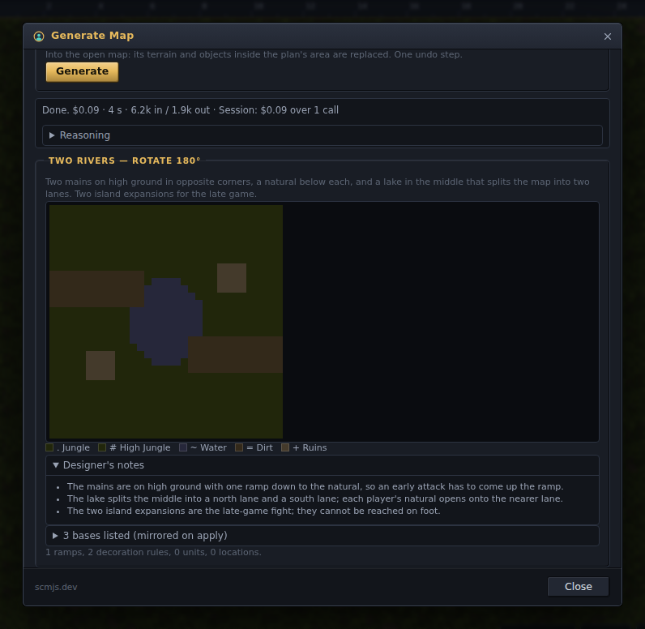

**Generate Map…** lays out a melee map from a description: the number of players, the kind
of terrain, where the bases go and the symmetry. It shows a *plan* first — a rough grid of
terrain, the bases with their resources, ramps, a name and the designer's notes. **Apply**
paints it with the isometric brush onto a new map, or onto the open map if it is the same
size. **Refine** sends the plan back with your changes ("more room around the naturals")
and a picture of the result. Treat the result as a starting point, and check the ramps
against the cliffs before you play.

**Redo Area…** does the same for part of an existing map. Mark an area (or right-click it
and choose *Redo this area with AI…*) and describe what should be there; the new ground
joins the old at the edges.

### Triggers, names and strings

- **Write Triggers…** turns a description into [TrigScript](#trigscript) and applies it,
  keeping the script with the map. It can add to the map's triggers or replace them.
- **Explain Triggers…** describes what the triggers do in play: all of them, a range, the
  mission briefing, or an answer to a question. The Trigger Editor and Mission Briefing
  Editor have the same *Explain*, *Write…* and *Ask* buttons.
- **Name and Describe…** suggests three names with descriptions from what is on the map.
  Map Properties has the same as a *Suggest a name* button.
- **Write Briefing…** writes objectives and narration and creates a mission briefing for
  each player.
- **Review Map…** critiques the map from a picture, its statistics and Check Map, with a
  **Go to** button on each finding that has a place.
- **Rewrite Strings…** translates, corrects or shortens the map's strings, showing a
  before-and-after table to tick. It is also the String Editor's *Rewrite with AI…*
  button.

### Options

**Tools ▸ AI ▸ Options…** opens the same Preferences page as the key:

- **Quality**: *Quick*, *Standard* (each feature at the level it was tuned for) or
  *Thorough*. Higher quality takes longer and costs more.
- **Spending**: a ceiling for one assistant message and for one Make Scenario run. At the
  ceiling the work stops with the map as edited so far. 0 means no ceiling.
- **Assistant**: rounds per message, the picture tick, following the work on the map,
  docking the panel on the right, and showing the model's reasoning summary.
- **Use the AI features**: unticked, it removes the menu, the assistant, the status-bar
  cell and the AI buttons, and keeps your key.

## Keyboard and preferences

Press F1 for a list of every shortcut. These are the ones the editor starts with; any of
the commands can be given other keys on Preferences ▸ Hotkeys:

| Keys | |
| --- | --- |
| `T` `D` `U` `S` `L` `F` `C` | switch layer |
| `[` `]` | brush size |
| Alt+click | pick what is under the cursor |
| Ctrl+Z / Ctrl+Y | undo / redo |
| Del / Esc | delete selection / stop placing |
| Ctrl+O, Ctrl+S, Ctrl+N | open, save, new |
| Ctrl+Shift+S | save as |
| Ctrl+T | Trigger Editor |
| Ctrl+Shift+T | Text Trigger Editor (when TrigEdit is on) |
| Ctrl+Shift+A | AI assistant (with your Anthropic key) |
| Ctrl+F | find |
| Ctrl+A | select all on the layer |
| Ctrl+G | grid |
| Ctrl+0, Ctrl+Shift+0 | 100%, zoom to fit |
| Alt+Enter | map properties |
| Ctrl+F5 | test map |
| Ctrl+, | preferences |
| Ctrl+Tab, Ctrl+Shift+Tab | next / previous open map (desktop app) |
| Ctrl+W | close map (desktop app) |

Preferences (Ctrl+,) are kept in the browser. Nothing is written until OK or Apply, and
**Reset to defaults** puts every page back. The pages down the left:

**General**

- **Language**: English or Korean. The default follows the browser's, and a change applies
  at once. A map's own text is never translated.
- **Startup**: the splash screen; whether to reopen the last map (the desktop app does it
  straight away; a browser that has to ask before reading the file again offers it in a
  notice); how many recent files to keep. In the desktop app, whether to check for updates
  at startup, and whether to include nightly builds.
- **Maps**: whether each map opens in its own tab, and whether to ask before closing or
  replacing a map with unsaved changes.
- **New scenario**: the tileset, size and revision a new map starts with.
- **Saving**: what the Save dialog starts from (how the file was opened, *Everything* or
  *Smallest*), the compression for a map with no file yet, and whether a save keeps the
  file it replaces (a `.bak`, or a previous version in a browser).
- **Recovery**: whether to keep [recovery copies](#recovery-copies) of unsaved maps, and
  how often.

**Editing**: the grid's spacing, colour and style, and what snaps to it (View ▸ Grid
Settings… opens this page); what the palettes start on — the owner of placed units, the
brush size, the size of a new location; and how many undo levels each map keeps.

**View**: whether the mouse wheel scrolls (Ctrl+wheel zooms) or zooms, and whether a wheel
zoom keeps the tile under the pointer in place; whether water and units animate and how
fast; whether the map starts out drawn with Remastered's graphics; which cells the status
bar shows; and whether string previews follow Remastered's colour rule or 1.16.1's.

**Testing**: Test Map's folder, and in the desktop app whether the game starts after the
map is written.

**Plugins**: what to do when an installed plugin has a newer version (tell you, do
nothing, or install it — see [docs/plugins.md](plugins.md#keeping-a-plugin-up-to-date)),
and each plugin's own settings page.

**Storage**: where the game data comes from, and everything the editor keeps in the
browser, one row per setting or cache, with a plugin's own data under its name. Each row
can be cleared on its own, or **Clear all data** throws the lot away. Maps are not part of
that list and are not touched by it. The recovery copies and the previous versions of
saved files have their own lines. **Export** writes the settings, the plugins' included,
to one file, and **Import** reads such a file into another browser or machine; caches and
the recent files stay behind.

**Hotkeys**: every command and its keys.

- **+** on a row waits for the next keys you press and adds them (Esc stops waiting); the
  × on a key removes it. A command can have several keys or none.
- Keys used by two commands, or by a command and a plugin, are marked. A plugin's keys are
  tried first; between two commands, the one higher in the list wins.
- Delete, Esc, the arrows, Tab, Enter, Space and F11 keep their own jobs and cannot be
  given to a command.
- A plain key such as `T` never fires while you type in a text box, and most Ctrl
  shortcuts leave a text box's own undo, clipboard and select-all alone.
- The browser keeps Ctrl+Tab and Ctrl+W for its own tabs, so Next Map and Close Map start
  with no keys there; give them others if you want them.

The placement options, the panels and the recent files are remembered too.

### What's new

**Help ▸ What's New…** lists what changed in each release, newest first, with the release
you are running open and the older ones folded below it. The part written for plugin
authors is folded as well. The notes come with the editor, so the list works offline and
always matches the version in front of you; a nightly build shows the notes of the last
release. The version line in **Help ▸ About scmJS…** opens the same list.

The first time you start a release with new notes, a notice says the editor has been
updated and offers the list. It appears once per release. The notes are written in
English.

In the desktop app, **Help ▸ Check for Updates…** looks for a newer version.

## When something goes wrong

If the editor does something strange, the debug console shows what happened, **Copy Bug
Report** puts it on the clipboard, and **Report an Issue** sends it to the project.

### Damaged and protected maps

The Repair plugin checks every map as it opens, the way the game reads it. Protected maps
in particular often have parts missing, damaged or repeated.

- **Safe repairs are made at once**: the ones that only write what the game already does,
  or put back what the editor needs, such as the isometric record a protector stripped.
  They do not mark the map as changed, and the next save writes them.
- **Judgement calls are left to you**, such as a player slot with a race the game does not
  have. A cell in the status bar (*Repaired 3 · 1 to review*) opens a list that says what
  the game does about each one and what the repair would change.

Undo in that list puts the file back as it opened. Tools ▸ Repair Map… runs the check
again, and Edit ▸ Preferences ▸ Plugins ▸ Repair can make it ask before repairing
anything, or not check at all. To look at the file section by section and byte by byte,
install Section Explorer from Plugins ▸ Browse Plugins…. [Protected and damaged
maps](file-formats.md#protected-and-damaged-maps) has the details.

### The debug console

**View ▸ Debug Console** opens a strip along the bottom of the window with the log in it:
maps opened and saved, plugins started and stopped, where the game data came from, and
every error the page threw.

The log is kept whether the strip is open or not, so opening it *after* something odd
happened still shows what happened. The last couple of thousand lines are kept; **Clear**
empties it, for starting clean before reproducing something.

**Warnings** and **Errors** narrow the list to what went wrong; the box beside them
filters on any text. **Verbose** adds a line for every edit and every call a plugin makes
into the editor. It answers "which plugin did that?", it is noisy by design, and it turns
itself off when you next load the editor.

### When part of the editor fails

If a panel, the palette or the map view hits an error it cannot draw past, that part alone
is replaced by a short notice with the error in it. Everything else keeps working, your
maps included. **Try again** draws the part afresh, and **Show the log** opens the debug
console at the line that says what failed.

A dialog that fails is closed, and a notice says so with the same **Show the log** button.
What you had changed in it and not yet applied is lost; what you had applied is in the
map.

If the whole editor fails, a plain page takes its place with the error, the end of the
log, and **Copy the log** and **Save the log…** for a bug report. Your maps are still open
behind it: **Try again** brings the editor back with them. A recovery copy of each map
with unsaved changes is written as that page appears (unless you switched recovery copies
off in Preferences), so **Reload** offers them back too.

### Copying a bug report

**Help ▸ Copy Bug Report** puts the log on the clipboard with a short header above it —
the version, the browser or desktop app, where the game data came from, the map's size and
tileset, and the plugins with their versions — ready to paste into an issue, a forum post
or a message. A long session is trimmed to its most recent lines so the paste fits in an
issue; when it is, the report says so.

The console's own **Copy** does the same without the trim, and **Save…** writes the whole
log to a file, for when it is too long to paste.

### Filing an issue

**Help ▸ Report an Issue…** opens a new issue on GitHub with the report already filled in,
under three questions: what you did, what you expected, and what happened. Answer those,
check the rest, and submit. You need a GitHub account.

The issue holds a shortened log. If the lines that matter were cut, use **Copy Bug
Report** and paste the full report over it.

Nothing is sent until you submit the issue yourself. The report names the map *file* you
have open, the plugins you have installed and the version you are running, and nothing
else about you.

## What it does not do

This section lists what the editor does not do, and the limits worth knowing before you
rely on a feature.

### Undo and history

- Undo takes back what a dialog's OK or Apply wrote, as one step. What you change inside
  an open dialog before that is not in the history; Cancel is the way back. The larger
  editors (triggers, the briefing, strings, sounds, switches, and the unit, upgrade and
  technology settings) ask before Escape, the close button or a click outside the dialog
  throws away changes you have not applied.
- Resizing and changing the tileset clear the undo history.
- A step that rewrites thousands of triggers (a TrigScript build, say) is kept, but the
  oldest steps are then dropped sooner than the undo-levels setting says, so the history
  does not grow without bound.

### Browsers and the desktop app

- In Firefox and Safari, every save is a download, and a recent map reopens through File ▸
  Open instead of straight from disk. Chrome, Edge and the desktop app write in place.
- In a browser, Tools ▸ Test Map writes the map where the game lists it but cannot start
  the game; in Firefox and Safari it downloads the map. Tools ▸ Test Map in Browser, at
  scmjs.dev, plays it in a browser tab instead.
- The Windows zip does not register `.scm`, `.scx` and `.chk`, since nothing is installed.
  A map dragged onto `scmJS.exe` still opens.
- On macOS the app sees a new version but cannot install it until the app is code-signed,
  so it offers the download page instead.

### Terrain and objects

- The isometric brush needs the map's isometric record. The Repair plugin, on by default,
  rebuilds one a protected map had stripped.
- Symmetry mirrors the brushes, the fills and placing things, but not moving, deleting or
  the Blend brush.
- Changing the tileset lays the terrain again and drops the doodads; the units, sprites,
  locations, fog and triggers stay.

### Triggers and text

- In the Trigger Editor, EUD values are raw numbers: the EPD box turns a memory address
  into the player value that reaches it, but nothing names what an address holds. For
  named reads and writes of the game, use a [TrigScript](trigscript.md#programs) program
  or the Magenta plugin. Both play on Remastered only.
- Transmission is the one briefing action no Blizzard map uses, so its layout could not be
  checked against one.
- TrigScript's programs play on Remastered only; `trigger()` works on every version. The
  full list is under [TrigScript's reference](trigscript.md#reference).
- A character the map's text encoding cannot hold is saved as `?`. Check Map and the Save
  dialog say so beforehand.
- The Korean translation was not written by a native speaker. A review is welcome (see
  [docs/development.md](development.md#translations)).

### The scmjs.dev features

- Keeping maps on an account and editing a map together run on scmjs.dev and need a
  connection. Keeping and sharing maps need an account; joining a shared map needs only
  the link.
- The AI features need your own Anthropic API key and a connection (see [The
  AI](#the-ai)).
