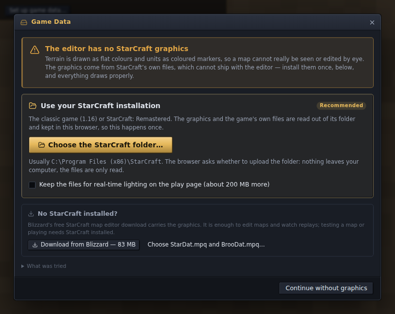
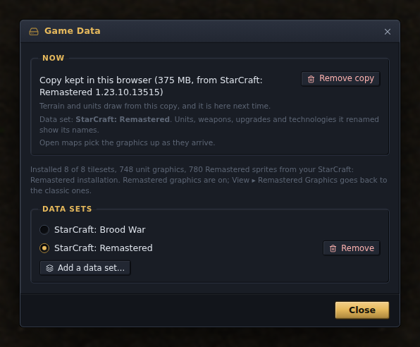

# Installing

scmJS runs in a web browser, as a desktop app for Windows, macOS and Linux, or from a
container on your own server. Whichever you choose, the editor needs StarCraft's graphics,
which are not shipped with it: on first use it asks for your StarCraft folder and reads
them from there once. This page covers each way of running the editor and that first
question. The [user guide](guide.md) starts once the editor is open.

## In the browser

[scmjs.dev/editor](https://scmjs.dev/editor/) is the newest numbered release. There is
nothing to install. Your maps stay on your own disk, and nothing is sent anywhere unless
you use a network feature, such as a copy kept on your scmjs.dev account, a map you share
for others to edit with you, or an AI request on your own Anthropic key. The user guide
describes each.

[scmjs.dev/nightly](https://scmjs.dev/nightly/) is rebuilt every night from the latest
changes, for trying what is in development. It keeps its own settings, plugins and
sign-in, but shares the game's graphics with the stable editor and the play page, so you
add them once for all three.

Chrome and Edge save a map back to the file you opened. In Firefox and Safari every save
is a download, and File ▸ Open Recent asks for the file again.

The hosted editor, the nightly and the documentation site count visits with Cloudflare Web
Analytics (no cookies, and nothing about your maps). The desktop app and a copy you host
yourself do not.

## The desktop app

The [releases](https://github.com/scm-js/scm-js/releases) page has the installers. These
links always point at the newest numbered release:

| System | Download |
| --- | --- |
| Windows, installer | [scmJS-windows-x64-setup.exe](https://github.com/scm-js/scm-js/releases/latest/download/scmJS-windows-x64-setup.exe) |
| Windows, zip to unpack and run | [scmJS-windows-x64.zip](https://github.com/scm-js/scm-js/releases/latest/download/scmJS-windows-x64.zip) |
| macOS, Apple silicon | [scmJS-macos-arm64.dmg](https://github.com/scm-js/scm-js/releases/latest/download/scmJS-macos-arm64.dmg) |
| macOS, Intel | [scmJS-macos-x64.dmg](https://github.com/scm-js/scm-js/releases/latest/download/scmJS-macos-x64.dmg) |
| Linux, AppImage | [scmJS-linux-x86_64.AppImage](https://github.com/scm-js/scm-js/releases/latest/download/scmJS-linux-x86_64.AppImage) |
| Linux, Debian and Ubuntu | [scmJS-linux-amd64.deb](https://github.com/scm-js/scm-js/releases/latest/download/scmJS-linux-amd64.deb) |

The app looks for a StarCraft installation on its own, registers `.scm`, `.scx` and `.chk`
so a double-click opens a map, and starts the game for Test Map.

### Windows

The installer and the app are not code-signed, so Windows shows a SmartScreen screen
saying the app is unrecognized. Choose **More info**, then **Run anyway**. The zip needs
no installation: unpack it anywhere and run `scmJS.exe`.

### macOS

Open the dmg and drag scmJS into Applications. macOS refuses to open an app that is not
code-signed, so clear the quarantine flag once, in Terminal:

```sh
xattr -dr com.apple.quarantine /Applications/scmJS.app
```

### Linux

Make the AppImage executable and run it:

```sh
chmod +x scmJS-linux-x86_64.AppImage
./scmJS-linux-x86_64.AppImage
```

Or install the `.deb`:

```sh
sudo apt install ./scmJS-linux-amd64.deb
```

### Updates

The app checks for a new version when it starts (a preference, on by default) and when you
choose Help ▸ Check for Updates…. A new version shows up as a notice with a **Download**
button. Nothing downloads or installs until you ask, and installing asks about unsaved
maps first, as closing the window does.

- **Windows, the AppImage and the `.deb`** install the update themselves.
- **macOS** cannot replace an app that is not code-signed, so the app offers the release
  page instead.

A preference lets the app follow the nightly builds instead of the numbered releases.
After an update, a notice offers the list of what changed; Help ▸ What's New… shows it at
any time. The browser editor does the same.

### Where it keeps its files

The app's data folder holds the graphics it extracted, the window's size and position, and
`startup.log`, a record of the last launch:

| System | Folder |
| --- | --- |
| Windows | `%APPDATA%\scm-js` |
| macOS | `~/Library/Application Support/scm-js` |
| Linux | `~/.config/scm-js` |

If the app is slow to open, or opens and shows nothing, `startup.log` says how long each
step of the launch took; attach it to a bug report. Deleting the `gamedata` folder inside
makes the app look for StarCraft again at the next start.

## In a container

The editor can also run from a container, for a server on your own network or to run it
locally:

```sh
docker run --rm -p 8080:80 ghcr.io/scm-js/scm-js:latest
```

then open `http://localhost:8080`. The image is the same editor as the numbered release it
is tagged with. It carries no game data, so it asks for your StarCraft folder like the
hosted editor. To serve graphics you have already extracted instead, see [The container
image](game-data.md#the-container-image).

Each release also has `scmJS-web.zip`, the same editor as plain files. Unpack it at the
root of any static web server.

## The graphics

The editor draws terrain and units with graphics out of StarCraft's own files. Blizzard's
data is not redistributable and none of it ships with the editor, so on first use the
**Game Data** dialog asks where to get it:



The recommended route is your own StarCraft installation, classic (1.16) or Remastered. If
you have neither, Blizzard's free map editor download is enough to edit maps and watch
replays. What each route gives you:

| Route | Editing | Remastered graphics | Test Map and playing | Replays |
| --- | --- | --- | --- | --- |
| Your StarCraft: Remastered folder | Yes | Yes | Yes | Yes |
| Your classic StarCraft (1.16) folder | Yes | No, but can be added | Yes | Yes |
| Blizzard's map editor download | Yes | No | No | Yes |

Test Map and playing means Tools ▸ Test Map, which hands the map to the installed game,
and Tools ▸ Test Map in Browser at scmjs.dev, which plays it on the site's play page from
your own StarCraft files. Neither works from the map editor download. Replays means File ▸
Open Replay… and watching the game play back.

If the editor was opened from a link (a shared map to join, or a copy of a map), that link
is handled first, and the question about the graphics follows.

### Use your StarCraft installation

This is the card marked **Recommended** at the top of the dialog.

- **In the browser**, choose **Choose the StarCraft folder…** and pick the folder the game
  is installed in, usually `C:\Program Files (x86)\StarCraft`. The browser asks whether to
  upload the folder. Nothing leaves your computer: the editor only reads the files.
- **In the desktop app**, there is nothing to do if the game is where its installer put
  it: the app finds it at start. Otherwise choose **Search this computer**, or **Choose
  the StarCraft folder…** to point at it yourself.

Classic or Remastered is told from the folder. A Remastered folder turns on **View ▸
Remastered Graphics**, which you can untick at any time for the classic look; the guide's
[Classic or Remastered graphics](guide.md#classic-or-remastered-graphics) shows the
difference.

The editor copies what it needs and keeps it, so this happens once. In the browser the
copy also keeps the files the site's play page runs the game from, so the game is set up
once for both. The tick box **Keep the files for real-time lighting on the play page**
adds what the play page needs to light units as Remastered does, about 200 MB more. Rough
sizes of the copy:

| Copy | Browser | Desktop app |
| --- | --- | --- |
| From a classic (1.16) installation or the download | about 140 MB | about 30 MB |
| From a Remastered installation | about 650 MB | about 365 MB |
| From Remastered, with the lighting files | about 850 MB | — |

Reading a Remastered installation takes under a minute.

### No StarCraft installed?

The lower part of the dialog has two ways in without an installation:

- **Download from Blizzard — 83 MB.** Blizzard offers its standalone StarCraft map editor
  as a free download, and the package carries the files the graphics come from. No
  account, nothing to find on your own disk. The editor fetches only the parts it needs.
- **Choose StarDat.mpq and BrooDat.mpq…** (browser only). Pick the two archives yourself,
  from the map editor download or from a classic installation's folder.

A copy made from the map editor download is enough to edit maps and watch replays. Testing
a map or playing needs StarCraft installed. Once you have it, open **Help ▸ Game Data…**,
choose **Remove copy**, and choose the StarCraft folder when the dialog asks again; for
Remastered, **Add StarCraft: Remastered…** also works, as below.

### Remastered graphics

Choosing a Remastered folder in the first place is all it takes: the editor reads the
Remastered graphics with the rest and turns them on.

If you installed from a classic copy or the map editor download first and get Remastered
later, open **Help ▸ Game Data…** and choose **Add StarCraft: Remastered…** under *Data
sets*. It is installed beside the copy you have, and the *Data sets* list switches between
the two.



Remastered added tiles, and so doodads, to most tilesets. A map that uses them needs the
Remastered files to be drawn; from a classic copy those tiles have no picture.

### Changing it later

**Help ▸ Game Data…** brings the dialog back. It shows where the graphics come from now,
and lets you:

- remove the copy (**Remove copy**), after which the dialog offers the routes above again;
- install a *data set*, a mod's files beside the game's, and switch between them (see
  [Data sets](game-data.md#data-sets));
- add StarCraft: Remastered beside a classic copy, as above.

At scmjs.dev, [scmjs.dev/editor/data](https://scmjs.dev/editor/data) lists every copy the
browser holds, with where it came from and how large it is.

Without any graphics the editor still runs: terrain is drawn in flat colours and units as
coloured markers, and everything else works.

## From source

Building the editor yourself needs Node.js 22.18 or newer and git:

```sh
git clone https://github.com/scm-js/scm-js
cd scm-js
npm install
npm run dev            # http://localhost:5173
```

A source build gets its graphics from `npm run extract` (see [Extracting for a source
build](game-data.md#extracting-for-a-source-build)) or from Help ▸ Game Data… like any
other copy. The rest, including building the desktop app and the container image, is in
[development.md](development.md).
