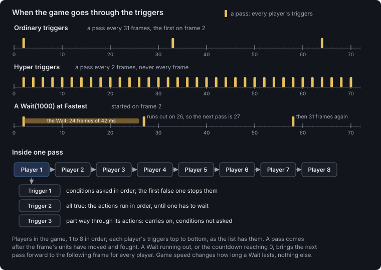
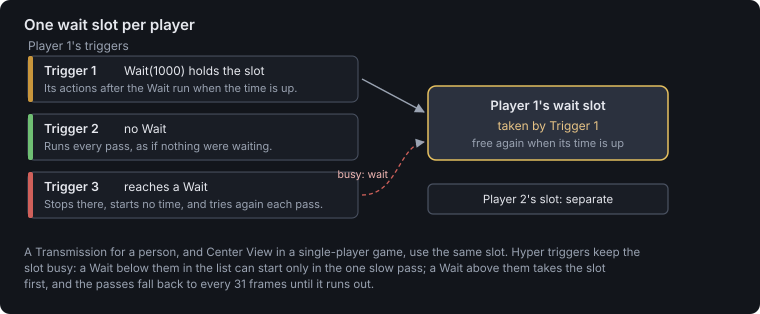
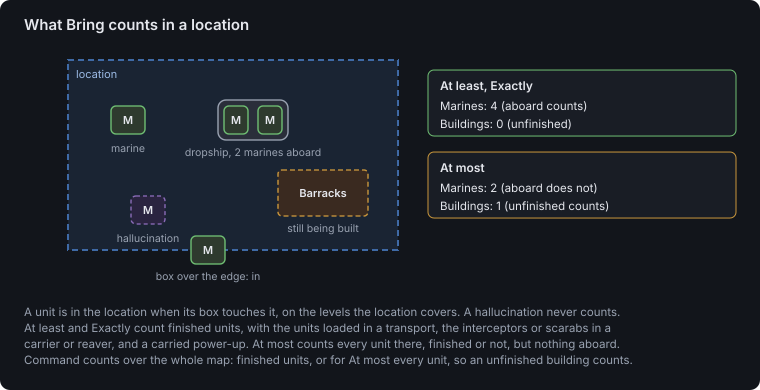

# Trigger reference

Every trigger condition and action in StarCraft and Brood War: what it does in the game,
the arguments it takes, how it is written as text, and where each argument is stored in
the map file. The game's behaviour described here is StarCraft 1.16.1's, found by running
test maps. StarCraft: Remastered's trigger engine has not been checked separately. Its map
list does read the triggers, to see whether a map uses EUD triggers; see [Where Remastered
differs](chk-format.md#where-remastered-differs).

Each condition and action has a number, a line in the text form, and a table of where its
arguments are stored. These come from the same tables the editor reads and writes maps
with. The text form is SCMDraft 2's TrigEdit syntax, so an example line can be pasted into
SCMDraft or into the editor's Text Trigger Editor.

In scmJS, triggers are edited in:

- the **Trigger Editor** (Triggers ▸ Trigger Editor…, Ctrl+T), a form like StarEdit's;
- the **Text Trigger Editor** (Ctrl+Shift+T), the same triggers in the text form. It comes
  with the TrigEdit plugin, which is installed but off until you turn it on in Plugins ▸
  Manage Plugins…. Triggers ▸ Import Triggers… and Export Triggers… use the same text
  without it;
- **TrigScript** (Triggers ▸ TrigScript…), triggers written as code. Each condition and
  action is a function named after it, such as `setDeaths`; see the [TrigScript
  guide](trigscript.md);
- the **Mission Briefing Editor** (Triggers ▸ Mission Briefing Editor…), for
  [briefings](#mission-briefing-actions).

The Trigger Map plugin, from Plugins ▸ Browse Plugins…, draws which triggers set and read
each switch, death count and location, and lists triggers that can never run. See
[Triggers](guide.md#triggers) in the user guide.

## How triggers run

A trigger is a list of up to 16 conditions and up to 64 actions, and the players it runs
for. When every condition holds, the game carries out the actions in order. A trigger that
should run straight away has [Always](#always) as its condition; a trigger with no
conditions at all runs straight away too.



### The trigger cycle

The game does not check triggers continuously. It goes through them in *passes*, one every
31 game frames: 1.3 seconds at Fastest, 2.1 seconds at Normal. The first pass is on the
game's second frame, so an Always trigger runs at once. A pass comes after that frame's
units have moved, fought and died, so a unit killed in a frame already counts in that
frame's pass.

In a pass the game takes the players in the game in order, Player 1 to Player 8, and for
each goes through that player's triggers top to bottom, in the order of the list. It asks
a trigger's conditions in order and stops at the first false one, so the conditions after
it are not even asked. If they all hold, it carries out the actions in order. What one
trigger does is seen by every trigger after it in the same pass, with one exception for
counts of units (see [Counting units](#counting-units)).

Two things bring the next pass forward to the very next frame, for every player: a
[Wait](#wait) running out, and the [countdown timer](#countdown-timer) reaching 0.

Game speed does not change the 31-frame cycle or game time: a game second is 16 frames at
every speed, for [Elapsed Time](#elapsed-time) and the countdown alike. It changes only
how long a Wait lasts ([Waits](#waits)).

### Hyper triggers

A Wait of 0 runs out on the frame after it starts, and the pass it brings forward comes
the frame after that. So the fastest the game goes through the triggers is once every **2
frames**. It never manages every frame.

*Hyper triggers* use this: two or three preserved triggers of 62 or 63 Wait(0) actions
each, owned by one player. Each pass starts another of their Waits, so the passes keep
coming every 2 frames. A slow pass, 31 frames after the last, comes only when none of them
has a Wait to start, and with that many Waits it comes so rarely that it does not matter
in practice.

The cycle is shared, so one player's hyper triggers speed up every player's triggers. A
computer player can carry them. The waits must be one frame long or less: 42 milliseconds
at Fastest.

### Who a trigger runs for

A trigger is owned by one or more of the [players and groups](#players-and-groups): a
player, a force, or All Players. A trigger owned by a group runs separately for each
player in it, as if each had a copy of their own. Its conditions are checked and its
actions carried out once per player, and inside it **Current Player** means whichever
player that copy is running for.

The copies are handed out when the game loads the map, and only to players in the game:
human and computer players, and rescuable and neutral slots, which run their triggers like
anyone else. Only these owners get copies:

- Players 1 to 8;
- Force 1 to Force 4;
- All Players.

A trigger owned only by anything else (Players 9 to 12, Current Player, Foes, Allies,
Neutral Players, Non-Allied Victory Players, None or the Unused groups) is dropped when
the game loads and never runs. An editor lets you tick those owners, but the game ignores
them.

Only Use Map Settings games read a map's triggers at all. Melee and the other game types
run triggers built into the game. (See [`TRIG`](chk-format.md#trig) in the CHK reference.)

Each owner gets its own copies, so a player reached twice, as with both "Player 1" and
"Force 1" ticked, has two copies of the trigger and runs it twice in every pass.

A player who is defeated, or leaves, stops running triggers. In a single-player game a
player who has won keeps running them until the victory screen stops the game.

### Once, or every time

A trigger runs once for each player it runs for and is then finished, unless it carries
[Preserve Trigger](#preserve-trigger). Then, once its actions are done, the game asks its
conditions again on the next pass. A preserved trigger whose conditions stay true keeps
firing: one that adds a mineral adds one each pass. Preserve Trigger works wherever it
stands in the list, even after a Wait: the game looks for it when the actions end.

While a trigger is part way through its actions, held at a Wait, the game does not ask its
conditions again. On each pass it carries on from the action it stopped at.

### Waits

Each player has one *wait slot*. A [Wait](#wait) takes it and holds the rest of its
trigger until its time has passed. While the slot is taken, another trigger of that player
that reaches a Wait stops there without starting its time, and tries again on each pass
until it finds the slot free. The player's triggers with no Wait in their way keep running
every pass, and every player's slot is their own. A [Transmission](#transmission) for a
person, and [Center View](#center-view) in a single-player game, take the same slot.



A Wait's time is in milliseconds of the game's speed, close to real time, not game time.
Each frame takes a fixed number of milliseconds at each speed, the Wait lasts its time in
frames, rounded up and at least one, and the trigger goes on in the pass on the frame
after:

| Speed | Milliseconds a frame | Wait(0) goes on after | Wait(1000) goes on after |
| --- | --- | --- | --- |
| Fastest | 42 | 2 frames | 25 frames |
| Faster | 48 | 2 frames | 22 frames |
| Fast | 56 | 2 frames | 19 frames |
| Normal | 67 | 2 frames | 16 frames |
| Slow | 83 | 2 frames | 14 frames |
| Slower | 111 | 2 frames | 11 frames |
| Slowest | 167 | 2 frames | 7 frames |

A Wait of 4,294,967,295 never runs out, and takes that player's wait slot for the rest of
the game.

On a map with hyper triggers, a Wait in another trigger below them in the list hardly ever
gets the slot: it can start only in the one slow pass. A Wait above them takes the slot
first, and while it runs no hyper Wait can start, so the passes fall back to every 31
frames until it runs out. Check Map points this out.

### Timers with a death counter

A [death count](#deaths) of a unit type the map never uses makes a timer that needs no
Wait, so it never holds up the player's other triggers or the hyper triggers. One
preserved trigger adds 1 to the count every pass, and other triggers act when it reaches a
number:

```text
Trigger("Player 1"){
Conditions:
	Always();

Actions:
	Set Deaths("Player 1", "Cave (Unused)", Add, 1);
	Preserve Trigger();
}

Trigger("Player 1"){
Conditions:
	Deaths("Player 1", "Cave (Unused)", At least, 120);

Actions:
	Create Unit("Player 8", "Zerg Zergling", 6, "Spawn");
	Set Deaths("Player 1", "Cave (Unused)", Set To, 0);
	Preserve Trigger();
}
```

The count goes up once per pass, so its speed depends on how often the passes come: one
every 31 frames normally, or one every 2 frames with hyper triggers, which is about 12 a
second at Fastest. With hyper triggers, the second trigger above sends a wave about every
ten seconds. Setting the count back to 0 starts the timer again. The trigger's owner has
to be in the game, or neither trigger runs.

### Single player and multiplayer

The game runs every player's triggers on every machine, and only what reaches the screen
is limited to the player the trigger runs for: text, sounds, portraits, pings and the
view. A few actions behave differently in a single-player game:

| Action | In a single-player game | In a multiplayer game |
| --- | --- | --- |
| [Transmission](#transmission), for a person | holds the trigger until the portrait has finished talking | holds the trigger for its duration, in milliseconds of game speed |
| [Center View](#center-view), for a person | scrolls the screen and holds the trigger until it gets there | jumps the screen at once and does not hold |
| [Pause Game](#pause-game) and [Unpause Game](#unpause-game) | pause and unpause, for a person's trigger | nothing |
| The Esc key | skips the person's running triggers through their Waits, transmissions, text and sounds, unless [Disable Debug Mode](#disable-debug-mode) protects them | nothing |
| A player who gets a result | keeps their triggers | loses their whole trigger list at once, winners and losers alike |

For a computer, rescuable or neutral player, Transmission, Center View, Pause Game and the
other actions that touch the screen do nothing at all, and do not hold the trigger.

### Winning and losing

[Victory](#victory), [Defeat](#defeat) and [Draw](#draw) give the player the trigger runs
for a result, and the game settles the results at the end of each pass:

- When any player won or drew in the pass, every other player still in the game with no
  result of their own is **defeated**.
- When every player in the game won or drew in the same pass, they all get a draw.
- The first result a player gets stays. A Defeat or Draw that comes after a Victory for
  the same player in the same pass waits, and by the next pass the player has already won.

So in a single-player game, a Victory for the person ends the game for the computers too,
and a Draw is a draw only when everyone draws.

### Counting units

[Command](#command) and [Bring](#bring), and the Most and Least conditions built on them,
count units in ways that are easy to trip over:



- **At most counts differently from At least and Exactly.** At least and Exactly count
  finished units. At most counts every unit that exists, finished or not: a building going
  up, an egg or cocoon (as Men), a unit whose training has begun. So the standard melee
  defeat rule, Command(Current Player, Buildings, At most, 0), does not defeat a player
  whose only building is still being built.
- **Units aboard** a transport or bunker count for Bring only with At least and Exactly,
  at the place of what carries them, and so do the interceptors or scarabs in a carrier or
  reaver and a power-up a worker carries. With At most, Bring does not count them.
- **A unit is in a location** when its box touches it, on the levels the location covers.
  Ground units count by the ground under them; air units by the air bits of the location's
  elevation settings.
- **Hallucinations never count**, in Command or Bring, and neither do turrets.
- **The counts are taken once per pass.** The first Command of a pass counts every
  player's units, and every later Command in that pass, for any player, reads the same
  counts.

So a unit made by [Create Unit](#create-unit) or handed over by [Give Units to
Player](#give-units-to-player) later in the pass is invisible to Command until the next
pass. These take a new count straight away:

- [Kill Unit](#kill-unit) and [Kill Unit At Location](#kill-unit-at-location);
- [Remove Unit](#remove-unit) and [Remove Unit At Location](#remove-unit-at-location);
- [Move Unit](#move-unit) and [Move Location](#move-location);
- a [Bring](#bring) condition.

Bring keeps a count of its own for one location, with the same blind spot. It counts again
when another location is asked about, and after the same actions.

### Deaths and kills

A unit's death counts only when it dies in the game: shot, killed by a spell, or consumed.
Then its owner's [death count](#deaths) for its type goes up by one, and the killer's
[kills](#kill) and score, if the killer is another player still in the game. Killing your
own units counts nothing as a kill; killing an ally's counts.

[Kill Unit](#kill-unit), [Remove Unit](#remove-unit) and their At Location forms count
nothing at all: no death, no kill, no score. Neither does a hallucination dying.

The unit classes are counted apart. Deaths of Men, Buildings and Factories read the game's
own counts of men, buildings and factories lost, which go up with each real death; Deaths
of Any unit reads men and buildings lost together. They are not the sum of the per-type
counts: [Set Deaths](#set-deaths) on a Marine does not change Deaths of Men, while Set
Deaths of Men changes the lost count itself.

### Disabled conditions and actions

A condition or action can be disabled without deleting it (a flag in its record). The game
skips it: a disabled condition does not count, and a disabled action is not carried out.
In text, a disabled line starts with `;`.

## Conditions

A condition is a test a trigger makes on every pass, unless the trigger is part way
through its actions. These are all of them:

| Condition | True when |
| --- | --- |
| [Accumulate](#accumulate) | a player has a given amount of ore or gas |
| [Always](#always) | always |
| [Bring](#bring) | a player has a given number of units in a location |
| [Command](#command) | a player has a given number of units anywhere |
| [Command the Least](#command-the-least) | the player has the fewest of a unit type |
| [Command the Least At](#command-the-least-at) | the player has the fewest of a unit type in a location |
| [Command the Most](#command-the-most) | the player has the most of a unit type |
| [Command the Most At](#command-the-most-at) | the player has the most of a unit type in a location |
| [Countdown Timer](#countdown-timer) | the countdown timer shows a given time |
| [Deaths](#deaths) | a player's death count for a unit type is a given number |
| [Elapsed Time](#elapsed-time) | a given time has passed since the game started |
| [Highest Score](#highest-score) | the player has the highest score of a kind |
| [Kill](#kill) | a player has killed a given number of a unit type |
| [Least Kills](#least-kills) | the player has killed the fewest of a unit type |
| [Least Resources](#least-resources) | the player has the least ore or gas |
| [Lowest Score](#lowest-score) | the player has the lowest score of a kind |
| [Mission Briefing](#mission-briefing) | used by briefings only |
| [Most Kills](#most-kills) | the player has killed the most of a unit type |
| [Most Resources](#most-resources) | the player has the most ore or gas |
| [Never](#never) | never |
| [Opponents](#opponents) | a player has a given number of opponents left |
| [Score](#score) | a player's score of a kind is a given number |
| [Switch](#switch) | a switch is set, or clear |

Conditions that compare a number take a [comparison](#comparisons): At least, At most or
Exactly. All of a trigger's conditions must hold for it to run.

### Accumulate

True when the player has at least, at most or exactly the amount of ore, gas, or ore and
gas.

<!-- generated: condition 4 -->
**Condition 4** · `Accumulate(Player, Comparison, Amount, Resource);`

| Argument | Takes | Stored in the condition |
| --- | --- | --- |
| Player | a [player or group](#players-and-groups) | bytes 4–7 |
| Comparison | [At least, At most or Exactly](#comparisons) | byte 14 |
| Amount | a whole number, 0 to 4,294,967,295 | bytes 8–11 |
| Resource | [ore, gas, or ore and gas](#resources) | byte 16 |
<!-- /generated -->

```trigedit
Accumulate("Current Player", At least, 500, ore);
```

### Always

Always true. A trigger that should run as soon as the game starts, or on every cycle with
[Preserve Trigger](#preserve-trigger), has this as its condition. A trigger with no
conditions at all behaves the same.

<!-- generated: condition 22 -->
**Condition 22** · `Always();`

It takes no arguments.
<!-- /generated -->

```trigedit
Always();
```

### Bring

True when the player has at least, at most or exactly the number of units of the type
inside the location. A location's elevation settings (which of low, middle and high ground
and air it covers) decide which units it counts.

A unit counts when its box touches the location. With At least or Exactly, Bring counts
finished units and the units aboard a transport in the location; with At most, it counts
every unit there, finished or not, but nothing aboard. See [Counting
units](#counting-units).

<!-- generated: condition 3 -->
**Condition 3** · `Bring(Player, Unit, Location, Comparison, Amount);`

| Argument | Takes | Stored in the condition |
| --- | --- | --- |
| Player | a [player or group](#players-and-groups) | bytes 4–7 |
| Unit | a unit type, or one of the [unit classes](#unit-classes) | bytes 12–13 |
| Location | a location (Anywhere is location 64) | bytes 0–3 |
| Comparison | [At least, At most or Exactly](#comparisons) | byte 14 |
| Amount | a whole number, 0 to 4,294,967,295 | bytes 8–11 |
<!-- /generated -->

```trigedit
Bring("Current Player", "Terran Marine", "Beacon", At least, 1);
```

### Command

True when the player has at least, at most or exactly the number of units of the type
anywhere on the map. With At least or Exactly it counts finished units; with At most,
every unit, including buildings still going up and eggs. The counts are taken once in each
pass, so a unit created later in the pass is not seen until the next one. See [Counting
units](#counting-units).

The example is the standard melee defeat rule, which every melee game runs: a player who
commands no buildings loses.

<!-- generated: condition 2 -->
**Condition 2** · `Command(Player, Unit, Comparison, Amount);`

| Argument | Takes | Stored in the condition |
| --- | --- | --- |
| Player | a [player or group](#players-and-groups) | bytes 4–7 |
| Unit | a unit type, or one of the [unit classes](#unit-classes) | bytes 12–13 |
| Comparison | [At least, At most or Exactly](#comparisons) | byte 14 |
| Amount | a whole number, 0 to 4,294,967,295 | bytes 8–11 |
<!-- /generated -->

```trigedit
Command("Current Player", "Buildings", At most, 0);
```

### Command the Least

True when the player the trigger runs for has fewer units of the type than any other
player. It counts finished units.

A tie counts: when every player has 0, the condition is true for all of them. The game
compares the player with every player in the game, rescuable and neutral slots included.

<!-- generated: condition 16 -->
**Condition 16** · `Command the Least(Unit);`

| Argument | Takes | Stored in the condition |
| --- | --- | --- |
| Unit | a unit type, or one of the [unit classes](#unit-classes) | bytes 12–13 |
<!-- /generated -->

```trigedit
Command the Least("Buildings");
```

### Command the Least At

As [Command the Least](#command-the-least), counting only the units inside the location.

<!-- generated: condition 17 -->
**Condition 17** · `Command the Least At(Unit, Location);`

| Argument | Takes | Stored in the condition |
| --- | --- | --- |
| Unit | a unit type, or one of the [unit classes](#unit-classes) | bytes 12–13 |
| Location | a location (Anywhere is location 64) | bytes 0–3 |
<!-- /generated -->

```trigedit
Command the Least At("Men", "Arena");
```

### Command the Most

True when the player the trigger runs for has more units of the type than any other
player. It counts finished units.

A tie counts: when every player has 0, the condition is true for all of them. The game
compares the player with every player in the game, rescuable and neutral slots included.

<!-- generated: condition 6 -->
**Condition 6** · `Command the Most(Unit);`

| Argument | Takes | Stored in the condition |
| --- | --- | --- |
| Unit | a unit type, or one of the [unit classes](#unit-classes) | bytes 12–13 |
<!-- /generated -->

```trigedit
Command the Most("Buildings");
```

### Command the Most At

As [Command the Most](#command-the-most), counting only the units inside the location. A
king-of-the-hill map checks who holds the hill with it.

<!-- generated: condition 7 -->
**Condition 7** · `Command the Most At(Unit, Location);`

| Argument | Takes | Stored in the condition |
| --- | --- | --- |
| Unit | a unit type, or one of the [unit classes](#unit-classes) | bytes 12–13 |
| Location | a location (Anywhere is location 64) | bytes 0–3 |
<!-- /generated -->

```trigedit
Command the Most At("Men", "Hill");
```

### Countdown Timer

True when the countdown timer shows at least, at most or exactly the number of seconds.
The timer is started and changed with [Set Countdown Timer](#set-countdown-timer).

<!-- generated: condition 1 -->
**Condition 1** · `Countdown Timer(Comparison, Amount);`

| Argument | Takes | Stored in the condition |
| --- | --- | --- |
| Comparison | [At least, At most or Exactly](#comparisons) | byte 14 |
| Amount | a whole number, 0 to 4,294,967,295 | bytes 8–11 |
<!-- /generated -->

```trigedit
Countdown Timer(At most, 0);
```

### Deaths

True when the number of units of the type the player has lost is at least, at most or
exactly the amount. Only units that die in the game count: [Kill Unit](#kill-unit) and
[Remove Unit](#remove-unit) add nothing. For Men, Buildings, Factories and Any unit it
reads the game's own counts of units lost, not the sum of the types (see [Deaths and
kills](#deaths-and-kills)).

Every player has a death count for every unit type, whether or not that unit is ever on
the map, and [Set Deaths](#set-deaths) can change it. That makes the death counts of unit
types a map does not use the usual place to keep numbers: a counter, a timer, a state.
Each is a whole number from 0 to 4,294,967,295.

<!-- generated: condition 15 -->
**Condition 15** · `Deaths(Player, Unit, Comparison, Amount);`

| Argument | Takes | Stored in the condition |
| --- | --- | --- |
| Player | a [player or group](#players-and-groups) | bytes 4–7 |
| Unit | a unit type, or one of the [unit classes](#unit-classes) | bytes 12–13 |
| Comparison | [At least, At most or Exactly](#comparisons) | byte 14 |
| Amount | a whole number, 0 to 4,294,967,295 | bytes 8–11 |
<!-- /generated -->

```trigedit
Deaths("Current Player", "Cave (Unused)", Exactly, 3);
```

### Elapsed Time

True when at least, at most or exactly the number of game seconds have passed since the
game started. A game second is 16 frames at every game speed, and the clock stops while
the game is paused, by a menu or by [Pause Game](#pause-game).

<!-- generated: condition 12 -->
**Condition 12** · `Elapsed Time(Comparison, Amount);`

| Argument | Takes | Stored in the condition |
| --- | --- | --- |
| Comparison | [At least, At most or Exactly](#comparisons) | byte 14 |
| Amount | a whole number, 0 to 4,294,967,295 | bytes 8–11 |
<!-- /generated -->

```trigedit
Elapsed Time(At least, 600);
```

### Highest Score

True when the player the trigger runs for has the highest score of the [kind](#scores).

A tie counts: when every player has 0, the condition is true for all of them. The game
compares the player with every player in the game, rescuable and neutral slots included.

<!-- generated: condition 9 -->
**Condition 9** · `Highest Score(Score);`

| Argument | Takes | Stored in the condition |
| --- | --- | --- |
| Score | a [score type](#scores) | byte 16 |
<!-- /generated -->

```trigedit
Highest Score(Kills);
```

### Kill

True when the player has killed at least, at most or exactly the number of units of the
type. A player's own units never count as kills; an ally's do. Units killed by triggers
are nobody's kills.

<!-- generated: condition 5 -->
**Condition 5** · `Kill(Player, Unit, Comparison, Amount);`

| Argument | Takes | Stored in the condition |
| --- | --- | --- |
| Player | a [player or group](#players-and-groups) | bytes 4–7 |
| Unit | a unit type, or one of the [unit classes](#unit-classes) | bytes 12–13 |
| Comparison | [At least, At most or Exactly](#comparisons) | byte 14 |
| Amount | a whole number, 0 to 4,294,967,295 | bytes 8–11 |
<!-- /generated -->

```trigedit
Kill("Current Player", "Zerg Zergling", At least, 20);
```

### Least Kills

True when the player the trigger runs for has killed fewer units of the type than any
other player.

A tie counts: when every player has 0, the condition is true for all of them. The game
compares the player with every player in the game, rescuable and neutral slots included.

<!-- generated: condition 18 -->
**Condition 18** · `Least Kills(Unit);`

| Argument | Takes | Stored in the condition |
| --- | --- | --- |
| Unit | a unit type, or one of the [unit classes](#unit-classes) | bytes 12–13 |
<!-- /generated -->

```trigedit
Least Kills("Men");
```

### Least Resources

True when the player the trigger runs for has less of the resource than any other player.

A tie counts: when every player has 0, the condition is true for all of them. The game
compares the player with every player in the game, rescuable and neutral slots included.

<!-- generated: condition 20 -->
**Condition 20** · `Least Resources(Resource);`

| Argument | Takes | Stored in the condition |
| --- | --- | --- |
| Resource | [ore, gas, or ore and gas](#resources) | byte 16 |
<!-- /generated -->

```trigedit
Least Resources(ore);
```

### Lowest Score

True when the player the trigger runs for has the lowest score of the [kind](#scores).

A tie counts: when every player has 0, the condition is true for all of them. The game
compares the player with every player in the game, rescuable and neutral slots included.

<!-- generated: condition 19 -->
**Condition 19** · `Lowest Score(Score);`

| Argument | Takes | Stored in the condition |
| --- | --- | --- |
| Score | a [score type](#scores) | byte 16 |
<!-- /generated -->

```trigedit
Lowest Score(Total);
```

### Mission Briefing

The condition of every trigger in a mission briefing. In a map's own triggers it is the
same as [Never](#never). See [Mission briefing actions](#mission-briefing-actions).

<!-- generated: condition 13 -->
**Condition 13** · `Mission Briefing();`

It takes no arguments.
<!-- /generated -->

### Most Kills

True when the player the trigger runs for has killed more units of the type than any other
player.

A tie counts: when every player has 0, the condition is true for all of them. The game
compares the player with every player in the game, rescuable and neutral slots included.

<!-- generated: condition 8 -->
**Condition 8** · `Most Kills(Unit);`

| Argument | Takes | Stored in the condition |
| --- | --- | --- |
| Unit | a unit type, or one of the [unit classes](#unit-classes) | bytes 12–13 |
<!-- /generated -->

```trigedit
Most Kills("Men");
```

### Most Resources

True when the player the trigger runs for has more of the resource than any other player.

A tie counts: when every player has 0, the condition is true for all of them. The game
compares the player with every player in the game, rescuable and neutral slots included.

<!-- generated: condition 10 -->
**Condition 10** · `Most Resources(Resource);`

| Argument | Takes | Stored in the condition |
| --- | --- | --- |
| Resource | [ore, gas, or ore and gas](#resources) | byte 16 |
<!-- /generated -->

```trigedit
Most Resources(ore and gas);
```

### Never

Never true. A trigger with it never runs; the actions are kept, which is a way to keep a
trigger in the list switched off.

<!-- generated: condition 23 -->
**Condition 23** · `Never();`

It takes no arguments.
<!-- /generated -->

```trigedit
Never();
```

### Opponents

True when the player has at least, at most or exactly the number of opponents still in the
game. The player's *side* is the player and every player allied for victory with it both
ways; an opponent is a player in the game who is not allied for victory, both ways, with
everyone on that side. Rescuable and neutral slots are nobody's opponents, and a defeated
player is no longer one.

The game's own melee rules use it: a player with no opponents left wins, as in the example
below. Blizzard's melee maps carry the same rule in another form, Command(Non Allied
Victory Players, Buildings, At most, 0), which runs only when such a map is played as Use
Map Settings.

<!-- generated: condition 14 -->
**Condition 14** · `Opponents(Player, Comparison, Amount);`

| Argument | Takes | Stored in the condition |
| --- | --- | --- |
| Player | a [player or group](#players-and-groups) | bytes 4–7 |
| Comparison | [At least, At most or Exactly](#comparisons) | byte 14 |
| Amount | a whole number, 0 to 4,294,967,295 | bytes 8–11 |
<!-- /generated -->

```trigedit
Opponents("Current Player", At most, 0);
```

### Score

True when the player's score of the [kind](#scores) is at least, at most or exactly the
amount.

<!-- generated: condition 21 -->
**Condition 21** · `Score(Player, Score, Comparison, Amount);`

| Argument | Takes | Stored in the condition |
| --- | --- | --- |
| Player | a [player or group](#players-and-groups) | bytes 4–7 |
| Score | a [score type](#scores) | byte 16 |
| Comparison | [At least, At most or Exactly](#comparisons) | byte 14 |
| Amount | a whole number, 0 to 4,294,967,295 | bytes 8–11 |
<!-- /generated -->

```trigedit
Score("Current Player", Custom, At least, 100);
```

### Switch

True when the [switch](#switches) is set, or when it is clear.

<!-- generated: condition 11 -->
**Condition 11** · `Switch(Switch, State);`

| Argument | Takes | Stored in the condition |
| --- | --- | --- |
| Switch | one of the 256 [switches](#switches) | byte 16 |
| State | [set or not set](#switches) | byte 14 |
<!-- /generated -->

```trigedit
Switch("Switch 1", set);
```

## Actions

An action is what a trigger does once its conditions hold. These are all of them:

| Action | Does |
| --- | --- |
| [Center View](#center-view) | moves the player's screen to a location |
| [Comment](#comment) | nothing in the game; names the trigger in an editor |
| [Create Unit](#create-unit) | creates units at a location |
| [Create Unit with Properties](#create-unit-with-properties) | creates units with hit points, energy and other properties set |
| [Defeat](#defeat) | the player loses |
| [Display Text Message](#display-text-message) | shows text on the player's screen |
| [Draw](#draw) | the player draws |
| [Give Units to Player](#give-units-to-player) | hands units at a location to another player |
| [Kill Unit](#kill-unit) | kills every unit of a type a player owns |
| [Kill Unit At Location](#kill-unit-at-location) | kills units in a location |
| [Leader Board Control](#leader-board-control) | a leaderboard of units owned |
| [Leader Board Control At Location](#leader-board-control-at-location) | a leaderboard of units owned in a location |
| [Leader Board Greed](#leader-board-greed) | a leaderboard of ore and gas towards a goal |
| [Leader Board Kills](#leader-board-kills) | a leaderboard of kills |
| [Leader Board Points](#leader-board-points) | a leaderboard of a score |
| [Leader Board Resources](#leader-board-resources) | a leaderboard of ore or gas |
| [Leaderboard Computer Players](#leaderboard-computer-players) | whether computer players are on leaderboards |
| [Leaderboard Goal Control](#leaderboard-goal-control) | a leaderboard of units owned, towards a goal |
| [Leaderboard Goal Control At Location](#leaderboard-goal-control-at-location) | the same, in a location |
| [Leaderboard Goal Kills](#leaderboard-goal-kills) | a leaderboard of kills, towards a goal |
| [Leaderboard Goal Points](#leaderboard-goal-points) | a leaderboard of a score, towards a goal |
| [Leaderboard Goal Resources](#leaderboard-goal-resources) | a leaderboard of ore or gas, towards a goal |
| [Minimap Ping](#minimap-ping) | pings a location on the player's minimap |
| [Modify Unit Energy](#modify-unit-energy) | sets units' energy to a percentage |
| [Modify Unit Hanger Count](#modify-unit-hanger-count) | adds interceptors or scarabs |
| [Modify Unit Hit Points](#modify-unit-hit-points) | sets units' hit points to a percentage |
| [Modify Unit Resource Amount](#modify-unit-resource-amount) | sets how much a mineral field or geyser holds |
| [Modify Unit Shield Points](#modify-unit-shield-points) | sets units' shields to a percentage |
| [Move Location](#move-location) | centres a location on a unit |
| [Move Unit](#move-unit) | moves units from one location to another instantly |
| [Mute Unit Speech](#mute-unit-speech) | silences unit voices |
| [Order](#order) | orders units to move, patrol or attack |
| [Pause Game](#pause-game) | pauses the game, in single player |
| [Pause Timer](#pause-timer) | stops the countdown timer |
| [Play WAV](#play-wav) | plays a sound |
| [Preserve Trigger](#preserve-trigger) | keeps the trigger so it can run again |
| [Remove Unit](#remove-unit) | removes every unit of a type a player owns |
| [Remove Unit At Location](#remove-unit-at-location) | removes units in a location |
| [Run AI Script](#run-ai-script) | starts a computer player's AI script |
| [Run AI Script At Location](#run-ai-script-at-location) | starts an AI script that uses a location |
| [Set Alliance Status](#set-alliance-status) | makes the player an enemy or ally of another |
| [Set Countdown Timer](#set-countdown-timer) | sets the countdown timer |
| [Set Deaths](#set-deaths) | changes a death count |
| [Set Doodad State](#set-doodad-state) | turns doors and traps on or off |
| [Set Invincibility](#set-invincibility) | makes units invincible, or not |
| [Set Mission Objectives](#set-mission-objectives) | sets the text of the objectives screen |
| [Set Next Scenario](#set-next-scenario) | chooses the map that follows a win |
| [Set Resources](#set-resources) | changes a player's ore or gas |
| [Set Score](#set-score) | changes a player's score |
| [Set Switch](#set-switch) | sets, clears, toggles or randomizes a switch |
| [Talking Portrait](#talking-portrait) | shows a unit's portrait talking |
| [Transmission](#transmission) | a message with a portrait, a sound and a minimap ping |
| [Unmute Unit Speech](#unmute-unit-speech) | lets unit voices play again |
| [Unpause Game](#unpause-game) | resumes a game Pause Game stopped |
| [Unpause Timer](#unpause-timer) | restarts the countdown timer |
| [Victory](#victory) | the player wins |
| [Wait](#wait) | holds the rest of the trigger for a time |
| [Disable Debug Mode](#disable-debug-mode) | stops the Esc key from skipping the trigger |
| [Enable Debug Mode](#enable-debug-mode) | lets the Esc key skip the trigger again |

Actions are carried out in order, for the player the trigger is running for. Actions that
act on "the player" — showing text, moving the screen, winning — act on that player.

### Center View

Moves the player's screen so the location is in the middle of it. In a single-player game
the screen scrolls there and the trigger is held, like a [Wait](#wait), until it arrives;
in a multiplayer game it jumps at once. It does nothing for a computer player, while the
game is paused, or with no location.

<!-- generated: action 10 -->
**Action 10** · `Center View(Location);`

| Argument | Takes | Stored in the action |
| --- | --- | --- |
| Location | a location (Anywhere is location 64) | bytes 0–3 |
<!-- /generated -->

```trigedit
Center View("Base");
```

### Comment

Does nothing in the game. Editors show the text as the trigger's name in the trigger list,
which is what it is for.

<!-- generated: action 47 -->
**Action 47** · `Comment(Text);`

| Argument | Takes | Stored in the action |
| --- | --- | --- |
| Text | text, stored as a string-table entry | bytes 4–7 |
<!-- /generated -->

```trigedit
Comment("Wave 3 spawns");
```

### Create Unit

Creates the number of units of the type for the player, at the middle of the location. A
unit that does not fit there is placed at the nearest spot it fits, up to 128 pixels away;
a unit with no room that close is not created. A building is not moved: it is not created
on ground it cannot stand on, or where something is in the way. Mineral fields and geysers
are always created for Player 12. A count of 0 creates one unit.

<!-- generated: action 44 -->
**Action 44** · `Create Unit(Player, Unit, Count, Location);`

| Argument | Takes | Stored in the action |
| --- | --- | --- |
| Player | a [player or group](#players-and-groups) | bytes 16–19 |
| Unit | a unit type, or one of the [unit classes](#unit-classes) | bytes 24–25 |
| Count | a number of units, 1 to 255, or All (stored as 0) | byte 27 |
| Location | a location (Anywhere is location 64) | bytes 0–3 |
<!-- /generated -->

```trigedit
Create Unit("Player 8", "Zerg Zergling", 6, "Spawn");
```

### Create Unit with Properties

As [Create Unit](#create-unit), and the new units take the properties of one of the map's
64 *unit properties slots*: hit points, shields and energy as percentages, resources,
hangar count, and states such as cloaked, burrowed, lifted or hallucinated. The slots are
stored in the map's `UPRP` section; the editor's Triggers ▸ Unit Properties Slots… edits
them. A unit is created cloaked or burrowed only if its owner has the technology that lets
it, and resources are kept to 16 bits.

<!-- generated: action 11 -->
**Action 11** · `Create Unit with Properties(Player, Unit, Count, Location, Properties);`

| Argument | Takes | Stored in the action |
| --- | --- | --- |
| Player | a [player or group](#players-and-groups) | bytes 16–19 |
| Unit | a unit type, or one of the [unit classes](#unit-classes) | bytes 24–25 |
| Count | a number of units, 1 to 255, or All (stored as 0) | byte 27 |
| Location | a location (Anywhere is location 64) | bytes 0–3 |
| Properties | a [unit properties slot](#create-unit-with-properties) | bytes 20–23 |
<!-- /generated -->

```trigedit
Create Unit with Properties("Player 8", "Zerg Hydralisk", 4, "Spawn", 1);
```

### Defeat

The player loses. Nobody else is affected. In a Use Map Settings game the player's units
stay on the map, idle, and the player stops running triggers and drops out of every group.
A Defeat that comes after a [Victory](#victory) for the same player in the same pass
waits, and so never takes effect. See [Winning and losing](#winning-and-losing).

<!-- generated: action 2 -->
**Action 2** · `Defeat();`

It takes no arguments.
<!-- /generated -->

```trigedit
Defeat();
```

### Display Text Message

Shows the text on the player's screen. *Always Display* shows it even to a player who has
turned subtitles off; *Don't Always Display* follows that setting. The text can carry the
game's colour codes. Only the player the trigger runs for sees it: a computer player's
Display Text shows on nobody's screen. The text stays for 4 seconds, or 50 milliseconds
for each character of a longer text, in real time.

<!-- generated: action 9 -->
**Action 9** · `Display Text Message(Display, Text);`

| Argument | Takes | Stored in the action |
| --- | --- | --- |
| Display | Always Display or Don't Always Display | bit 0x04 of byte 28 |
| Text | text, stored as a string-table entry | bytes 4–7 |
<!-- /generated -->

```trigedit
Display Text Message(Always Display, "Defend the base until help arrives.");
```

### Draw

Gives the player a draw. It is a draw for everyone only when every player in the game
draws or wins in the same pass; otherwise every other player still in the game with no
result is defeated. See [Winning and losing](#winning-and-losing).

<!-- generated: action 56 -->
**Action 56** · `Draw();`

It takes no arguments.
<!-- /generated -->

```trigedit
Draw();
```

### Give Units to Player

Hands the number of units of the type in the location from one player to another. With a
group as the player, the count is for the whole group. A transport takes its cargo along
to the new owner; a unit inside a transport is not given on its own.

<!-- generated: action 48 -->
**Action 48** · `Give Units to Player(From, To, Unit, Count, Location);`

| Argument | Takes | Stored in the action |
| --- | --- | --- |
| From | a [player or group](#players-and-groups) | bytes 16–19 |
| To | a [player or group](#players-and-groups) | bytes 20–23 |
| Unit | a unit type, or one of the [unit classes](#unit-classes) | bytes 24–25 |
| Count | a number of units, 1 to 255, or All (stored as 0) | byte 27 |
| Location | a location (Anywhere is location 64) | bytes 0–3 |
<!-- /generated -->

```trigedit
Give Units to Player("Player 12", "Current Player", "Any unit", All, "Rescue");
```

### Kill Unit

Kills every unit of the type the player owns, anywhere on the map, with their death
animation. A unit killed this way adds nothing to anyone's [death count](#deaths), kills
or score: only a unit that dies in the game, shot or killed by a spell, does. A death
counter meant to see a unit die therefore never sees Kill Unit. *Any unit* means every
unit the player owns, mineral fields included.

<!-- generated: action 22 -->
**Action 22** · `Kill Unit(Player, Unit);`

| Argument | Takes | Stored in the action |
| --- | --- | --- |
| Player | a [player or group](#players-and-groups) | bytes 16–19 |
| Unit | a unit type, or one of the [unit classes](#unit-classes) | bytes 24–25 |
<!-- /generated -->

```trigedit
Kill Unit("Player 8", "Zerg Larva");
```

### Kill Unit At Location

As [Kill Unit](#kill-unit), for the number of units of the type in the location, units
loaded in transports there included. With a group as the player, the count is for each
player in it.

<!-- generated: action 23 -->
**Action 23** · `Kill Unit At Location(Player, Unit, Count, Location);`

| Argument | Takes | Stored in the action |
| --- | --- | --- |
| Player | a [player or group](#players-and-groups) | bytes 16–19 |
| Unit | a unit type, or one of the [unit classes](#unit-classes) | bytes 24–25 |
| Count | a number of units, 1 to 255, or All (stored as 0) | byte 27 |
| Location | a location (Anywhere is location 64) | bytes 0–3 |
<!-- /generated -->

```trigedit
Kill Unit At Location("All Players", "Men", All, "Lava");
```

### Leader Board Control

Shows a leaderboard of how many units of the type each player owns. A map shows one
leaderboard at a time: showing another replaces it. It is one leaderboard for everyone,
whichever player's trigger shows it, and the last one shown wins.

<!-- generated: action 17 -->
**Action 17** · `Leader Board Control(Label, Unit);`

| Argument | Takes | Stored in the action |
| --- | --- | --- |
| Label | text, stored as a string-table entry | bytes 4–7 |
| Unit | a unit type, or one of the [unit classes](#unit-classes) | bytes 24–25 |
<!-- /generated -->

```trigedit
Leader Board Control("Marines", "Terran Marine");
```

### Leader Board Control At Location

A leaderboard of how many units of the type each player has in the location.

<!-- generated: action 18 -->
**Action 18** · `Leader Board Control At Location(Label, Unit, Location);`

| Argument | Takes | Stored in the action |
| --- | --- | --- |
| Label | text, stored as a string-table entry | bytes 4–7 |
| Unit | a unit type, or one of the [unit classes](#unit-classes) | bytes 24–25 |
| Location | a location (Anywhere is location 64) | bytes 0–3 |
<!-- /generated -->

```trigedit
Leader Board Control At Location("On the hill", "Men", "Hill");
```

### Leader Board Greed

A leaderboard of each player's ore and gas together, towards the goal.

<!-- generated: action 40 -->
**Action 40** · `Leader Board Greed(Goal);`

| Argument | Takes | Stored in the action |
| --- | --- | --- |
| Goal | a whole number, 0 to 4,294,967,295 | bytes 20–23 |
<!-- /generated -->

```trigedit
Leader Board Greed(5000);
```

### Leader Board Kills

A leaderboard of how many units of the type each player has killed.

<!-- generated: action 20 -->
**Action 20** · `Leader Board Kills(Label, Unit);`

| Argument | Takes | Stored in the action |
| --- | --- | --- |
| Label | text, stored as a string-table entry | bytes 4–7 |
| Unit | a unit type, or one of the [unit classes](#unit-classes) | bytes 24–25 |
<!-- /generated -->

```trigedit
Leader Board Kills("Kills", "Men");
```

### Leader Board Points

A leaderboard of each player's score of the [kind](#scores). With Custom, the numbers are
whatever [Set Score](#set-score) has made them.

<!-- generated: action 21 -->
**Action 21** · `Leader Board Points(Label, Score);`

| Argument | Takes | Stored in the action |
| --- | --- | --- |
| Label | text, stored as a string-table entry | bytes 4–7 |
| Score | a [score type](#scores) | bytes 24–25 |
<!-- /generated -->

```trigedit
Leader Board Points("Points", Custom);
```

### Leader Board Resources

A leaderboard of each player's ore, gas, or ore and gas.

<!-- generated: action 19 -->
**Action 19** · `Leader Board Resources(Label, Resource);`

| Argument | Takes | Stored in the action |
| --- | --- | --- |
| Label | text, stored as a string-table entry | bytes 4–7 |
| Resource | [ore, gas, or ore and gas](#resources) | bytes 24–25 |
<!-- /generated -->

```trigedit
Leader Board Resources("Minerals", ore);
```

### Leaderboard Computer Players

Whether computer players appear on leaderboards: enable, disable or toggle.

<!-- generated: action 32 -->
**Action 32** · `Leaderboard Computer Players(State);`

| Argument | Takes | Stored in the action |
| --- | --- | --- |
| State | [enable, disable or toggle](#states) | byte 27 |
<!-- /generated -->

```trigedit
Leaderboard Computer Players(disable);
```

### Leaderboard Goal Control

As [Leader Board Control](#leader-board-control), counting towards the goal.

<!-- generated: action 33 -->
**Action 33** · `Leaderboard Goal Control(Label, Unit, Goal);`

| Argument | Takes | Stored in the action |
| --- | --- | --- |
| Label | text, stored as a string-table entry | bytes 4–7 |
| Unit | a unit type, or one of the [unit classes](#unit-classes) | bytes 24–25 |
| Goal | a whole number, 0 to 4,294,967,295 | bytes 20–23 |
<!-- /generated -->

```trigedit
Leaderboard Goal Control("Build 10", "Terran Marine", 10);
```

### Leaderboard Goal Control At Location

As [Leader Board Control At Location](#leader-board-control-at-location), counting towards
the goal.

<!-- generated: action 34 -->
**Action 34** · `Leaderboard Goal Control At Location(Label, Unit, Goal, Location);`

| Argument | Takes | Stored in the action |
| --- | --- | --- |
| Label | text, stored as a string-table entry | bytes 4–7 |
| Unit | a unit type, or one of the [unit classes](#unit-classes) | bytes 24–25 |
| Goal | a whole number, 0 to 4,294,967,295 | bytes 20–23 |
| Location | a location (Anywhere is location 64) | bytes 0–3 |
<!-- /generated -->

```trigedit
Leaderboard Goal Control At Location("Hold the hill", "Men", 5, "Hill");
```

### Leaderboard Goal Kills

As [Leader Board Kills](#leader-board-kills), counting towards the goal.

<!-- generated: action 36 -->
**Action 36** · `Leaderboard Goal Kills(Label, Unit, Goal);`

| Argument | Takes | Stored in the action |
| --- | --- | --- |
| Label | text, stored as a string-table entry | bytes 4–7 |
| Unit | a unit type, or one of the [unit classes](#unit-classes) | bytes 24–25 |
| Goal | a whole number, 0 to 4,294,967,295 | bytes 20–23 |
<!-- /generated -->

```trigedit
Leaderboard Goal Kills("First to 50", "Men", 50);
```

### Leaderboard Goal Points

As [Leader Board Points](#leader-board-points), counting towards the goal.

<!-- generated: action 37 -->
**Action 37** · `Leaderboard Goal Points(Label, Score, Goal);`

| Argument | Takes | Stored in the action |
| --- | --- | --- |
| Label | text, stored as a string-table entry | bytes 4–7 |
| Score | a [score type](#scores) | bytes 24–25 |
| Goal | a whole number, 0 to 4,294,967,295 | bytes 20–23 |
<!-- /generated -->

```trigedit
Leaderboard Goal Points("Points", Custom, 100);
```

### Leaderboard Goal Resources

As [Leader Board Resources](#leader-board-resources), counting towards the goal.

<!-- generated: action 35 -->
**Action 35** · `Leaderboard Goal Resources(Label, Goal, Resource);`

| Argument | Takes | Stored in the action |
| --- | --- | --- |
| Label | text, stored as a string-table entry | bytes 4–7 |
| Goal | a whole number, 0 to 4,294,967,295 | bytes 20–23 |
| Resource | [ore, gas, or ore and gas](#resources) | bytes 24–25 |
<!-- /generated -->

```trigedit
Leaderboard Goal Resources("Mine 1000", 1000, ore);
```

### Minimap Ping

Pings the middle of the location on the player's minimap. Only the player the trigger runs
for sees it.

<!-- generated: action 28 -->
**Action 28** · `Minimap Ping(Location);`

| Argument | Takes | Stored in the action |
| --- | --- | --- |
| Location | a location (Anywhere is location 64) | bytes 0–3 |
<!-- /generated -->

```trigedit
Minimap Ping("Enemy base");
```

### Modify Unit Energy

Sets the energy of the number of units of the type in the location to the percentage of
their maximum. Only units that use energy are changed, and the count passes over the
others. Units inside a transport are not reached.

<!-- generated: action 50 -->
**Action 50** · `Modify Unit Energy(Player, Unit, Percent, Count, Location);`

| Argument | Takes | Stored in the action |
| --- | --- | --- |
| Player | a [player or group](#players-and-groups) | bytes 16–19 |
| Unit | a unit type, or one of the [unit classes](#unit-classes) | bytes 24–25 |
| Percent | a percentage, 0 to 100 | bytes 20–23 |
| Count | a number of units, 1 to 255, or All (stored as 0) | byte 27 |
| Location | a location (Anywhere is location 64) | bytes 0–3 |
<!-- /generated -->

```trigedit
Modify Unit Energy("Current Player", "Terran Ghost", 100, All, "Anywhere");
```

### Modify Unit Hanger Count

Adds the amount of interceptors to carriers, or scarabs to reavers, for the number of
units of the type in the location, up to the most each can hold. A unit that has no room
for more does not use up the count.

<!-- generated: action 53 -->
**Action 53** · `Modify Unit Hanger Count(Player, Unit, Amount, Count, Location);`

| Argument | Takes | Stored in the action |
| --- | --- | --- |
| Player | a [player or group](#players-and-groups) | bytes 16–19 |
| Unit | a unit type, or one of the [unit classes](#unit-classes) | bytes 24–25 |
| Amount | a whole number, 0 to 4,294,967,295 | bytes 20–23 |
| Count | a number of units, 1 to 255, or All (stored as 0) | byte 27 |
| Location | a location (Anywhere is location 64) | bytes 0–3 |
<!-- /generated -->

```trigedit
Modify Unit Hanger Count("Current Player", "Protoss Carrier", 8, All, "Anywhere");
```

### Modify Unit Hit Points

Sets the hit points of the number of units of the type in the location to the percentage
of their maximum. A unit is never left below 1/256 of a hit point, so 0% does not kill it.
Units inside a transport are not reached.

<!-- generated: action 49 -->
**Action 49** · `Modify Unit Hit Points(Player, Unit, Percent, Count, Location);`

| Argument | Takes | Stored in the action |
| --- | --- | --- |
| Player | a [player or group](#players-and-groups) | bytes 16–19 |
| Unit | a unit type, or one of the [unit classes](#unit-classes) | bytes 24–25 |
| Percent | a percentage, 0 to 100 | bytes 20–23 |
| Count | a number of units, 1 to 255, or All (stored as 0) | byte 27 |
| Location | a location (Anywhere is location 64) | bytes 0–3 |
<!-- /generated -->

```trigedit
Modify Unit Hit Points("Player 8", "Men", 50, All, "Anywhere");
```

### Modify Unit Resource Amount

Sets how much ore or gas the mineral fields and geysers of the player in the location
hold. There is no unit argument: it applies to every resource the player owns there. The
amount is kept to 16 bits, so 100,000 becomes 34,464.

<!-- generated: action 52 -->
**Action 52** · `Modify Unit Resource Amount(Player, Amount, Count, Location);`

| Argument | Takes | Stored in the action |
| --- | --- | --- |
| Player | a [player or group](#players-and-groups) | bytes 16–19 |
| Amount | a whole number, 0 to 4,294,967,295 | bytes 20–23 |
| Count | a number of units, 1 to 255, or All (stored as 0) | byte 27 |
| Location | a location (Anywhere is location 64) | bytes 0–3 |
<!-- /generated -->

```trigedit
Modify Unit Resource Amount("Player 12", 1500, All, "Main");
```

### Modify Unit Shield Points

Sets the shields of the number of units of the type in the location to the percentage of
their maximum.

<!-- generated: action 51 -->
**Action 51** · `Modify Unit Shield Points(Player, Unit, Percent, Count, Location);`

| Argument | Takes | Stored in the action |
| --- | --- | --- |
| Player | a [player or group](#players-and-groups) | bytes 16–19 |
| Unit | a unit type, or one of the [unit classes](#unit-classes) | bytes 24–25 |
| Percent | a percentage, 0 to 100 | bytes 20–23 |
| Count | a number of units, 1 to 255, or All (stored as 0) | byte 27 |
| Location | a location (Anywhere is location 64) | bytes 0–3 |
<!-- /generated -->

```trigedit
Modify Unit Shield Points("Current Player", "Protoss Zealot", 100, All, "Anywhere");
```

### Move Location

Centres the second location (*Move*) on a unit of the type owned by the player inside the
first (*Unit at*). Following a unit with a location, so that other triggers can act around
it, is done with this. With no such unit, the second location is centred on the first. The
moved location keeps its size and is kept inside the map. Anywhere can be moved too.

<!-- generated: action 38 -->
**Action 38** · `Move Location(Player, Unit, Unit at, Move);`

| Argument | Takes | Stored in the action |
| --- | --- | --- |
| Player | a [player or group](#players-and-groups) | bytes 16–19 |
| Unit | a unit type, or one of the [unit classes](#unit-classes) | bytes 24–25 |
| Unit at | a location (Anywhere is location 64) | bytes 0–3 |
| Move | a location (Anywhere is location 64) | bytes 20–23 |
<!-- /generated -->

```trigedit
Move Location("Current Player", "Terran Marine", "Anywhere", "Hero");
```

### Move Unit

Moves the number of units of the type from one location to the middle of another, at once.
With a group as the player, the count is for the whole group. A unit that does not fit
there goes to the nearest spot it fits.

<!-- generated: action 39 -->
**Action 39** · `Move Unit(Player, Unit, Count, From, To);`

| Argument | Takes | Stored in the action |
| --- | --- | --- |
| Player | a [player or group](#players-and-groups) | bytes 16–19 |
| Unit | a unit type, or one of the [unit classes](#unit-classes) | bytes 24–25 |
| Count | a number of units, 1 to 255, or All (stored as 0) | byte 27 |
| From | a location (Anywhere is location 64) | bytes 0–3 |
| To | a location (Anywhere is location 64) | bytes 20–23 |
<!-- /generated -->

```trigedit
Move Unit("Current Player", "Men", All, "Teleporter", "Exit");
```

### Mute Unit Speech

Silences the voices of units, so that a transmission or a sound can be heard over them.
[Unmute Unit Speech](#unmute-unit-speech) turns them back on.

<!-- generated: action 30 -->
**Action 30** · `Mute Unit Speech();`

It takes no arguments.
<!-- /generated -->

```trigedit
Mute Unit Speech();
```

### Order

Orders the player's units of the type in one location to move, patrol or attack towards
the middle of another. It orders all of them; there is no count.

<!-- generated: action 46 -->
**Action 46** · `Order(Player, Unit, From, To, Order);`

| Argument | Takes | Stored in the action |
| --- | --- | --- |
| Player | a [player or group](#players-and-groups) | bytes 16–19 |
| Unit | a unit type, or one of the [unit classes](#unit-classes) | bytes 24–25 |
| From | a location (Anywhere is location 64) | bytes 0–3 |
| To | a location (Anywhere is location 64) | bytes 20–23 |
| Order | [move, patrol or attack](#orders) | byte 27 |
<!-- /generated -->

```trigedit
Order("Player 8", "Men", "Spawn", "Base", attack);
```

### Pause Game

Pauses the game. It works in single player only, and only for a person's trigger; in a
multiplayer game it does nothing. The triggers keep running while the game is paused:
waits count down and passes go on, but the game clock and the countdown stop. The game is
unpaused when the trigger that paused it finishes.

<!-- generated: action 5 -->
**Action 5** · `Pause Game();`

It takes no arguments.
<!-- /generated -->

```trigedit
Pause Game();
```

### Pause Timer

Stops the countdown timer where it is.

<!-- generated: action 54 -->
**Action 54** · `Pause Timer();`

It takes no arguments.
<!-- /generated -->

```trigedit
Pause Timer();
```

### Play WAV

Plays a sound for the player. The file is one stored in the map archive, which the
editor's Sound Editor adds, or one of the game's own sounds by its path, such as
`sound\Terran\Marine\TMaYes00.wav`. A sound of the game's needs no file in the map; the
Trigger Editor's **Browse…** lists them. Duration is the sound's length in milliseconds,
which editors fill in from the file. The game does not use it: Play WAV never holds the
trigger, so the next action runs while the sound plays. Only the player the trigger runs
for hears it.

<!-- generated: action 8 -->
**Action 8** · `Play WAV(WAV, Duration);`

| Argument | Takes | Stored in the action |
| --- | --- | --- |
| WAV | the name of a sound file in the map, stored as a string-table entry | bytes 8–11 |
| Duration | a time in milliseconds | bytes 12–15 |
<!-- /generated -->

```trigedit
Play WAV("staredit\\wav\\alarm.wav", 1500);
```

### Preserve Trigger

Keeps the trigger after it runs, so it runs again on every cycle its conditions hold.
Without it a trigger runs once for each player it runs for. The trigger's Preserved flag
(0x04) does the same.

<!-- generated: action 3 -->
**Action 3** · `Preserve Trigger();`

It takes no arguments.
<!-- /generated -->

```trigedit
Preserve Trigger();
```

### Remove Unit

Removes every unit of the type the player owns, anywhere on the map, without a death
animation. Like [Kill Unit](#kill-unit), it adds nothing to death counts, kills or score.

<!-- generated: action 24 -->
**Action 24** · `Remove Unit(Player, Unit);`

| Argument | Takes | Stored in the action |
| --- | --- | --- |
| Player | a [player or group](#players-and-groups) | bytes 16–19 |
| Unit | a unit type, or one of the [unit classes](#unit-classes) | bytes 24–25 |
<!-- /generated -->

```trigedit
Remove Unit("Player 12", "Map Revealer");
```

### Remove Unit At Location

As [Remove Unit](#remove-unit), for the number of units of the type in the location.

<!-- generated: action 25 -->
**Action 25** · `Remove Unit At Location(Player, Unit, Count, Location);`

| Argument | Takes | Stored in the action |
| --- | --- | --- |
| Player | a [player or group](#players-and-groups) | bytes 16–19 |
| Unit | a unit type, or one of the [unit classes](#unit-classes) | bytes 24–25 |
| Count | a number of units, 1 to 255, or All (stored as 0) | byte 27 |
| Location | a location (Anywhere is location 64) | bytes 0–3 |
<!-- /generated -->

```trigedit
Remove Unit At Location("All Players", "Men", All, "Void");
```

### Run AI Script

Starts an [AI script](#ai-scripts) for the player, which is normally a computer player:
the custom-level scripts that make it play a normal game, or one of the small scripts that
change its behaviour. For a person's or a rescuable player's trigger the game runs only
the scripts that make sense for them: the bunker, transport and web scripts (EnBk, EnTr,
ExTr, DWHe, PB3F) and the shared-vision ones (+Vi and −Vi); it ignores any other.

<!-- generated: action 15 -->
**Action 15** · `Run AI Script(Script);`

| Argument | Takes | Stored in the action |
| --- | --- | --- |
| Script | an [AI script](#ai-scripts), stored as its four-letter code | bytes 20–23 |
<!-- /generated -->

```trigedit
Run AI Script("Terran Expansion Custom Level");
```

### Run AI Script At Location

As [Run AI Script](#run-ai-script), for the scripts that act on a place, such as *Value
This Area Higher* or *Make These Units Patrol*.

<!-- generated: action 16 -->
**Action 16** · `Run AI Script At Location(Script, Location);`

| Argument | Takes | Stored in the action |
| --- | --- | --- |
| Script | an [AI script](#ai-scripts), stored as its four-letter code | bytes 20–23 |
| Location | a location (Anywhere is location 64) | bytes 0–3 |
<!-- /generated -->

```trigedit
Run AI Script At Location("Value This Area Higher", "Expansion");
```

### Set Alliance Status

Sets how the player the trigger runs for stands towards the Player argument: enemy, ally,
or ally for victory. Any status value other than ally and allied victory makes them
enemies.

Making a player an ally, or an ally for victory, also changes every other player the
trigger's player was already allied with to the same kind of alliance.

<!-- generated: action 57 -->
**Action 57** · `Set Alliance Status(Player, Status);`

| Argument | Takes | Stored in the action |
| --- | --- | --- |
| Player | a [player or group](#players-and-groups) | bytes 16–19 |
| Status | [Enemy, Ally or Allied Victory](#alliances) | bytes 24–25 |
<!-- /generated -->

```trigedit
Set Alliance Status("Force 1", Allied Victory);
```

### Set Countdown Timer

Sets the countdown timer shown at the top of the screen, adds to it or takes from it, in
seconds. [Countdown Timer](#countdown-timer) tests it. The timer stays between 0 and
359,999 seconds. When it reaches 0 the game goes through the triggers on the next frame.

<!-- generated: action 14 -->
**Action 14** · `Set Countdown Timer(Modifier, Seconds);`

| Argument | Takes | Stored in the action |
| --- | --- | --- |
| Modifier | [Set To, Add or Subtract](#modifiers) | byte 27 |
| Seconds | a whole number, 0 to 4,294,967,295 | bytes 12–15 |
<!-- /generated -->

```trigedit
Set Countdown Timer(Set To, 300);
```

### Set Deaths

Changes the player's [death count](#deaths) for the unit type. It is how maps keep
numbers: nothing but Set Deaths and units dying in the game changes a death count, so the
counts of unit types a map never uses can hold anything.

Add past 4,294,967,295 wraps around to 0, and Subtract stops at 0. It writes nothing for a
player above Player 8 or a unit number above 232, so in 1.16.1 it cannot reach memory
outside the table (see [EUD](#eud)).

<!-- generated: action 45 -->
**Action 45** · `Set Deaths(Player, Unit, Modifier, Amount);`

| Argument | Takes | Stored in the action |
| --- | --- | --- |
| Player | a [player or group](#players-and-groups) | bytes 16–19 |
| Unit | a unit type, or one of the [unit classes](#unit-classes) | bytes 24–25 |
| Modifier | [Set To, Add or Subtract](#modifiers) | byte 27 |
| Amount | a whole number, 0 to 4,294,967,295 | bytes 20–23 |
<!-- /generated -->

```trigedit
Set Deaths("Current Player", "Cave (Unused)", Add, 1);
```

### Set Doodad State

Turns doodad units in the location on or off: the doors and traps of the Installation and
other tilesets, which the map places as units. It changes only the first such unit it
finds in the location, not all of them.

<!-- generated: action 42 -->
**Action 42** · `Set Doodad State(Player, Unit, Location, State);`

| Argument | Takes | Stored in the action |
| --- | --- | --- |
| Player | a [player or group](#players-and-groups) | bytes 16–19 |
| Unit | a unit type, or one of the [unit classes](#unit-classes) | bytes 24–25 |
| Location | a location (Anywhere is location 64) | bytes 0–3 |
| State | [enable, disable or toggle](#states) | byte 27 |
<!-- /generated -->

```trigedit
Set Doodad State("All Players", "Right Upper Level Door", "Door", disable);
```

### Set Invincibility

Makes the player's units of the type in the location invincible, or takes it away. Units
aboard the player's transports there are changed too. A unit type that is invincible in
the game's own data stays invincible.

<!-- generated: action 43 -->
**Action 43** · `Set Invincibility(Player, Unit, Location, State);`

| Argument | Takes | Stored in the action |
| --- | --- | --- |
| Player | a [player or group](#players-and-groups) | bytes 16–19 |
| Unit | a unit type, or one of the [unit classes](#unit-classes) | bytes 24–25 |
| Location | a location (Anywhere is location 64) | bytes 0–3 |
| State | [enable, disable or toggle](#states) | byte 27 |
<!-- /generated -->

```trigedit
Set Invincibility("Player 8", "Buildings", "Anywhere", enable);
```

### Set Mission Objectives

Sets the text of the player's mission objectives screen.

<!-- generated: action 12 -->
**Action 12** · `Set Mission Objectives(Text);`

| Argument | Takes | Stored in the action |
| --- | --- | --- |
| Text | text, stored as a string-table entry | bytes 4–7 |
<!-- /generated -->

```trigedit
Set Mission Objectives("Destroy the Zerg hive.");
```

### Set Next Scenario

Chooses the map that follows when the player wins, as a campaign does. The text is the
scenario's name.

<!-- generated: action 41 -->
**Action 41** · `Set Next Scenario(Scenario);`

| Argument | Takes | Stored in the action |
| --- | --- | --- |
| Scenario | text, stored as a string-table entry | bytes 4–7 |
<!-- /generated -->

```trigedit
Set Next Scenario("Episode 2");
```

### Set Resources

Sets the player's ore, gas, or both, adds to it or takes from it. With *ore and gas*, each
gets the whole amount. Add past 4,294,967,295 wraps around to 0, and Subtract stops at 0.
Blizzard's melee maps give every player their starting minerals with it, when they are
played as Use Map Settings.

<!-- generated: action 26 -->
**Action 26** · `Set Resources(Player, Modifier, Amount, Resource);`

| Argument | Takes | Stored in the action |
| --- | --- | --- |
| Player | a [player or group](#players-and-groups) | bytes 16–19 |
| Modifier | [Set To, Add or Subtract](#modifiers) | byte 27 |
| Amount | a whole number, 0 to 4,294,967,295 | bytes 20–23 |
| Resource | [ore, gas, or ore and gas](#resources) | bytes 24–25 |
<!-- /generated -->

```trigedit
Set Resources("Current Player", Set To, 50, ore);
```

### Set Score

Sets the player's score of the [kind](#scores), adds to it or takes from it. Custom is the
score maps keep for themselves, often shown with [Leader Board
Points](#leader-board-points). A kind that is a sum of others is shared out between them:
Total adds or takes a quarter of the amount, rounded up, to each of units, buildings,
kills and razings (Custom is left alone), and the two kinds that are pairs half to each.

<!-- generated: action 27 -->
**Action 27** · `Set Score(Player, Modifier, Amount, Score);`

| Argument | Takes | Stored in the action |
| --- | --- | --- |
| Player | a [player or group](#players-and-groups) | bytes 16–19 |
| Modifier | [Set To, Add or Subtract](#modifiers) | byte 27 |
| Amount | a whole number, 0 to 4,294,967,295 | bytes 20–23 |
| Score | a [score type](#scores) | bytes 24–25 |
<!-- /generated -->

```trigedit
Set Score("Current Player", Add, 10, Custom);
```

### Set Switch

Sets, clears, toggles or randomizes the [switch](#switches). Randomize sets or clears it
at random, with one draw of the game's random numbers, the same on every machine.

<!-- generated: action 13 -->
**Action 13** · `Set Switch(Switch, Action);`

| Argument | Takes | Stored in the action |
| --- | --- | --- |
| Switch | one of the 256 [switches](#switches) | bytes 20–23 |
| Action | [set, clear, toggle or randomize](#switches) | byte 27 |
<!-- /generated -->

```trigedit
Set Switch("Switch 1", set);
```

### Talking Portrait

Shows the unit type's portrait talking in the player's portrait box for the time. It does
not hold the trigger. Only the player the trigger runs for sees it.

<!-- generated: action 29 -->
**Action 29** · `Talking Portrait(Unit, Duration);`

| Argument | Takes | Stored in the action |
| --- | --- | --- |
| Unit | a unit type, or one of the [unit classes](#unit-classes) | bytes 24–25 |
| Duration | a time in milliseconds | bytes 12–15 |
<!-- /generated -->

```trigedit
Talking Portrait("Jim Raynor (Marine)", 3000);
```

### Transmission

A message from a unit: the unit type's portrait talks, the text is shown and the sound
plays. The first unit of the type in the location, whoever owns it, blinks and is pinged
on the minimap; with none there, nothing is pinged. Like a [Wait](#wait), it holds the
rest of the trigger until it is over, in the player's wait slot. How long that is starts
from the sound's length (*WAV duration*) and is changed by the modifier and *Duration*:
Set To replaces it, Add and Subtract change it.

In a single-player game it holds until the portrait has finished talking; in a multiplayer
game for that time, in milliseconds of game speed. For a computer player it shows nothing
and holds nothing, and without a location it does nothing at all.

<!-- generated: action 7 -->
**Action 7** · `Transmission(Display, Text, Unit, Location, Modifier, Duration, WAV, WAV duration);`

| Argument | Takes | Stored in the action |
| --- | --- | --- |
| Display | Always Display or Don't Always Display | bit 0x04 of byte 28 |
| Text | text, stored as a string-table entry | bytes 4–7 |
| Unit | a unit type, or one of the [unit classes](#unit-classes) | bytes 24–25 |
| Location | a location (Anywhere is location 64) | bytes 0–3 |
| Modifier | [Set To, Add or Subtract](#modifiers) | byte 27 |
| Duration | a time in milliseconds | bytes 20–23 |
| WAV | the name of a sound file in the map, stored as a string-table entry | bytes 8–11 |
| WAV duration | a time in milliseconds | bytes 12–15 |
<!-- /generated -->

```trigedit
Transmission(Always Display, "Hold this position.", "Jim Raynor (Marine)", "Base", Add, 0, "staredit\\wav\\raynor.wav", 2400);
```

### Unmute Unit Speech

Lets unit voices play again after [Mute Unit Speech](#mute-unit-speech).

<!-- generated: action 31 -->
**Action 31** · `Unmute Unit Speech();`

It takes no arguments.
<!-- /generated -->

```trigedit
Unmute Unit Speech();
```

### Unpause Game

Resumes a game that [Pause Game](#pause-game) stopped. Single player only.

<!-- generated: action 6 -->
**Action 6** · `Unpause Game();`

It takes no arguments.
<!-- /generated -->

```trigedit
Unpause Game();
```

### Unpause Timer

Restarts the countdown timer after [Pause Timer](#pause-timer).

<!-- generated: action 55 -->
**Action 55** · `Unpause Timer();`

It takes no arguments.
<!-- /generated -->

```trigedit
Unpause Timer();
```

### Victory

The player wins. Every other player still in the game who has no result in the same pass
is defeated, and if every player wins in the same pass it is a draw for all. See [Winning
and losing](#winning-and-losing).

<!-- generated: action 1 -->
**Action 1** · `Victory();`

It takes no arguments.
<!-- /generated -->

```trigedit
Victory();
```

### Wait

Holds the rest of the trigger's actions for the time, in milliseconds at the game's speed:
Wait(1000) is 25 frames at Fastest and 16 at Normal. See [Waits](#waits) for the frames at
every speed and how a player's waits hold each other up, and [Hyper
triggers](#hyper-triggers) for Wait(0).

<!-- generated: action 4 -->
**Action 4** · `Wait(Milliseconds);`

| Argument | Takes | Stored in the action |
| --- | --- | --- |
| Milliseconds | a time in milliseconds | bytes 12–15 |
<!-- /generated -->

```trigedit
Wait(1000);
```

### Disable Debug Mode

In the game's list of actions, but StarEdit does not offer it. It stops the Esc key from
skipping this trigger: in a single-player game Esc normally skips the person's running
triggers through their Waits, transmissions, text and sounds, as for a cinematic. [Enable
Debug Mode](#enable-debug-mode) allows it again.

<!-- generated: action 58 -->
**Action 58** · `Disable Debug Mode();`

It takes no arguments.
<!-- /generated -->

### Enable Debug Mode

Lets the Esc key skip this trigger again after [Disable Debug Mode](#disable-debug-mode).
Not offered by StarEdit.

<!-- generated: action 59 -->
**Action 59** · `Enable Debug Mode();`

It takes no arguments.
<!-- /generated -->

## Mission briefing actions

A mission briefing is the screen before a single-player mission: portraits, text and
speech, one briefing per player. It is stored in the map's `MBRF` section, in the same
record as a trigger, with the condition [Mission Briefing](#mission-briefing) and its own
set of actions, numbered separately from a trigger's. Four portrait slots, 0 to 3, hold
the portraits. The editor's Triggers ▸ Mission Briefing Editor… edits them.

### Wait (briefing)

Holds the briefing for the time.

<!-- generated: briefing 1 -->
**Briefing action 1** · `Wait(Milliseconds);`

| Argument | Takes | Stored in the briefing action |
| --- | --- | --- |
| Milliseconds | a time in milliseconds | bytes 12–15 |
<!-- /generated -->

### Play WAV (briefing)

Plays a sound.

<!-- generated: briefing 2 -->
**Briefing action 2** · `Play WAV(WAV, Duration);`

| Argument | Takes | Stored in the briefing action |
| --- | --- | --- |
| WAV | the name of a sound file in the map, stored as a string-table entry | bytes 8–11 |
| Duration | a time in milliseconds | bytes 12–15 |
<!-- /generated -->

### Text Message

Shows the text for the time.

<!-- generated: briefing 3 -->
**Briefing action 3** · `Text Message(Text, Duration);`

| Argument | Takes | Stored in the briefing action |
| --- | --- | --- |
| Text | text, stored as a string-table entry | bytes 4–7 |
| Duration | a time in milliseconds | bytes 12–15 |
<!-- /generated -->

### Mission Objectives

Sets the text of the objectives shown with the briefing.

<!-- generated: briefing 4 -->
**Briefing action 4** · `Mission Objectives(Text);`

| Argument | Takes | Stored in the briefing action |
| --- | --- | --- |
| Text | text, stored as a string-table entry | bytes 4–7 |
<!-- /generated -->

### Show Portrait

Shows the unit type's portrait in a slot.

<!-- generated: briefing 5 -->
**Briefing action 5** · `Show Portrait(Unit, Slot);`

| Argument | Takes | Stored in the briefing action |
| --- | --- | --- |
| Unit | a unit type, or one of the [unit classes](#unit-classes) | bytes 24–25 |
| Slot | a portrait slot, 0 to 3 | bytes 16–19 |
<!-- /generated -->

### Hide Portrait

Hides the portrait in a slot.

<!-- generated: briefing 6 -->
**Briefing action 6** · `Hide Portrait(Slot);`

| Argument | Takes | Stored in the briefing action |
| --- | --- | --- |
| Slot | a portrait slot, 0 to 3 | bytes 16–19 |
<!-- /generated -->

### Display Speaking Portrait

Makes the portrait in a slot talk for the time.

<!-- generated: briefing 7 -->
**Briefing action 7** · `Display Speaking Portrait(Slot, Duration);`

| Argument | Takes | Stored in the briefing action |
| --- | --- | --- |
| Slot | a portrait slot, 0 to 3 | bytes 16–19 |
| Duration | a time in milliseconds | bytes 12–15 |
<!-- /generated -->

### Transmission (briefing)

Text and a sound with the portrait in a slot talking, as a trigger's
[Transmission](#transmission) does. No Blizzard map uses it; its layout follows the
community's reference and SCMDraft.

<!-- generated: briefing 8 -->
**Briefing action 8** · `Transmission(Text, Slot, Modifier, Amount, Duration, WAV);`

| Argument | Takes | Stored in the briefing action |
| --- | --- | --- |
| Text | text, stored as a string-table entry | bytes 4–7 |
| Slot | a portrait slot, 0 to 3 | bytes 16–19 |
| Modifier | [Set To, Add or Subtract](#modifiers) | byte 27 |
| Amount | a whole number, 0 to 4,294,967,295 | bytes 20–23 |
| Duration | a time in milliseconds | bytes 12–15 |
| WAV | the name of a sound file in the map, stored as a string-table entry | bytes 8–11 |
<!-- /generated -->

### Skip Tutorial Enabled

Offers the button that skips the tutorial.

<!-- generated: briefing 9 -->
**Briefing action 9** · `Skip Tutorial Enabled();`

It takes no arguments.
<!-- /generated -->

## Players and groups

The sections from here on are reference tables. These are the values a trigger stores for
a player. The same 27 values number the owners a trigger can have (one byte each in the
record) and are what the Player arguments of conditions and actions store.

<!-- generated: players -->
| Player or group | Stored as |
| --- | --- |
| Player 1 (also `P1`) | 0 |
| Player 2 (also `P2`) | 1 |
| Player 3 (also `P3`) | 2 |
| Player 4 (also `P4`) | 3 |
| Player 5 (also `P5`) | 4 |
| Player 6 (also `P6`) | 5 |
| Player 7 (also `P7`) | 6 |
| Player 8 (also `P8`) | 7 |
| Player 9 (also `P9`) | 8 |
| Player 10 (also `P10`) | 9 |
| Player 11 (also `P11`) | 10 |
| Player 12 (also `P12`) | 11 |
| None (also `Player 13`) | 12 |
| Current Player | 13 |
| Foes | 14 |
| Allies | 15 |
| Neutral Players | 16 |
| All Players (also `All players`) | 17 |
| Force 1 | 18 |
| Force 2 | 19 |
| Force 3 | 20 |
| Force 4 | 21 |
| Unused 1 | 22 |
| Unused 2 | 23 |
| Unused 3 | 24 |
| Unused 4 | 25 |
| Non Allied Victory Players (also `Non AV Players`) | 26 |
<!-- /generated -->

Players 1 to 8 are the seats a person or a computer plays in. Players 9 to 12 are not;
Player 12 is the neutral player, which owns the resources and critters a map places as
Neutral. **Current Player** is the player the trigger is running for (see [Who a trigger
runs for](#who-a-trigger-runs-for)). **Foes** and **Allies** are counted from that
player's point of view: **Allies** are the players allied *for victory* with it, and
players who are plain allies count as **Neutral Players**. A rescuable or neutral slot is
in the game like anyone else, so it is counted in All Players, in its force and in every
Most and Least comparison. The four **Unused** groups have no players behind them.

**None** is no player. As a condition's player it reads somewhere unexpected, and a player
value past this table reads outside the game's tables; see [EUD](#eud).

## Argument values

These are the values the enumerated arguments take, and the number each is stored as. The
names in parentheses are the other spellings the editor's text format accepts.

### Comparisons

<!-- generated: values comparison -->
| Name | Stored as |
| --- | --- |
| At least (also `atleast`, `>=`) | 0 |
| At most (also `atmost`, `<=`) | 1 |
| Exactly (also `==`) | 10 |
<!-- /generated -->

### Modifiers

Set To replaces the value, Add and Subtract change it.

<!-- generated: values modifier -->
| Name | Stored as |
| --- | --- |
| Set To (also `setto`, `set`) | 7 |
| Add | 8 |
| Subtract (also `sub`) | 9 |
<!-- /generated -->

### Switches

A map has 256 switches, each either set or clear, and every one starts clear. The
[Switch](#switch) condition tests one and [Set Switch](#set-switch) changes it. Their
names are for the editor; the game only uses the numbers.

The Switch condition's states:

<!-- generated: values switchState -->
| Name | Stored as |
| --- | --- |
| set (also `true`) | 2 |
| not set (also `cleared`, `clear`, `false`) | 3 |
<!-- /generated -->

Set Switch's actions:

<!-- generated: values switchAction -->
| Name | Stored as |
| --- | --- |
| set | 4 |
| clear (also `cleared`) | 5 |
| toggle | 6 |
| randomize (also `random`, `randomise`) | 11 |
<!-- /generated -->

### Resources

<!-- generated: values resource -->
| Name | Stored as |
| --- | --- |
| ore (also `minerals`) | 0 |
| gas | 1 |
| ore and gas (also `both`) | 2 |
<!-- /generated -->

### Scores

Custom is a score only triggers change, with [Set Score](#set-score).

<!-- generated: values score -->
| Name | Stored as |
| --- | --- |
| Total | 0 |
| Units | 1 |
| Buildings | 2 |
| Units and buildings | 3 |
| Kills | 4 |
| Razings | 5 |
| Kills and razings | 6 |
| Custom | 7 |
<!-- /generated -->

### Orders

<!-- generated: values order -->
| Name | Stored as |
| --- | --- |
| move | 0 |
| patrol | 1 |
| attack | 2 |
<!-- /generated -->

### Alliances

<!-- generated: values alliance -->
| Name | Stored as |
| --- | --- |
| Enemy | 0 |
| Ally (also `Allied`) | 1 |
| Allied Victory | 2 |
<!-- /generated -->

### States

For Set Doodad State, Set Invincibility and Leaderboard Computer Players.

<!-- generated: values unitState -->
| Name | Stored as |
| --- | --- |
| enable (also `enabled`) | 4 |
| disable (also `disabled`) | 5 |
| toggle | 6 |
<!-- /generated -->

### Unit classes

Unit arguments take a unit type (0 to 227) or one of these classes, which stand for a
whole group of types. A melee map's defeat trigger is "commands at most 0 Buildings".

<!-- generated: values unitClass -->
| Class | Stored as |
| --- | --- |
| Any unit (also `Any Unit`) | 229 |
| Men | 230 |
| Buildings | 231 |
| Factories | 232 |
<!-- /generated -->

### AI scripts

The scripts StarEdit offers. An action stores the script's four-letter code; the
campaign's own scripts are there too, under codes this table does not name.

<!-- generated: values aiScript -->
| Code | Script |
| --- | --- |
| `TMCu` | Terran Custom Level |
| `ZMCu` | Zerg Custom Level |
| `PMCu` | Protoss Custom Level |
| `TMCx` | Terran Expansion Custom Level |
| `ZMCx` | Zerg Expansion Custom Level |
| `PMCx` | Protoss Expansion Custom Level |
| `TLOf` | Terran Campaign Easy |
| `TMED` | Terran Campaign Medium |
| `THIf` | Terran Campaign Difficult |
| `TSUP` | Terran Campaign Insane |
| `TARE` | Terran Campaign Area Town |
| `ZLOf` | Zerg Campaign Easy |
| `ZMED` | Zerg Campaign Medium |
| `ZHIf` | Zerg Campaign Difficult |
| `ZSUP` | Zerg Campaign Insane |
| `ZARE` | Zerg Campaign Area Town |
| `PLOf` | Protoss Campaign Easy |
| `PMED` | Protoss Campaign Medium |
| `PHIf` | Protoss Campaign Difficult |
| `PSUP` | Protoss Campaign Insane |
| `PARE` | Protoss Campaign Area Town |
| `TLOx` | Expansion Terran Campaign Easy |
| `TMEx` | Expansion Terran Campaign Medium |
| `THIx` | Expansion Terran Campaign Difficult |
| `TSUx` | Expansion Terran Campaign Insane |
| `TARx` | Expansion Terran Campaign Area Town |
| `ZLOx` | Expansion Zerg Campaign Easy |
| `ZMEx` | Expansion Zerg Campaign Medium |
| `ZHIx` | Expansion Zerg Campaign Difficult |
| `ZSUx` | Expansion Zerg Campaign Insane |
| `ZARx` | Expansion Zerg Campaign Area Town |
| `PLOx` | Expansion Protoss Campaign Easy |
| `PMEx` | Expansion Protoss Campaign Medium |
| `PHIx` | Expansion Protoss Campaign Difficult |
| `PSUx` | Expansion Protoss Campaign Insane |
| `PARx` | Expansion Protoss Campaign Area Town |
| `Suic` | Send All Units on Strategic Suicide Missions |
| `SuiR` | Send All Units on Random Suicide Missions |
| `Rscu` | Switch Computer Player to Rescue Passive |
| `+Vi0` | Turn ON Shared Vision for Player 1 |
| `+Vi1` | Turn ON Shared Vision for Player 2 |
| `+Vi2` | Turn ON Shared Vision for Player 3 |
| `+Vi3` | Turn ON Shared Vision for Player 4 |
| `+Vi4` | Turn ON Shared Vision for Player 5 |
| `+Vi5` | Turn ON Shared Vision for Player 6 |
| `+Vi6` | Turn ON Shared Vision for Player 7 |
| `+Vi7` | Turn ON Shared Vision for Player 8 |
| `-Vi0` | Turn OFF Shared Vision for Player 1 |
| `-Vi1` | Turn OFF Shared Vision for Player 2 |
| `-Vi2` | Turn OFF Shared Vision for Player 3 |
| `-Vi3` | Turn OFF Shared Vision for Player 4 |
| `-Vi4` | Turn OFF Shared Vision for Player 5 |
| `-Vi5` | Turn OFF Shared Vision for Player 6 |
| `-Vi6` | Turn OFF Shared Vision for Player 7 |
| `-Vi7` | Turn OFF Shared Vision for Player 8 |
| `MvTe` | Move Dark Templars to Region |
| `ClrC` | Clear Previous Combat Data |
| `Enmy` | Set Player to Enemy |
| `Ally` | Set Player to Ally |
| `VluA` | Value This Area Higher |
| `EnBk` | Enter Closest Bunker |
| `StTg` | Set Generic Command Target |
| `StPt` | Make These Units Patrol |
| `EnTr` | Enter Transport |
| `ExTr` | Exit Transport |
| `NuHe` | AI Nuke Here |
| `HaHe` | AI Harass Here |
| `JYDg` | Set Unit Order To: Junk Yard Dog |
| `DWHe` | Disruption Web Here |
| `ReHe` | Recall Here |
<!-- /generated -->

## The trigger record

Triggers are stored in the map's `TRIG` section, one 2400-byte record per trigger, in the
order of the list. Mission briefings are in `MBRF`, in the same record with a different
set of actions.

### A trigger


| Bytes | Holds |
| --- | --- |
| 0–319 | 16 conditions, 20 bytes each |
| 320–2367 | 64 actions, 32 bytes each |
| 2368–2371 | the trigger's flags |
| 2372–2398 | 27 bytes, one per [player or group](#players-and-groups): non-zero where the trigger runs for it |
| 2399 | used by the game while the trigger runs; 0 in a saved map |

The trigger's flags:

| Bit | Meaning |
| --- | --- |
| 0x04 | Preserved: the same as a [Preserve Trigger](#preserve-trigger) action |
| 0x08 | Disabled, or finished: the trigger never runs. Editors set it to disable a trigger, and the game sets it on a trigger that has run and is not preserved |
| 0x02 | Each time the trigger's actions run, the player counts as having won without winning: every other player still in the game with no result is defeated, and the player's game goes on. A Defeat or Draw in the same trigger never takes effect. Some editors call it "ignore Defeat and Draw", which is not what it does |
| 0x01 | The trigger is part way through its actions; byte 2399 says which is next |
| 0x10 | Esc is skipping the trigger's Waits, transmissions and text |
| 0x20 | The trigger paused the game, and unpauses it when it finishes |
| 0x40 | Esc may not skip the trigger ([Disable Debug Mode](#disable-debug-mode)) |

The game sets 0x01, 0x10, 0x20 and 0x40 itself while the trigger runs, and StarEdit saves
them as 0. A file that sets them is still obeyed: with 0x01 set, the first pass skips the
conditions and starts at the action byte 2399 names.

The list of conditions ends at the first slot whose type is 0, and so does the list of
actions.

### A condition

<!-- generated: layout condition -->
| Bytes | Holds |
| --- | --- |
| 0–3 | Location number, counted from 1; 0 for none. |
| 4–7 | Player or group. |
| 8–11 | Amount compared against. |
| 12–13 | Unit type. |
| 14 | Comparison, or the switch state for Switch. |
| 15 | Which condition this is. |
| 16 | Resource type, score type or switch number, depending on the condition. |
| 17 | Flags: 0x02 disabled; the others are editor and game bookkeeping. |
| 18–19 | Unused by ordinary triggers; some EUD tools store a mask here. |

All numbers are little-endian. An unused condition slot is all zeros.
<!-- /generated -->

### An action

<!-- generated: layout action -->
| Bytes | Holds |
| --- | --- |
| 0–3 | Location number, counted from 1; 0 for none. The source location where there are two. |
| 4–7 | String-table entry of the text. |
| 8–11 | String-table entry of the sound file's name. |
| 12–15 | A time: milliseconds, or seconds for Set Countdown Timer. |
| 16–19 | Player or group; the first player where there are two. |
| 20–23 | Second player, destination location, amount, properties slot or AI script, depending on the action. |
| 24–25 | Unit type, or the score, resource or alliance type. |
| 26 | Which action this is. |
| 27 | Unit count, modifier, switch action, order or state, depending on the action. |
| 28 | Flags: 0x02 disabled, 0x04 always display; the others are editor and game bookkeeping. |
| 29 | Unused. |
| 30–31 | Unused by ordinary triggers; some EUD tools store a mask here. |

All numbers are little-endian. An unused action slot is all zeros.
<!-- /generated -->

## EUD

An *EUD* trigger uses a player or unit value outside the game's tables to reach other
parts of the game's memory. The editor's player pick has an EPD box that turns a memory
address into the player value that reaches it.

A condition with a player value past the [players and groups](#players-and-groups) table
reads memory outside its table. Deaths reads the 4 bytes at 0x58A364 + 4 × player + 48 ×
unit, for any player and unit number.

In 1.16.1 this works for reading only. [Set Deaths](#set-deaths), [Set
Resources](#set-resources) and [Set Score](#set-score) write nothing for a player above
Player 8, and Set Deaths writes nothing for a unit number above 232, so 1.16.1 has no EUD
writes. StarCraft: Remastered has EUD support of its own, which this page does not
describe.

**None** as a condition's player does not check anything: it reads the cell after Player
12's, which is Player 1's count of the *next* unit type. Deaths(None, unit 7) is Player
1's deaths of unit 8, and Accumulate(None, ore) is Player 1's gas.

## In the source

| What | Where |
| --- | --- |
| The trigger record, its flags and the numbers of every condition and action | `src/formats/chk/sections/triggers.ts` |
| Which field holds which argument, the argument values, the AI scripts | `src/data/triggerDefs.ts` |
| The text form, printed and parsed | `src/formats/triggers/text.ts` |
| The generated blocks of this page | `scripts/lib/trigger-reference.mjs`, written by `npm run docs:reference` |
