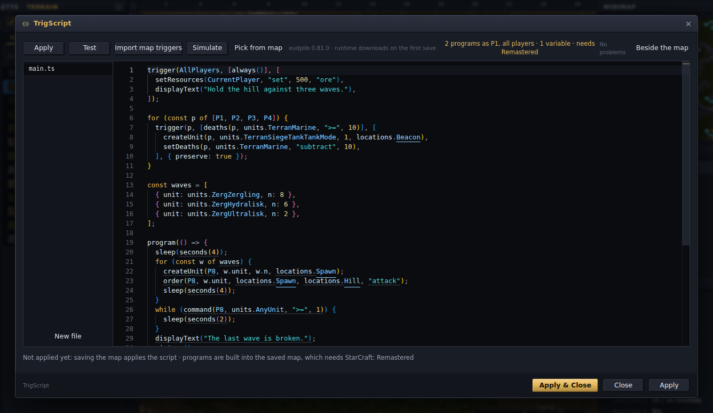
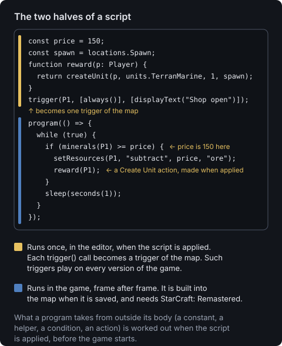
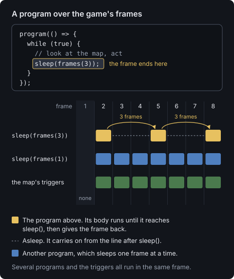
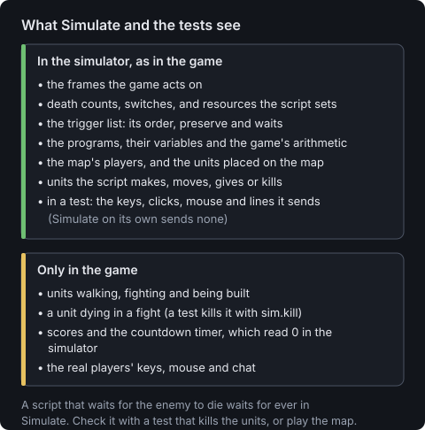
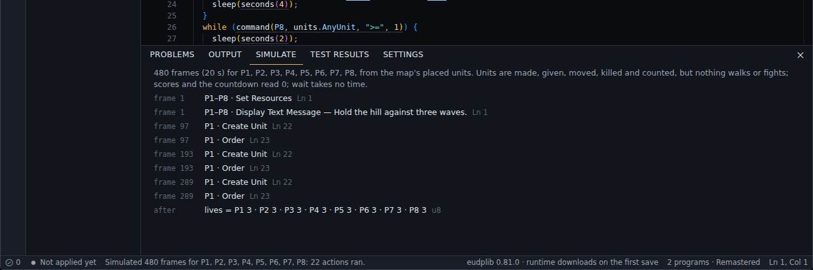
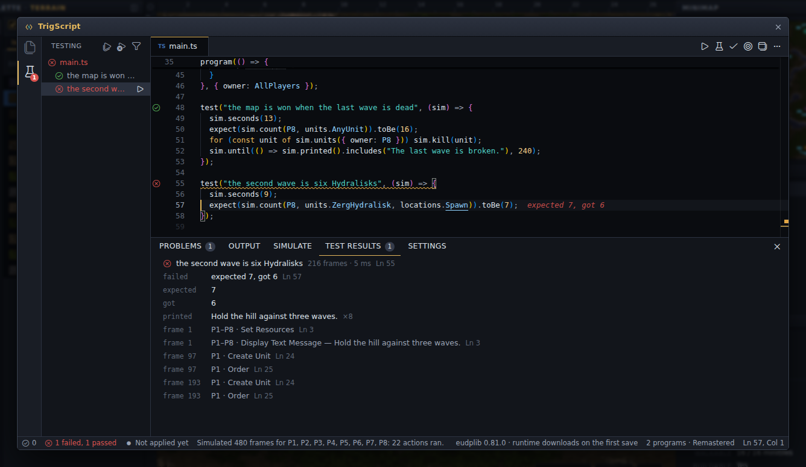
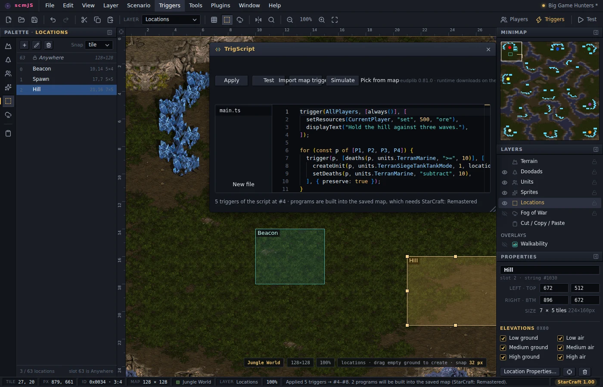
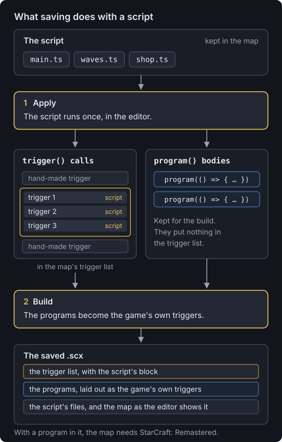
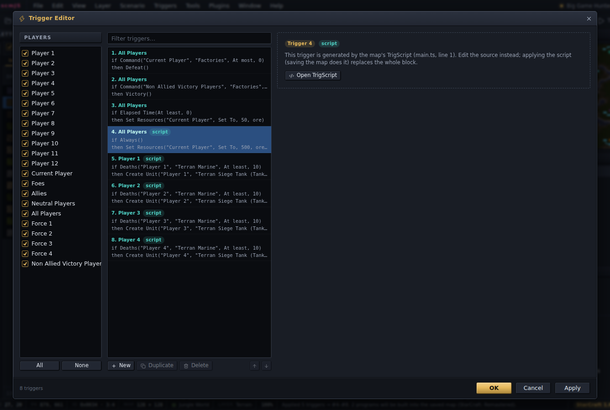

# TrigScript

TrigScript lets you write a map's triggers as code. The code is TypeScript, and it is kept
inside the map. TrigScript is a plugin that is on from the start: Triggers ▸ TrigScript…
opens it as soon as a map is open.

A script can make two kinds of things:

| | `trigger()` | `program()` |
| --- | --- | --- |
| What it makes | Ordinary triggers in the map's list | Code that runs inside the game |
| Plays on | Every version of StarCraft | StarCraft: Remastered only |
| Good for | Anything the Trigger Editor can do, without the repetition | Counters, timers, per-player state, loops over units, keys and chat |

Each `trigger()` call becomes one trigger, the same kind the Trigger Editor shows. The
code around the calls runs only while the script is applied, so a loop over the players, a
helper that returns the ten triggers a shop needs, or a table of waves all end up as plain
triggers.

Code inside `program(() => { … })` runs in the game instead. It has variables, arrays,
text, functions, classes, loops and `sleep`, so a lives counter or a wave timer is a loop
rather than a dozen triggers with hand-numbered death counts. TrigScript builds programs
into the map itself when it is [saved](guide.md#saving), in under a second, and **a map
with a program in it needs StarCraft: Remastered**. If the map must play on the classic
game, use `trigger()` only.



TrigScript works beside the editor's other trigger tools. The Trigger Editor shows the
triggers a script made, and the Text Trigger Editor (the TrigEdit plugin, installed but
off until you turn it on) shows them as text. The Trigger Map plugin, from Plugins ▸
Browse Plugins…, draws how triggers depend on each other. See
[Triggers](guide.md#triggers) in the user guide. What each condition and action does in
the game is in the [trigger reference](triggers.md). The words this page uses are
explained under [Terms](#terms).

## Quick start

This makes a map where Player 1 wins by walking a Marine onto a marked spot.

1. Open a map, or make one with File ▸ New (Ctrl+N). In Scenario ▸ Player Settings, give
   Player 1 a fixed race such as Terran. A player left on *User Selectable* gets a melee
   base instead of the units you place; see [Your first map](guide.md#your-first-map).
2. On the **Units** layer (`U`), pick Player 1 at the top of the palette and place a
   Terran Marine.
3. On the **Locations** layer (`L`), drag a box a short walk away from the Marine.
   Double-click the box and name it `Beacon`.
4. Open Triggers ▸ TrigScript…. Replace the contents of `main.ts` with:

   ```ts
   trigger(P1, [
     bring(P1, units.AnyUnit, locations.Beacon, ">=", 1),
   ], [
     displayText("You found the beacon."),
     victory(),
   ]);
   ```

   As you type `locations.`, the editor offers the map's locations by name.
5. Save the map (Ctrl+S). Saving applies the script: the trigger goes into the map's
   trigger list. The status bar at the bottom of the TrigScript window shows how many
   triggers the script made and where they start in the list, such as **1 trigger at #1**.
6. Press **Play** (F5) in the TrigScript window, or use Tools ▸ Test Map in the editor.
   The first time, Test Map needs to know where the game is; see [Test
   Map](guide.md#test-map). In the game, open Single Player ▸ Custom Game, pick the map
   from the `scmJS` folder, and choose *Use Map Settings* as the game type. Walk the
   Marine to the beacon.

To see what the script made, open the Trigger Editor (Ctrl+T). The trigger is there with a
`script` badge. From here, [Writing triggers](#writing-triggers) explains the parts of a
trigger, and [Examples of triggers](#examples-of-triggers) has complete scripts to start
from.

## Writing triggers

A trigger is one call:

```ts
trigger(AllPlayers, [
  bring(CurrentPlayer, units.AnyUnit, locations.Beacon, ">=", 1),
], [
  displayText("You found it!"),
  preserve(),
]);
```

`trigger(players, conditions, actions, options?)` records one trigger:

- `players` is one player or a list of them.
- `conditions` is a list of conditions, up to 16.
- `actions` is a list of actions, up to 64.
- `options` are the trigger's flags by name. `{ preserve: true }` is the same as the
  `preserve()` action; `disabled`, `ignoreGameEnd` and the others are listed in the
  [Reference](#triggers).

The order of the `trigger()` calls is the order of the triggers in the map.

### Conditions and actions

Every condition and action the game has is a function named after StarEdit's name for it,
in camel case: `bring`, `deaths`, `command`, `accumulate`, `elapsedTime`, `createUnit`,
`displayText`, `setResources`, `moveUnit`, `order`, `runAiScript`, `victory`. The one
exception is the Switch condition, which is `switchIs`, because `switch` is a reserved
word.

The arguments come in the order the Trigger Editor shows them. Where the Trigger Editor
offers a list, the argument is a short word:

- a comparison is `">="`, `"<="` or `"=="`;
- a modifier is `"set"`, `"add"` or `"subtract"`;
- a resource is `"ore"`, `"gas"` or `"oreAndGas"`;
- an order is `"move"`, `"patrol"` or `"attack"`;
- a unit count is a number or `"All"`.

The full list is in the [Reference](#argument-words). StarEdit's own labels, such as
`"At least"`, work too. Hover over any function in the editor to see its arguments.

`not(condition)` is the opposite of a condition, where one condition can say it:
`not(bring(…, ">=", 1))` is "at most 0".

### Names from the map

Units, locations and switches are named the way the map names them:

- Each display name becomes an identifier: `Terran Marine` is `units.TerranMarine`, and
  `Terran Siege Tank (Tank Mode)` is `units.TerranSiegeTankTankMode`. The display name
  works as well: `units["Terran Marine"]`.
- `locations.` lists the map's locations, and `switches.` its switches, by number and by
  any name the map gives them.
- `P1` … `P12`, `CurrentPlayer` and `AllPlayers` are constants. The other player groups
  are under `players`: `players.Force1`, `players.Foes`, `players.Allies`.
- A plain number works wherever a name does. That is how an EUD player or an unusual unit
  id gets in.

The editor checks the names as you type. A location passed where a unit belongs is an
error, and so is a name the map no longer has.

### Many triggers from a little code

The script runs when it is applied, and everything TypeScript offers is available at that
moment. A loop makes the same trigger for several players, a function returns a list of
actions, a table holds the numbers, and a template string builds the text:

```ts
function reinforce(p: Player) {
  return trigger(p, [deaths(p, units.TerranMarine, ">=", 10)], [
    createUnit(p, units.TerranSiegeTankTankMode, 1, locations.Spawn),
    setDeaths(p, units.TerranMarine, "subtract", 10),
    displayText("Reinforcements have arrived."),
  ], { preserve: true });
}

for (const p of [P1, P2, P3, P4]) reinforce(p);
```

Nested lists are flattened, and `false`, `null` and `undefined` entries are skipped. A
helper can return a list of actions, and a condition can be written
`hardMode && bring(…)`.

A condition is a *value* here: the game tests it later, when the map is played. So
`if (bring(…))` outside a program does not do what it looks like, and the editor says so.
The test belongs in a trigger's conditions, or in an `if` inside a [program](#programs).

### Several files

A script can have several files. `import { x } from "./name"` brings in another file of
the map's script; nothing else can be imported. The library is available everywhere
without an import, and also as the module `"trigscript"` for anyone who prefers
`import { trigger, bring } from "trigscript"`.

### Hyper triggers

`hyperTriggers(P8)` anywhere in the script adds the usual three preserved triggers of
sixty-two waits, so that the game goes through the trigger list every 2 frames instead of
every 31 ([Hyper triggers](triggers.md#hyper-triggers)). Give them to a player whose other
triggers never wait, usually a computer slot: each player has one wait slot, and the hyper
triggers keep it busy ([Waits](triggers.md#waits)). A map with a program does not need
them, since its build already makes the list run every frame: the build leaves hyper
triggers out, the script's and the map's own alike, and says so in a notice, as it does
for a trigger owned by a player group the game runs no list for (Players 9 to 12, Foes,
Allies, Neutral, Non-Allied Victory Players).

## Examples of triggers

Each of these is a complete `main.ts`, and each plays on every version of the game. They
assume a map with locations named `Beacon`, `Spawn`, `Base`, `Hill` and `Shop`. Use your
own names; the editor completes them.

**Starting resources and a welcome.** No preserve, so the trigger runs once, and
`CurrentPlayer` means each player in turn.

```ts
trigger(AllPlayers, [always()], [
  setResources(CurrentPlayer, "set", 500, "ore"),
  setResources(CurrentPlayer, "set", 100, "gas"),
  displayText("Hold the hill for five minutes to win."),
]);
```

**Hyper triggers.** One line, and the whole trigger list runs every 2 frames. Player 8 is
the computer slot here, and nothing else in the script makes that player wait.

```ts
hyperTriggers(P8);
```

**Something for every player.** A helper returns the trigger, and a loop calls it. Death
counts are the game's own counters. Subtracting ten after the reward lets the trigger fire
again at the next ten, which `preserve: true` allows.

```ts
function reinforce(p: Player) {
  return trigger(p, [deaths(p, units.TerranMarine, ">=", 10)], [
    createUnit(p, units.TerranSiegeTankTankMode, 1, locations.Spawn),
    setDeaths(p, units.TerranMarine, "subtract", 10),
    displayText("Reinforcements have arrived."),
  ], { preserve: true });
}

for (const p of [P1, P2, P3, P4]) reinforce(p);
```

**A shop.** Bring a civilian to the shop with enough minerals, and four marines appear at
the spawn. The civilian is moved out first, so the trigger does not fire again on the next
pass. `price` is an ordinary constant used twice.

```ts
const price = 150;

trigger(AllPlayers, [
  bring(CurrentPlayer, units.TerranCivilian, locations.Shop, ">=", 1),
  accumulate(CurrentPlayer, ">=", price, "ore"),
], [
  moveUnit(CurrentPlayer, units.TerranCivilian, 1, locations.Shop, locations.Spawn),
  setResources(CurrentPlayer, "subtract", price, "ore"),
  createUnit(CurrentPlayer, units.TerranMarine, 4, locations.Spawn),
  displayText(`Four marines for ${price} minerals.`),
], { preserve: true });
```

**A map that already has triggers.** Open TrigScript, press **…** and choose **Import the
Map's Triggers**. Every hand-made trigger comes back as a `trigger()` call, in its order,
and applying the script replaces the whole list with what it makes. From there a repeated
trigger becomes a loop, a number used in ten places becomes a constant, and the rest stays
as it was.

## Programs

Everything inside `program(() => { … })` runs in the game:

```ts
program(() => {
  let wave = 0;
  let alarm = false;
  while (true) {
    if (bring(P1, units.AnyUnit, locations.Beacon, ">=", 1) && !alarm) {
      alarm = true;
      displayText("They are coming.");
    }
    if (alarm) {
      createUnit(P8, units.ZergZergling, 4, locations.Spawn);
      wave += 1;
    }
    if (wave >= 10) defeat();
    sleep(seconds(20));
  }
}, { owner: P1 });
```

A map with a program needs StarCraft: Remastered. The programs are built into the map when
it is saved or tested (see [Saving and building](#saving-and-building)).

> **Note.** Building a program also changes how the rest of the map runs: the game goes
> through the trigger list every frame instead of every 31 frames. A preserved trigger that
> adds a mineral then adds twenty-four a second at Fastest.

### What is worked out when the script is applied

This is the one rule to keep in mind. **Everything the program reads from outside its body
is worked out once, when the script is applied**, before the game starts: a constant, a
helper, a condition, an action. The editor underlines those parts with dots, so you can
see the boundary as you type. That is what lets a helper written outside the program
supply actions inside it.

In the picture, the lines beside the gold bar run once in the editor, and the lines beside
the blue bar run in the game, where `price` is the number 150 and `reward(P1)` is the
action the helper made.



It also means a program variable cannot reach a condition, an action or a helper. The
location and the player of an action, and the amount a condition compares with, are fixed
when the script is applied. To compare with a variable, read the quantity and compare it
yourself: `minerals(P1) >= price` (see [Reading the
game](trigscript-language.md#reading-the-game)).

These parts of an action can follow a variable:

- the amount of `setResources`, `setDeaths`, `setScore` and `setCountdownTimer`;
- the unit count of `createUnit`, `killUnitAt`, `removeUnitAt` and `giveUnits`;
- an action's unit type;
- a text: `displayText` and `print`, the objectives, a leaderboard's label, a transmission
  and a unit type's name take any text the program made.

A sound's path or the next scenario's name is a text written in the script.

### How a program runs

**A program runs every frame, from where it left off.** It starts on frame 2, the game's
first pass. Its body runs until it reaches a `sleep()` or its end, all within one frame of
the game, and the next frame it carries on from there. A body that ends stops for good. So
the loop above is a game loop: it looks at the beacon, sends a wave if the alarm is up,
and sleeps twenty seconds.

In the picture, a program that sleeps three frames at a time runs on frames 2, 5 and 8,
while one that sleeps a frame at a time runs on every frame.



**Time is `sleep`.** `sleep(seconds(15))` gives the frame back and carries on that much
later, while other programs and the map's triggers go on. `frames(n)` and `minutes(n)`
make a duration too. Something that keeps its own time is a task beside the program, or
another program ([Waiting and tasks](trigscript-language.md#waiting-and-tasks)).

The game's own `wait()` is allowed in a program, but it is a different thing: it holds the
rest of its trigger for the time, and it uses the player's one wait slot, so any other
Wait of that player stops until the slot is free ([Waits](triggers.md#waits)). Use it for
a short pause, such as a text and then a sound, and use `sleep` to pass time.

**Two kinds of second.** A second of `sleep(seconds(n))` is 24 frames, which is one real
second at Fastest. A *game second* is 16 frames at every speed. `elapsed()`, `countdown()`
and the Elapsed Time and Countdown Timer conditions count game seconds, so at Fastest they
run about one and a half times as fast as `sleep` seconds: after `sleep(seconds(14))`,
`elapsed()` reads about 21.

**Edges.** `if (rose(bring(…)))` is true on the frame the condition becomes true, and not
again until it has been false in between. `once(…)` is true the first time only.
`random()` is a coin toss, and `random(n)` a whole number from 0 to n − 1.

### Owners and per-player programs

**A program runs for its owner**, as that player, while that player is in the game. The
owner is Player 1 unless `{ owner: … }` says otherwise.

An owner of `AllPlayers`, a force or a list of players makes a **per-player program**. The
same code runs for each of those players who is in the game, computers included.
`CurrentPlayer` is that player, and every variable is per player, each with its own copy.
That is how lives, scores and cooldowns are written once. `let total = shared(0)` is one
value that all of them share.

`{ name: "waves" }` names a program. The name appears in the Explorer, and a
[test](#tests) finds the program by it.

### What a program can use

A program is written in nearly all of TypeScript. The [TrigScript
language](trigscript-language.md) guide covers each part in full. In short:

- **Values**: numbers, booleans, texts, units, players and records. `u8`, `u16` and `u32`
  are numbers that are never below zero, and a number holds a fraction once one is stored
  in it ([Variables and numbers](trigscript-language.md#variables-and-numbers)).
- **Arrays, maps and sets**, fixed or growing, with their methods (`map`, `filter`, `sort`
  and the rest), patterns and spread ([Arrays](trigscript-language.md#arrays), [Tables,
  maps and sets](trigscript-language.md#tables-maps-and-sets)).
- **Functions and classes**, including functions kept in variables, closures, `extends`
  and `try` / `catch` ([Functions](trigscript-language.md#functions),
  [Classes](trigscript-language.md#classes), [Errors](trigscript-language.md#errors)).
- **Time**: `sleep`, `async` and `await`, tasks that run beside the program, and
  `Promise.all` and `race` ([Waiting and
  tasks](trigscript-language.md#waiting-and-tasks)).
- **The game**: every condition's quantity as a number, loops over units and their fields,
  events such as `on.died`, and the game's own tables through `stats()` ([Reading the
  game](trigscript-language.md#reading-the-game), [Units](trigscript-language.md#units),
  [Events](trigscript-language.md#events), [The game's tables and
  memory](trigscript-language.md#the-games-tables-and-memory)).
- **The players**: keys, clicks, the cursor and typed lines ([Keys, the mouse and
  chat](trigscript-language.md#keys-the-mouse-and-chat)).
- **Text and sound**: texts with values, lines of JSX, and sounds the script makes
  ([Text](trigscript-language.md#text), [Sounds and imported
  files](trigscript-language.md#sounds-and-imported-files)).
- **Libraries**: nine modules that come with TrigScript, such as `trigscript/ui` for menus
  and `trigscript/cutscene` for scenes, and libraries other plugins provide ([TrigScript
  library](trigscript-library.md)).

A few of these together: a wave every thirty seconds, each bigger than the last, until
Player 1 has lost ten Marines.

```ts
import { every, SECOND } from "trigscript/timers";

program(async () => {
  let lost = 0;
  on.died({ owner: P1 }, (u) => {
    if (u.type == units.TerranMarine) lost += 1;
  });
  const waves = every(30 * SECOND, (n) => createUnit(P8, units.ZergZergling, n * 2, locations.Spawn));
  await until(() => lost >= 10);
  waves.cancel();
  displayText("Ten Marines lost.");
  defeat();
});
```

What a program cannot do, and what to write instead, is listed under [What a program does
not have](trigscript-language.md#what-a-program-does-not-have).

## Examples of programs

Each of these is a complete `main.ts` for a map that needs StarCraft: Remastered. Like the
[trigger examples](#examples-of-triggers), they assume locations named `Beacon`, `Spawn`,
`Base`, `Hill` and `Shop`.

**Waves from a table.** The table is ordinary data, and the program walks it: one wave
every forty-five seconds, then it waits for the last attacker to die. A `for … of` over a
list known when the script is applied is written out once per entry, so `w.unit` and `w.n`
are plain values in each copy. The program runs as Player 1, so `victory()` is Player 1's;
a team needs a `trigger()` for the others.

```ts
const waves = [
  { unit: units.ZergZergling, n: 8 },
  { unit: units.ZergHydralisk, n: 6 },
  { unit: units.ZergUltralisk, n: 2 },
];

program(() => {
  displayText("The first wave arrives in thirty seconds.");
  sleep(seconds(30));
  for (const w of waves) {
    createUnit(P8, w.unit, w.n, locations.Spawn);
    order(P8, w.unit, locations.Spawn, locations.Base, "attack");
    minimapPing(locations.Spawn);
    sleep(seconds(45));
  }
  while (command(P8, units.AnyUnit, ">=", 1)) {
    sleep(seconds(2));
  }
  displayText("The last wave is broken.");
  victory();
});
```

**Lives, per player.** One program runs for every player, and `lives` is a separate
counter for each. When the hero dies, the game's death count for it goes to 1. The program
resets that count, takes a life, and either brings the hero back or ends the game for that
player. The `sleep(frames(1))` at the end of the loop makes it look once a frame.

```ts
program(() => {
  let lives: u8 = 3;
  while (true) {
    if (deaths(CurrentPlayer, units.JimRaynorMarine, ">=", 1)) {
      setDeaths(CurrentPlayer, units.JimRaynorMarine, "set", 0);
      lives -= 1;
      if (lives == 0) {
        displayText("No lives left.");
        defeat();
      } else {
        createUnit(CurrentPlayer, units.JimRaynorMarine, 1, locations.Spawn);
        displayText("Your hero returns.");
      }
    }
    sleep(frames(1));
  }
}, { owner: AllPlayers });
```

**King of the hill.** A point a second for holding the hill alone, shown on a leaderboard,
and a win at a hundred. `points` is a program variable, and the amount of `setScore`
follows it. `players.Foes` means "anyone at war with the current player", so the check is
written once for everyone.

```ts
trigger(AllPlayers, [always()], [leaderboardPoints("Hill", "custom")]);

program(() => {
  let points: u16 = 0;
  while (true) {
    if (bring(CurrentPlayer, units.AnyUnit, locations.Hill, ">=", 1)
        && !bring(players.Foes, units.AnyUnit, locations.Hill, ">=", 1)) {
      points += 1;
      setScore(CurrentPlayer, "set", points, "custom");
      if (points >= 100) {
        displayText("The hill is yours.");
        victory();
      }
    }
    sleep(seconds(1));
  }
}, { owner: AllPlayers });
```

**Random events.** Every two minutes, a coin toss decides which of two things happens.

```ts
program(() => {
  while (true) {
    sleep(minutes(2));
    if (random()) {
      displayText("Reinforcements pour from the nydus canal.");
      createUnit(P8, units.ZergZergling, 12, locations.Spawn);
    } else {
      displayText("A supply drop: 100 minerals for everyone.");
      setResources(AllPlayers, "add", 100, "ore");
    }
  }
});
```

**A beacon that opens a gate, once.** `once()` is true only the first time its condition
holds, so this runs once however long the unit stands there. Two things happen on their
own clocks, so there are two programs.

```ts
program(() => {
  while (true) {
    if (once(bring(P1, units.AnyUnit, locations.Beacon, ">=", 1))) {
      displayText("The gate opens.");
      killUnitAt(P12, units.LeftUpperLevelDoor, "All", locations.Base);
      setSwitch(switches.Switch1, "set");
    }
    sleep(frames(1));
  }
});

program(() => {
  while (true) {
    if (switchIs(switches.Switch1, "set")) {
      createUnit(P8, units.ZergHydralisk, 2, locations.Spawn);
      sleep(seconds(30));
    } else {
      sleep(seconds(1));
    }
  }
});
```

**A heal that each Marine gets once every ten seconds.** A `Map` keyed by units keeps a
number for each of them. A unit that has died reads as no unit in the loop over the map,
which is where its entry is deleted.

```ts
program(() => {
  const wait = new Map<Unit, number>();
  while (true) {
    for (const u of unitsAt(locations.Hill, { owner: P1, type: units.TerranMarine })) {
      if (!wait.has(u)) { u.heal({ percent: 100 }); wait.set(u, 10); }
    }
    for (const [u, left] of wait) {
      if (!u || left <= 1) wait.delete(u); else wait.set(u, left - 1);
    }
    sleep(seconds(1));
  }
});
```

## Showcase

Maps made with TrigScript, each with its whole script and a recording of it played in
StarCraft: Remastered.

### Bad Apple!!

[](https://www.youtube.com/watch?v=EbaFmgYyHgU)

[Watch it on YouTube](https://www.youtube.com/watch?v=EbaFmgYyHgU).

The shadow-art video for "Bad Apple!!" played on the minimap, in time with the song. The
fog of war is the screen: a tile lit this frame is white, a tile seen before is grey, so
each frame of the game shows one frame of the video, 5,216 of them.

The video is a file of the script. **Import Video…** turned it into `bad-apple.video`, a
tile a pixel at 128 × 96, and when the script is built the `fog` library works out, for
every frame, the units whose sight covers exactly its white parts. In the game each of
those units is made and taken away in the same trigger pass, and what it saw stays lit
until the next frame, when the library has the game put every tile back in fog. A frame
takes about 125 units on average and 356 at the most. The language guide describes [files
the script imports](trigscript-language.md#files-the-script-imports) and [the `fog`
library](trigscript-language.md#the-standard-library).

```ts
import { fog } from "trigscript/fog";
import badApple from "./bad-apple.video";

const W = 128, H = 96;
// The camera waits below the board: the minimap draws the camera's box over
// whatever is under it.
const PARK = reserveLocation("bad apple: the camera, below the board");

// Rows `from` to `to` of the board lit, as a picture: one step of the curtain the
// video opens and closes behind.
const band = (from: number, to: number) =>
  fog.picture(Array.from({ length: H }, (_, y) => (y >= from && y < to ? "#" : ".").repeat(W)));
const STEP = 4;
const board = band(0, H);
// White falls over the board from the top, a second long, then slides off the bottom.
const fall = Array.from({ length: H / STEP }, (_, i) => band(0, (i + 1) * STEP));
const lift = Array.from({ length: H / STEP - 1 }, (_, i) => band((i + 1) * STEP, H));

const credits = () => {
  displayText("\x04Bad Apple!! feat. nomico");
  displayText("\x05Alstroemeria Records, after a Touhou Project song by ZUN. Shadow art video by Anira.");
};

program(async () => {
  centerLocation(PARK, 64 * 32, 116 * 32);
  centerView(PARK);
  await sleep(frames(24));
  credits();
  displayText("\x05Played on the minimap with the fog of war, written in TrigScript.");
  for (const p of fall) { fog.light(P1, 0, 0, p); await nextFrame(); }
  let i = 0;
  while (i < 72) { fog.light(P1, 0, 0, board); await nextFrame(); i++; }
  for (const p of lift) { fog.light(P1, 0, 0, p); await nextFrame(); }
  await sleep(frames(12));

  playWav("staredit\\wav\\badapple.ogg", 0);
  await fog.play(P1, badApple);

  // The song runs a little past the last frame.
  await sleep(frames(48));
  for (const p of fall) { fog.light(P1, 0, 0, p); await nextFrame(); }
  displayText("\x04Fin.");
  credits();
  i = 0;
  while (i < 120) { fog.light(P1, 0, 0, board); await nextFrame(); i++; }
  for (const p of lift) { fog.light(P1, 0, 0, p); await nextFrame(); }
});
```

The `for … of` loops are written out once per picture when the script is built, so each
step of the curtain is a fixed set of units; the `while` loops run in the game.

**The map.** 128 × 128 Badlands. The top 96 rows, the picture, are all one tile, 23778,
laid with the Tile brush: of the tiles measured, its lit and fogged colours lie furthest
apart on the Classic minimap. The 32 rows below have never been seen, so they stay black,
and the camera waits there. There are no units, so nothing lights the fog but the script.
Player 1 is the human and Player 2 a computer: Remastered will not start a Use Map
Settings map without a computer slot.

**The song** is in the map's archive as a stereo Ogg file, `staredit\wav\badapple.ogg`,
which Remastered plays. Import Video… also takes a sound file, as a `.sound` file of the
script that `playWav` plays (mixed to mono).

**Playing it.** Host a multiplayer game alone, which runs at Fastest, the speed the video
was imported for. Switch to Classic graphics (Options ▸ Graphics, or F5): Classic draws
the minimap a pixel a tile, sharp, where Remastered graphics blurs it. Turn the music
volume down, so the game's own music does not play over the song.

"Bad Apple!! feat. nomico" is by Alstroemeria Records, an arrangement of a song from the
Touhou Project by ZUN; the shadow-art video is by Anira. Neither comes with the editor or
the plugin.

## Coming from eudplib

This page is for map makers who already write EUD maps with eudplib, in Python or in
epScript, and build them with euddraft. A TrigScript program does the same kind of work:
code that runs inside StarCraft: Remastered, reading and writing the game's memory. Most
of what you know carries over, and this page says where each idea went.

### Which one to use

TrigScript suits you when you want to work in one place: the code is checked against the
map's own names as you type, [Simulate and tests](#testing-and-simulate) try it without
starting the game, and saving the map builds it, in the browser or the desktop app. Its
language is TypeScript, with arrays that grow, classes, closures, `try` / `catch` and
`async`, and the same script can make ordinary triggers for the classic game beside the
programs.

eudplib stays the better fit when a map depends on an euddraft plugin or a community
library that TrigScript has nothing like, when you want euddraft's map protection, or when
you already have a build you are happy with. TrigScript does not read eudplib or epScript
code: moving a map over means writing its code again.

### The same ideas, side by side

| eudplib, epScript | TrigScript |
| --- | --- |
| `EUDVariable()`, `var x = 0;` | `let x = 0;` inside a `program()` ([Variables](trigscript-language.md#variables-and-records)) |
| `PVariable`, `getcurpl()` / `setcurpl()` | A per-player program, `{ owner: AllPlayers }`: every variable is per player, and `CurrentPlayer` is that player ([Owners](trigscript-language.md#owners-and-per-player-programs)) |
| `onPluginStart()` | The start of a program's body, before its loop |
| `beforeTriggerExec()`, `afterTriggerExec()` | A loop in the program: `while (true) { …; await nextFrame(); }` ([How a program runs](#how-a-program-runs)) |
| `EUDIf()`, `EUDWhile()`, `if`, `while` in epScript | `if`, `while`, `for`, `switch`, with conditions of the game where a boolean goes ([Control flow](trigscript-language.md#control-flow)) |
| `DoActions(…)`, an action as a statement | An action as a statement: `setDeaths(P1, units.TerranMarine, "set", 0);` |
| `@EUDFunc`, `function` in epScript | `function`, called or written out by the compiler ([Functions](trigscript-language.md#functions)) |
| `EUDFuncPtr` | A function kept in a variable, and closures ([Functions as values](trigscript-language.md#functions-as-values)) |
| `EUDArray`, `EUDVArray` | `number[]`, fixed or growing, with `push`, `map`, `filter`, `sort` and the rest ([Arrays](trigscript-language.md#arrays)) |
| `foreach (cunit : EUDLoopCUnit())`, `CUnit` | `for (const u of unitsOf(P1))`, `u.hp`, `u.order(…)` ([Units](trigscript-language.md#units)) |
| `f_dwread_epd`, `SetMemory`, `MemoryEPD` | `stats()` and `memory.*` for the named fields; `memory()` and `setMemory()` for any address ([The game's tables and memory](trigscript-language.md#the-games-tables-and-memory)) |
| `StringBuffer`, `f_sprintf` | A template literal: `` displayText(`Wave ${wave}`) `` ([Text](trigscript-language.md#text)) |
| The MSQC plugin (keys and the mouse) | `keyPressed`, `keyHeld`, `clicked`, `mouse`, with nothing to configure ([Keys, the mouse and chat](trigscript-language.md#keys-the-mouse-and-chat)) |
| The chatEvent plugin | `chatted(player, "-spawn {n} {what:unit}")` and `on.chat` |
| The `.eds` file and an euddraft run | Saving the map |

One difference shows up everywhere: a unit's fields. eudplib reads them as the game keeps
them, so hit points are in 256ths and an owner is a number. TrigScript's fields are in the
units the game shows (`u.hp` is whole hit points, `u.owner` a player), and only the fields
that have been seen working in Remastered are there.

**A counter of lives**, in epScript as a euddraft plugin, then in TrigScript:

```js
var lives = 3;

function beforeTriggerExec() {
    if (Deaths(P1, AtLeast, 1, "Terran Marine")) {
        lives -= 1;
        SetDeaths(P1, SetTo, 0, "Terran Marine");
        if (lives == 0) {
            setcurpl(P1);
            DisplayText("Out of lives.");
        }
    }
}
```

```ts
program(() => {
  let lives = 3;
  while (true) {
    if (deaths(P1, units.TerranMarine, ">=", 1)) {
      lives -= 1;
      setDeaths(P1, units.TerranMarine, "set", 0);
      if (lives == 0) displayText("Out of lives.");
    }
    sleep(frames(1));
  }
});
```

The program runs as Player 1, so `displayText` is already Player 1's. Its loop is the
`beforeTriggerExec` of the epScript, and the `sleep` gives the frame back.

**A loop over units**: Player 1's Marines under 20 hit points healed to 40.

```js
function beforeTriggerExec() {
    foreach (cunit : EUDLoopCUnit()) {
        if (cunit.owner == P1 && cunit.unitType == $U("Terran Marine") && cunit.hp < 20 * 256) {
            cunit.hp = 40 * 256;
        }
    }
}
```

```ts
program(() => {
  while (true) {
    for (const u of unitsOf(P1, { type: units.TerranMarine })) if (u.hp < 20) u.hp = 40;
    sleep(frames(1));
  }
});
```

The epScript examples here were built with euddraft 0.11 and eudplib 0.81.

### Speed and size

We built the same test maps both ways, with TrigScript's own build and with eudplib, and
ran them on the same machine. The figures are from October 2026, and they are rounded:

- **Building** a small test map took under a second in the editor, against about five
  seconds through euddraft.
- **Running**: a benchmark of program statements ran in about half eudplib's time, and a
  loop over units cost about half as much a unit. Arrays, text with numbers in it and
  tasks came out several times faster. One thing is slower: throwing an error costs about
  three times what it does in eudplib.
- **Map size**: TrigScript's maps came out larger on most test maps, usually 1.2 to 1.6
  times eudplib's: 2.9 MB against 1.8 MB for the units test map. The tasks test map came
  out smaller, 1.4 MB against 2.1 MB.

Neither kind of map plays on StarCraft 1.16.1: that version refuses writes past the end of
the deaths table, which such a map makes from its first frame. A script of `trigger()`
calls alone, with no program, plays on every version.

### What does not carry over

- **Map protection.** euddraft's freeze scrambles a map against copying. TrigScript adds
  no protection, by decision: a map stays one the editor, and anyone else's, can open.
- **euddraft plugins and Python libraries.** TrigScript has its own [library of
  modules](trigscript-library.md), and other scmJS plugins can provide [libraries of their
  own](trigscript-library.md#libraries-from-other-plugins). Neither runs Python.
- **Fields nobody has checked.** `memory()` and `setMemory()` reach any address, as
  eudplib does, but the named fields are only the ones seen working in Remastered. Writing
  a unit's position, for one, ends a Remastered game with "EUD not supported", so it is
  not offered.
- **The community.** eudplib has years of maps, guides and libraries behind it, many of
  them in Korean. TrigScript's own build is new, from October 2026.

## Testing and Simulate

TrigScript can run a script without starting the game, in a simulator built into the
editor. **Simulate** shows what the script does in its first twenty seconds. **Tests** are
checks you write that run after every change. Neither adds anything to the map.

The simulator models death counts, switches, preserve, the order of the trigger list, the
game's arithmetic and the map's players. It has units: the ones placed on the map, then
whatever `createUnit` makes, `giveUnits` hands over, `moveUnit` moves and `killUnitAt`
kills, which `bring` and `command` count. It leaves out what it cannot know without the
game: nothing walks, nothing fights and nothing is built, so no unit dies unless the
script (or a test) kills it. Scores and the countdown read 0, and keys, clicks, the mouse
and chat read as nothing. The picture sets the two lists side by side.



The simulator keeps the game's time, so the frames it lists are the frames the game would
act on: the first pass on frame 2, then one every 31 frames, or every frame in a map with
a program. A Wait holds its trigger for its time at Fastest. See [How triggers
run](triggers.md#how-triggers-run).

### Simulate

**Simulate** (Ctrl+F5 in the TrigScript window) runs the script for 480 frames, twenty
seconds of the game at Fastest. It lists, under the code, every action that ran with its
frame and its line in the script, and the final value of every program variable. Triggers
and programs run side by side, so a death count a program sets is seen by a trigger. A
program or a trigger of a force runs for each of its players, and each line says whose it
is.



Simulate is a check on the logic. A script that waits for the enemy to die waits for ever
here; for the fight, write a [test](#tests) that kills the units, or play the map.

### Tests

A test is ordinary TypeScript that runs in the simulator after every change that compiles.
It never runs in the game and adds nothing to the map. If you have used Vitest or Jest,
the names are the same: `test`, `describe`, `beforeEach`, `test.only`, `test.skip`,
`test.each` and `expect`, imported from `"trigscript"`.

A test of a trigger:

```ts
import { test, expect } from "trigscript";

trigger(P1, [bring(P1, units.TerranCivilian, locations.Shop, ">=", 1)], [
  moveUnit(P1, units.TerranCivilian, 1, locations.Shop, locations.Spawn),
  createUnit(P1, units.TerranMarine, 4, locations.Spawn),
], { preserve: true });

test("a civilian at the shop buys four marines", (sim) => {
  sim.place(P1, units.TerranCivilian, locations.Shop);
  sim.seconds(3);
  expect(sim.count(P1, units.TerranMarine, locations.Spawn)).toBe(4);
});
```

A test of a program, which reads the program's variables by name:

```ts
import { test, expect } from "trigscript";

// A Marine on the beacon calls the next wave, each bigger than the last.
program(() => {
  let wave = 0;
  while (true) {
    if (countUnits(P1, units.TerranMarine, locations.Beacon) > 0) {
      wave += 1;
      createUnit(P8, units.ZergZergling, wave * 4, locations.Spawn);
      print(`Wave ${wave}`);
      killUnitAt(P1, units.TerranMarine, "All", locations.Beacon);
    }
    sleep(frames(1));
  }
}, { name: "waves" });

test("the second wave is bigger", (sim) => {
  sim.place(P1, units.TerranMarine, locations.Beacon);
  sim.until(() => sim.program("waves").wave === 1);
  sim.place(P1, units.TerranMarine, locations.Beacon);
  sim.until(() => sim.program("waves").wave === 2);
  expect(sim.count(P8, units.ZergZergling, locations.Spawn)).toBe(12);
  expect(sim).toHavePrinted("Wave 2");
});
```

Every test gets `sim`, a world of its own: the map's placed units, locations and players,
the script's programs and triggers, and the same `random()` results every run. Time in a
test is the game's: nothing runs on frame 1, the first pass is on frame 2, and
`sim.frames(3)` gives a program two runs.

| What a test does | With |
| --- | --- |
| Change the world | `sim.place(player, type, location, count?)`, `sim.kill(unit)`, `sim.remove(unit)`, `sim.give(unit, to)`, `sim.move(unit, to)` |
| Let time pass | `sim.frames(n)`, `sim.seconds(n)`, `sim.until(() => …)` |
| Act as a player | `sim.press("F2")`, `sim.click()`, `sim.type("-give 100")`, `sim.moveMouse(x, y)` |
| Read the world | `sim.count(player, type, location?)`, `sim.units(filter?)`, `sim.resources(player)`, `sim.deaths(player, type)`, `sim.switch(n)` |
| Read a program | `sim.program("waves").wave` |
| See what was shown | `sim.printed()`, `expect(sim).toHavePrinted("Wave 2")` |

- `place` gives the new units back, and `kill` stands in for a fight.
- `until` fails the test if its condition is still not true after 2400 frames, so no test
  hangs.
- What a player does is found by the program on the next frame.
- `sim.program(…)` gives a program's variables by their names in the code: numbers, texts,
  arrays, and a record as an object. Name the program in its options
  (`{ name: "waves" }`), or give its place in the script, counting from 0:
  `sim.program(0)`. For a per-player program, name the player too:
  `sim.program("lives", P2)`.

A test fails when an `expect` does not hold, when it throws, and when a program does
something that is always a mistake and that the game would pass over in silence, such as
reading past the end of an array. A test that means to check for that says
`expect(sim).toHaveFaulted()`.

Tests live beside what they test, as above, or in files whose names end in `.test.ts`, in
any folder. A test file can `import` the script's own functions and test them as plain
TypeScript. A test file is never part of the map: `main.ts` cannot import one, and a
`trigger()` or a `program()` inside one is an error.



In the editor, every `test(` has a mark in the margin (passed, failed or not run), and a
click on the mark runs that test. A failure is shown where it happened, as
`expected 7, got 6` at the end of the line.

- The **Testing** view, from the strip at the far left, lists the tests by folder, file
  and `describe`. It runs all of them, one of them or the ones that failed, and can show
  only the failing ones.
- The status bar keeps the count.
- **Test Results**, under the code, has the chosen test's message, what it printed and
  what happened frame by frame.

A failing test is a warning, not an error: the map still saves and builds. The **Tests**
setting in the workspace's Settings view, kept in the map, makes a failing test stop the
build instead.

## The workspace

This part covers the TrigScript window, the panel beside the map, and what happens to the
script when the map is saved.

### Opening the script

Triggers ▸ TrigScript… opens the map's script in a window laid out like VS Code, with the
same keys:

| Part | What is there |
| --- | --- |
| Explorer (left, Ctrl+B) | The script's files as a tree, and under them the programs with their variables |
| Strip at the far left | Switches the sidebar between the Explorer and **Testing** |
| Tabs (over the code) | One per open file |
| Icons right of the tabs | **Play** (F5), **Simulate** (Ctrl+F5), **Apply** (Ctrl+Shift+B), **Pick from map**, beside the map or in a window, and **…** for the rest |
| Panel (under the code, Ctrl+J) | **Problems**, **Output**, **Simulate**, **Test Results** and **Settings** (Ctrl+,) |
| Status bar | Problems, tests, whether the triggers are in the map, the last build |
| Command palette (F1) | Every command |

`main.ts` is where the script starts. *New file* and *New folder* add to it, and a row's
pencil and bin rename and remove a file. To move a file or folder, drag it onto a folder,
or rename it with a folder before its name. The `import`s that pointed at it are rewritten
to match, and the notice that says so has an **Undo**. Folders mean nothing to TrigScript
itself: `tests/` is a habit, not a rule.

Edits are saved into the map as you type, since the files are part of the map archive,
like a sound. Ctrl+S saves the map from inside the TrigScript window too.

The code is checked as you type, against the map's own names: `locations.` completes to
the locations the map has, `units.` to every unit type (and the map's custom names),
`switches.` to the switches, and `players.` to the forces. The status bar counts the
problems, and a click on the count opens **Problems**, the list of them.


The **Settings** view holds what the map's author chose about how its programs are built,
kept in the map so it builds the same on any computer: the memory for arrays that grow,
how deep a function may call itself, and whether a failing test stops the build.

### Beside the map

The TrigScript window covers the map. To keep the map in reach, open the script *beside
the map*: use the icon right of the tabs, or Triggers ▸ TrigScript beside the map. It is a
panel over the map that blocks nothing: drag it by its title, resize it by its corner, and
keep placing units while the code sits next to them.



Beside the map, the names in the code and the objects on the map know about each other:

- **Ctrl+click** on `locations.Beacon` scrolls the map to the location and flashes it.
  Hovering over the name says where it is and how big.
- **Pick from map** (the target icon, or a right-click in the code): click a location or a
  unit on the map, and its name (`locations.Beacon`, `units.TerranMarine`) is typed at the
  cursor. From the window, it first moves the editor beside the map.
- When you rename a location or a switch the script mentions, a notice offers to **Update
  references** in every file. It follows the name the way the code does (an alias from
  `import { locations as L }` counts) and leaves comments, strings and anything merely
  spelled the same alone.

### Applying the script

*Applying* the script runs it and puts the triggers it recorded into the map's trigger
list as one block. The block replaces the one from the last apply, or is added at the end
the first time. There is no step to remember: **saving the map applies the script**, and
so do Test Map and anything else that writes the map out. A save then builds the programs,
as the picture shows and [Saving and building](#saving-and-building) explains.



- **Apply** (Ctrl+Shift+B) applies the script without saving, so you can look at the
  triggers in the Trigger Editor first. A click on the status bar's trigger count does the
  same.
- **Play** (F5) applies the script, builds the map as Save would, and hands it to [Test
  Map](guide.md#test-map) to start it in the game.
- **Output**, in the panel, keeps what each of them reported.



The Trigger Editor shows the script's triggers with a `script` badge and does not let you
edit them. *Open TrigScript* there jumps to the file and line that made a trigger. The
Text Trigger Editor fences them in comments. Hand-made triggers around the block are left
alone, and a hand-made trigger inserted before the block just moves the block along.

If the script has an error when the map is saved, the map is saved anyway, with the
triggers from the last script that worked, and a notice names the file and the line.

### Triggers edited by hand

Editing one of the script's triggers outside the script makes the block *stale*. The
editor says so the next time the script opens: how many triggers are still the script's,
and how many were changed. While the block is stale, saving the map does not apply the
script, and the notice on Save says so. The notice offers two ways out:

- **Apply** replaces the unchanged triggers and keeps the edited ones as hand-made
  triggers right after the new block, so a wave system tuned in one trigger does not come
  back twice.
- **Append instead** leaves all of them as they are and adds a fresh block after them.

**Import the Map's Triggers** (under **…**) goes the other way: it rewrites the map's
hand-made triggers as `trigger()` calls, in their order, so a map made in the Trigger
Editor can carry on as a script.

### Saving and building

A script with programs is *built* when the map is saved, tested or exported. TrigScript
lays the programs out in the file being written, as the game's own triggers after the
map's strings, and makes the file a Remastered one. It takes under a second, and nothing
else has to be installed. The build also tidies the map as euddraft's build would: a null
terrain tile becomes tile 1, and a placed unit's flags are made to agree with its values.
The Output panel of the TrigScript window lists what it changed. A notice shows while the
build runs, and its **Save without it** button saves at once, without the programs.

A script with something TrigScript does not take yet is not built: Problems says which
line and why, as a warning, and the save's notice says so again, with a button to save
without the programs. The rest of the map is saved as it is. A map with Magenta's rows is
built in the same pass: Magenta writes its rows as TrigScript and hands them to this
build, so the two share one layout.

The file you get is the one to play and to share. It also holds the map as you see it in
the editor, which is what comes back when you open it again, so the trigger list never
fills up with what the build generated.

The script's files and a record of the last apply live in the map archive under
`trigscript\` (`main.ts`, any other files, and `build.json`), so they travel with the
`.scx`. The [Save dialog](guide.md#saving) lists them with the archive's other files, each
with a tick, so a copy for release can leave the source out. The triggers stay either way.

## Reference

### Terms

| Term | Meaning |
| --- | --- |
| Frame | One step of the game. 24 a second at Fastest. |
| Pass | One time the game goes through the trigger list: every 31 frames, every 2 with hyper triggers, every frame in a map with a program. |
| Game second | 16 frames, at every game speed. What Elapsed Time and the countdown timer count. |
| Wait slot | Each player has one. A Wait takes it, and the player's other Waits wait for it. |
| Apply | Run the script and put its triggers into the map's trigger list. |
| Block | The run of triggers in the list that the script made. |
| Build | Turn the programs into the saved map. Only a script with programs is built. |
| Per-player program | A program owned by several players, run for each with its own variables. |

### Triggers

| | |
| --- | --- |
| `trigger(players, conditions, actions, options?)` | One trigger. `players` is a player or a list; up to 16 conditions and 64 actions. |
| `{ preserve, disabled, ignoreGameEnd, ignoreDisplay, conditionsMet, paused, waitSkipDisabled, flags }` | The options: each trigger flag by name, and `flags` for raw bits. |
| `preserve()` | The same as `{ preserve: true }`, as an action. |
| `not(condition)` | The opposite condition. "Exactly n" has none, and is an error. |
| `disabled(item)` | The condition or action kept in the trigger but switched off. |
| `hyperTriggers(owner?)` | The three triggers that make the list run every 2 frames. |
| `condition(type, …)`, `action(type, …)` | A record by raw type number, for anything the tables do not know. |
| `memory(address, comparison, value)`, `setMemory(address, modifier, value)` | EUD: a value in the game's memory, through the deaths table. |

`not()` flips a comparison or a switch test, and turns `always()` into `never()`.

### Argument words

StarEdit's labels work too.

| Argument | Words |
| --- | --- |
| Comparison | `">="`, `"<="`, `"=="` |
| Modifier | `"set"`, `"add"`, `"subtract"` |
| Switch state | `"set"`, `"cleared"` |
| Switch action | `"set"`, `"clear"`, `"toggle"`, `"randomize"` |
| Resource | `"ore"`, `"gas"`, `"oreAndGas"` |
| Score | `"total"`, `"units"`, `"buildings"`, `"unitsAndBuildings"`, `"kills"`, `"razings"`, `"killsAndRazings"`, `"custom"` |
| Order | `"move"`, `"patrol"`, `"attack"` |
| Alliance | `"enemy"`, `"ally"`, `"alliedVictory"` |
| Unit state (doodads, invincibility) | `"enable"`, `"disable"`, `"toggle"` |
| Count | A number, or `"All"` |

`displayText(text)` always displays; `displayText(text, false)` follows the player's
subtitle setting.

### Names

| | |
| --- | --- |
| `P1` … `P12`, `CurrentPlayer`, `AllPlayers` | Constants. |
| `players.` | Every player group: `Force1` … `Force4` (and the force's own name), `Foes`, `Allies`, `Neutral`, `NonAlliedVictory`, and the twelve players. |
| `units.` | Every unit type by name as an identifier (`TerranMarine`) or a string (`units["Terran Marine"]`), and by the map's custom names. `AnyUnit`, `Men`, `Buildings`, `Factories`. |
| `locations.` | The map's locations by name; `Anywhere` and `NoLocation`. |
| `switches.` | `Switch1` … `Switch256`, and any name the map sets. |
| `aiScripts.` | The AI scripts by StarEdit name; a four-letter code as a string works too. |
| `weapons.`, `upgrades.`, `techs.` | The game's weapons, upgrades and technologies, for `stats()`. |
| `colors.` | The player colours. |
| A number | Accepted wherever a name is: an EUD player, an unlisted unit id. |

### Inside a program

Each row links to where the [TrigScript language](trigscript-language.md) guide explains
it.

| | |
| --- | --- |
| `program(body, options?)` | Code that runs in the game. Options: `owner` (a player, `AllPlayers`, a force or a list) and `name`. [Owners](trigscript-language.md#owners-and-per-player-programs) |
| `game(fn)` | A function that runs in the game, for programs to call. It can live in any file and be imported. [Functions in other files](trigscript-language.md#functions-in-other-files) |
| `let n = 0`, `let f = false`, `let s = ""`, `let u: Unit \| null = null`, `let p = { … }` | A number, a boolean, a text, a unit, a record. [Variables](trigscript-language.md#variables-and-records) |
| `u8`, `u16`, `u32`, `fixed` | Numbers never below zero, and a number with a fraction. [Whole numbers](trigscript-language.md#whole-numbers), [fractions](trigscript-language.md#numbers-with-a-fraction) |
| `u32(x)`, `i32(x)` | The same 32 bits read the other way, where a `u32` meets a plain number. |
| `Math.sqrt`, `Math.hypot`, `Math.sin`, `Math.cos`, `Math.atan2`, … | Fixed numbers. `Math.min`, `max`, `abs`, `floor` and `clamp(x, lo, hi)` work on whole ones. |
| `number[]`, `string[]`, `Unit[]`, `{ … }[]`, `number[][]` | Arrays. One that is pushed to grows. [Arrays](trigscript-language.md#arrays) |
| `forEach`, `some`, `every`, `find`, `findIndex`, `reduce`, `map`, `filter`, `sort`, `reverse` | Array methods that take a function, on arrays and on units (`unitsOf(P1).filter(…)`). [The methods](trigscript-language.md#the-methods-that-take-a-function) |
| `push`, `pop`, `shift`, `unshift`, `splice`, `slice`, `concat`, `join`, `toSorted`, `Array.from`, `[...xs]` | Growing, cutting and copying arrays. |
| `Record<K, V>`, `Map<K, V>`, `Set<K>` | Tables keyed by an id of the game, by any number, or by units. [Tables](trigscript-language.md#tables-maps-and-sets) |
| `class`, `extends`, `get` / `set`, `static`, `instanceof` | Classes, in the program or at the top of any file. [Classes](trigscript-language.md#classes) |
| `const f = (x: number) => …`, `return () => …` | Functions kept as values, and closures. [Functions as values](trigscript-language.md#functions-as-values) |
| `try`, `catch`, `finally`, `throw new Error(…)` | Errors. One nothing catches is shown in red in the game. [Errors](trigscript-language.md#errors) |
| `shared(value)` | In a per-player program, one value for all the players. |
| `sleep(duration)`, `await sleep(…)`, `await nextFrame()`, `await until(…)` | Pause the program. `frames(n)`, `seconds(n)`, `minutes(n)` make a duration. [Waiting](trigscript-language.md#waiting-and-tasks) |
| `start(f())`, `t.cancel()`, `Promise.all`, `Promise.race` | Tasks that run beside the program. [Tasks](trigscript-language.md#tasks) |
| `wait(ms)` | The game's own Wait, which uses the player's wait slot. Prefer `sleep`. |
| `rose(condition)`, `once(condition)` | True on the frame the condition becomes true; true the first time only. |
| `random()`, `random(n)` | A coin toss; a whole number from 0 to n − 1. |
| `deaths(p, unit)`, `bring(p, unit, location)`, `score(p, kind)`, … | A comparing condition without its comparison and amount reads the number. [Reading the game](trigscript-language.md#reading-the-game) |
| `minerals(p)`, `gas(p)`, `resources(p, kind)`, `countUnits(p, unit, location?)`, `kills(p, unit)`, `countdown()`, `elapsed()` | Reads by plainer names. |
| `race(p)`, `slot(p)`, `isHuman(p)`, `hasLeft(p)`, `supply(p, of?)` | The player. |
| `unitsAt(location, filter?)`, `unitsOf(player, filter?)`, `allUnits(filter?)` | The units a `for…of` runs over. [Units](trigscript-language.md#units) |
| `first(filter?)`, `nearest(type, location, filter?)`, `randomUnit(filter?)` | One unit, or `null`. |
| `u.hp`, `u.shields`, `u.energy`, `u.kills`, `u.cooldown`, `u.buildTime`, `u.stim` …, `u.invincible` | Read and written. `u.hp = 0` kills. [A unit's fields](trigscript-language.md#a-units-fields) |
| `u.maxHp`, `u.owner`, `u.type`, `u.x`, `u.y`, `u.speed`, `u.burrowed`, `u.cloaked`, `u.underAttack`, `u.inTransport` | Read only. |
| `u.order(kind, location)`, `u.give(player)`, `u.kill()`, `u.remove()`, `u.damage(n)`, `u.heal(n)`, `u.locate(location)` | What a unit can be told. `damage` and `heal` also take `{ percent }`. |
| `on.created`, `on.died`, `on.killed`, `on.morphed`, `on.order` | A function run each time something happens to a unit. [Events](trigscript-language.md#events) |
| `stats(unitType)`, `stats(weapon)`, `stats(upgrade)`, `stats(tech)`, `stats(player)` | The game's tables. [The game's tables](trigscript-language.md#the-games-tables-and-memory) |
| `memory.game.frame`, `memory.map.width`, `memory.vision.countdown` | Other values of the game. |
| `keyPressed(p, key)`, `keyHeld(p, key)`, `clicked(p, button)`, `on.key(key, fn)` | Keys and mouse buttons. [Keys](trigscript-language.md#keys-and-buttons) |
| `mouse(p)`, `underMouse(p, filter?)`, `centerLocation(location, x, y)`, `bounds(location)` | The cursor's place on the map; the unit nearest it, or `null`; a location moved onto a point; where a location is now. |
| `chatted(p, pattern)`, `on.chat(pattern, fn)` | `null`, or the values read out of a typed line. [Chat](trigscript-language.md#chat) |
| `local.player`, `local.camera`, `local.selected`, `await sync(p, value)` | What only this computer knows, and sending it to every computer. [Local values](trigscript-language.md#what-only-one-computer-knows) |
| `` displayText(`… ${n} …`) ``, `name(p)`, `color(p)` | A text with numbers, a player's name and colour in it, for the current player. [Text](trigscript-language.md#text) |
| `print(text, { to?, position? })` | The same for others, in the `"chat"` area or on the `"center"` line. |
| `<line>`, `<bar>`, `<cell>`, `ui.lines(p, () => …)` | Lines of JSX, in a `.tsx` file. [Lines of JSX](trigscript-language.md#lines-of-jsx) |
| `playWav(sound, 0)`, `tone()`, `noise()`, `pluck()` | Sounds, including clips the script makes. [Sounds](trigscript-language.md#sounds) |
| `import … from "trigscript/<name>"` | The standard library. [Libraries](trigscript-language.md#libraries) |

Keys for `keyPressed` are letters, digits, `"F1"` and `"F7"` … `"F12"`, `"Space"`,
`"Enter"`, `"Escape"`, the arrows and the rest of the list the editor offers. The game
keeps F2 to F6 to itself. Buttons are `"left"`, `"right"` and `"middle"`.

### TrigScript beside TypeScript

Outside `program()` the script is all of TypeScript: it runs when it is applied, with the
whole language and its standard library. Inside a program, nearly all of the language
works as in TypeScript, and what differs is set out in one table at [TrigScript beside
TypeScript](trigscript-language.md#trigscript-beside-typescript). Everything a program
cannot do is refused with a message as you type, never passed over in silence; [What a
program does not have](trigscript-language.md#what-a-program-does-not-have) says what to
write instead.

The compiler and the commands TrigScript offers other plugins are described in the
plugin's own README at
[scm-js/plugin-trigscript](https://github.com/scm-js/plugin-trigscript).

## Troubleshooting

**The TrigScript window stays on "Loading the editor…".** The first time it opens, it
downloads the code editor and TypeScript from jsDelivr, so it needs an internet connection
once. After that the browser keeps them.

**The status bar shows a red problem count.** Click it to open **Problems**, and click a
problem to go to its line. While the script has an error, saving still works: the map
keeps the triggers from the last script that worked, and a notice names the file and line.

**The status bar says "Not applied yet" or "Changes not applied".** The script's triggers
in the map are older than the script. Saving or testing the map applies it, or press
**Apply** (Ctrl+Shift+B).

**The status bar says "Triggers edited outside the script".** Someone edited the script's
triggers in the Trigger Editor or the Text Trigger Editor, and saving does not apply the
script until that is settled. Click the item and choose **Apply** or **Append instead**;
see [Triggers edited by hand](#triggers-edited-by-hand).

**A notice says the map renamed something the script names.** A location or switch was
renamed on the map. **Update references** changes the script to match.

**The programs are not built.** Look at the status bar of the TrigScript window:

- *built by TrigScript*: the programs are built by TrigScript itself on every save. If the
  game shows nothing, the **Output** panel has the last build's lines, and Problems may
  name a line.
- *Build failed* or *Saved without its programs*: the map was saved with the script in it,
  but its programs do not run in the game. **Show the log** on the notice, or the
  **Output** panel, says why. Fix the error and save again.

**A map with a program does not start in the game.** Programs need StarCraft: Remastered.
For the classic game (1.16.1), use only `trigger()`.

**Nothing happens in the game.** Check that the game type is *Use Map Settings*: melee
games ignore the map's triggers. Check that the trigger's players are in the game, and see
the [trigger reference](triggers.md#who-a-trigger-runs-for) for owners the game never
runs. The Trigger Map plugin shows which triggers can never run.

**A typed line does nothing.** A single-player game has no chat. Host a multiplayer game,
alone if you like.

**Simulate or a test never sees an enemy die.** The simulator does not fight. In a test,
kill the units with `sim.kill(unit)`.

**A test fails with "still not true after 2400 frames".** The condition given to
`sim.until()` never became true. Give `until` a larger limit as its second argument, or
check the script with Simulate.
